# Chapter 3 — Data Warehouse
## 完整知识点总结与复习笔记

> **资料依据：** `Chapter 3_DataWarehouse_20222023.pdf`（共 72 页，UTM 课程课件）  
> **整理方式：** 按课件的四个章节顺序整理，保留英文术语、定义、例子、架构图和比较表。  
> **图片说明：** 本文档中的图片从原始 PDF 对应页面导出，图片位于同目录的 `assets/` 文件夹中。请保持 Markdown 文件与 `assets` 文件夹的相对位置不变。

---

## 目录

- [3.1 Data in Business Environment](#31-data-in-business-environment)
  - [1. Data in Business Environment](#1-data-in-business-environment)
  - [2. What is Business Data?](#2-what-is-business-data)
  - [3. Business Data Sources](#3-business-data-sources)
- [3.2 Data Warehouse Architecture](#32-data-warehouse-architecture)
  - [4. What is Data Warehouse?](#4-what-is-data-warehouse)
  - [5. Why Get Data Warehouse?](#5-why-get-data-warehouse)
  - [6. Enterprise Data Warehouse (EDW)](#6-enterprise-data-warehouse-edw)
  - [7. EDW Basic Concepts, Characteristics and Functions](#7-edw-basic-concepts-characteristics-and-functions)
  - [8. Types of EDW](#8-types-of-edw)
  - [9. Data Warehouse, Data Lake and Data Mart](#9-data-warehouse-data-lake-and-data-mart)
  - [10. On-premise vs Cloud Data Warehouse](#10-on-premise-vs-cloud-data-warehouse)
  - [11. Data Warehouse Architecture and Three-Tier Architecture](#11-data-warehouse-architecture-and-three-tier-architecture)
  - [12. Staging Area and Metadata](#12-staging-area-and-metadata)
  - [13. Modern Data Warehouse](#13-modern-data-warehouse)
  - [14. MPP, Lambda and Hybrid Architecture](#14-mpp-lambda-and-hybrid-architecture)
  - [15. Why Modern Data Warehouse Matters](#15-why-modern-data-warehouse-matters)
- [3.3 ETL Processes](#33-etl-processes)
  - [16. What is ETL?](#16-what-is-etl)
  - [17. Extraction](#17-extraction)
  - [18. Transformation](#18-transformation)
  - [19. Loading](#19-loading)
  - [20. ELT](#20-elt)
  - [21. Can a Data Lake Replace a Data Warehouse for BI?](#21-can-a-data-lake-replace-a-data-warehouse-for-bi)
- [3.4 Data Mining](#34-data-mining)
  - [22. What is Data Mining?](#22-what-is-data-mining)
  - [23. KDD](#23-kdd)
  - [24. Data Mining vs Data Analytics / Data Analysis](#24-data-mining-vs-data-analytics--data-analysis)
- [整章重点对比表](#整章重点对比表)
- [考试复习清单](#考试复习清单)
- [英文术语表](#英文术语表)

---

# 3.1 Data in Business Environment

## 1. Data in Business Environment

### 1.1 Data can be an asset or liability

数据对于企业来说既可能是**资产（Asset）**，也可能成为**负担或风险（Liability）**。

- **Asset：** 数据能够帮助企业了解客户、改善经营、制定策略、支持决策，从而创造价值。
- **Liability：** 如果企业收集了大量数据，却无法有效管理、保护和利用，数据可能增加存储、管理和安全方面的成本与风险。

课件强调：

> The challenge is not in the data collection but in the data analysis.

含义：企业面临的主要挑战不只是收集数据，而是如何分析数据并从中发现有价值的信息。

例如：银行每天产生大量交易记录。仅仅保存这些记录并不等于创造价值；如果银行通过分析交易数据识别异常交易或客户风险，就可以支持风险管理和经营决策。

### 1.2 Competitive Advantage

能够从数据中发现有价值洞察（insights）的组织，可以获得竞争优势（competitive advantage）。

**考试关键词：**

- Data can be an asset or liability.
- The challenge is data analysis, not merely data collection.
- Insights from data can provide competitive advantage.

**课件位置：** PDF 第 2–4 页。

---

## 2. What is Business Data?

### 2.1 Definition

**Business Data（商业数据）** 是企业在经营过程中捕获并存储的数字化数据，可以作为数字资产，用于支持：

- Strategy：战略制定。
- Decision Making：决策。
- Day-to-day Operations：日常运营。

英文定义要点：

> Data captured and stored by business as digital asset that may support strategy, decision making and day-to-day operations.

### 2.2 Types of Business Data

| 类型 | 中文 | 例子或含义 |
|---|---|---|
| Lead and Opportunities | 潜在客户与商机 | 潜在客户名单、可能的交易机会 |
| Customer Details | 客户信息 | 客户姓名、联系方式、客户资料 |
| Transactions | 交易数据 | 存款、购买、转账等记录 |
| Commercial Transactions | 商业交易记录 | 客户购买商品的记录 |
| Social Media | 社交媒体数据 | 用户评论、点赞、互动记录 |
| Product | 产品数据 | 产品信息、产品销售情况 |
| Employee | 员工数据 | 员工信息、工作记录 |
| Knowledge | 知识数据 | 员工或合作伙伴创建并保存的文档、媒体等 |

**例子：** 电商企业的客户资料、订单记录、产品库存、社交媒体评论、员工资料和产品说明书，都属于 Business Data。

**考试重点：** 能够解释 Business Data 的定义，并列举主要类型。

**课件位置：** PDF 第 5–6 页。

---

## 3. Business Data Sources

企业数据通常分散在不同位置和系统中，课件主要列出以下来源。

### 3.1 Application Databases（应用程序数据库）

存储企业核心应用程序产生的数据。

例子：

- 企业核心业务数据库。
- Point of Sale（POS，销售终端）系统。
- 电商平台订单数据库。

### 3.2 Web Applications（网络应用程序）

企业为扩大业务规模或维持业务运营而使用的网络应用程序。

课件例子：

- Mailchimp：电子邮件营销软件。
- Google Analytics：网站数据分析。
- Mixpanel：用户行为分析。
- Xero、QuickBooks：会计软件。

### 3.3 Spreadsheets（电子表格）

企业使用的电子表格文件，例如：

- Excel
- CSV
- Google Sheets

例子：员工手动整理的销售统计表、客户名单和财务报表。

### 3.4 Summary

| 数据来源 | 主要特点 | 例子 |
|---|---|---|
| Application Databases | 核心业务系统产生的数据 | POS、订单数据库 |
| Web Applications | 网络软件产生的数据 | Google Analytics、Xero |
| Spreadsheets | 表格文件或人工整理的数据 | Excel、CSV |

不同来源的数据格式和结构可能不同，因此企业需要将这些数据整合起来，才能进行全面分析。

**课件位置：** PDF 第 7–8 页。

---

# 3.2 Data Warehouse Architecture

## 4. What is Data Warehouse?

### 4.1 Definition

**Data Warehouse（数据仓库）** 是一个集中存储来自一个或多个不同数据源的集成数据的系统，用于连接和分析企业数据，帮助组织进行决策。

课件中的核心关键词：

- **Central Repository：** 中央存储库。
- **Integrated Data：** 集成数据。
- **Different / Disparate Sources：** 不同的数据来源。
- **Decision Making：** 辅助决策。
- **Business Intelligence (BI)：** 商业智能。

### 4.2 How it works — example

假设一家银行有三个独立业务系统：

| 系统 | 保存的数据 |
|---|---|
| System A | 客户信息 |
| System B | 贷款信息 |
| System C | 交易信息 |

管理人员希望分析某类客户的贷款情况。如果数据没有整合，就需要分别查询三个系统，再手动合并。

Data Warehouse 可以将这些数据整合到一个中央存储库中，方便统一查询和分析。

### 4.3 Main functions

1. **Connect：** 连接不同数据来源。
2. **Integrate：** 整合不同来源的数据。
3. **Store：** 集中存储数据。
4. **Analyze：** 支持数据分析。
5. **Decision Making：** 帮助企业决策。

Data Warehouse 是 Business Intelligence 的核心组成部分。

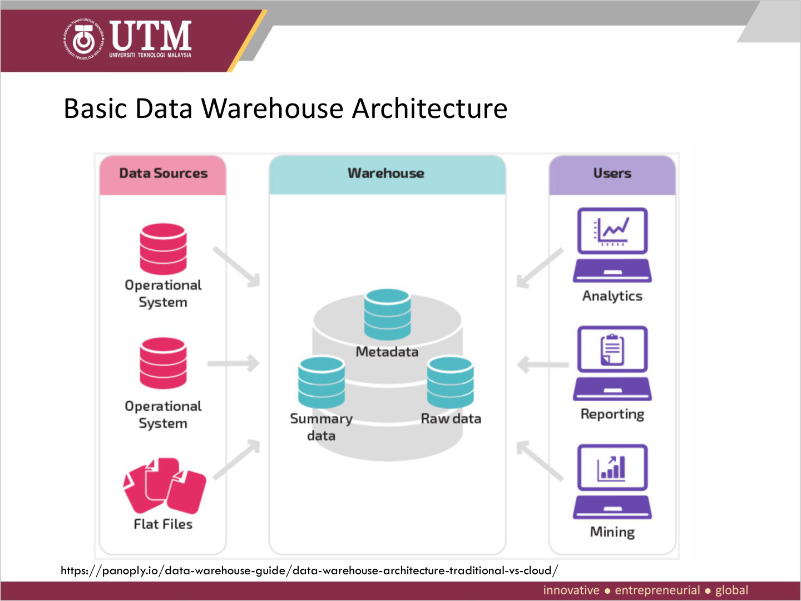

*图：基础数据仓库架构。数据源中的业务系统和文件经过整合后进入数据仓库，再提供给用户进行分析、报表和挖掘。*

**课件位置：** PDF 第 9–12 页。

---

## 5. Why Get Data Warehouse?

课件第 14–16 页明确解释了以下三个原因。

### 5.1 Need to analyze data from different sources

企业需要整合不同来源的数据，以便做出更全面、更有依据的业务决策。

例如，企业想每周追踪最有价值的客户，需要结合：

- 信用卡处理商提供的支付信息。
- 会计系统中的财务信息。
- 客户在产品或应用程序中产生的活动数据。

如果数据集中在一个地方，分析会比在三个独立系统中分别查询容易。

### 5.2 Need to separate analytical data from transactional data

需要将分析数据与交易数据分开。

- **Transactional Data：** 交易数据，支持日常业务操作。
- **Analytical Data：** 分析数据，用于复杂查询和分析。

例如：如果分析人员直接在应用程序的生产数据库上运行大量复杂查询，可能影响应用程序的运行性能。

因此，可以将分析所需的数据转移到专门为复杂查询设计的数据仓库，避免分析工作影响日常交易。

### 5.3 Original data source is not suitable for querying

原始数据源可能不适合直接进行分析查询。

课件例子：许多 BI 工具不能很好地直接处理某些 NoSQL 数据存储，例如 MongoDB。使用 MongoDB 作为后端的应用程序，可以将分析数据转移到 Data Warehouse，以便数据分析人员更有效地工作。

### 5.4 Summary

| 原因 | 英文关键词 | 主要目的 |
|---|---|---|
| 1 | Different Sources | 整合不同数据源 |
| 2 | Separate Analytical from Transactional | 避免分析影响日常交易 |
| 3 | Source Not Suitable for Querying | 解决原始数据源不适合分析的问题 |

> **来源范围说明：** 课件第 13 页为 “Why Get Data Warehouse?” 标题页，第 14–16 页展开了以上三个原因。本文按课件实际列出的内容整理，不额外添加课件未列出的第四个原因。

**课件位置：** PDF 第 13–16 页。

---

## 6. Enterprise Data Warehouse (EDW)

### 6.1 Definition

**Enterprise Data Warehouse（EDW，企业级数据仓库）** 是企业级的中央数据存储库，用于存储和管理整个企业的历史业务数据。

数据通常来自不同系统，例如：

- ERP（Enterprise Resource Planning，企业资源计划系统）。
- CRM（Customer Relationship Management，客户关系管理系统）。
- Physical Recordings（实体记录）。
- Flat Files（普通文件）。

EDW 将来自不同系统的数据放入统一存储设施，使不同业务部门能够查询数据，并从多个角度进行分析。

### 6.2 EDW vs ordinary Data Warehouse

| 对比 | Data Warehouse (DW) | Enterprise Data Warehouse (EDW) |
|---|---|---|
| 范围 | 可以针对某个业务或主题 | 覆盖整个企业 |
| 数据来源 | 一个或多个数据源 | 企业内多个系统和部门 |
| 规模与复杂度 | 根据业务需求而定 | 通常规模更大、架构更复杂 |
| 功能 | 支持特定分析 | 支持企业整体分析 |
| 架构 | 可以较简单 | 架构和功能通常更加多样 |

课件指出：由于 EDW 的规模和结构复杂，常常会拆分成较小的数据库，使最终用户更容易查询。

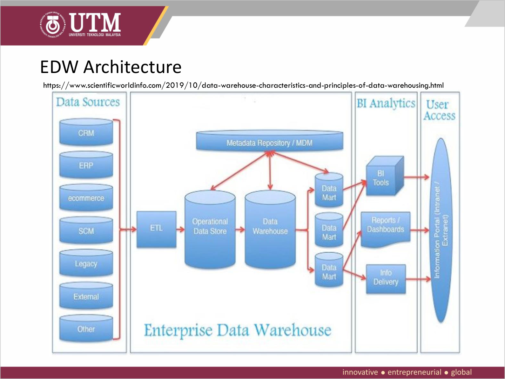

*图：企业级数据仓库架构示意。*

**课件位置：** PDF 第 17–18、21–22 页。

---

## 7. EDW Basic Concepts, Characteristics and Functions

课件介绍了 EDW 的主要功能和特点。

### 7.1 Ultimate Storage（统一的最终存储库）

EDW 是企业所有业务数据的统一存储库（unified repository）。

### 7.2 Reflects the Source Data（反映源数据）

EDW 从原始数据存储系统获取数据，例如：

- Google Analytics
- CRM
- IoT Devices

如果数据分散在多个系统中，就难以统一管理。EDW 的目的之一是把这些分散的数据集中到一个存储库中。

### 7.3 Stores Structured Data（存储结构化数据）

EDW 中的数据经过标准化和结构化处理，使最终用户能够通过 BI 接口查询并生成报表。

这也是 Data Warehouse 与 Data Lake 的一个重要区别：

- Data Warehouse：主要保存经过整理、结构化的数据。
- Data Lake：更多用于保存原始或非结构化数据，供数据工程师和数据科学家分析。

### 7.4 Subject-oriented Data（面向主题的数据）

数据仓库围绕特定业务主题组织数据，而不是简单地按照原始数据来源组织。

主题例子：

- Sales Region：销售地区。
- Total Sales：总销售额。
- Customer：客户。
- Product：产品。

**Metadata（元数据）** 可以补充说明每项信息的来源和含义。

### 7.5 Time-dependent（时变性）

数据仓库通常保存历史数据。为了了解某种趋势在什么时候发生、持续了多久，数据通常按照时间段组织。

例如：

| 年份 | 销售额 |
|---|---:|
| 2023 | 100 万 |
| 2024 | 150 万 |
| 2025 | 200 万 |

### 7.6 Nonvolatile（非易失性）

数据进入数据仓库后，通常不会像日常业务数据库一样被频繁删除。数据仓库重视历史数据的保留，以支持分析。

课件也指出，数据可能因为来源变化而被操作、修改或更新；Nonvolatile 并不意味着任何情况下都绝对不能修改，而是强调数据仓库不以频繁删除历史数据为目的。

### 7.7 Six-point summary

| 英文 | 中文 | 记忆关键词 |
|---|---|---|
| Ultimate Storage | 统一存储库 | 企业数据集中存储 |
| Reflects Source Data | 反映源数据 | 整合原始来源 |
| Structured Data | 结构化数据 | 标准化、可查询 |
| Subject-oriented | 面向主题 | 按业务主题组织 |
| Time-dependent | 时变性 | 保存历史数据 |
| Nonvolatile | 非易失性 | 保留历史数据 |

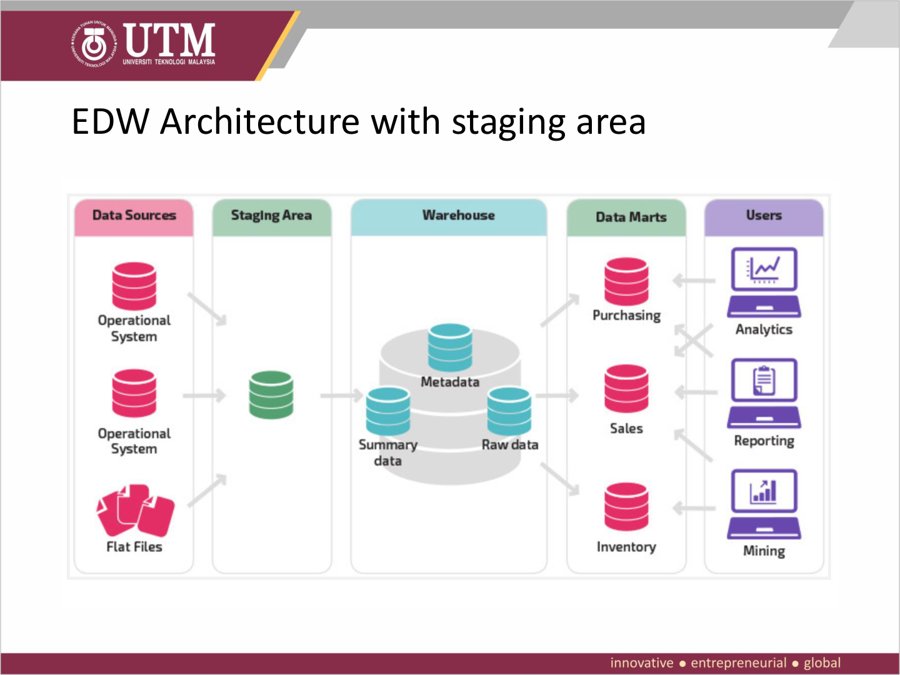

*图：包含 Data Sources、Staging Area、Warehouse、Data Marts 和 Users 的架构。*

**课件位置：** PDF 第 23–25 页。

---

## 8. Types of EDW

课件列出三类 EDW：

1. Classic Data Warehouse
2. Virtual Data Warehouse
3. Cloud Data Warehouse

### 8.1 Classic Data Warehouse（传统数据仓库）

使用专门的硬件和软件建立统一的物理存储系统。

**特点：**

- 数据集中保存在专门的物理存储设施中。
- 可以通过 API 从不同数据源获取信息。
- 数据转换可以在 Staging Area 或 Data Warehouse 内完成。
- 相比 Virtual Data Warehouse，没有额外的虚拟抽象层。

**缺点：**

- 硬件和软件基础设施成本较高。
- 需要数据工程师和 DevOps 人员搭建、维护整个数据平台。

**适用情况：** 希望处理企业数据、建立自己的数据平台，并根据需要扩展或调整架构的组织。

### 8.2 Virtual Data Warehouse（虚拟数据仓库）

将多个数据库通过虚拟方式连接起来，使用户可以像访问一个统一系统一样查询数据。

**关键特点：** 数据可以继续保留在原来的数据源中，不一定需要全部复制到新的物理仓库。

例如，企业有客户数据库、销售数据库和财务数据库，通过虚拟连接和分析工具，使用户能够统一查询。

**优点：**

- 不必一开始就建立完整的集中式物理仓库。
- 数据可以保留在原始数据源。
- 适合数据已经比较标准化、分析需求相对简单的场景。

**缺点：**

- 多个数据库仍然需要持续维护。
- 仍然需要数据转换软件，使数据适合用户和报表工具使用。
- 如果查询需要访问两个或多个数据库，复杂查询可能耗时较长。

**适用情况：** 原始数据已标准化、不需要复杂分析，或组织刚开始使用 BI 的情况。

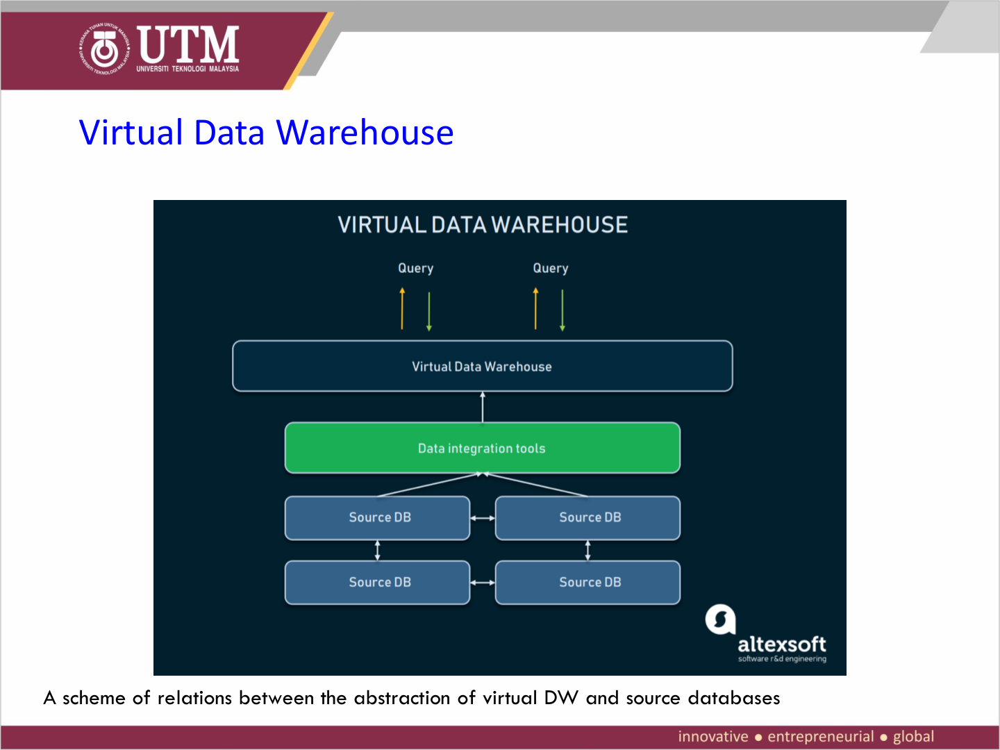

*图：虚拟数据仓库与多个源数据库之间的关系。*

### 8.3 Cloud Data Warehouse（云数据仓库）

将数据仓库部署在云平台上，由云服务商提供存储、计算和管理服务。

课件列举的服务：

- Amazon Redshift
- IBM Db2
- Google BigQuery
- Snowflake
- Microsoft SQL Data Warehouse

**优点：**

- 不需要企业自行搭建所有服务器和基础设施。
- 云服务商负责基础设施维护。
- 可以根据存储需求和查询计算能力调整资源。
- 可以提供数据集成、数据仓库维护和 BI 支持。

**需要注意：**

- 数据安全是需要重点考虑的问题。
- 需要评估云服务商的可信度。
- 服务价格与所需存储空间、计算能力有关。

**适用情况：** 希望使用托管式服务，不想自行管理全部服务器、数据库和工具的组织。

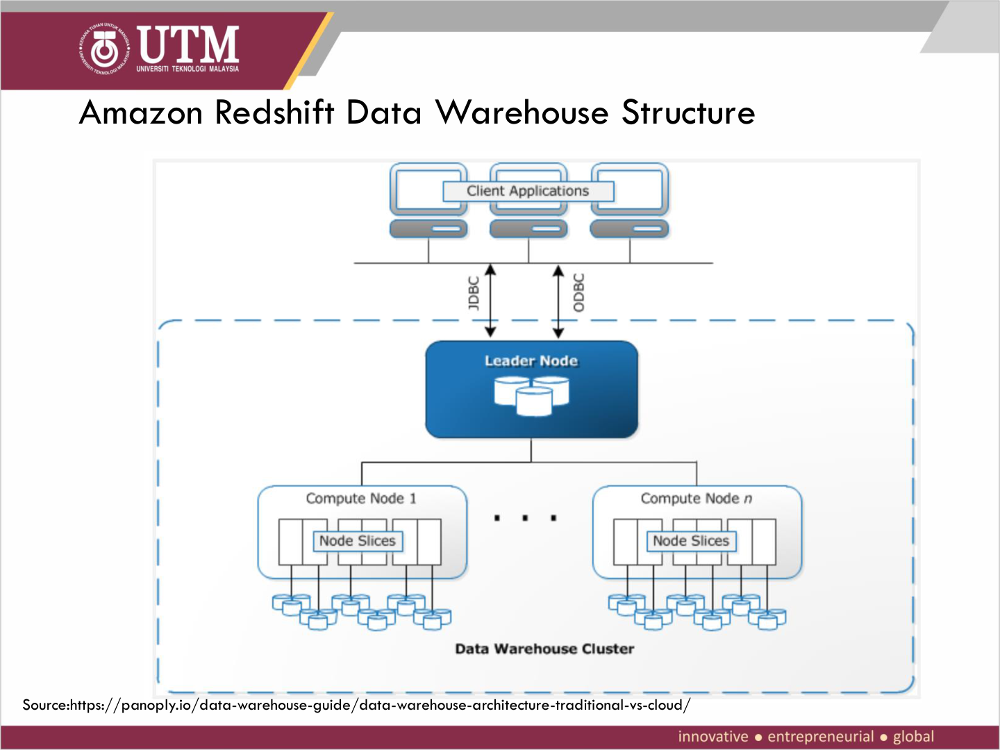

*图：云数据仓库结构示意。*

### 8.4 Three types comparison

| 对比 | Classic | Virtual | Cloud |
|---|---|---|---|
| 中文 | 传统数据仓库 | 虚拟数据仓库 | 云数据仓库 |
| 存储方式 | 集中物理存储 | 数据可保留在原数据库 | 云平台存储 |
| 自建硬件 | 通常需要 | 不一定需要集中式硬件 | 通常不需要自行搭建全部硬件 |
| 主要优势 | 控制力强、架构直接 | 灵活、可保留原始数据 | 托管、易扩展 |
| 主要不足 | 基础设施和维护成本高 | 多源复杂查询可能较慢 | 需关注数据安全和服务成本 |

**课件位置：** PDF 第 26–37 页。

---

## 9. Data Warehouse, Data Lake and Data Mart

这是本章重要的比较知识点。

### 9.1 Data Warehouse（数据仓库）

- 主要存储经过整理和标准化的结构化数据。
- 主要服务于 BI、报表和综合数据查询。
- 使查询工具和最终用户能够获得较完整、可靠的分析结果。

### 9.2 Data Lake（数据湖）

- 主要存储原始数据或混合类型数据。
- 可以保存结构化、半结构化和非结构化数据。
- 常用于 Big Data、Machine Learning 和 Data Mining。
- 可以先把原始数据加载到数据湖，再根据分析需要进行转换。

### 9.3 Data Mart（数据集市）

Data Mart 是面向特定业务领域或部门的数据存储区域。

例子：

- Sales Data Mart：销售数据集市。
- Purchasing Data Mart：采购数据集市。
- Inventory Data Mart：库存数据集市。

课件指出，Data Mart 通常较小（通常小于 100GB），常用于把大型数据仓库划分成更容易操作和查询的部分。

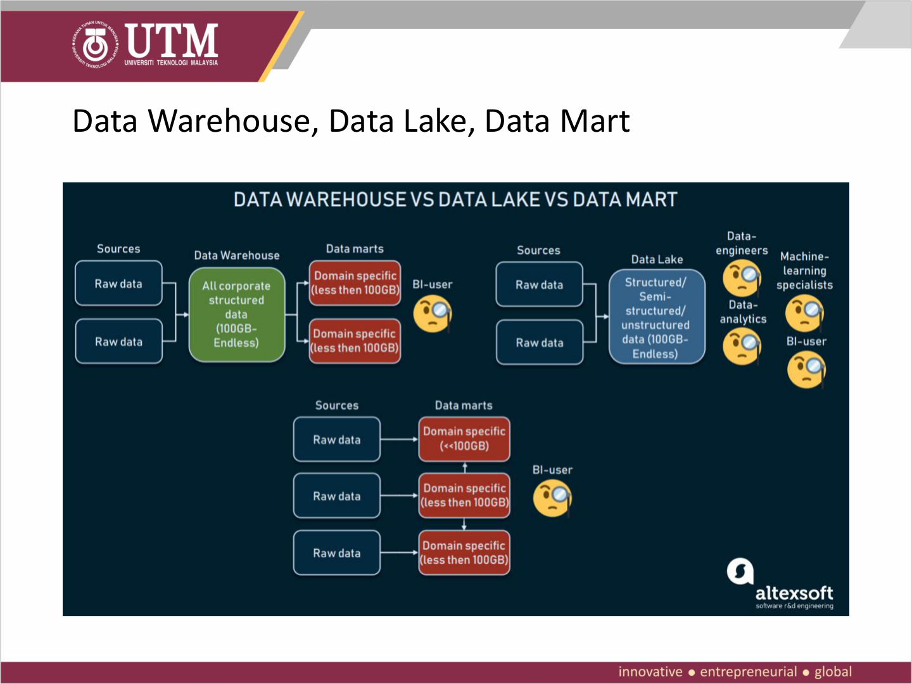

*图：三种数据存储模式的比较。*

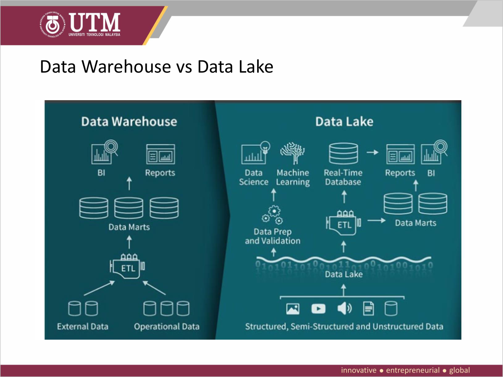

*图：数据仓库与数据湖的主要差异。*

### 9.4 Comparison table

| 比较 | Data Warehouse | Data Lake | Data Mart |
|---|---|---|---|
| 核心作用 | 综合分析和 BI | 原始数据存储 | 特定领域分析 |
| 数据类型 | 结构化为主 | 多种类型 | 以结构化数据为主 |
| 数据状态 | 整理、标准化 | 原始或混合 | 按业务领域组织 |
| 使用者 | BI 分析人员、业务用户 | 数据工程师、数据科学家等 | 特定部门用户 |
| 典型用途 | 企业报表、综合查询 | 大数据、机器学习、数据挖掘 | 销售、采购、库存分析 |

**记忆方式：**

- **Warehouse：** 综合性数据仓库。
- **Lake：** 先容纳各种原始数据。
- **Mart：** 服务某个具体业务领域。

**课件位置：** PDF 第 38–40 页。

---

## 10. On-premise vs Cloud Data Warehouse

### 10.1 On-premise（本地部署）

企业在自己的场所或数据中心部署服务器和数据仓库。

特点：

- 前期安装成本较高。
- 需要购买硬件。
- 需要专门的技术人员维护。
- 企业自行管理系统运行、故障和停机问题。
- 课件指出，本地部署的容量不一定总能得到充分利用。

### 10.2 Cloud Service（云服务）

通过云平台购买数据仓库的存储和计算服务。

特点：

- 可以按需购买存储空间。
- 可以按需购买计算能力。
- 不需要自行维护全部基础设施。
- 更方便扩展资源。

### 10.3 Comparison

| 比较 | On-premise | Cloud |
|---|---|---|
| 部署地点 | 企业自己的环境 | 云平台 |
| 前期成本 | 通常较高 | 通常可按需购买 |
| 硬件维护 | 企业负责 | 服务商负责云基础设施 |
| 扩展能力 | 通常需要增加硬件 | 可按需调整资源 |
| 数据管理 | 企业自行管理 | 需要管理云端数据、权限和安全 |

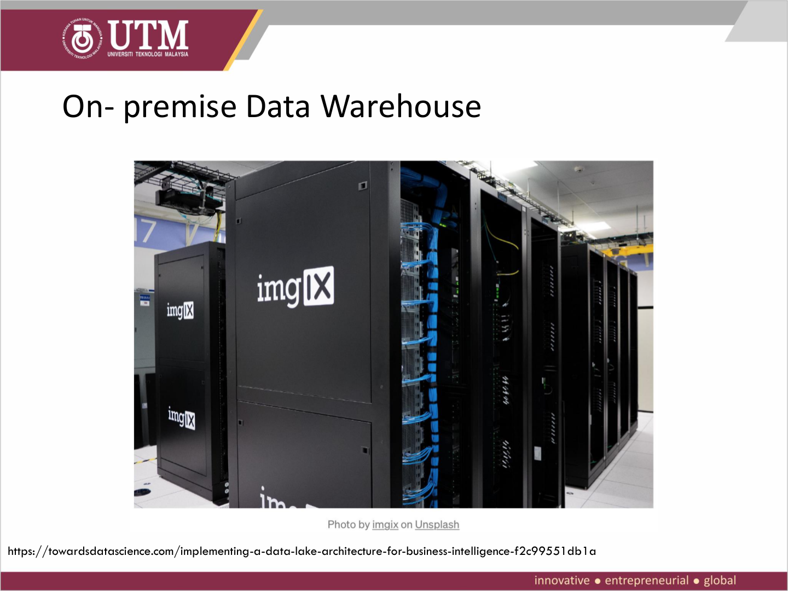

*图：本地部署数据仓库的硬件环境。*

**课件位置：** PDF 第 41–42 页。

---

## 11. Data Warehouse Architecture and Three-Tier Architecture

### 11.1 Basic Data Warehouse Architecture

基础数据仓库架构通常包括：

1. Data Sources：数据源。
2. Staging Area：数据暂存区。
3. Data Warehouse：数据仓库。
4. Data Marts：数据集市。
5. Users：最终用户。

### 11.2 Three-Tier Architecture（三层架构）

三层架构是数据仓库架构中的重要知识点。

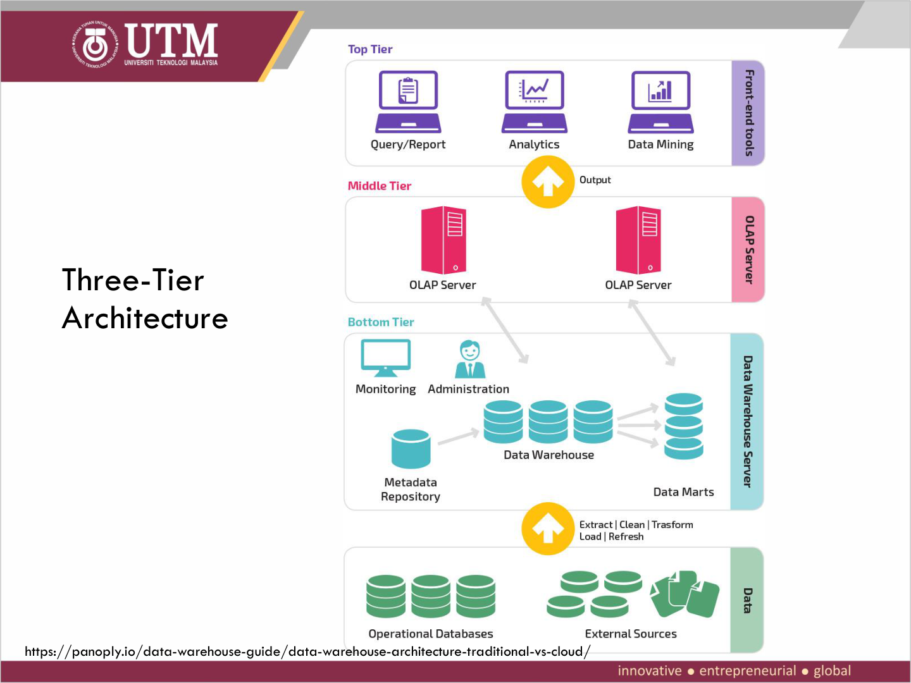

#### Bottom Tier（底层）

**Data Warehouse Server**

主要负责：

- 数据存储。
- 数据仓库管理。
- Metadata Repository 管理。
- 支持数据进入和存储。

可以理解为：负责数据的存储和管理。

#### Middle Tier（中间层）

**OLAP Server**

OLAP = Online Analytical Processing（联机分析处理）。

主要负责：

- 多维数据分析。
- 数据查询。
- 数据聚合。
- 为上层提供分析所需的数据处理能力。

例如：

- 哪个地区的销售额最高？
- 哪个年份的销售额增长最快？
- 哪类客户的利润贡献最大？

#### Top Tier（顶层）

**Front-end Tools（前端工具）**

主要包括：

- Query / Report：查询和报表。
- Analytics：数据分析。
- Data Mining：数据挖掘。

这一层面向最终用户，负责展示和使用分析结果。

### 11.3 Three-tier summary

| 层级 | 组成 | 主要功能 |
|---|---|---|
| Top Tier | Front-end Tools | 用户查询、报表、分析、挖掘 |
| Middle Tier | OLAP Server | 多维分析、查询处理 |
| Bottom Tier | Data Warehouse Server | 数据存储、管理 |

**记忆口诀：Bottom 存储，Middle 分析，Top 展示。**

---

## 12. Staging Area and Metadata

### 12.1 Staging Area（数据暂存区）

Staging Area 是数据从原始数据源进入 Data Warehouse 之前，暂时存放和处理数据的区域。

**为什么需要 Staging Area？**

- 不同数据源的数据格式可能不一致。
- 提取的数据可能存在错误或损坏。
- 直接加载到 Data Warehouse 可能影响数据质量。
- 出现问题时，直接加载后的回滚会更困难。

因此，数据通常先进入 Staging Area，经过必要处理后再加载到 Data Warehouse。

### 12.2 Metadata（元数据）

Metadata = Data about Data，即“描述数据的数据”。

例如，一张客户信息表包含：

- Customer_ID：客户编号。
- Name：客户姓名。
- Age：年龄。

这些字段的含义、数据类型、来源等信息都可以属于 Metadata。

Metadata 帮助用户理解数据的结构、含义和来源。

### 12.3 Raw Data and Summary Data

- **Raw Data：** 原始数据，尚未经过充分汇总的数据。
- **Summary Data：** 汇总数据，例如某个月的总销售额。

数据仓库可以同时保存原始明细数据和汇总数据，以支持不同层次的分析。

---

## 13. Modern Data Warehouse

### 13.1 What is Modern Data Warehouse?

现代数据仓库由多种程序和数据存储技术组成，能够为不同技能和需求的用户提供合适的数据存储和分析能力。

课件指出，现代数据仓库需要处理 PB（Petabytes）级别的数据，并使用更优化的技术运行复杂分析查询。传统方法在效率和成本方面可能无法充分满足现代需求。

### 13.2 Main features

课件第 54–55 页列出：

1. **Incorporate Hadoop and Traditional Data Warehouse：** 整合 Hadoop、传统数据仓库和其他数据存储。
2. **Multiple Repositories：** 多个数据存储库可以位于不同地点。
3. **More Data Sources：** 接入移动设备、传感器、云和 Internet of Things（IoT）数据。
4. **Multi-structured Data：** 支持结构化、半结构化、非结构化和原始数据。
5. **Commodity Hardware in Cluster Mode：** 使用相对低成本的通用硬件，以集群模式运行。

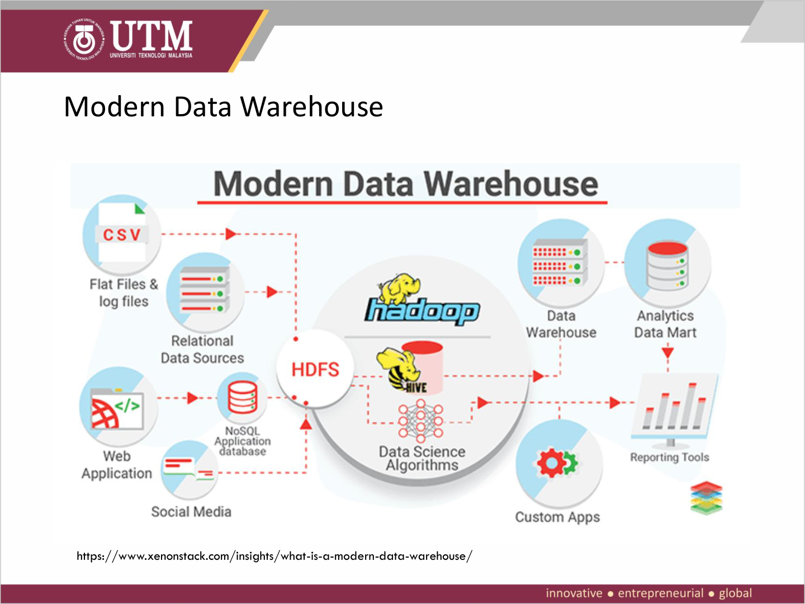

*图：现代数据仓库整合文件、关系型数据库、NoSQL、Web、社交媒体等数据源，并连接数据仓库、分析数据集市、报表工具和自定义应用。*

### 13.3 Why Modern Data Warehouse Matters

现代数据仓库主要帮助企业应对：

- **Data Lakes：** 保存大量原始数据，数据可以在需要时再处理。
- **Data divided across organizations：** 更快地整合和分析分散在不同部门的数据。
- **IoT streaming data：** 支持物联网设备不断产生和共享的数据。

课件列出的业务挑战：

- 降低不断增长的数据存储和管理成本。
- 满足企业分析新数据源的需求。
- 处理不同的数据格式。
- 传统数据仓库擅长多维分析，但不适合所有图像、视频或新类型分析。

### 13.4 Features of Modern Data Warehouse

| Feature | 含义 |
|---|---|
| Variety of subject areas and data sources | 支持多种主题和数据来源 |
| Large volume of data | 处理大量数据 |
| Include Data Lake | 不局限于单一关系型 DW / Data Mart |
| Multi-platform architecture | 多平台架构，平衡性能和扩展能力 |
| Data virtualization | 除数据集成外，还支持数据虚拟化 |
| Support different users | 支持不同类型和层次的用户 |
| Flexible deployment | 部署方式可以与开发工具相对独立 |

### 13.5 Benefits of Modern Data Warehouse

- 更快地将数据整合到环境中。
- 提高数据集成效率，减少时间、成本和工作量。
- 支持创新的数据模型。
- 提供新的数据洞察，支持 Preventive Analysis（预防性分析）和 Predictive Analysis（预测性分析）。
- 能够利用持续增长的数据集进行分析。
- 利用开源软件和通用硬件获得成本优势。

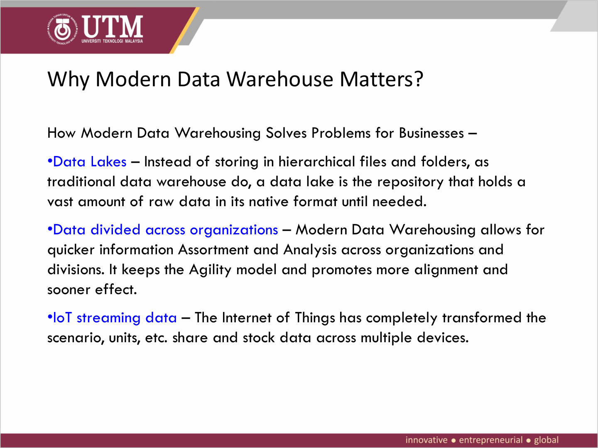

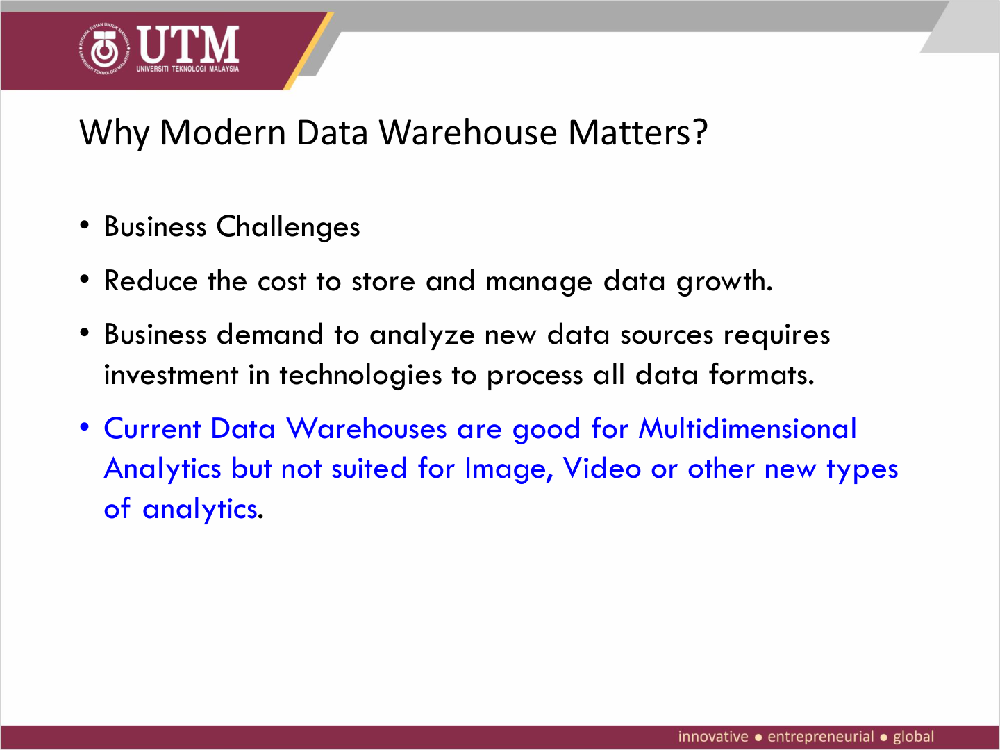

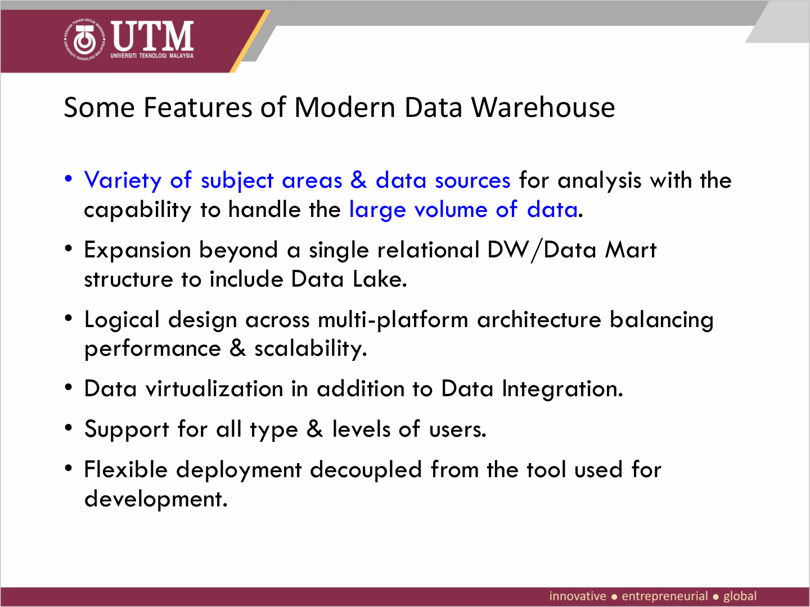

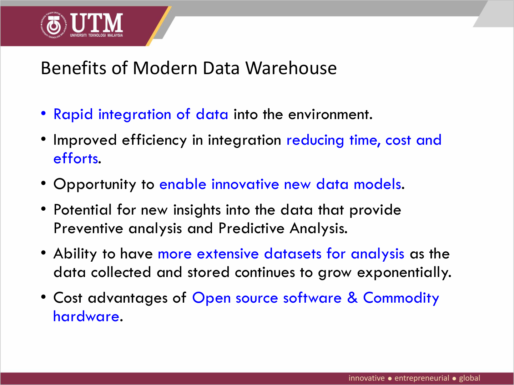

---

## 14. MPP, Lambda and Hybrid Architecture

### 14.1 MPP Architecture

MPP = **Multiple Parallel Processing**（课件用语；通常也称 Massively Parallel Processing）。

MPP 是现代数据仓库使用的并行处理架构。

主要特点：

- **Distributed Computing：** 分布式计算。
- **Scale-out：** 通过增加计算节点扩展处理能力。
- **Shared-nothing：** 多个物理节点各自运行实例，并拥有相对独立的资源。
- **Parallel Processing：** 多个节点同时处理任务。
- **Multi-Structured Data：** 支持多结构数据。

例如，企业需要分析大量交易记录，可以把数据和任务分配给多个计算节点并行处理，最后汇总结果。

**重点：MPP 的优势在于并行处理和横向扩展（Scale-out）。**

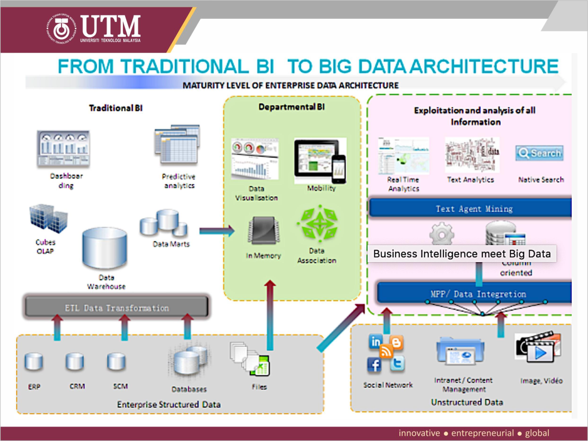

### 14.2 Polyglot Persistence and Federated Query

课件第 58 页还提到：

- **Polyglot Persistence Strategy：** 使用多种适合不同数据类型和需求的存储技术。
- **Integrate Portions of Data into the Data Warehouse：** 将部分数据整合到数据仓库。
- **Federated Query Access：** 联邦式查询访问，即对分布在不同数据存储中的数据提供统一查询访问能力。

### 14.3 Lambda Architecture

Lambda Architecture（Lambda 架构）包含三个层次：

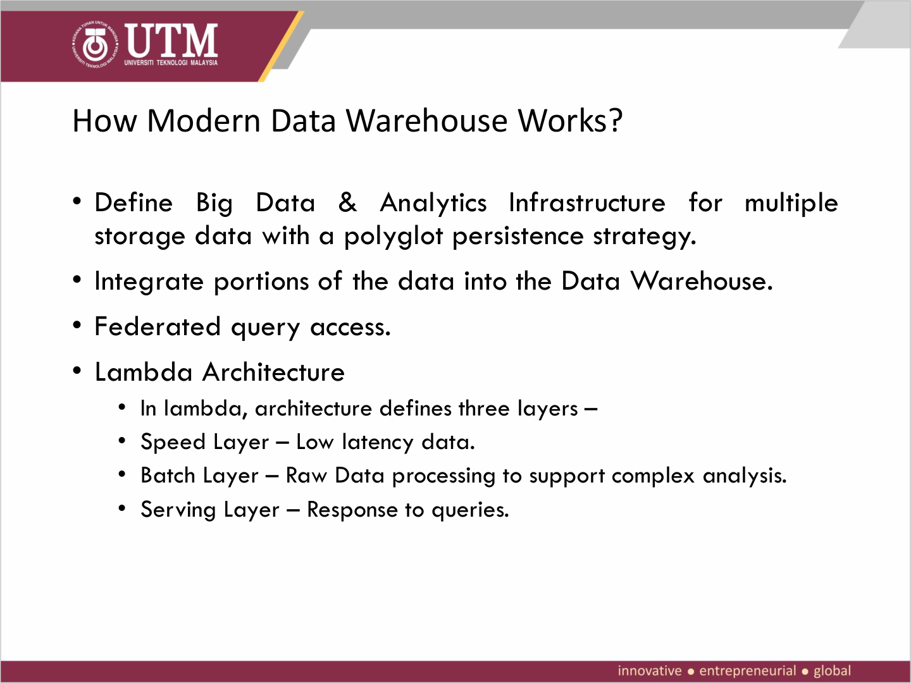

#### Speed Layer（速度层）

处理低延迟数据，强调快速响应。

例子：实时监控交易数据，快速识别异常。

#### Batch Layer（批处理层）

负责原始数据处理，以支持复杂分析。

例子：对过去一年的交易数据进行整体统计。

#### Serving Layer（服务层）

负责响应查询并提供结果。

例子：用户查询某个地区过去一年的交易总额。

**记忆：**

- Speed：快速处理。
- Batch：批量处理。
- Serving：提供查询结果。

### 14.4 Hybrid Architecture（混合架构）

课件第 59 页介绍了混合架构：

- 在 ETL 数据加载高峰期间扩展 MPP 计算节点。
- 在查询量较大时增加计算能力。
- 利用现有 On-premises 数据结构。
- 使用 Cloud Services 进行 Advanced Analytics（高级分析）。

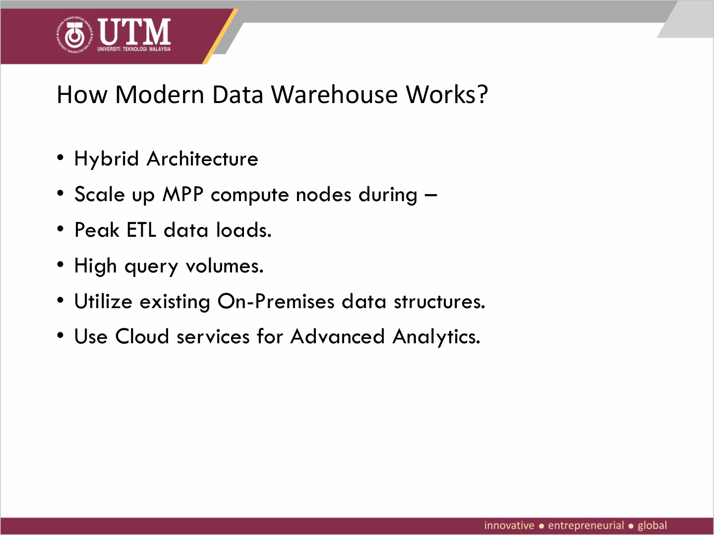

**课件位置：** PDF 第 54–59 页。

---

## 15. Why Modern Data Warehouse Matters

本节将现代数据仓库的业务价值再次归纳。

### 15.1 Business challenges

- 降低数据增长带来的存储和管理成本。
- 企业需要分析新的数据来源，因此需要能够处理多种数据格式的技术。
- 传统 Data Warehouse 擅长 Multidimensional Analytics（多维分析），但不一定适合图像、视频等新类型分析。

### 15.2 From Traditional BI to Big Data Architecture

课件第 64 页展示了从传统 BI 向 Big Data Architecture 发展的架构示意：

- 传统 BI 主要使用结构化企业数据、ETL、Data Warehouse、Data Mart、OLAP、Dashboard 和报表。
- 大数据架构进一步整合社交网络、网页内容、图片和视频等非结构化数据。
- 通过数据集成、文本分析、搜索、数据挖掘和实时分析等方式处理更丰富的数据。

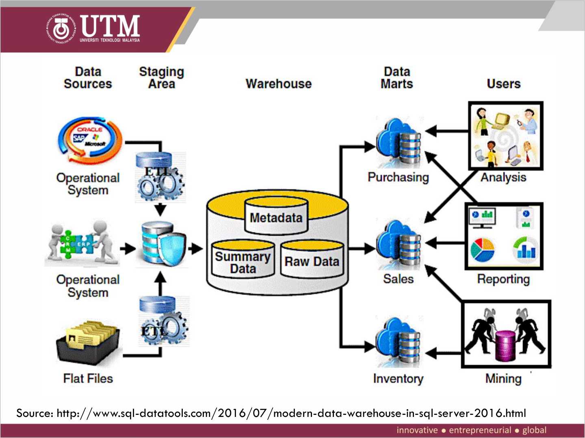

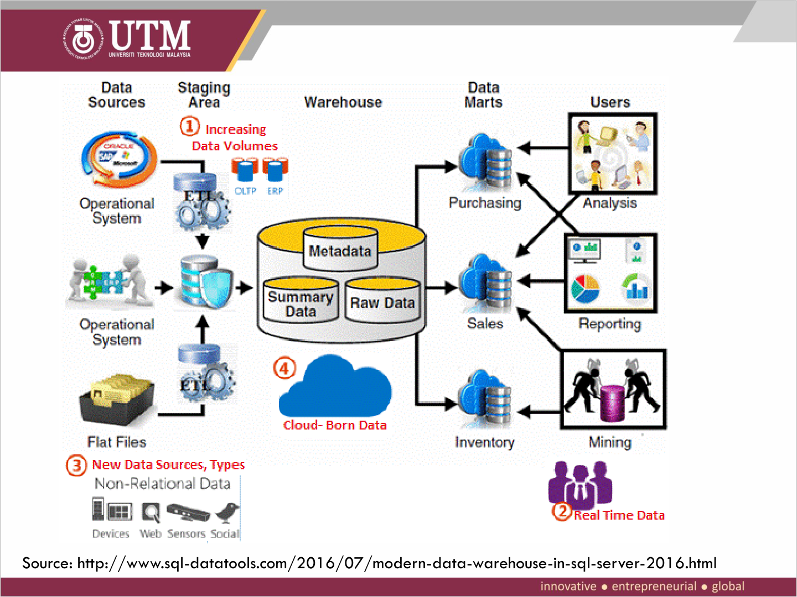

---

# 3.3 ETL Processes

## 16. What is ETL?

ETL 是三个英文单词的缩写：

- **E — Extract：** 抽取。
- **T — Transform：** 转换。
- **L — Load：** 加载。

**定义：** ETL 是数据仓库中的数据处理过程。ETL 工具从不同数据源提取数据，在 Staging Area 中进行转换，最后将数据加载到 Data Warehouse。

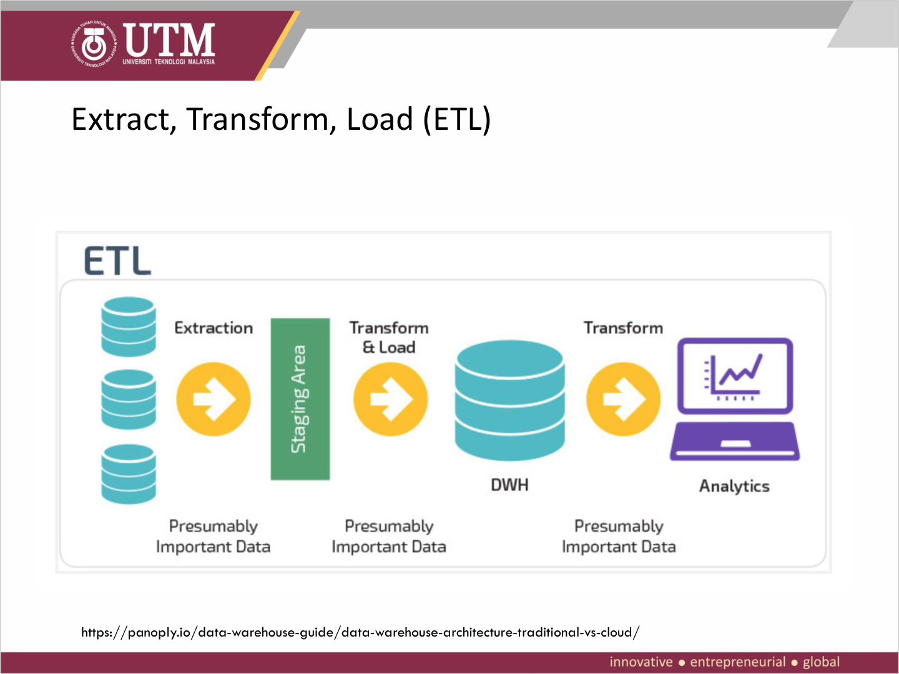

**基本顺序：**

`Data Sources → Extract → Staging Area / Transform → Load → Data Warehouse`

---

## 17. Extraction（数据抽取）

这是 ETL 的第一步。

### 17.1 Definition

从不同的数据源提取数据，并将其放入 Staging Area。

课件列出的来源和格式：

- Relational Databases：关系型数据库。
- NoSQL：非关系型数据库。
- XML：可扩展标记语言文件。
- Flat Files：普通文件，例如 CSV。

### 17.2 Why use Staging Area first?

不能简单地把提取的数据直接放入 Data Warehouse，原因包括：

1. 不同数据源的数据格式可能不同。
2. 提取的数据可能存在错误或损坏。
3. 直接加载可能影响 Data Warehouse 中的数据。
4. 如果直接加载后出现问题，Rollback（回滚）会更加困难。

**考试重点：** Extraction 的主要任务是从不同来源提取数据，并先放入 Staging Area。

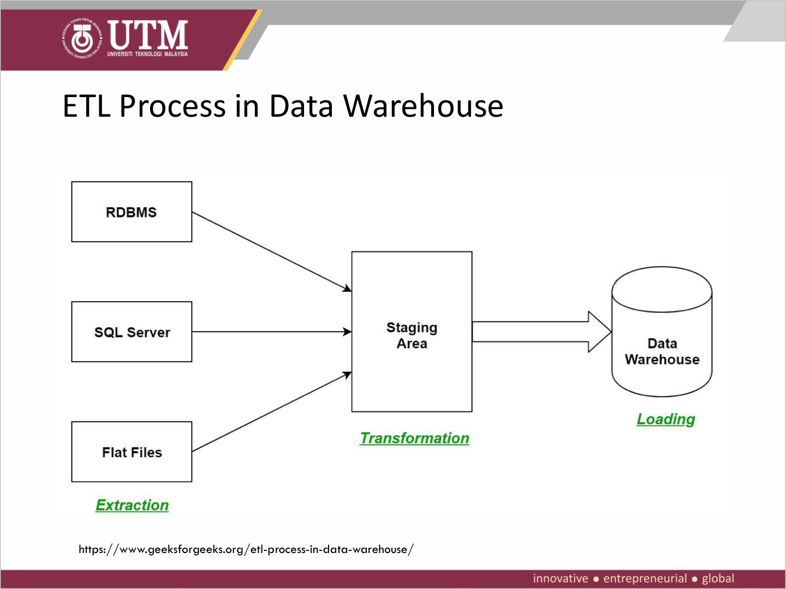

---

## 18. Transformation（数据转换）

这是 ETL 的第二步。

### 18.1 Definition

对提取出来的数据应用一系列规则或函数，将数据转换成统一的标准格式。

### 18.2 Five Transformation Operations

#### (1) Filtering（过滤）

只选择需要的字段或属性加载到 Data Warehouse。

例子：原始客户数据包含 ID、Name、Age、Phone、Address。如果当前只需要 Name 和 Age，就可以过滤掉其他字段。

#### (2) Cleaning（清洗）

修复或统一数据中的错误和不一致。

课件例子：

- 用默认值填充 NULL。
- 将 U.S.A、United States、America 统一映射为 USA。

| 原始数据 | 清洗后 |
|---|---|
| U.S.A | USA |
| United States | USA |
| America | USA |

#### (3) Joining（连接）

将多个属性合并在一起。

例子：

| First_Name | Last_Name |
|---|---|
| Tom | Smith |

Joining 后：

| Full_Name |
|---|
| Tom Smith |

#### (4) Splitting（拆分）

将一个属性拆分成多个属性。

例子：

| Full_Name |
|---|
| Tom Smith |

Splitting 后：

| First_Name | Last_Name |
|---|---|
| Tom | Smith |

#### (5) Sorting（排序）

按照某个属性对数据记录（Tuples）进行排序，通常根据 Key Attribute（键属性）进行。

例子：按照 Customer_ID 对客户记录进行升序排列。

### 18.3 Summary table

| 操作 | 中文 | 作用 |
|---|---|---|
| Filtering | 过滤 | 选择需要的属性 |
| Cleaning | 清洗 | 修复错误、统一数据 |
| Joining | 连接 | 合并多个属性 |
| Splitting | 拆分 | 一个属性拆成多个 |
| Sorting | 排序 | 按指定属性排列记录 |

**记忆提示：** 过滤、清洗、连接、拆分、排序。

---

## 19. Loading（数据加载）

这是 ETL 的第三步，也是最后一步。

### 19.1 Definition

将经过转换的数据正式加载到 Data Warehouse 中。

### 19.2 Loading frequency

数据加载频率取决于系统需求：

- **Very Frequently：** 频繁加载和更新。
- **Regular Intervals：** 按照较长但固定的时间间隔加载。

例子：

- 需要及时更新的数据可以频繁加载。
- 月度经营统计可以按照月度周期加载。

**考试重点：** Loading 的作用是将转换后的数据加载到 Data Warehouse；加载频率由系统需求决定。

---

## 20. ELT（Extract, Load, Transform）

除了 ETL，课件还介绍了 ELT。

### 20.1 Definition and order

ELT 的三个步骤：

1. Extract：抽取。
2. Load：加载。
3. Transform：转换。

### 20.2 ELT process

在 ELT 方法中，数据提取后立即加载到一个集中式数据存储库（课件以 Data Lake 为例），之后根据需要进行转换。

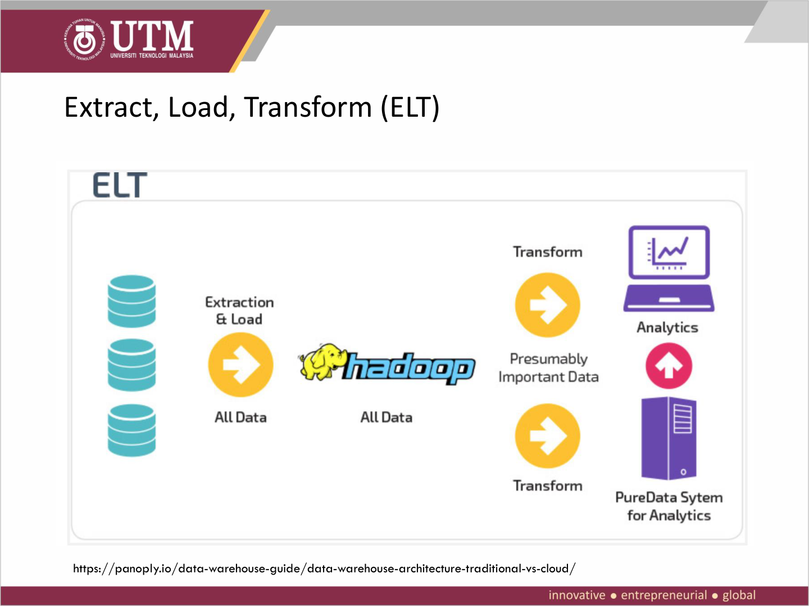

### 20.3 Characteristics of ELT

- 数据提取后立即加载。
- 可以把来自不同来源的数据放入统一的数据存储库。
- 可以先保留原始数据。
- 用户可以根据需要直接在原始数据上运行新的转换。
- 可以测试和改进查询，而不必在每次需求变化时都重新设计传统 ETL 流程。

课件认为 ELT 在开发代码方面更有效率，而且比 ETL 更灵活。

### 20.4 ETL vs ELT

| 比较 | ETL | ELT |
|---|---|---|
| 全称 | Extract, Transform, Load | Extract, Load, Transform |
| 顺序 | 抽取 → 转换 → 加载 | 抽取 → 加载 → 转换 |
| 转换时间 | 加载前 | 加载后 |
| 课件中的存储场景 | Data Warehouse | Data Lake |
| 数据状态 | 加载前已经处理 | 可以先保留原始数据 |
| 主要优势 | 数据标准化后再进入仓库 | 灵活，可以根据需要重新处理 |

**考试记忆：**

- ETL：先转换，再加载。
- ELT：先加载，再转换。

---

## 21. Can a Data Lake Replace a Data Warehouse for BI?

课件第 53 页提出：Data Lake 能否取代 Data Warehouse 用于 Business Intelligence？

### 21.1 Advantages of Data Lake

- 适合处理 Big Data。
- 存储成本方面可能更有优势。
- 可以保存大量原始数据和多种数据类型。

### 21.2 Problems

**Data Quality（数据质量）**

如果企业不了解 Data Lake 中数据的质量，业务用户就可能无法信任这些数据。

例如，数据湖中可能存在：

- 重复记录。
- 缺失值。
- 不一致的数据格式。
- 错误的数据。

如果直接使用这些数据生成 BI 报表，可能产生错误结果。

课件还指出，将来自多个来源的原始数据整理成干净、高质量、可用于建模的数据，可能占据数据科学家约 80% 的工作时间（这是课件引用的说法）。

### 21.3 Conclusion

Data Lake 虽然适合存储大量原始数据，但不代表它可以完全取代 Data Warehouse。

- **Data Lake：** 保存原始、多类型数据。
- **Data Warehouse：** 提供经过整理、标准化、适合 BI 查询和报表的数据。

---

# 3.4 Data Mining

## 22. What is Data Mining?

### 22.1 Definition

**Data Mining（数据挖掘）** 是通过分析大量数据，发现其中隐藏的规律和有价值的信息，从而帮助企业解决问题、降低风险并发现新机会的过程。

课件的核心关键词：

- **Hidden Patterns：** 隐藏的规律。
- **Hidden Value：** 隐藏的价值。
- **Business Intelligence：** 商业智能。
- **Mitigate Risks：** 降低风险。
- **Seize New Opportunities：** 抓住新机会。

### 22.2 Example

银行拥有大量客户贷款数据。

Data Mining 可能发现某些客户特征与违约情况之间存在规律。这些规律并不一定能从单条记录直接看出，而是通过分析大量数据发现的。

银行可以利用这些发现改善贷款风险管理。

### 22.3 Main purposes

1. Discover Business Intelligence：发现商业智能。
2. Solve Problems：解决问题。
3. Mitigate Risks：降低风险。
4. Seize New Opportunities：发现并抓住新机会。
5. Find Hidden Value：寻找数据中的隐藏价值。

**课件位置：** PDF 第 67 页。

---

## 23. KDD — Knowledge Discovery in Databases

KDD = **Knowledge Discovery in Databases（数据库中的知识发现）**。

课件将 Data Mining 描述为一个有计划、连续的过程，通过不断识别和发现大型数据集中的隐藏模式，找出有用的数据和知识。

理解：

- KDD 强调从数据库中发现知识的过程。
- Data Mining 是寻找隐藏模式和有价值信息的重要活动。
- 两者密切相关，课件也将 Data Mining 称为 Knowledge Discovery in Databases。

**课件位置：** PDF 第 68 页。

---

## 24. Data Mining vs Data Analytics / Data Analysis

### 24.1 Main difference

#### Data Mining（数据挖掘）

主要负责：

- 在大量数据中寻找规律。
- 发现隐藏的信息。
- 提取有价值的模式。
- 产生初步发现。

#### Data Analytics（数据分析）

范围更广，涉及数据驱动模型的整个流程。

它可以利用 Data Mining 发现的规律和初步假设，进一步建立模型、进行分析并形成洞察。

例子：银行希望预测客户是否会违约。

- **Data Mining：** 从历史贷款数据中发现某些客户特征与违约情况之间的关联。
- **Data Analytics：** 利用数据和发现建立分析模型，评估新客户的违约风险。

### 24.2 Core comparison

| 比较 | Data Mining | Data Analytics / Data Analysis |
|---|---|---|
| 中文 | 数据挖掘 | 数据分析 |
| 主要作用 | 发现隐藏规律 | 更全面地分析数据 |
| 主要目标 | 找到有价值的信息和模式 | 利用数据产生洞察、建立模型 |
| 工作范围 | 数据分析流程中的一个环节 | 涵盖更完整的数据分析流程 |
| 关系 | 是 Data Analytics 过程中的一个步骤 | 范围更广 |

课件第 69 页强调：

> Data mining is a step in the process of data analytics.

也就是说，Data Mining 是 Data Analytics 过程中的一个步骤，而 Data Analytics 涵盖整个数据驱动模型的流程。

### 24.3 Additional comparison shown in slides 70–72

课件第 70–72 页的表格标题为 “Data Mining vs Data Analytics”，但表格右侧部分使用了 “Data Analysis” 一词。以下保留课件表格的主要比较内容：

| 比较依据 | Data Mining | Data Analysis |
|---|---|---|
| Definition | 从大型数据集中提取特定模式 | 对原始数据进行整理和组织，以确定有用的洞察和决策 |
| Area of expertise | 涉及 Machine Learning、Statistics 和 Databases | 需要 Computer Science、Statistics、Mathematics、Subject Knowledge、AI / Machine Learning |
| Synonyms | 也称 Knowledge Discovery in Databases | 包括探索性、描述性、文本分析、预测分析、数据挖掘等类型 |
| Work Profile | 专家通常建立算法，以识别数据中的有意义结构；需要归纳学习和编码能力 | 工作包括原始数据准备、清洗、转换、建模，并以图表或其他可视化方式呈现 |
| Responsibilities | 提取并发现数据中有意义的模式和结构 | 使用分析方法开发模型、解释、测试并提出假设 |
| Output | Data Pattern（数据模式） | 经验证的假设或数据洞察 |
| Examples | 电商网站显示“购买该商品的用户也看了……” | 研究过去 10 年的失业率时间序列 |

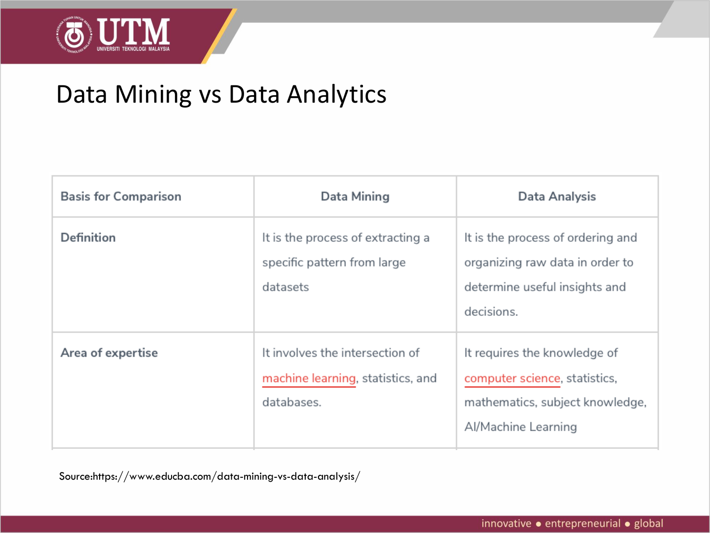

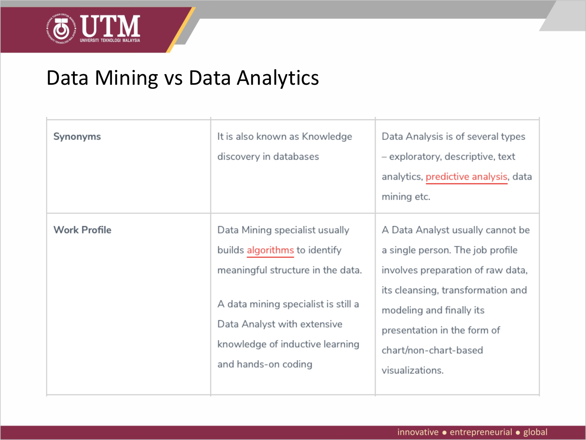

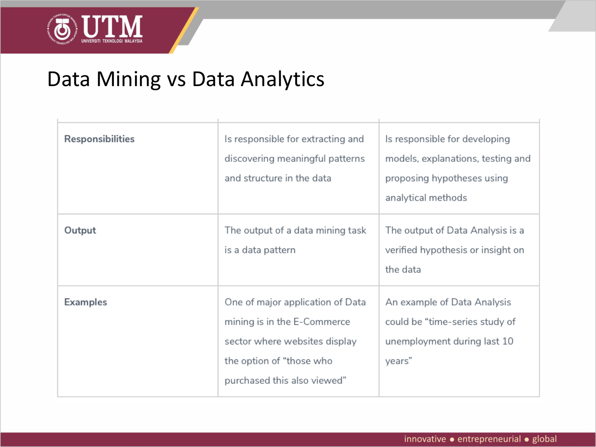

### 24.4 Key conclusion

- Data Mining 侧重发现数据中的模式和结构。
- Data Analytics / Data Analysis 的范围更广，涉及数据准备、清洗、转换、建模、解释和呈现。
- Data Mining 是更广泛数据分析流程中的一部分。

**课件位置：** PDF 第 69–72 页。

---

# 整章重点对比表

## A. Data Warehouse vs Data Lake vs Data Mart

| 比较 | Data Warehouse | Data Lake | Data Mart |
|---|---|---|---|
| 核心作用 | 综合分析和 BI | 原始数据存储 | 特定领域分析 |
| 数据类型 | 结构化为主 | 结构化、半结构化、非结构化 | 以结构化为主 |
| 数据状态 | 整理、标准化 | 原始或混合 | 按业务领域组织 |
| 使用者 | BI 分析人员、业务用户 | 数据工程师、数据科学家等 | 特定部门用户 |
| 例子 | 企业综合报表 | 图片、视频、日志和原始数据 | 销售、采购、库存数据集市 |

## B. Classic vs Virtual vs Cloud Data Warehouse

| 比较 | Classic | Virtual | Cloud |
|---|---|---|---|
| 存储 | 集中物理存储 | 虚拟连接多个源 | 云平台 |
| 主要优势 | 控制力强 | 灵活、数据可留在源系统 | 托管、可扩展 |
| 主要不足 | 基础设施成本高 | 跨库复杂查询可能较慢 | 需关注安全与服务成本 |

## C. On-premise vs Cloud

| 比较 | On-premise | Cloud |
|---|---|---|
| 部署 | 企业本地 | 云平台 |
| 硬件 | 企业采购和维护 | 云服务商提供基础设施 |
| 成本 | 前期投入较高 | 可按需购买资源 |
| 扩展 | 通常需要增加硬件 | 可按需扩展 |
| 维护 | 企业负责 | 服务商负责云基础设施 |

## D. ETL vs ELT

| 比较 | ETL | ELT |
|---|---|---|
| 顺序 | Extract → Transform → Load | Extract → Load → Transform |
| 转换时点 | 加载前 | 加载后 |
| 课件示例存储场景 | Data Warehouse | Data Lake |
| 主要特点 | 先标准化再加载 | 先保存数据，再按需转换 |

## E. Data Mining vs Data Analytics

| 比较 | Data Mining | Data Analytics |
|---|---|---|
| 核心目标 | 发现隐藏模式 | 更全面地分析数据 |
| 工作内容 | 模式发现、结构识别 | 数据准备、转换、建模、解释和呈现 |
| 输出 | 数据模式 | 假设、洞察、分析模型 |
| 关系 | 分析流程中的一个步骤 | 更广泛的分析流程 |

---

# 考试复习清单

## 需要重点背诵的内容

- [ ] Business Data 的定义和主要类型。
- [ ] Business Data Sources 的三种来源。
- [ ] Data Warehouse 的定义和主要作用。
- [ ] 课件列出的三个建立 Data Warehouse 的原因。
- [ ] EDW 的定义和六个特点。
- [ ] Classic、Virtual、Cloud Data Warehouse 的区别。
- [ ] Data Warehouse、Data Lake、Data Mart 的区别。
- [ ] On-premise 与 Cloud 的区别。
- [ ] Three-Tier Architecture 三层架构及各层功能。
- [ ] Staging Area 和 Metadata 的作用。
- [ ] Modern Data Warehouse 的特点和优势。
- [ ] MPP Architecture 的特点。
- [ ] Lambda Architecture 的三个层次。
- [ ] Hybrid Architecture 的基本思路。
- [ ] ETL 的三个步骤及顺序。
- [ ] Extraction 为什么需要 Staging Area。
- [ ] Transformation 的五种操作。
- [ ] Loading 的作用及加载频率。
- [ ] ETL 与 ELT 的区别。
- [ ] Data Lake 能否完全取代 Data Warehouse for BI。
- [ ] Data Mining 的定义和作用。
- [ ] KDD 的含义。
- [ ] Data Mining 与 Data Analytics / Data Analysis 的区别。

## 建议优先掌握的高频比较和流程

1. **ETL 五种 Transformation 操作：** Filtering、Cleaning、Joining、Splitting、Sorting。
2. **EDW 六个特点：** Ultimate Storage、Reflects Source Data、Structured Data、Subject-oriented、Time-dependent、Nonvolatile。
3. **Three-Tier Architecture：** Bottom Tier、Middle Tier、Top Tier。
4. **ETL vs ELT：** 重点记住顺序不同。
5. **Data Warehouse vs Data Lake vs Data Mart：** 重点记住数据类型和用途不同。
6. **Data Mining vs Data Analytics：** 重点记住范围和输出不同。

---

# 英文术语表

| English Term | 中文 |
|---|---|
| Business Data | 商业数据 |
| Data Source | 数据源 |
| Application Database | 应用程序数据库 |
| Web Application | 网络应用程序 |
| Spreadsheet | 电子表格 |
| Data Warehouse (DW) | 数据仓库 |
| Enterprise Data Warehouse (EDW) | 企业级数据仓库 |
| Business Intelligence (BI) | 商业智能 |
| Central Repository | 中央存储库 |
| Integrated Data | 集成数据 |
| Data Lake | 数据湖 |
| Data Mart | 数据集市 |
| Classic Data Warehouse | 传统数据仓库 |
| Virtual Data Warehouse | 虚拟数据仓库 |
| Cloud Data Warehouse | 云数据仓库 |
| On-premise | 本地部署 |
| Staging Area | 数据暂存区 |
| Metadata | 元数据 |
| Raw Data | 原始数据 |
| Summary Data | 汇总数据 |
| Subject-oriented | 面向主题 |
| Time-dependent | 时变性 |
| Nonvolatile | 非易失性 |
| OLAP | 联机分析处理 |
| Three-Tier Architecture | 三层架构 |
| Front-end Tools | 前端工具 |
| MPP | 大规模并行处理 |
| Shared-nothing | 共享无关架构 |
| Scale-out | 横向扩展 |
| Lambda Architecture | Lambda 架构 |
| Speed Layer | 速度层 |
| Batch Layer | 批处理层 |
| Serving Layer | 服务层 |
| Hybrid Architecture | 混合架构 |
| ETL | 抽取、转换、加载 |
| Extract | 抽取 |
| Transform | 转换 |
| Load | 加载 |
| Filtering | 过滤 |
| Cleaning | 清洗 |
| Joining | 连接 |
| Splitting | 拆分 |
| Sorting | 排序 |
| ELT | 抽取、加载、转换 |
| Rollback | 回滚 |
| Data Mining | 数据挖掘 |
| KDD | 数据库中的知识发现 |
| Data Analytics | 数据分析 |
| Data Pattern | 数据模式 |
| Predictive Analysis | 预测性分析 |
| Preventive Analysis | 预防性分析 |
| Federated Query | 联邦式查询 |
| Polyglot Persistence | 多语言/多模型持久化存储策略 |

---

## 课件范围说明

本总结以原始课件为依据。课件对 Data Mining 的介绍主要集中在定义、KDD，以及 Data Mining 与 Data Analytics / Data Analysis 的比较；没有系统展开 Classification、Clustering、Association Rules 等算法，因此本文没有将这些课外知识混入课件总结。

课件第 64–66 页包含从传统 BI 到 Big Data Architecture 的示意图；第 70–72 页包含 Data Mining 与 Data Analysis 的比较表，已在对应章节保留图片并整理其主要内容。

**复习建议：** 先理解架构图，再背诵术语和比较表，最后练习用英文解释 ETL、EDW、Three-Tier Architecture 和 Data Mining。
