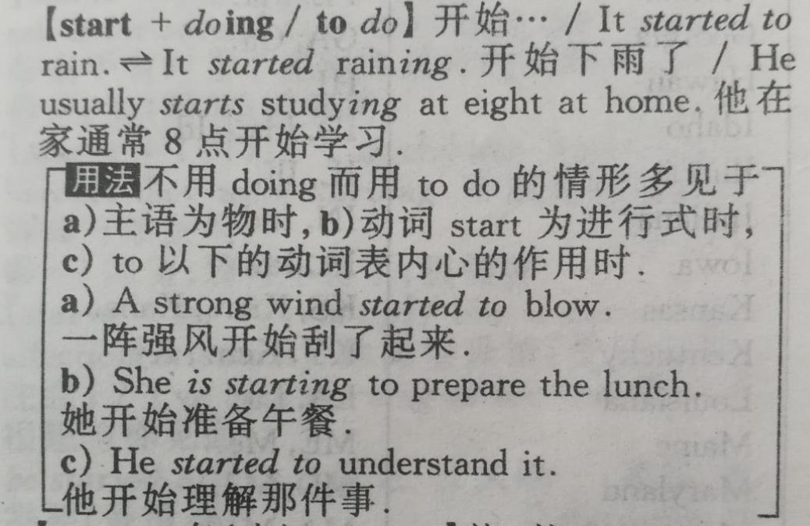
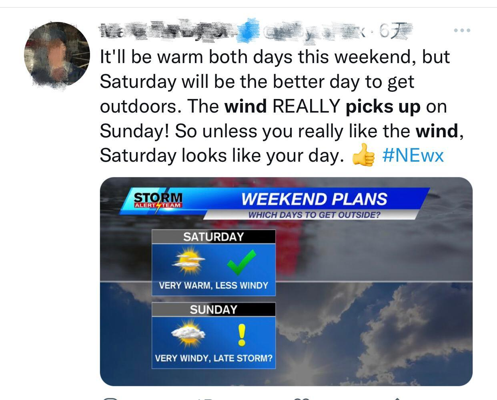
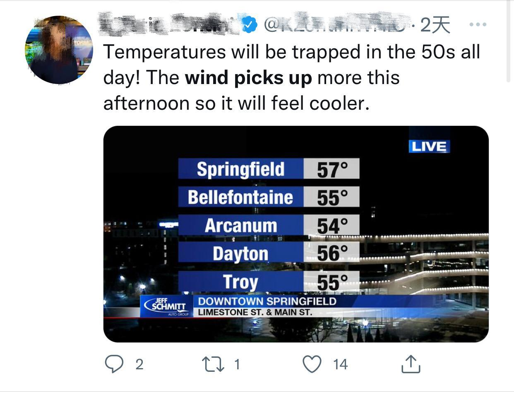
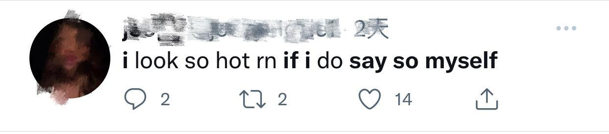
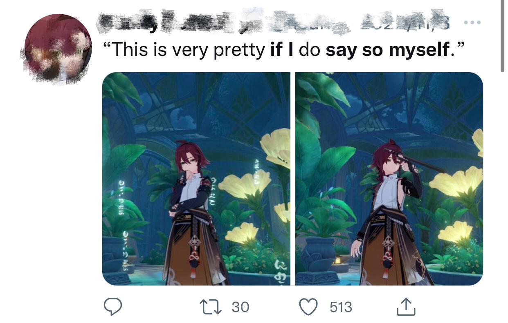
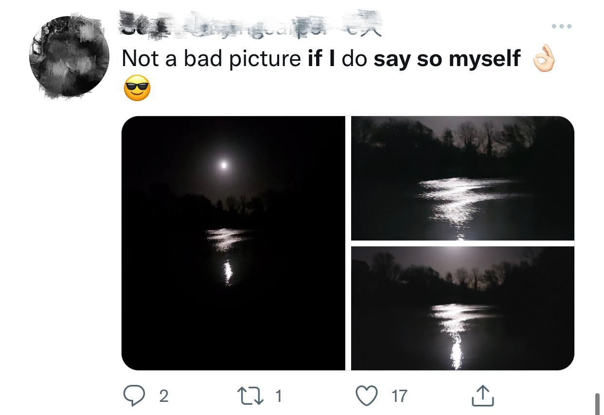

# 小猪佩奇逐集语法讲义与例句

第 1–29 集逐页收录原语法讲义。Markdown 中用空行和引文区分原讲解与醒目例句，可以点击页链接查看原 PDF 的原始排版。上一版的 133 条补充讲解和中英例句另附在对应集数下。

第 30–52 集的原资料提供一份共用说明，收录在分册末尾。各集的附加笔记来自词表和台词。三段发音视频未转录。

## 分集目录

[[#第 01 集 泥坑|第 01 集 泥坑]] · [[#第 02 集 恐龙先生不见了|第 02 集 恐龙先生不见了]] · [[#第 03 集 最好的朋友|第 03 集 最好的朋友]] · [[#第 04 集 鹦鹉波利|第 04 集 鹦鹉波利]]

[[#第 05 集 捉迷藏|第 05 集 捉迷藏]] · [[#第 06 集 幼儿园|第 06 集 幼儿园]] · [[#第 07 集 猪妈妈在工作|第 07 集 猪妈妈在工作]] · [[#第 08 集 中间的小猪|第 08 集 中间的小猪]]

[[#第 09 集 爸爸的眼镜不见了|第 09 集 爸爸的眼镜不见了]] · [[#第 10 集 花园种菜|第 10 集 花园种菜]] · [[#第 11 集 打嗝|第 11 集 打嗝]] · [[#第 12 集 自行车|第 12 集 自行车]]

[[#第 13 集 秘密|第 13 集 秘密]] · [[#第 14 集 放风筝|第 14 集 放风筝]] · [[#第 15 集 野餐|第 15 集 野餐]] · [[#第 16 集 乐器|第 16 集 乐器]]

[[#第 17 集 青蛙小虫和蝴蝶|第 17 集 青蛙小虫和蝴蝶]] · [[#第 18 集 装扮游戏|第 18 集 装扮游戏]] · [[#第 19 集 新鞋子|第 19 集 新鞋子]] · [[#第 20 集 学校游园会|第 20 集 学校游园会]]

[[#第 21 集 猪妈妈的生日|第 21 集 猪妈妈的生日]] · [[#第 22 集 牙仙子|第 22 集 牙仙子]] · [[#第 23 集 新车|第 23 集 新车]] · [[#第 24 集 寻宝|第 24 集 寻宝]]

[[#第 25 集 不太好|第 25 集 不太好]] · [[#第 26 集 下雪了|第 26 集 下雪了]] · [[#第 27 集 风息堡|第 27 集 风息堡]] · [[#第 28 集 我的堂姐克洛伊|第 28 集 我的堂姐克洛伊]]

[[#第 29 集 煎饼|第 29 集 煎饼]] · [[#第 30 集 照顾小孩|第 30 集 照顾小孩]] · [[#第 31 集 芭蕾舞课|第 31 集 芭蕾舞课]] · [[#第 32 集 暴风雨|第 32 集 暴风雨]]

[[#第 33 集 清洁汽车|第 33 集 清洁汽车]] · [[#第 34 集 午餐|第 34 集 午餐]] · [[#第 35 集 露营|第 35 集 露营]] · [[#第 36 集 沉睡公主|第 36 集 沉睡公主]]

[[#第 37 集 树屋|第 37 集 树屋]] · [[#第 38 集 化妆舞会|第 38 集 化妆舞会]] · [[#第 39 集 博物馆|第 39 集 博物馆]] · [[#第 40 集 酷暑难当|第 40 集 酷暑难当]]

[[#第 41 集 克洛伊的木偶表演|第 41 集 克洛伊的木偶表演]] · [[#第 42 集 爸爸减肥|第 42 集 爸爸减肥]] · [[#第 43 集 整理房间|第 43 集 整理房间]] · [[#第 44 集 操场|第 44 集 操场]]

[[#第 45 集 爸爸挂相片|第 45 集 爸爸挂相片]] · [[#第 46 集 去海边玩|第 46 集 去海边玩]] · [[#第 47 集 瘦腿先生|第 47 集 瘦腿先生]] · [[#第 48 集 猪爷爷的船|第 48 集 猪爷爷的船]]

[[#第 49 集 购物|第 49 集 购物]] · [[#第 50 集 我的生日派对|第 50 集 我的生日派对]] · [[#第 51 集 爸爸的摄像机|第 51 集 爸爸的摄像机]] · [[#第 52 集 学校戏剧|第 52 集 学校戏剧]]

## 第 01 集 泥坑

[打开原 PDF（保留原始颜色、页边距和插图）](%E8%AF%AD%E6%B3%95%E5%8E%9F%E8%AE%B2%E4%B9%89/episode-01.pdf)

### 原讲义第 1 页

[查看原版第 1 页](%E8%AF%AD%E6%B3%95%E5%8E%9F%E8%AE%B2%E4%B9%89/episode-01.pdf#page=1)

第一集知识点总结  
（视频在 B 站搜“挑战 52 天背完小猪佩奇”或者搜“脑洞部长”）

> This is my little brother, George.这是我的弟弟乔治。

弟弟 little brother/younger brother  
哥哥 big brother/older brother  
妹妹 little sister/younger sister  
姐姐 big sister/older sister  
little brother/big brother/little sister/big sister 这种说法感觉要更亲昵一些. elder brother /elder sister 这种说法比较老旧，现在已经很少用了，很像你用中文说  
兄长/家姐，一些年纪比较大的英国人还是会这么说，  
建议你平常不要这么说，但是如果有人这么说或者看一些有年代感的电视剧电影里这么  
说，知道是什么意思就可以了。

> This is Mummy Pig.这是我的妈妈。And this is Daddy Pig.这是我的爸爸。

猪妈妈是 mommy pig 而不是 pig mommy，英文比较喜欢先说重点，猪妈妈的重点是  
妈妈，而不是介绍猪，猪爸爸也是一样，是 Daddy Pig 而不是 Pig daddy

> Muddy Puddles.泥坑

泥泞的是 muddy，是个形容词，puddle 是水坑的意思，muddy puddle 就是泥坑，但  
是，这里说的不是一个泥坑而是指所有的泥坑，就像我说我喜欢狗，不是喜欢某一只狗，  
而是狗这个大类，很多很多狗，所以要加 s，说 I like dogs，我喜欢猫，不是喜欢某一只  
猫，而是猫这个大类，好多好多猫，所以要加 s，说 I like cats. 所以这里的泥坑也是一  
样，表示一个大类，要加 s，Muddy Puddles

> It is raining today.今天是雨天。

形容天气的句子一般都用 it 做主语来代表天气，这句话描绘的场景就是正在下雨。那就  
用现在进行时，It is raining. 同理如果是正在下雪就是 It is snowing. 还可以在最后加  
上时间，today，英语里时间地点这种词都喜欢放在最后，所以就是 It is raining today. So, Peppa and George cannot play outside.所以佩奇和乔治不能在外边玩。  
玩是 play，外面是 outside  
如果你说  
所以佩奇和乔治不能玩 就是  
So, Peppa and George can’t play. 那么所以佩奇和乔治不能在外边玩。在最后再加个 outside 就行了，

### 原讲义第 2 页

[查看原版第 2 页](%E8%AF%AD%E6%B3%95%E5%8E%9F%E8%AE%B2%E4%B9%89/episode-01.pdf#page=2)

So, Peppa and George can’t play outside. 注意这里没有介词，不要说 Peppa and George can’t play at outside. 因为外面它并不是一个具体地点，如果你说，所以佩奇和乔治不能在学校玩。  
那你可以说  
So, Peppa and George can’t play at school. 而 outside 你可以把它理解为一个大方向，用来补充说明一下 play 的方向,所以直接说  
play outside 就可以了。

> Daddy, it's stopped raining.爸爸，现在雨停了。

当你去形容一个刚才一直在发生的动作现在结束了，或者完成了的时候，  
比如：雨下着下着停了，雪下着下着停了，东西找着找着找到了，作业写着写着，写完  
了。刚才一直在发生的动作现在结束了，或者完成了，有了个结果的时候就可以用  
现在完成时  
have/has+动词的过去分词  
雨停了，形容天气用 it 开头代表天气，所以是 it has stopped，但你光说 it has stopped  
不知道是啥停了，所以在最后再加上一个 raining 来代表下雨这件事。如果是雪停了，  
就说 it has stopped snowing. 口语里 it 和 has 经常会缩略成 it's，it‘s stopped raining，it‘s stopped snowing

> Can we go out to play?我们能出去玩吗？

出去 go out 出去玩就是 go out to play  
我能干嘛干嘛吗？Can I..... 我们能干嘛干嘛吗？Can we..... 所以整句话就是  
Can we go out to play?

> Alright, run along you two.好的，你们两个去玩吧。

小朋友想去玩，征求你的同意的时候，你应该怎么说呢，  
就是 alright，run along，alright 表示好的好吧，你说 ok 也可以，不重要。  
run along 就是去吧，去玩吧的意思。  
通常都是对小朋友说的，对成年人这么说就感觉很没有礼貌，就像你用中文跟成年人说，  
去吧，去玩吧就也挺冒犯的。除非你们的关系就是那种类似大人跟孩子的关系。  
一个小朋友要去玩，你说 run along，两个小朋友要去玩，可以说  
run along you two，三个小朋友可以说 run along you three

> Peppa loves jumping in muddy puddles.佩奇喜欢在泥坑里玩。

### 原讲义第 3 页

[查看原版第 3 页](%E8%AF%AD%E6%B3%95%E5%8E%9F%E8%AE%B2%E4%B9%89/episode-01.pdf#page=3)

这句话如果是佩奇喜欢泥坑  
那就可以说 Peppa loves muddy puddles. 那么在泥坑里玩这里指的情景其实是在泥坑里跳啊跳，jump 是跳的意思，在泥坑里玩就  
可以说 jump in muddy puddles. 那么这句话就直接把 muddy puddles 换成 jump in muddy puddles 吗？Peppa loves  
jump in muddy puddles. 这样吗？  
当然不可以，love 是动词，正常就应该是 I love 啥，啥这个位置应该是个名词块，muddy  
puddles 就是个名词块，泥坑的意思，而 jump in muddy puddles，在泥坑里跳是个动  
作，它一个动作放在名词块的位置，怎么行呢，除非，它把自己伪装成名词块，也就是  
在 jump 后面加个 ing，把动词 jump 变成动名词 jumping 就可以了。  
当你说喜欢什么什么的时候，如果你接下来说的是个名词，  
I love books.我喜欢书  
I love you.我爱你  
I love money.我爱钱  
I love beautiful pictures.我喜欢漂亮的图  
这种就直接说那个词就可以了，但是你要说的是喜欢做某件事情，love 后面紧跟着的是  
某个动作，那你就要把那个动词加个 ing。比如  
I love reading books.我喜欢读书  
I love drawing pictures.我喜欢画图  
或者你也可以在 love 后面加个 to，这样你就可以直接说动词原形了。  
I love to read books.  
I love to draw pictures. 也可以，你可以这么理解，I love 啥/ I love to 干啥。所以在 to 后面就是动词位置，就  
可以用原形，而啥是个名词块的位置，你得把动作加个 ing 伪装成名词块。  
所以佩奇喜欢在泥坑里玩应该是  
Peppa loves jumping in muddy puddles. Peppa. lf you jump in muddy puddles, you must wear your boots.佩奇，如果你要

> 在泥坑里跳，你必须要穿上靴子才行。

如果你要。。。。。你必须要。。。。。。  
If you.....you must...... 在泥坑里跳，是 jump in muddy puddles. 穿上靴子，穿是 wear，靴子是 boot，但是一般都不会穿一只靴子的，两只脚都要穿，  
所以是两只靴子，加个 s，wear your boots. 这里的动词都用的原形，因为这是一个真实的条件句，如果是假设的条件句，如果我是  
一个外星人，这种句子的动词就要用过去时，这个我们 13 课的时候再细讲，要不然这集

### 原讲义第 4 页

[查看原版第 4 页](%E8%AF%AD%E6%B3%95%E5%8E%9F%E8%AE%B2%E4%B9%89/episode-01.pdf#page=4)

内容太多了。总之这种真实的条件句，用动词原形。

> George, let's find some more puddles.乔治，我们再去找几个泥坑跳吧。

提出我们一起去干嘛干嘛的建议，那就用 Let’s 开头，  
Let‘s 干嘛呢，再找几个泥坑，不用去管这个跳吧这两个字，不要逐字翻译，你要想的是  
现在这个场景，怎么表达清楚意思就行了，找泥坑当然是去跳的，不然还去喝水吗，所  
以就表达清楚“我们再去找几个泥坑吧”就行了。  
这句话如果只是说，我们去找几个泥坑，我们去找些泥坑，就可以说  
Let's find some muddy puddles. 那“我们再去找几个泥坑吧”多了个再，就在 some 后面加个 more 就可以了，就像你  
说：  
要喝点茶吗？  
Would you like some tea？  
那如果现在人家已经喝了一些了，你问  
要再喝点茶吗？就是  
Would you like some more tea？  
或者直接把 tea 省略了  
Would you like some more？要再来点吗？  
就可以了。  
所以这句话就是  
George, let's find some more puddles. Peppa and George are having a lot of fun.佩奇和乔治玩得很开心。  
have fun 是一个惯用词组，字面意思是拥有乐趣，拥有快乐，实际上是指玩得开心。  
have a lot of fun 也是一个惯用词组，意思是玩得很开心，a lot of 是很多的意思。  
一般形容别人玩得很开心就用 have a lot of fun 个惯用词组，如果别人要去哪里玩你祝  
别人玩得开心，就用 have fun 这个词组，这就跟中文一样的，人家跟你说我要去三亚玩  
啦，你说，  
哇，玩得开心 have fun. 你不会说  
玩得很开心 have a lot of fun  
这里的场景是佩奇和乔治正玩着呢，玩得很开心，所以用现在进行时。  
Peppa and George are having a lot of fun. Peppa has found a little puddle.佩奇找到了一个小泥坑。George has found a big

> puddle.乔治找到了一个大泥坑。

这种句子就是我说过的那种，找东西找找找找到了，写作业写写写写完了，就是做完了  
一个什么事，或者有了个啥结果，这种就用现在完成时。

### 原讲义第 5 页

[查看原版第 5 页](%E8%AF%AD%E6%B3%95%E5%8E%9F%E8%AE%B2%E4%B9%89/episode-01.pdf#page=5)

找到是 find，过去分词 found，佩奇是第三人称单数，has found 一个小泥坑 a little muddy puddle 一个大泥坑 a big muddy puddle  
或者省略说 a little puddle/a big puddle  
所以整句话就是  
Peppa has found a little puddle. George has found a big puddle. Look, George. There's a really big puddle. 你看，乔治。那里有一个很大的泥坑。  
如果这句话是，看！我有个大泥坑。就是，look ,I have a big puddle. 但现在要说的是，那里有个大泥坑，是某个位置有某个东西，不是某个人有某个东西，  
某个人有某个东西可以用 have，某个地方有某个东西要用 there be 结构。  
比如，你跟朋友逛商场呢，看到了一家海底捞，你说：  
那里有家海底捞  
There is a HaiDiLao. 桌子上有两本书  
There are two books on the table. 所以那里有个大泥坑就可以说  
There is a big puddle. there 和 is 可以缩略成 There’s  
如果要强调这个泥坑很大，可以在 big 前面加个 really 来加强一下语气和程度，big 是  
大，really big 就是很大，所以这句话是  
Look, George. There's a really big puddle. George wants to jump into the big puddle first.乔治想第一个跳到泥坑里去玩。  
先说乔治想跳到泥坑里去玩。  
这里的动作是乔治想跳到这个大泥坑里去，这个大泥坑就是他们刚才找到的那个大泥坑，  
所以用 the big puddle 来形容这个泥坑，那跳到这个泥坑里说 jump in the big puddle  
合适吗？不合适，因为 jump in 表达的感觉就是在这个大泥坑里跳啊跳，就像刚才那些  
句子都是指的乔治和佩奇喜欢在泥坑里跳啊跳，所以都用的 jump in，而这里的动作是  
从旁边跳进来，要描述跳进来这个动作，用 jump into 比较合适，into 就有个方向感。  
那乔治想要干嘛干嘛就是， George wants to .... George wants to jump ino the big puddle. 他想第一个跳进去，在句子最后加个 first 就可以了，整句话就是  
George wants to jump into the big puddle first.

### 原讲义第 6 页

[查看原版第 6 页](%E8%AF%AD%E6%B3%95%E5%8E%9F%E8%AE%B2%E4%B9%89/episode-01.pdf#page=6)

> Stop, George.l must check if it's safe for you.等一下，乔治。我得检查一下这里安不  
> 安全。

等一下，乔治，这里就是让乔治停下，直接说 stop 就行了，因为乔治正要跳嘛，佩奇阻  
止他，佩奇说，我得检查一下这里安不安全，我得检查一下  
我得确认一下....是不是.....  
I must check if........ 比如，出门的时候你可以说：  
I must check if I have my phone. 我得检查一下我带没带手机。  
吃瓜的时候你可以说：  
I must check if it's the real thing. 我得确认一下是不是真事。  
那佩奇说 我得检查一下这里是不是安全，如果是安全的，就是说对乔治是安全的，她这  
里是要帮乔治检查，所以可以说 it's safe for you. 那我得检查一下这里是不是安全.就可  
以说 I must check if it's safe for you. Sorry, George. It's only mud.对不起，乔治。只是些泥而已。  
muddy 是泥泞的的意思，是个形容词，而 mud 是名词，泥的意思，  
是泥就可以说 It’s mud. 只是泥就在泥前面加个 only 就可以了， It's only mud.只是泥  
而已，It's only water.只是水而已

> Come on, George. Let's go and show Daddy.走，乔治。我们去给爸爸看看。

这里是佩奇想叫上乔治跟她一起去给爸爸展示身上的泥，给别人展示什么东西的时候可  
以用 show 这个词，比如说，你在网上看到一个图特别搞笑，要给朋友看，就可以说，  
I’ll show you a picture.我给你看个图。  
那我们给爸爸看，这里又是佩奇提出我们一起去干嘛干嘛的建议，那就用 Let’s 开头，我  
们给爸爸看看，就可以说  
Let’s show Daddy. 现在爸爸不在眼前，得先去爸爸那边，我们去给爸爸看看，就可以说  
Let’s go and show Daddy. Daddy. Daddy.Guess what we've been doing.爸爸，爸爸，你猜猜我们刚才干了些什

> 么。

这里是让爸爸猜刚才这一段时间里他们在做的事情，这种描述刚才的一段时间里一直在  
做的事的句子可以用现在完成进行时。  
就是 have/has＋been 加动词的 ing 形式

### 原讲义第 7 页

[查看原版第 7 页](%E8%AF%AD%E6%B3%95%E5%8E%9F%E8%AE%B2%E4%B9%89/episode-01.pdf#page=7)

比如：  
你放学回家之后就一直在写作业，朋友给你打了好多电话你都没接，后来你看她一直打，  
你就接了，你一接她就问你怎么都不接电话，你就可以说  
I have been doing my homework. 这句话就表示的是，你刚一直在写作业，如果你说  
I‘m doing my homework. 表示的就只是你当下这个时刻在写作业，它只是形容的一个时间点，而你说 I have been  
doing my homework .表示的就是刚才那一段时间都在写作业，指的是一个时间段。  
刚才我们说现在完成时的时候说  
雨下着下着停了，雪下着下着停了，东西找着找着找到了，作业写着写着，写完了！就  
是刚才一直在发生的动作现在结束了，或者完成了，有了个结果的时候就用现在完成时，  
现在完成时的重点是结果，而现在完成进行时说的是这个过程，雨刚一直在下，雪刚一  
直在下，东西刚一直在找，作业刚一直在写，重点是过程。  
所以猜猜我们刚才干什么了，先说猜 guess，然后 what，guess what we have been  
doing. 这里其实也可以说 guess what we have done.用现在完成时，但是这个的重点就不是  
过程而是结果，就变成了不是猜刚才我们在做什么，而是猜做成了什么，做完了什么，  
就不是特别合适，但是也行。

> Have you been watching television?你们刚才看电视了？

描述刚一段时间在做的事，那就用现在完成进行时，但这是个问句，现在完成进行时的  
问句用 have 开头  
Have you been..... Has he been...... Has she been......  
........ 这里就是 have you been 后面在加一个 watching television ，整句话就是  
Have you been watching television?

> Have you just had a bath?你们刚才洗澡了？

洗澡可以说 have a bath/take a bath , 那么这句话就跟刚才一样在 Have you been 后面加个 having a bath?  
Have you been having a bath？你们刚在洗澡?  
这么说是可以的，但是这句话也可以用现在完成时  
Have you had a bath？  
这种说法的重点就在结果了，一个是洗澡的过程，一个是洗完了澡的结果，这里佩奇他

### 原讲义第 8 页

[查看原版第 8 页](%E8%AF%AD%E6%B3%95%E5%8E%9F%E8%AE%B2%E4%B9%89/episode-01.pdf#page=8)

们明显很脏，爸爸说这句话就是逗一下他们，把重点放在洗澡的结果，所以用现在完成  
时，就更合适一些，还可以在 had a bath 前面加个 just ，代表刚刚，你们这么脏一定  
是刚洗完澡吧，这种感觉。所以整句话就是  
Have you just had a bath?

> I know. You've been jumping in muddy puddles.我知道了。你们刚才在泥坑里跳来  
> 跳去。

我知道了虽然也是一个结果，猜着猜着，哎知道了，但是它不是动作，它就是你的思想，  
跟写作业找东西那些都不一样，所以直接说 I know。不需要用现在完成时。

> Ho. Ho. And look at the mess you're in.呵呵，看看你们弄得多脏呀。

看看多脏可以说 look at the mess，mess 是个名词，意思是脏，不整洁，比如你进你  
弟弟的房间，看到房间超级脏乱，你就可以跟他说，Look at the mess 你看看多脏。  
如果是你弟弟出去玩，把自己弄的特别脏，你就可以说：  
Look at the mess you are in. 字面意思就是你在这个脏里，那就是你脏嘛。

> Let's clean up quickly before Mummy sees the mess.快清理干净，别让妈妈看到那  
> 么脏。（在妈妈看到前弄干净）

清理干净可以说 clean up，这里是提议我们一起来清理干净，我们一起来做这件事，那  
就是 Let’s clean up, 再加个快，quickly，Let's clean up quickly. 别让妈妈看到那么脏，就是在妈妈看到前弄干净，before mummy sees the mess. 整句话就是  
Let's clean up quickly before Mummy sees the mess. Daddy, when we've cleaned up, will you and Mummy come and play, too?爸爸，

> 我们清理干净以后，你和妈妈也会一起来玩吗？

我们清理干净之后又是做完了一个什么事情，就是爸爸在这里擦擦擦擦擦，哎，擦好了，  
所以也用现在完成时。我们清理干净之后，当我们清理干净了的那个时候，就可以用  
when，When we have cleaned up，可以缩略成 When we’ve cleaned up，这种 when  
加上一个现在完成时的句子在生活中很常见的。  
等我写完作业了，我可以看电视吗？  
When I‘ve finished my homework，can I watch TV？  
等我吃完早饭，我能跟朋友出去吗？  
When I‘ve finished my breakfast，can I go out with my friends？  
会干嘛干嘛吗？用 will 开头：

### 原讲义第 9 页

[查看原版第 9 页](%E8%AF%AD%E6%B3%95%E5%8E%9F%E8%AE%B2%E4%B9%89/episode-01.pdf#page=9)

你和妈妈会来玩吗？Will you and Mommy come and play？  
“也”会来玩吗？最后加个 too 就可以了。  
整句话就是  
Daddy, when we've cleaned up, will you and Mummy come and play, too?

> Yes, we can all play in the garden.是的，我们都可以在花园玩。

我们可以在花园玩，We can play in the garden. 我们都可以在花园玩就可以说，We  
can all play in the garden.或者 we all can play in the garden.差别不大，都行。

> Peppa and George are wearing their boots.佩奇和乔治穿着他们的靴子。

一般形容穿着什么东西都是用现在进行时，因为这东西就一直在你身上嘛，所以这句话  
就是  
Peppa and George are wearing their boots. Peppa loves jumping up and down in muddy puddles.佩奇喜欢在泥坑里跳来跳去  
这句话是前面讲过的，不过这里还可以再形容的细致一点，把  
jump in muddy puddles  
换成  
jump up and down in muddy puddles  
就是说在泥坑里上上下下地跳，整句话就是  
Peppa loves jumping up and down in muddy puddles. Everyone loves jumping up and down in muddy puddles.每个人都喜欢在泥坑里跳

> 来跳去。

每个人是 everyone 它也是第三人称单数，因为它指的是一个一个的人，所以这里的 love  
后面也要加 s，就是  
Everyone loves jumping up and down in muddy puddles. 第一集知识点总结-完  
（视频在 B 站搜“挑战 52 天背完小猪佩奇”或者搜“脑洞部长”）

### 本集补充用法与例句

- 天气用 it 作主语，正在发生用 be + -ing，如 It is raining today. 今天正在下雨。
  - **原台词例句** — *It is raining today.*
  - **中文** — 今天正在下雨。

- 用 have/has + 过去分词说明与现在有关的结果，如 It's stopped raining. 雨已经停了。
  - **补充例句** — *It's stopped raining.*
  - **中文** — 雨已经停了。

- have/has been + -ing 可交代刚做过的一段过程，如 You've been jumping in muddy puddles. 你们刚才一直在泥坑里跳。
  - **补充例句** — *You've been jumping in muddy puddles.*
  - **中文** — 你们刚才一直在泥坑里跳。

## 第 02 集 恐龙先生不见了

[打开原 PDF（保留原始颜色、页边距和插图）](%E8%AF%AD%E6%B3%95%E5%8E%9F%E8%AE%B2%E4%B9%89/episode-02.pdf)

### 原讲义第 1 页

[查看原版第 1 页](%E8%AF%AD%E6%B3%95%E5%8E%9F%E8%AE%B2%E4%B9%89/episode-02.pdf#page=1)

第二集知识点总结  
（视频在 B 站搜“挑战 52 天背完小猪佩奇”或者搜“脑洞部长”）

> Mr. Dinosaur is Lost.恐龙先生弄丢了

恐龙是 dinosaur，恐龙先生就是 Mr. Dinosaur，它是个玩具，没有生命，所以他丢了肯  
定是被人弄丢了，不是自己丢的，要用被动语态，be 加动词的过去分词，丢失的动词是 lose，  
他的过去分词是 lost，被弄丢就得用被动 be lost，所以如果你要说某个东西丢了，以这个  
东西开头做主语的话，比如：  
我的书丢了。  
My book is lost. 我的手机丢了。  
My phone is lost. 我的钥匙丢了。  
My keys are lost. 这里是复数。好几个钥匙，用 are。  
所以恐龙先生丢了，就是 Mr. Dinosaur is lost. 或者这种句子你也可以把 lost 理解为一个形容词，因为 lost 它除了是动词 lose 的过去分  
词之外，它也是一个形容词，意思是丢失的，所以也可以理解为这种句子是在形容书是丢  
失的状态，手机是丢失的状态，钥匙是丢失的状态，恐龙先生是丢失的状态。随便你怎么  
理解，总之这个句式就是这样。

> George's favourite toy is Mr. Dinosaur.乔治最喜欢的玩具是恐龙先生。

先不看最喜欢的这几个字，就说“乔治的玩具是恐龙先生”  
George's toy is Mr. Dinosaur. 乔治的大玩具是恐龙先生  
就是 George's big toy is Mr. Dinosaur. big 是个形容词，意思是大的，favourite，也是个形容词，意思是最喜欢的，那就把 big  
换成 favourite 就可以了，就是  
George's favourite toy is Mr. Dinosaur. 乔治最喜欢的玩具是恐龙先生。  
我为什么要用这种扩句的方式给大家讲这个呢，因为很多人知道了 favourite 这个词之后，  
去形容某个人最喜欢的东西的时候，就会说  
He favorite movie is XXX. She favorite book is xxx.  
I favorite game is XXX. 这么说非常符合中文的思路，他最喜欢的电影是啥啥啥，她最喜欢的书是啥啥啥，我最喜  
欢的游戏是啥啥啥，但这样不对，这句“George's toy is Mr. Dinosaur.”在扩句之前，

### 原讲义第 2 页

[查看原版第 2 页](%E8%AF%AD%E6%B3%95%E5%8E%9F%E8%AE%B2%E4%B9%89/episode-02.pdf#page=2)

George's toy 它是连起来的，是结合起来的，是一个整体，来作为句子的主语，加了 favorite  
只是起到一个修饰的作用，  
而这三句话  
He favorite movie is XXX. She favorite book is xxx.  
I favorite game is XXX. 里 he movie 两个独立个体，连不起来；she book 两个独立个体连不起来；I game 两个  
独立个体连不起来，连不起来怎么成为一个整体来做句子的主语呢，连不起就是连不起来，  
不会因为加了一个 favorite 的形容词修饰它它就连起来了，这就好像你的头是断的，那你  
化个妆也依然是断的，根本不改变你头是断的这个本质，所以你得说。  
His favorite movie is XXX. Her favorite book is xxx. My favorite game is XXX. 把他，她，我全都换成他的，她的，我的。虽然这样不符合中文逻辑，但英文就得这么说，  
所以一定要记得当你说某个人最喜欢的某个东西是什么的时候，某个人一定要用所有格。  
也就是你得说”某个人的”

> Sometimes, George likes to scare Peppa with Mr. Dinosaur.有时候，乔治喜欢用恐龙  
> 先生吓唬佩奇。

乔治喜欢用恐龙先生吓唬佩奇，如果这句话没有“用恐龙先生”这几个字，就只是，有时  
候，乔治喜欢吓唬佩奇，吓唬可以用 scare 这个词，那就可以说  
George likes to scare Peppa  
那再加上用恐龙先生，很多人就会想用 use 这个词，说：  
George likes to use Mr.Dinosaur to scare Peppa. 这么说也不是不可以，但是，不是特别常用。  
一般你说喜欢用某个工具,那可以用 use；但是你说用某个工具去做什么事的时候，用 with  
这个词比较常见。  
比如，  
我想用那个红色的笔。  
I want to use the red pen. 我想用那个红色的笔写作业。  
I want to do my homework with the red pen. 我喜欢用香皂。  
I like to use soap. 我喜欢用香皂洗脸.  
I like to wash face with soap.

### 原讲义第 3 页

[查看原版第 3 页](%E8%AF%AD%E6%B3%95%E5%8E%9F%E8%AE%B2%E4%B9%89/episode-02.pdf#page=3)

我能用下你的手机吗？  
Can I use your phone？  
我能用你的手机给他打个电话吗？  
Can I call him with your phone?  
就是说，如果只是单纯地用某个东西，那通常是用 use，但如果是用某个东西做什么事，  
那用 with 比较多。

> At suppertime, Mr. Dinosaur sits next to George.晚饭的时候，恐龙先生坐在乔治身旁

晚饭的时候可以说 at suppertime 或者 at dinnertime 一般这种在一天里具体做某件事的  
时间，介词都是用 at  
at breakfast time 早饭的时候  
at lunch time 午饭的时候  
at bath time 洗澡的时候  
而 dinner 和 supper 的区别是什么呢？  
supper 它的本意就是晚餐，一天的最后一顿饭，达芬奇有个很著名的画叫最后的晚餐，这  
幅画的英文名就是 the last supper. 但是 dinner 的本意其实是比较丰盛的一餐，所以 dinner 其实既可以指晚餐也可以指中餐，  
像美国基本都是晚餐吃得比较丰盛，所以美国人基本把晚餐叫 dinner，但是有的国家比如  
英国加拿大，有些人就喜欢中午吃的比较丰盛，那可能她中午吃 dinner，晚上吃 supper，  
所以，如果有人邀请你一起吃饭，说：  
Can we have a dinner together this weekend？  
如果他是个美国人，那你基本可以判断他说的是晚饭，如果她是别的国家的人，你不太确  
定他说的是午饭还是晚饭，那你可以问一下，说：  
At lunch time or supper time？是午饭时间还是晚饭时间？  
总之 lunch 一定是午饭，supper 一定是晚饭，但是 dinner 不一定。  
然后恐龙先生坐在乔治身旁就很简单，坐在。。。的旁边就是 sit next to。  
比如：  
I want to sit next to you.我想坐在你身边。  
那恐龙先生坐在乔治身旁就是  
Mr. Dinosaur sits next to George.

> I beg your pardon. Was that you George, or was it Mr. Dinosaur?这是谁发出的声  
> 音？是你吗？乔治，还是恐龙先生呢？

这里是乔治打了个嗝，妈妈没有听清，或者说妈妈是假装没有听清，逗一下乔治，让乔治  
重复一遍，这种情况，其实，只需要简单地 sorry？就可以了，但是这里妈妈说的是  
I beg your pardon.

### 原讲义第 4 页

[查看原版第 4 页](%E8%AF%AD%E6%B3%95%E5%8E%9F%E8%AE%B2%E4%B9%89/episode-02.pdf#page=4)

beg 是祈求，请求的意思，padon 有原谅的意思。  
I beg your pardon 字面意思是我祈求你的原谅，实际上就是指请原谅我没听清，请求你  
再重复一遍的意思，也可以就只说 pardon？  
但是无论是你说 I beg your pardon.还是 pardon？都有点太过时了，小猪佩奇这个动画  
片是 2004 年在英国播出的，距离现在已经快 20 年了，这种说法确实有点过时了，你现在  
跟人家说这个可能有的人会觉得你挺好笑的，所以这种情况直接说个 sorry 配上迷惑不解  
的表情就行了  
是你吗？乔治，还是恐龙先生呢？  
这里问的是刚才那个打嗝的声音是你吗？用 that 表示刚才那个打嗝的声音。问的又是已  
经过去的事情，所以应该是 was that you？Gerge.还是恐龙先生呢？or was that Mr. Dinosaur? 也可以把这个 that 换成 it，不重要，不影响任何意思。这就好像你用中文说，  
刚才那是你吗乔治？还是说那是恐龙先生？或者你说 刚才那是你吗乔治？还是说它是恐  
龙先生？就并没有什么区别，只是体现了一下词汇的多样性。

> At bath time,George shares his bath with Mr. Dinosaur.洗澡的时候，乔治和恐龙先生  
> 一起洗。

刚才说过一般这种在一天里具体做某件事的时间，介词都是用 at  
所以洗澡的时候就是 at bath time  
乔治和恐龙先生一起洗。这句话其实就可以说，  
George and Mr. Dinosaur have bath together. 但是这个动画片里用了一种更贴切地描述这个场景的说法，就是乔治跟恐龙先生分享他的  
浴缸，因为恐龙先生其实也没有一起洗，就只是乔治洗澡的时候，它也在浴缸里而已，它  
就是个玩具嘛。  
跟某人分享某个东西，可以说 share sth with sb，比如  
George shares his toy with Peppa. Peppa shares her cake with peppa. 浴缸可以用 bath 这个词，这个词不仅有洗澡的意思，还有浴缸的意思  
那么乔治跟恐龙先生分享他的浴缸，跟恐龙先生一起洗澡就可以说  
George shares his bath with Mr. Dinosaur. When George goes to bed,Mr. Dinosaur is tucked up with him.乔治睡觉的时候，恐龙

> 先生和他睡在一起。

这句话其实可以说，When George sleeps, Mr. Dinosaur sleeps with him. sleep 就是睡觉的意思嘛，乔治和恐龙先生都是第三人称单数又加了 s. 但是动画片里说的这句话是  
When George goes to bed,Mr. Dinosaur is tucked up with him.

### 原讲义第 5 页

[查看原版第 5 页](%E8%AF%AD%E6%B3%95%E5%8E%9F%E8%AE%B2%E4%B9%89/episode-02.pdf#page=5)

解释一下这种说法：  
这个 go to bed 字面意思是去床上，实际上指的就是去睡觉，但是它一般还包含了你睡前  
躺在床上玩手机啊跟人聊天啊各种事，基本上从你上床打算睡觉一直到你起床离开床，都  
包括在里面，但是 sleep 一般指的就是纯粹的睡觉。比如有一些短视频会做那种妈妈睡觉  
时和我睡觉时的对比(when Mom sleeps VS when I sleep)，标题就是用的 sleep 这个词，  
因为这种对比视频就是讲的妈妈睡觉的时候，我轻手轻脚，但是我睡觉的时候，妈妈就很  
吵，它指的就是在床上闭眼睡觉的这一段，那肯定用 sleep 是比较合适的，用 go to bed  
就不太合适。  
那这里，当乔治睡觉的时候，说 When George goes to bed,这个范围就比 When George  
sleeps 的范围更宽泛一点，就是只要去床上，恐龙先生就跟他一起。  
tuck up 是给某人盖被子的意思，主要是指给孩子盖被子，因为乔治是个婴幼儿，每晚都  
是需要人安顿在床上的，给他盖好被子。一般这种都是说  
tuck sb in 或者 tuck sb up in bed 都可以。  
如果是以被盖被子的这个人为主语的话，那就是被动句。  
sb be tucked in 或者 sb be tucked up in bed  
（这里有一个短片的片段和一些推特上的例句在视频里给大家看过了。视频在 B 站搜“挑  
战 52 天背完小猪佩奇”或者搜“脑洞部长”）  
所以这里说 Mr. Dinosaur is tucked up with him.意思就是恐龙先生跟乔治被盖在一个  
被窝里，这里把 in bed 省略了，因为前半句话 When George goes to bed 已经说了 bed  
了。

> George's favourite game is throwing Mr. Dinosaur up in the air and catching him  
> when he falls back down.乔治最喜欢的游戏就是把恐龙先生扔到空中在他掉下来的时  
> 候把他接住。

乔治最喜欢的游戏，这个我们在这一集一开始就讲过了，可以说 George's favourite game  
把恐龙先生扔到空中，扔可以用 throw 这个动词，在空中可以说 in the air，那把恐龙先  
生扔到天空就可以说，throw Mr. Dinosaur in the air，还可以把 throw 这个动作描述地  
细致一点，乔治是往上扔，扔进天空，所以可以说往上扔是 throw Mr. Dinosaur up ，那  
扔上天空就是，throw Mr. Dinosaur up in the air，当然不加 up 也可以，只是加了 up 描  
述得更细致一点。  
“在他掉下来的时候把他接住”接住可以用 catch 这个词，把他接住就是 catch him “在他掉下来时”when he falls down. fall down 是掉下来，这里可以在中间加个 back，fall back down,就是掉回来了，不止是  
掉下来还是掉回来。  
就是 catch him when he falls back down. 那整个把恐龙先生扔上天空然后在他掉下来时把他接住就是

### 原讲义第 6 页

[查看原版第 6 页](%E8%AF%AD%E6%B3%95%E5%8E%9F%E8%AE%B2%E4%B9%89/episode-02.pdf#page=6)

throw Mr. Dinosaur up in the air and catch him when he falls back down. 加上前面的“George's favourite game is”乔治最喜欢的游戏是  
是啥，is 后面也是应该跟名词块的，这里直接放个动词，throw，当然不可以了，要加个  
ing 用它的动名词形式，而 catch 也是一样，因为这个动作和前面的动作是个并列关系，  
乔治最喜欢的游戏是啥 and 啥，这两个位置都应该是名词块，所以 catch 也要加 ing。  
fall 不用，它也是个动词，但是它属于“when he falls back down”这个小句子，he 才  
是它的主语。George's favourite game is 跟它没有直接关系。

> Peppa and Daddy Pig are playing draughts.佩奇正在和猪爸爸下棋呢。

他们下的是国际跳棋，是 draughts，下国际跳棋可以说 play draughts，这里是正在和爸  
爸下棋就用现在进行时

> I win, Daddy. Oh, well done, Peppa.我赢了，爸爸。哦，下得好啊佩奇。

我赢了，I win,我输了，I lose, 下得好啊佩奇就是做得不错，well done， peppa 就可以  
了

> George, have you lost Mr. Dinosaur? 乔治，你把恐龙先生弄丢了？

这里又需要用到现在完成时。  
上一集的时候我们说过  
雨下着下着停了，雪下着下着停了，东西找着找着找到了，作业写着写着写完了，这种刚  
一直在做某个事，然后做完了，结束了，可以用现在完成时，但这其实只是现在完成时的  
一种应用场景。现在完成时的应用场景非常丰富, 我们之后还会再讲很多次现在完成时，  
让你可以慢慢地完全掌握现在完成时的用法。但你这集可以先记住一个小规律就是  
大部分中文里有了的句子， 且表达的意思又是完成了某个动作的  
可以考虑用现在完成时  
我买了本书。  
I have bought a book. 我把书弄丢了。  
I have lost my book. 我到了，你在哪？  
I‘ve arrived，where’re you？

那么乔治把恐龙先生弄丢了就是  
You have lost Mr.Dinosaur. 这一集的标题是恐龙先生弄丢了，恐龙先生丢了，以恐龙先生为主语，所以是  
Mr. Dinosaur is lost. 这种句子不用现在完成时，因为现在完成时指的是句子的主语做完了什么动作，完成了什  
么动作，而恐龙先生是个玩具，不具备主动完成任何动作的能力，所以就像我们这集最开  
始讲的那样，要用被动语态

### 原讲义第 7 页

[查看原版第 7 页](%E8%AF%AD%E6%B3%95%E5%8E%9F%E8%AE%B2%E4%B9%89/episode-02.pdf#page=7)

Mr. Dinosaur is lost. 以乔治为主语的时候，就可以用现在完成时，  
George has lost Mr. Dinosaur. 这里是个问句，爸爸问乔治，你把恐龙先生弄丢了吗？现在完成时用 have 或者 has 开头  
have you lost Mr. Dinosaur?

> It's a job for a detective.现在该轮到侦探出场了。

侦探是 detective，爸爸说这是一个侦探负责的工作，It's a job for a detective. 其实这里  
直接说 We need a detective. 也可以

> 爸爸，什么是侦探？Daddy, what is a detective?

> A detective is a very important person who is good at finding things.我所说的侦探  
> 呢，他们都是非常厉害的人，能帮人找到掉了的东西。（侦探是个非常重要的人，擅长找  
> 东西。）

侦探是个非常重要的人，  
A detective is a very important person  
这里用 A detective 不是 The detective，因为佩奇问的就是 a detective. 后半句，”擅长找东西”,擅长.... good at..... 比如：擅长数学 good at maths  
擅长英语 good at English  
但是数学和英语都是名词，如果是要说擅长做什么事，比如擅长找东西就  
不能说 good at find things ，而要说 good at finding things . at 是个介词，它后面也得是名词块，如果是动词的话就要加 ing，变成动名词，伪装成动  
词放在这里。  
那么  
A detective is a very important person  
和 good at finding things.怎么连起来呢，其实就加个逗号和 and 就行，  
A detective is a very important person ，and good at finding things. 但是这里还可以把这句话合成一整句话说  
A detective is a very important person who is good at finding things. 这两句话没有太大的差别，但是后一句感觉起来要更强调 good at finding things. 再比如：  
她是个漂亮的女孩  
She is a beautiful girl. 她是个擅长数学的漂亮女孩，就可以说  
She is a beautiful girl ，and she is good at maths. 还可以用 who 放在中间，就是  
She is a beautiful girl who is good at maths.

### 原讲义第 8 页

[查看原版第 8 页](%E8%AF%AD%E6%B3%95%E5%8E%9F%E8%AE%B2%E4%B9%89/episode-02.pdf#page=8)

感觉就更强调她擅长数学。  
再比如  
Tom is a cute boy，He lives next door to us. Tom 是个可爱的男孩，他住在我们隔壁。  
Tom is a cute boy who lives next door to us. Tom 是个住在我们隔壁的可爱男孩。

> George? where's Mr. Dinosaur?George does not know where Mr. Dinosaur is. 乔  
> 治？恐龙先生在哪里呢？乔治不知道恐龙先生在哪里。

恐龙先生在哪里是个问句，所以说的是 where's Mr. Dinosaur?，但是这句  
“乔治不知道恐龙先生在哪里” 是个陈述句，所以 is 不用放到 Mr. Dinosaur 前面，就陈  
述语序 where Mr. Dinosaur is.就可以了

> The detective could try and guess where Mr. Dinosaur might be.侦探小姐也许要试

着猜猜恐龙先生流落到哪了. 不用管流落这么高级的词，这里就是让佩奇试着猜猜恐龙先生在哪。  
试着猜猜可以说 try and guess  
侦探小姐这里只是这么翻译了而已，实际上就是 the detective，因为佩奇前面都说了  
I am the detective.所以这里就用 The detective 就可以。  
The detective can try and guess where Mr. Dinosaur is. 侦探可以试着猜猜恐龙先生在哪. 这句话这么说就可以的，还可以把 is 换成 may be. The detective can try and guess where Mr. Dinosaur may be. 侦探可以试着猜猜恐龙先生可能会在哪. 比如你的亲人离家出走了，你到处找他，你跟人说，  
Please call me if you know where he is. 这句话就不如你说，  
Please call me if you know where he may be. 因为这句话表达的是，只要你想到了他可能会在哪你都给我打个电话，而不是准确地知  
道他在哪才给我打电话。  
那这句话也是一样，  
The detective can try and guess where Mr. Dinosaur may be. 就是只要恐龙先生有可能在的地方你都可以猜猜看哦。  
这句话还可以把里面的情态动词，can和 may都换成 could 和 might，虽然 could 和 might  
分别是 can 和 may 的过去时，但是这里和过去没有任何关系，换成 could 和 might 只是  
因为这样显得更委婉，更礼貌，用 can 的时候就好像在教人做事，你可以干嘛干嘛，而用  
could 就委婉了很多。而 might 比 may 感觉可能性要更低一点，就会显得更委婉，很有

### 原讲义第 9 页

[查看原版第 9 页](%E8%AF%AD%E6%B3%95%E5%8E%9F%E8%AE%B2%E4%B9%89/episode-02.pdf#page=9)

礼貌，像刚才我们说的那句  
Please call me if you know where he may be.如果把 may 换成 might 的话也会更委  
婉，就有一种 只要你知道他有一点点可能会在哪，都给我打个电话的那种感觉。

> George always has Mr. Dinosaur with him in the bath.乔治总是在洗澡的时候让恐龙  
> 先生陪着

乔治总是在洗澡的时候让恐龙先生陪着  
就是乔治总是让恐龙先生跟他一起洗澡。  
让别人干什么事情 可以说 have sb do... 让某人做... 干嘛干嘛，它跟 let 是不一样的，  
let sb do... 允许某个人做... ，比如说，I let him use my phone ，我让他用我的手机，  
有允许的意思在里面，而 have sb 干嘛干嘛就是让别人做什么事，比如你们小区停水了，  
你邻居说要是你家来水了，让你给他说一声，你说，行，我让我哥给你打电话，就可以说，  
I’ll have my brother call you.或者 I‘ll have my brother give you a call. 那么，乔治总是让恐龙先生跟他一起洗澡，就可以说，  
George always has Mr. Dinosaur have bath with him. 但这里因为恐龙先生只是个玩具，乔治只是让它一起呆在浴缸里，所以也可以说  
George always has Mr. Dinosaur with him in the bath. 这里 with 虽然不是一个动词，但是它表达的也是和乔治在一起的动作和状态，所以是可  
以的。

> George always has Mr.Dinosaur in his bed at night.乔治总是在晚上睡觉的时候让恐  
> 龙先生陪着。

这就是说，乔治总是让恐龙先生陪他一起睡觉。  
那就用跟上一句一样的句式，可以说，  
George always has Mr.Dinosaur sleep with him. 再在最后加个时间 at night . George always has Mr.Dinosaur sleep with him at night. 这句话还可以说是乔治总是让恐龙先生在他床上，  
就可以说 George always has Mr.Dinosaur in his bed  
这里介词是用 in，因为恐龙先生其实是和乔治睡在一起，in his bed 有睡在床上，在被窝  
里的意思，如果用 on his bed 就只是放在床上，所以用 in 比较合适，再在最后加上时间，  
at night，这句话就也可以说  
George always has Mr.Dinosaur in his bed at night. So that's where he is.所以它一定就在床上  
所以它在床上  
So he is in the bed.

### 原讲义第 10 页

[查看原版第 10 页](%E8%AF%AD%E6%B3%95%E5%8E%9F%E8%AE%B2%E4%B9%89/episode-02.pdf#page=10)

这句话也可以换种说法，因为前一句一番推论都是指向床，所以这句话也可以把床作为主  
语，说所以床是他在的地方” So the bed is 他在的地方”。  
先说”地方”where，再说”他在的”he is，整句话啊就是  
So the bed is where he is. 所以床是他在的地方。  
也可以把床直接用 that 来指代，反正上一句已经说过床了，就直接用 that 就可以  
So that is where he is. 所以床是他在的地方。/所以他在床上。

> Maybe we should try the garden.也许我们应该去花园里找一找。

> Yes, the garden.I was going to say that.是的，去花园，我正准备说那个呢。

也许我们应该试试花园，很简单 Maybe we should try the garden. 是的，去花园 Yes, the garden. “我正准备说那个呢”准备干嘛，可以用 be going to .... 我准备说那个就是 I’m going to say that. 但是这里是说，我正准备说，就是，你刚说去花园找的那个时候，我正准备说呢，而不是  
现在准备说，所以把 is 换成过去时 was，就是  
I was going to say that. 再比如，你去老师办公室犹豫了半天准备敲门，结果老师把门打开了，你没敲成，你就可  
以说，  
I‘m sorry, I was going to knock. 对不起，我正准备敲门呢  
你肯定得用过去时，门都打开了，你现在还准备啥呀，肯定是刚才准备敲。不能用现在时。  
所以一般你说，  
我正准备....就是 I was going to....... Mr. Dinosaur is very hard to find.看来恐龙先生很难找到。  
恐龙先生很难找到  
很难....very hard to..... 很难干嘛干嘛，可以说 very hard to..... 比如，  
It’s very hard to say. 这很难说。  
It’s very hard to believe. 这很难相信。  
Crabs are very hard to eat. 螃蟹很难吃。  
这不是指的味道不好的那个难吃，是说难以吃进嘴里的那种难吃。  
那恐龙先生很难找到就是 Mr. Dinosaur is very hard to find.

### 原讲义第 11 页

[查看原版第 11 页](%E8%AF%AD%E6%B3%95%E5%8E%9F%E8%AE%B2%E4%B9%89/episode-02.pdf#page=11)

> Oh. Mr. Dinosaur isn't anywhere.哦。哪里都没有恐龙先生。

哪里都没有啥啥啥，就是 XXX isn't anywhere.你找书，怎么找都找不到，My book isn’t  
anywhere. 你找手机，哪里都找不到，不知道放哪去了，你就可以说，My phone isn’t  
anywhere. 哪里都没有恐龙先生就是

> George? You do love to throw Mr. Dinosaur in the air...I wonder if this time you  
> threw Mr. Dinosaur just a bit too high.乔治？你最喜欢把恐龙先生扔到空中了，我想是  
> 不是你这一次把恐龙先生扔得太高了一点呢

你最喜欢把恐龙先生扔到空中了  
这里这个翻译不是很好，应该是说，你确实很喜欢把恐龙先生扔到空中，我想是不是你这  
一次把恐龙先生扔得太高了一点呢  
你喜欢把恐龙先生扔到天空可以说  
You love to throw Mr. Dinosaur in the air. 或者  
You love throwing Mr. Dinosaur in the air. 那么你确实很喜欢，你确实喜欢，就再在 love 前面加个 do 就可以了，强调一下这个动  
词，比如，你现在在跟男朋友或者女朋友吵架，ta 说，  
You don't love me. 你说，No，I love you. 这句话就不如你说  
No,I do love you. 强调一下 love 这个词，就有一种我确实爱你的那种感觉。  
所以在我们动画片里的这句话加 do 来强调 love 这个词就有一种，你喜欢扔是确实喜欢，  
但你扔得也太高了吧，那种感觉。You do love to throw Mr. Dinosaur in the air. 后半句，  
”我想是不是你这一次把恐龙先生扔得太高了一点“  
我想是不是啥啥啥，可以说 I wonder if...... 比如说，出门之前你说  
I wonder if I should wear a coat. 我在想我是不是该穿个外套。  
I wonder if we should tell her. 我在想我们是不是该告诉她  
I wonder if you can help me. 我在想你是不是可以帮我。  
那不能把 wonder 换成 think 呢？  
不可以。  
因为 wonder 本身就有想知道的意思，所以 I wonder if......是个固定搭配，我想是不是啥  
啥啥，而 I think if 就变成了我想如果......

### 原讲义第 12 页

[查看原版第 12 页](%E8%AF%AD%E6%B3%95%E5%8E%9F%E8%AE%B2%E4%B9%89/episode-02.pdf#page=12)

if 放在 wonder 后面表达的意思是”是不是“  
if 放在 think 后面表达的意思是”如果“  
所以这里要说 I wonder if.... 你这一次把恐龙先生扔得太高了一点。  
太高了 too high ，有点太高了 a bit too high , a bit 是有点的意思. 这一次是 this time ，扔恐龙先生是 throw Mr. Dinosaur ，但是乔治这次扔恐龙先生  
的动作已经结束了，是过去的动作，所以要用 throw 的过去式 threw  
整句话就可以说 I wonder if this time you threw Mr. Dinosaur a bit too high. 这个 this time 放在最后面也行，但是你不要放到 you 的后面，破坏了整个句子结构，  
要么放在整个 you threw Mr. Dinosaur a bit too high 的前面，要么放在最后面。  
这句话还可以在 a bit too high 前面加个 just， just a bit too high，只是有点太高了，  
you threw Mr. Dinosaur just a bit too high.就会显得整句话更委婉了。

> There he is. There he is. 在这呢在这呢

他在这呢，可以说 There he is 或者 Here he is 也可以。  
字面意思就是，他在那或者他在这。  
这个非常常用，就比如你现在在找你一个朋友，然后另一个人看到他了，给你一指，说，  
他在那，说 There he is. 然后你就看到他了嘛，你走过去跟他说，你在这啊，就是  
There you are.或者 Here you are . 都行  
这个 there 和 here 理论上的区别是 here 比较近，there 比较远,但是实际使用中，差别  
不大，即使这人就站在你面前，你也可以说 there you are. 你在这啊。  
这个 here you are 大家应该还学过给别人东西的时候可以这么说，别人让你把书递给他  
Pass me the book, please. 你递给他的时候就可以说一句，here you are.给你，你也可  
以说 there you are.意思差不多

> I saw him first.是我先看到他的。

一般这种句子，是我先干嘛干嘛的，都用过去时，比如，  
是我先说的。  
I said it first. 是我先买的。  
I bought it first. 是我先到这里的。  
I was here first. 那么是我先看到他的，就是 I saw him first. George is so happy to have Mr. Dinosaur back again.找回了恐龙先生，乔治开心得不

> 得了。

### 原讲义第 13 页

[查看原版第 13 页](%E8%AF%AD%E6%B3%95%E5%8E%9F%E8%AE%B2%E4%B9%89/episode-02.pdf#page=13)

找回了什么东西就可以说 have sth back 这里的 have 可以理解为拥有，而 back 表示回  
原处，就是表示这个东西又回到了原处，你又拥有它了，那种感觉，不止是东西，人也可  
以，比如，大家都知道 It's nice to meet you. 很高兴见到你。  
那么  
It's nice to have you back. 就是  
很高兴你回来了。  
这个可以是字面意义上的回来了，比如朋友去了某个地方很久，现在回来了，你可以这么  
说，也可以是心里意义上的回来，比如你们分手了，现在他又来找你复合了，你也就可以  
说，It's nice to have you back. 很高兴你回来了，又重新拥有你了那种感觉。  
所以找回了恐龙先生就是  
have Mr. Dinosaur back 还可以再加个 again. have Mr. Dinosaur back again . 再次找回了恐龙先生，又找回了恐龙先生。  
乔治开心得不得了这个怎么说呢。  
我很开心可以说 I‘m so happy ，我因为什么事情很开心就可以说，  
I’m so happy to.....  
I’m so happy to hear that.  
I’m so happy to have you back. 所以找回了恐龙先生，乔治开心得不得了。就可以说  
George is so happy to have Mr. Dinosaur back again. Maybe it isn't a good idea to play with dinosaurs near trees.也许在树附近和恐龙先

> 生玩不是一个好主意。

这不是一个好主意。  
it’s not a good idea  
做某件事不是一个好主意，就是  
it’s not a good idea to..... 比如，你跟朋友有一个秘密在考虑要不要告诉另一个朋友，你觉得不告诉他比较好，你就  
可以说  
I think it’s not a good idea to tell him the truth. 我觉得告诉他真相并不是一个好主意。  
再比如，你跟几个同事一起做项目出了点问题，有人提议想直接给老板打电话，你觉得这  
样不好，就可以说。  
I think it’s not a good idea to call the boss. 那么 也许在树附近和恐龙先生玩不是一个好主意。  
和恐龙先生玩是 paly with Mr.Dinosaur  
在树附近和恐龙先生玩就是 paly with Mr.Dinosaur near trees. 地点放后面。  
整句话就是

### 原讲义第 14 页

[查看原版第 14 页](%E8%AF%AD%E6%B3%95%E5%8E%9F%E8%AE%B2%E4%B9%89/episode-02.pdf#page=14)

Maybe it isn't a good idea to paly with Mr.Dinosaur near trees. 这里猪爸爸又把 Mr.Dinosaur 换成了 dinosaurs ，升华了一下，就是不仅仅指乔治的这  
个恐龙玩具，而是所有的恐龙。也就是说在树旁边和任何恐龙玩都不是个好主意。 第二集知识点总结-完  
（视频在 B 站搜“挑战 52 天背完小猪佩奇”或者搜“脑洞部长”）

### 本集补充用法与例句

- 用 have/has + 过去分词交代失物的当前结果，如 George has lost Mr. Dinosaur. 乔治把恐龙先生弄丢了。
  - **原台词例句** — *George has lost Mr. Dinosaur.*
  - **中文** — 乔治把恐龙先生弄丢了。

- 嵌入式问句用陈述语序，如 where he may be（他可能在哪里），不能写 where may he be。
  - **补充例句** — *Do you know where he may be?*
  - **中文** — 你知道他可能在哪儿吗？

- who 可引出说明人物的定语从句，如 a boy who lives next door（一个住在隔壁的男孩，补充例句）。
  - **补充例句** — *Tom is a boy who lives next door.*
  - **中文** — 汤姆是个住在隔壁的男孩。

## 第 03 集 最好的朋友

[打开原 PDF（保留原始颜色、页边距和插图）](%E8%AF%AD%E6%B3%95%E5%8E%9F%E8%AE%B2%E4%B9%89/episode-03.pdf)

### 原讲义第 1 页

[查看原版第 1 页](%E8%AF%AD%E6%B3%95%E5%8E%9F%E8%AE%B2%E4%B9%89/episode-03.pdf#page=1)

第三集知识点总结  
（视频在 B 站搜“挑战 52 天背完小猪佩奇”或者搜“脑洞部长”）

> Best Friend.最好的朋友  
> Peppa is waiting for her best friend, Suzy Sheep.佩奇在等她最好的朋友，小羊苏茜。

小羊苏西是 Suzy Sheep . Suzy 是她的名字，sheep 是羊的意思，这就跟猪妈妈一样，  
先说妈妈，再说猪，Mummy Pig，因为重点是妈妈不是猪，小羊苏西先说苏西再说羊 Suzy  
Sheep  
她最好的朋友是 her best friend  
千万不要说成 she best friend，这个就跟上一集的 George’s favourite toy 一样，要用  
所有格，不然你说，She best friend is Suzy.”She” 和”friend“连不成一个整体，无  
法做句子的主语。要说 Her best friend is Suzy. 等某人或者某物，用 wait for  
比如：  
等等我  
Wait for me!  
我在等你。  
I’m waiting for you. 我在等车。  
I‘m waiting for the bus. 等着去做某事，用 wait to  
比如：  
我等着进去。  
I’m waiting to get in. 我等不及回家了。  
I can’t wait to come back home. 我迫不及待地想见你。  
I can’t wait to see you. 这里是佩奇正在等她的最好的朋友，用现在进行时

> Suzy Sheep has come to play with Peppa.小羊苏茜来找佩奇玩了。

如果这里只是说，小羊苏西来了，可以说  
Suzy Sheep has come. 上一集说过大部分中文里有了的句子，且表达的意思又是完成了某个动作的，都可以考虑  
用现在完成时。  
come 的过去分词：come  
来干嘛呢，来跟佩奇玩，所以是

### 原讲义第 2 页

[查看原版第 2 页](%E8%AF%AD%E6%B3%95%E5%8E%9F%E8%AE%B2%E4%B9%89/episode-03.pdf#page=2)

Suzy Sheep has come to play with Peppa. 这一集后面还有一句话是：  
猪爸爸来找乔治了。  
Daddy Pig has come to find George. 这整部动画片里还有几句类似的话。比如：  
Suzy Sheep has come to see Peppa. 小羊苏西来看佩奇了。  
Dr. Brown Bear has come to make Peppa better. 棕熊医生过来给佩奇治病了。  
Everyone has come to see the school play!  
大家都来看学校舞台剧了。

佩奇喜欢苏茜。苏茜也喜欢佩奇。  
Peppa loves Suzy. Suzy loves Peppa. 他们是最好的朋友。

> Peppa, why don't you and Suzy go and play in your bedroom?佩奇，你为什么不和  
> 苏茜去你的卧室玩？

你为什么不......，通常表达的是一种建议  
Why don't you.... 比如说，你遇到什么问题，不知道该怎么办，但是你哥很擅长这个，我就建议你:  
Why don't you ask your brother？  
你为什么不问你哥？  
或者你在犹豫要不要做一件事，我就建议你:  
Why don't you have a try？  
为什么不试试呢？  
她/他为什么不..... Why does't she ask her brother？  
Why does't he have a try？  
如果是过去时的话，  
Why didn't you.....通常表达的是一种质问  
比如：  
Why didn't you call me last night？  
你昨天晚上为什么不给我打电话？  
Why didn't you come yesterday？

### 原讲义第 3 页

[查看原版第 3 页](%E8%AF%AD%E6%B3%95%E5%8E%9F%E8%AE%B2%E4%B9%89/episode-03.pdf#page=3)

你昨天为什么没来？  
Why didn't he tell us？  
他为什么没告诉我们？  
所以这句你为什么不和苏茜去你的卧室玩？  
去你的卧室玩，可以说，go and play in your bedroom  
也可以说 go to play in your bedroom. 差别不大。  
所以就可以说 Why don't you and Suzy go and play in your bedroom?  
可能有的朋友会想，这里是 为什么不和苏西去你的卧室玩 那可不可以说  
Why don't you go and play with Suzy in your bedroom?  
这么说不合适，因为英语喜欢先说重点，你说 you and Suzy go and play，重点就是佩  
奇和苏西，两个人都是主角，如果你说 you go and play with Suzy 听起来这句话就是对  
着佩奇说的，现在苏西就在面前，这么说不礼貌。

> Peppa and Suzy love playing in Peppa's bedroom.佩奇和苏茜喜欢在佩奇的卧室玩。

> So does George. 乔治也喜欢

乔治也喜欢。  
可以说  
George loves playing in Peppa's bedroom，too. 乔治也喜欢在佩奇的卧室玩。  
也可以很简单地说 George does,too 乔治也喜欢  
或者 So does George. 乔治也喜欢  
乔治是第三人称单数，所以是 dose. 扩展一下，我也是;他/她也是  
Peppa and Suzy love playing in Peppa's bedroom.  
I do, too You do,too He does,too George does,too  
So do I So do you So does he So does George  
Peppa is cute .  
I am, too You are,too She is, too Suzy is,too  
So am I So are you So is she So is Suzy  
Peppa can jump up and down in muddy puddles.  
I can, too You can,too He can,too Suzy can,too  
So can I. So can you So can he So can Suzy. 所有肯定句的我也是，都可以说 Me too  
否定  
Peppa and Suzy don't love playing in Peppa's bedroom.  
I don’t, either You don’t, either He doesn’t,either George doesn’t,either

### 原讲义第 4 页

[查看原版第 4 页](%E8%AF%AD%E6%B3%95%E5%8E%9F%E8%AE%B2%E4%B9%89/episode-03.pdf#page=4)

Neither do I Neither do you Neither does he Neither does George  
Peppa isn't cute.  
I am not, either You are not,either She isn’t, either Suzy isn’t,either  
Neither am I Neither are you Neither is she Neither is Suzy. Peppa can’t jump up and down in muddy puddles.  
I can’t, either You can’t, either He can’t, either Suzy can’t, either  
Neither can I Neither can you Neither can he Neither can Suzy  
所有否定句的我也是，都可以说 Me neither  
不行，乔治。这游戏只适合大女孩玩。No, George. This game is just for big girls. 这个游戏是适合大女孩玩的，是给大女孩玩的，可以说  
This game is for big girls. 只适合大女孩玩，就可以说  
This game is just for big girls. 或者说  
This game is only for big girls. 也可以  
第一集的时候学的”只是泥而已“，就是 It’s only mud. 其实也可以说 It’s just mud. 当表示”仅仅、只“这个意思的时候，just 和 only 是可以互换的。  
但是他们还有各自的意思，比如说  
This is the only choice. 这是唯一的选择。  
这里的 only 意思是唯一的，就不能换成 just。  
再比如之前我们学过的一句台词是  
Have you just had a bath？你们刚洗了个澡？  
这里的 just 是刚刚的意思，也不能换成 only。  
只有作为”仅仅、只“这个意思的时候，just 和 only 才可以互换。  
你去玩你自己的玩具吧。Go and play with your own toys. 玩什么东西一般都是说 play with....而不是 paly..... 比如：玩玩具 paly with toys 玩火 play with fire 玩水 play with water  
play 除了玩的意思之外，还有，播放，弹奏之类的意思,这种时候才会直接跟名词，  
比如  
play piano 弹钢琴 play music 播放音乐  
自己的玩具可以说 own toys own 在这里是个形容词意思是”自己的“  
去玩你自己的玩具吧 就可以说  
Go and play with your own toys. 这里也可以说

### 原讲义第 5 页

[查看原版第 5 页](%E8%AF%AD%E6%B3%95%E5%8E%9F%E8%AE%B2%E4%B9%89/episode-03.pdf#page=5)

Go to play with your own toys. 但是由于 go and play 是两个并列的动作，相当于把 go 从 go to play 里提取出来了  
一样，所以感觉听起来比 go to play 更希望乔治走开。

> Peppa and Suzy want to play on their own.佩奇和苏茜想自己玩。

佩奇和苏西想玩，就是  
Peppa and Suzy want to play. 佩奇和苏茜只想自己玩  
很多朋友就会想到  
Peppa and Suzy want to play by themseleves. 这么说在这里也是可以的。但是动画片里说的是  
Peppa and Suzy want to play on their own. by oneself 和 on one’s own 的区别其实就是独自和独立的区别。  
比如，你在看书，你的哥哥也凑到你旁边一起看，你不想跟他一起看，你想一个人看，  
就可以说  
I want to read it by myself. 就是希望他不要在这里跟你一起，去别的房间或者角落里之类，总之不要跟你一起看。  
如果是你在看一本很难的比如说英文小说，你哥他英语很好，他不停地在给你解释翻译，  
但是不想听他说，你想自己看，就可以说  
I want to read it on my own. 这个意思就是，我不想要你的帮助，你的参与，我想独立地看这个，不想别人掺和。  
再比如，你跟朋友提到你交往了一个男朋友，这个男的目前是自己住的，你就可以说  
He lives by himself. 如果你说  
He lives on his own. 这就是在说他是自己独立在住，在生活，不太合适，这种说法适合形容那种未成年自己住，  
他本身是个孩子，是需要人照顾的，但是现在他靠自己，在没有其他人帮助的情况下，独  
立地住。而 He lives by himself.就只是说独自住而已，它可以是一种孤独感或者一种自  
由感，但是绝对不是自立自强的感觉。  
再比如  
She likes to watch movie by herself. 意思是，她喜欢自己看电影，一个人看电影，不喜欢跟别人一起看。  
但是如果你说  
She likes to watch movie on her own. 就点奇怪了，就感觉好像别人看电影需要谁帮助才能看一样。  
在某些语境下，这俩的意思差不多，比如说，你公司有个项目，是你同事自己做的，那你  
可以说

### 原讲义第 6 页

[查看原版第 6 页](%E8%AF%AD%E6%B3%95%E5%8E%9F%E8%AE%B2%E4%B9%89/episode-03.pdf#page=6)

He did it by himself. He did it on his own. 这俩差别就不大，一个是说他自己做的，没有别人跟他一起做，那就是独立完成的嘛  
这个是说他没有别人的帮助，独立完成的，在这个语境下意思差不多。  
动画片里的这句话，这里其实说  
Peppa and Suzy want to play by themselves.或者  
Peppa and Suzy want to play on their own. 都可以，by themself 就是她们想自己玩，不想乔治在旁边一起玩，on their own 就是说  
她们不想乔治参与进来，她们要玩过家家嘛，不需要乔治帮忙来扮演什么角色。  
这里其实意思都差不多，哪种说法都可以。

> I'm a tiny little fairy princess!我是一个小小仙女公主！

> I'm going to wave my magic wand...and turn you into a frog!我现在要挥动我的魔  
> 法棒了。。。然后把你变成青蛙！

挥动我的魔法棒可以说 wave my magic wand  
我要挥动我的魔法棒了  
我要干嘛干嘛，将来时  
可以说 I will wave my magic wand 或者 I am going to wave my magic wand  
going to 可以缩略成 gonna  
I’m gonna wave my magic wand  
那么 will 和 be going to(be gonna)的区别 是什么呢？  
这个我们分两种类型的区别  
一：将来时（将要做某件事） 二：推测  
一：将来时（将要做某件事）的情况下：  
be going to(be gonna) 我准备/打算要（做）.........（一般是经过思考规划的意愿）  
will 我要（做）....我来（做）....（一般是聊天过程中的瞬时意愿）  
假设一个场景，你跟朋友吃饭，正在看菜单，你减肥，打算点个沙拉，你就可以跟他说  
I’m going to order a salad. 我打算点个沙拉。  
然后你跟服务员说  
我要个沙拉，谢谢  
I’ll have a salad, thank you. 然后你的朋友他点了螃蟹，可是他又很不会剥壳，你看他剥的那么困难，你就说，  
我来帮你.  
I‘ll help you. 你们吃得差不多了，你说，我明天要办个 party，你会来吗？  
你办 party 一般都是经过思考规划的意愿，所以说

### 原讲义第 7 页

[查看原版第 7 页](%E8%AF%AD%E6%B3%95%E5%8E%9F%E8%AE%B2%E4%B9%89/episode-03.pdf#page=7)

I’m going to have a party tomorrow. 比较合适  
你会来吗？问的就是一个瞬时意愿？问别人会去做什么事情吗一般都是用 will，所以是  
Will you come?  
然后呢，你们吃完饭了，你说  
我（来）载你回家。  
I’ll drive you home. 这个时候你说 I’m going to drive you home. 就不合适，可能有的朋友会想那可能我想  
载你回家就是我经过思考规划的意愿啊，为什么不能这么说，这当然可以是你经过思考规  
划的意愿，但是你没必要说出来，就好像你用中文跟人家说，我打算带你回家，我准备带  
你回家，在这个场景就很奇怪。所以还是说 I’ll drive you home.我（来）载你回家。

二：表推测的情况下：  
will 表推测，觉得未来会发生  
be going to(be gonna) 表推测，确定很快就会发生  
比如说你周末要跟人家比赛下棋，现在才周二，你跟我说了好多你下棋有多厉害之前得  
了很多奖之类的，那我就觉得你这么厉害，应该会赢，我就可以说，  
I think you will win. 我觉得你会赢  
但是真到了比赛的当天，我在旁边看着感觉你不行啊，很明显要输了，我就可以说，  
You are gonna lose. 你要输了。  
这两句话其实都是推测，但是 be going to 的这句就感觉更确定，而且很快就会发生。  
不过在有些情况下他俩差别也比较细微，就比如，你感觉天可能要下雨，你可以说  
It’s going to rain.  
It will rain. 都可以，其实没有太大的差别，只是说 It’s going to rain.的话感觉这个雨要来的更快点，  
更确定一点。  
动画片的这句话，这里是表达将来时  
I will wave my magic wand 或者 I am going to wave my magic wand  
其实都可以，一个是我要挥舞我的魔法棒了，一个是我准备要挥舞我的魔法棒了  
在这个场景下没有太大的差别。  
把你变成青蛙，可以用  
turn sb into sth 把某人变成某物，  
I‘ll turn you into a pig.  
I‘ll turn you into a dog.  
I’ll turn you into a frog.

### 原讲义第 8 页

[查看原版第 8 页](%E8%AF%AD%E6%B3%95%E5%8E%9F%E8%AE%B2%E4%B9%89/episode-03.pdf#page=8)

> George wants to play, too.乔治也想一起玩。No, George! I'm playing with Suzy...不  
> 行，乔治！我正在和苏茜玩。。。You'll have to play somewhere else.你应该去别的地  
> 方玩。

别的地方可以说 somewhere else . 在别的地方玩就是 play somewhere else，这里没有介词，不要说 play at ，就跟我们  
第一集讲的那个 play outside 一样，别的地方也不是什么具体的地点，只是一个大方向，  
用来修饰 play 的，所以直接放在后面就可以了。  
你应该去别的地方玩。  
你得去别的地方玩. 可以说 You should play somewhere else. 或者 You have to paly somewhere else. 但是这里说的是 You’ll have to paly somewhere else. 加了个 will 有什么区别呢，其实在这里也没什么太大的区别，你不说 will 其实也可以，  
不影响意思，只是说加了 will 它表示一个将来的动作，而不是现在，立刻，感觉稍微好像  
委婉那么一点点。  
如果这句话是  
You’ll have to paly somewhere else tomorrow. 就很好理解。因为是明天的事情，  
你明天得要去别的地方玩。所以加个 will 就很合理。  
而现在这句话呢加不加 will 其实差别不大。  
这个差别就很像是，你去餐厅等位，服务员说，  
不好意思，您得等等。 和  
不好意思，您得要等等。  
感觉也没有什么太大的差别。

> George wants to play with Peppa.乔治想和佩奇一起玩。He feels a bit lonely.他感到  
> 有点孤单。

> I'm making chocolate chip cookies!!我在做巧克力饼干啊！Someone needs to lick  
> out the bowl.我需要有人帮我舔干净这个碗。

舔可以用 lick 这个词，舔这个碗就是 lick the bowl  
舔干净这个碗，把里面东西都舔完就可以说 lick out the bowl. 我需要有人舔干净这个碗就可以说  
I need someone to lick out the bowl. 也可以用 someone 做主语说  
Someone needs to lick out the bowl. 有人需要去舔干净这个碗。

### 原讲义第 9 页

[查看原版第 9 页](%E8%AF%AD%E6%B3%95%E5%8E%9F%E8%AE%B2%E4%B9%89/episode-03.pdf#page=9)

> I want to be a nurse!咩~！我想当护士。I want to be a doctor.我想当一名医生。But  
> who's gonna be the sick person?但谁来当病人呢？

病人可以用 patient 这个词，或者说 sick person. 就是生病的人。  
这里是特指扮演佩奇和苏西的病人的那个病人，  
所以要说 the patient / the sick person  
谁来当病人呢？  
如果你说 Who is the sick person？  
意思就不太对，这里可以理解为一种推测，所以可以说  
Who will be the sick person？  
也可以说 Who is going to be the sick person？  
Who’s gonna be the sick person？  
这里用 Who is going to be the sick person？  
更合适，因为之前说了，be going to 表达的推测更近更肯定，佩奇说完这句话就立刻  
喊乔治了，是一种很近的推测  
假如现在你领导离职了，下周要选一个新领导，不知道下一个领导会是谁，这个时候你  
可以说  
Who will be the next leader？  
谁会是下一个领导呢？  
这个时候你用 will 就比较合适。  
再比如你看一个比赛的直播，主持人说  
Who’s gonna be the number one？  
谁会是第一呢？  
这时候用 be going be 也很合适，因为很快就会知道了呀。

> Peppa listens to George's chest.佩奇听了听乔治的心脏。

听乔治的心脏可以说 listen to George's heart  
这里说的是 listen to George’s chest chest 是胸部的意思  
佩奇听了听乔治的心脏。  
Peppa listens to George's chest. 这里用的是现在时，用现在完成时不合适，因为这里  
佩奇正在听乔治的心脏，并没有听完，其实是旁白在描述这个场景，佩奇听了听乔治的心  
脏，所以用现在时比较合适。

> Now, George, take a big breath in...then cough.现在，乔治，深吸一口气。。。然后  
> 咳嗽。

吸一口气，take a breath in 深吸一口气就是 take a big breath in  
咳嗽可以用 cough 这个词

### 原讲义第 10 页

[查看原版第 10 页](%E8%AF%AD%E6%B3%95%E5%8E%9F%E8%AE%B2%E4%B9%89/episode-03.pdf#page=10)

> Mm, I think your heart's a bit loose...嗯，我觉得你的心跳有一点慢。。。

假如现在你见到了一个特别喜欢的人，然后你跟旁边的朋友说，我心跳得好快  
Oh my god. My heart is beating so fast. , 那如果是我的心脏跳得好慢  
就是 My heart is beating so slow. 这里佩奇说的是 I think your heart's a bit loose... 就是我觉得你的心脏有点松了。这种说法我感觉不太常见，也有可能是我知识储备不够，  
一般都是说  
My dress is a bit loose. 我的裙子有点松了。  
My belt is a bit loose 我的皮带有点松了。  
The tooth is a bit loose. 这颗牙有点松了。  
心脏有点松了应该就是一种比较可爱的说法吧。

> ...I'll put a plaster on it.。。。我给你贴块膏药。

这里佩奇说这句话的时候还没贴上呢，是她要去贴，就跟我们前面讲的那个场景，你跟  
朋友吃饭，她不会剥螃蟹，你说，我来帮你 I‘ll help you. 然后你就上手了。  
这里也是一样的，佩奇说我给你贴块膏药。我来给你贴块膏药，然后就上手了。  
所以这里也是 I’ll ..... 膏药是 plaster. 把膏药贴在你的心脏上。 就可以说 put a plaster on your heart. put 这个词本意就是放置，但是它能指代的动作非常多，像这里这个贴就也可以用 put，  
因为也是把膏药放在心脏上。  
跟前面的句子连起来就是  
I think your heart's a bit loose，I'll put a plaster on your heart. 最后的 your heart 也可以用 it 代替

> Open wide, please.请把嘴张大。Suzy takes George's temperature.苏茜量了乔治的体  
> 温。

量体温 take someone’s temperature. Can the patient have a visitor?那病人能有访客吗？  
也可以说 Can I visit the patient?

> Just for a little while.只能看一会哦。

He might get tired.他可能会很累。  
假设一个场景，你要玩我姐姐的口红，我说不行，她会生气的。  
She will be angry. angry 是个形容词，意思是生气的，这里这么说不是很贴切，最好是说  
She will get angry.

### 原讲义第 11 页

[查看原版第 11 页](%E8%AF%AD%E6%B3%95%E5%8E%9F%E8%AE%B2%E4%B9%89/episode-03.pdf#page=11)

get 它有个过程，从不生气到生气的过程，而你用 be 的话，就只是说生气的状态，所  
以，She will get angry.要更贴切一点。  
那么同理，假如现在你不想玩我姐姐口红了，想让我姐姐帮你写论文，我说，不行，她  
会累的，就可以说  
She will get tired. tired 跟 angry 一样，也是个形容词，意思是累的。  
那如果我委婉一点，不是那么肯定，我可以说  
She may get tired. 或者  
She might get tired. might 感觉要更委婉一点。  
所以这里的这个他可能会很累。  
He might get tired.

> I have a sore tummy.我肚子有点疼。

I have a sore tummy. 这里可以学一个句式，就是 I have a sore....... 比如：  
我头疼 I have a sore head  
我眼睛疼 I have sore eyes  
我嗓子疼 I have a sore throat  
我肚子疼 I have a sore tummy  
我胃疼 I have a sore stomach  
我背疼 I have a sore back

好痒！  
That tickles!  
tickle 是个动词，意思是使人痒  
That 就是指代你对我做的这个动作，这个动作让我很痒，如果是这个动作让我很疼，  
那可以说  
That hurts！  
Hurt 也是个动词，意思是疼，使人疼  
that 是单数，所以他们都加了 s  
My head hurts. = 我头疼 I have a sore head  
My eyes hurt. =我眼睛疼 I have sore eyes  
My throat hurts.=我嗓子疼 I have a sore throat  
My tummy hurts.=我肚子疼 I have a sore tummy  
My stomach hurts.=我胃疼 I have a sore stomach  
My back hurts. =我背疼 I have a sore back

### 原讲义第 12 页

[查看原版第 12 页](%E8%AF%AD%E6%B3%95%E5%8E%9F%E8%AE%B2%E4%B9%89/episode-03.pdf#page=12)

> I can hear it rumbling.我听到你的肚子在响。

听到和听不一样，刚才那个听了听乔治的心脏，是用的 listen，听到要用 hear  
比如你跟朋友在玩密室逃脱，你突然听到一个很恐怖的声音，然后，你说，  
Listen！Can you hear it？听！你能听到吗？  
所以这里 我能听到你的肚子，就可以说  
I can hear your tummy ，我听到你的肚子在响。就是  
I can hear your tummy rumbling. 这个 rumble 是个动词，意思是发出隆隆声，这里加 ing 并不是动名词，而是进行时，  
就是我能听到你的肚子正在响，  
I can hear the birds singing. 这里也是进行时，而不是动名词  
hear sb do 做某件事，这里是可以用动词原型的。  
比如我最近搬家了，我那个房子能听到鸟唱歌，然后晚上我跟你一起吃饭的时候，聊起  
来我这个房子的优点，我说  
I can hear the birds sing. 我能听到鸟唱歌，直接用原形就可以了。

> I think you're hungry, Daddy.我想你是饿了，爸爸。Then I think I need lots of cookies

to make me better.我想我需要很多的饼干让我好起来。 第三集知识点总结-完  
（视频在 B 站搜“挑战 52 天背完小猪佩奇”或者搜“脑洞部长”）

### 本集补充用法与例句

- Why don't you + 动词原形可提建议，如 Why don't you go and play with Suzy in your bedroom? 你何不去卧室和苏茜玩呢？
  - **补充例句** — *Why don't you go and play with Suzy in your bedroom?*
  - **中文** — 你何不去卧室和苏茜玩呢？

- 赞同否定句用 Neither + 对应助动词 + 主语。口语也可用 Me neither. 我也不。
  - **补充例句** — *I don't like it. — Neither do I.*
  - **中文** — 我不喜欢它。——我也不喜欢。

- on one's own 和 by oneself 都能表示独自做某事，如 play on their own（自己玩）。
  - **补充例句** — *She can play on her own.*
  - **中文** — 她可以自己玩。

## 第 04 集 鹦鹉波利

[打开原 PDF（保留原始颜色、页边距和插图）](%E8%AF%AD%E6%B3%95%E5%8E%9F%E8%AE%B2%E4%B9%89/episode-04.pdf)

### 原讲义第 1 页

[查看原版第 1 页](%E8%AF%AD%E6%B3%95%E5%8E%9F%E8%AE%B2%E4%B9%89/episode-04.pdf#page=1)

第四集知识点总结  
（视频在 B 站搜“挑战 52 天背完小猪佩奇”或者搜“脑洞部长”）

> Polly Parrot 鹦鹉波利  
> Peppa and her family are visiting Granny Pig and Grandpa Pig.佩奇和家人去看望猪  
> 奶奶和猪爷爷。

猪奶奶 Granny Pig 猪爷爷 Grandpa Pig  
奶奶 grandmother 爷爷 grandfather Her  
granny 和 grandpa 是比较亲昵的叫法，granny 也可以说 grandma  
grandpa 也可以说 grandad，这个词写 granddad 或者 grandad 都可以  
这里看望猪爷爷和猪奶奶用的是 visit 这个词，这句话是旁白说的，用的是现在进行时。  
Peppa and her family are visiting Granny Pig and Grandpa Pig. 上一集的时候，有两句话是  
Peppa listens to George's chest. Suzy takes George's temperature. 这两句话也是旁白说的，但是用的是现在时，都是现在在做的动作，为什么这两句话用  
现在时，这集里的这句话用现在进行时呢，因为这种句子都是旁白在描述现在的画面，  
如果这个的动作是属于瞬时动作,就是很快就能做完的那种，那用现在时就可以了，但是  
如果这个动作比较长，是属于一个过程 ，那就用现在进行时。  
举个例子:  
比如现在你在跟朋友打电话，你妈在家做饭。你朋友问你说，你妈在干嘛呢  
What’s your Mom doing?  
那么这个时候你就像一个旁白一样在描述现在的画面  
然后你看向你妈，发现你妈正在开冰箱，这个时候你会说她正在开冰箱吗？正常来讲不  
会的，你会说 She’s cooking. 她在做饭。而开冰箱只是她做饭的过程中一个瞬态的动  
作而已，这个动作瞬间就能完成。那如果你这个朋友非常喜欢你妈做的菜，就想学习一  
下，让你实况转播给她你妈的每一步动作。那现在你妈的细节动作就是在开冰箱嘛，你  
可以说 She opens the fridge. 你如果说 She’s opening the fridge. 就很奇怪，感觉  
开个冰箱需要多长时间一样。那假如你妈开始切菜了，你说，现在，她在切菜，你就可  
以说 And now, she’s cutting the vegetables. 这个时候就可以用现在进行时，因为切  
蔬菜是需要时间的，它有过程。  
那我们回到动画片里的这句话  
Peppa and her family are visiting Granny Pig and Grandpa Pig. 看望这个动作就是一个过程，这一整集的内容无论是跟奶奶家的鹦鹉玩也好，还是在奶  
奶家吃饭也好，都是在看望爷爷奶奶，就像你妈无论是开冰箱还是切菜都是在做饭的这  
个过程里一样。  
所以我问你你妈在干嘛，你说 She’s cooking.

### 原讲义第 2 页

[查看原版第 2 页](%E8%AF%AD%E6%B3%95%E5%8E%9F%E8%AE%B2%E4%B9%89/episode-04.pdf#page=2)

那么同理，我问你佩奇在干嘛，你说  
Peppa and her family are visiting Granny Pig and Grandpa Pig. 而上一集的那两句话  
Peppa listens to George's chest. Suzy takes George's temperature. 都是瞬间就完成的动作，当然如果佩奇听乔治的心脏听了很久，她自己把这个动作变成  
了一个过程，那你可以用现在进行时，但是上一集的这一部分大家也看到了，她就只是  
听了一下下，跟开冰箱门那种动作差不多，所以这里都用的一般现在时。

> Granny Pig! Grandpa Pig!奶奶！ 爷爷！

> Hello, my little ones. Come inside,你们好，我的小宝贝们。快点进来吧

little one 在这里就是小家伙的意思，两个小家伙，所以加了 s，进来说  
come in/come inside 都可以，come inside 就有一种进里边来的那种感觉

> We have a surprise. 我们有个惊喜给你们。What is it?是什么惊喜啊？

> We have a new pet.我们养了一只新宠物。

宠物是 pet，新宠物就是 new pet ，养了一只新宠物怎么说呢，非常简单，就直接说，  
We have a new pet. 就可以了。  
不要一想到了就想着用现在完成时，之前说现在完成时的时候是说，大部分中文里有了，  
且表达的是动作完成了的句子可以考虑用现在完成时，那养了宠物动作并没有结束呀，因  
为现在依然是养着它的，所以这里其实只是在说养宠物的状态，所以就用现在时  
We have a new pet. 就可以了，你也可以理解为，我们有一只新宠物。你就记得一般说养了宠物的时候，几乎  
都是用 have 来表达。  
比如说，你想养只狗，问妈妈可不可以，就可以说  
Can I have a dog?  
我能养只狗吗？  
再比如：  
Do you have any pet?  
你有宠物吗？  
I have a dog. 我养了只狗  
I have a cat. 我养了只猫. Can you guess what it is? 你们能猜猜是什么吗？  
它是什么？

### 原讲义第 3 页

[查看原版第 3 页](%E8%AF%AD%E6%B3%95%E5%8E%9F%E8%AE%B2%E4%B9%89/episode-04.pdf#page=3)

What is it?  
你能猜猜它是什么吗？  
Can you guess what it is?  
注意这里的 it 和 is 的顺序奥，不是 is it，而是 it is. Do you know what it is？  
也是这样  
之前说过陈述句的时候就说按正常顺序，不需要把 is 提前。  
比如： Where is Mr.Dinosaur？  
George doesn’t know where Mr.Dinosaur is. 其实也不止是陈述句，这种问句也是正常顺序，is 不提前，按语法来讲呢，其实这个顺  
序正常的原因是，这种句子里的 what it is，where Mr.Dinosaur is.并不是完整的问句，  
而是只在句子里充当一个宾语的成分，所以不需要像问句一样把 is 提前。但是你也可以  
理解为，Can you guess 和 Do you know 已经表达了问句的含义了，所以后面的 What  
it is 就按陈述句的顺序来就可以了。

> It's not a dinosaur. Come and see.它不是恐龙。快进来看看。

这里爷爷说的是 come and see，说 come to see 也行，但是感觉 come and see 更  
好一点，come to see 感觉你进来的目的就只是为了看，而 come and see 就是两个并  
列的动作，进来而且看看。  
比如我说，我很想你，你能来看我吗？这时候其实说  
I miss you, Can you come and see me？  
Can you come to see me？ 都可以  
但是更好一点，Can you come and see me？我更喜欢这种说法，就是有一种我很想你，  
希望你来，也希望你看我的那种感觉。

> She's called Polly. 她叫波利。

Her name is Polly. She's called Polly. 这个非常常见，be called 叫做...... His name is Tom. He is called Tom. His name is Tom, but everyone calls him baby. He‘s called baby. He likes to be called baby. He likes being called baby. 不止是人名，歌名，东西的名字都可以这么说。  
比如你跟朋友在商场听到一首歌，你想不起来歌名了，你就可以问

### 原讲义第 4 页

[查看原版第 4 页](%E8%AF%AD%E6%B3%95%E5%8E%9F%E8%AE%B2%E4%B9%89/episode-04.pdf#page=4)

What‘s this called？  
这叫什么？  
然后朋友说 It’s called 《Wa Da Da》

> Pretty Polly.漂亮的波利。

pretty 是漂亮的意思，beautiful 也是漂亮的意思，但是 beautiful 的程度要比 pretty  
深，比如你去逛街看到一个裙子挺好看的，你可能会说，it’s pretty, 然后你看到一个超  
美的裙子，你可能会说，wow，it's beautiful！程度要更深一点。

> I'm a clever parrot. 我是一只聪明的鹦鹉。I'm a clever parrot. 我是一只聪明的鹦鹉。

> Mummy, why does Polly copy everything that Granny says?妈妈，为什么奶奶说什么  
> 鹦鹉就跟着说什么呢？

这句话肯定是 Why 开头，然后接着怎么说呢？  
我觉得我们得先练习一下问句的思维，因为这种问句 Why 后面会有一个助动词，而这  
种东西我们中文里没有。  
英文它不同时态不同人称后面，why 后面的词都不一样，所以我们要多练一练。  
这集我们练几个现在时的。  
你为什么这么凶？  
Why are you so rude？  
他为什么这么严肃？  
Why is he so serious？  
她为什么喜欢我？  
Why does she like me？  
你为什么有这个？  
Why do you have this？  
你老板为什么在这？  
Why is your boss here？  
他为什么是第一？  
Why is he the number one？  
你脸上为什么有巧克力？  
Why do you have chocolate on your face？  
为什么我说什么你就说什么？  
Why do you copy everything that I say？  
为什么奶奶说什么鹦鹉就跟着说什么呢？  
why does Polly copy everything that Granny says?

> That's what parrots do.鹦鹉就是这样的

这是一个特别常见的句式，就是

### 原讲义第 5 页

[查看原版第 5 页](%E8%AF%AD%E6%B3%95%E5%8E%9F%E8%AE%B2%E4%B9%89/episode-04.pdf#page=5)

That's what ..... do 。。。就是这样的  
比如说：  
That‘s what brothers do. 兄弟就是这样的。  
That’s what kids do. 孩子就是这样的。  
That’s what he does. 他就是这样的。  
That’s what dads do. 爸爸就是这样的。  
Because that's what I do，right？  
因为我就是这种人，对吧？

> What a sweet little parrot! 真是一只可爱的小鹦鹉！

这是一种感叹句。  
Polly is a sweet little parrot. 波利是一只可爱的小鹦鹉。  
What a sweet little parrot Polly is!  
波利真是一只可爱的小鹦鹉啊！  
如果是复数，  
They are sweet little parrots. 他们是可爱的小鹦鹉。  
What sweet little parrots they are!  
他们真是可爱的小鹦鹉啊！  
It’s a beautiful day. 今天是个好天。  
What a beautiful day it is!  
今天真是个好天啊！

> Come on, everyone, teatime!来吧，大家，下午茶的时间到了！Peppa, George. Come  
> on!佩奇，乔治。快来吧！There's chocolate cake!这有巧克力蛋糕！

> Coming, Granny!来了，奶奶！

I’m coming 省略成了 coming

> Peppa and George love eating chocolate cake.佩奇和乔治喜欢吃巧克力蛋糕。

> But today, they are in a hurry to get back and play with Polly Parrot.但是今天，他们  
> 赶着想去和鹦鹉波利玩。

### 原讲义第 6 页

[查看原版第 6 页](%E8%AF%AD%E6%B3%95%E5%8E%9F%E8%AE%B2%E4%B9%89/episode-04.pdf#page=6)

他们赶着。。。。就是说她们很着急去干嘛干嘛  
很着急可以说 in a hurry  
I’m in a hurry. 我很着急  
比如说，  
If you are in a hurry，go by yourself. 你要是急的话，就自己去吧  
急着去做某事 in a hurry to...... 比如：  
I’m in a hurry to go to school. 我急着去上学。  
I’m in a hurry to go to work. 我急着去上班。  
那他们急着去和鹦鹉波利玩就是  
They are in a hurry to play with Polly Parrot. 这里还可以加个回去，他们急着回去跟鹦鹉波利玩。  
They are in a hurry to get back and play with Polly Parrot. Finished!吃完了！  
I have finished！省略成了 finished

> What noisy little ones you are!你们俩个小家伙可真吵啊！

You are noisy little ones. 感叹句 What noisy little ones you are. Granny, please, can we leave the table and go and see Polly Parrot?奶奶，我们现在

> 可以离开餐桌去和鹦鹉波利玩吗？

Can we leave the table to play with Polly Parrot？  
Can we leave the table and go to play with Polly Parrot？  
Can we leave the table and go and see Polly Parrot?  
都可以

> Are you sure you've completely finished your cake?你们确定已经吃干净蛋糕了吗？

你们把蛋糕吃完了  
You have finished your cake. 你们把蛋糕吃干净了  
You‘ve completely finished your cake. 你们把蛋糕吃干净了吗？  
Have you completely finished your cake？  
你们确定你们吃干净蛋糕了吗？

### 原讲义第 7 页

[查看原版第 7 页](%E8%AF%AD%E6%B3%95%E5%8E%9F%E8%AE%B2%E4%B9%89/episode-04.pdf#page=7)

Are you sure you‘ve completely finished your cake？  
这里又跟我们讲的那个  
Can you guess what it is？一样. Are you sure 已经表达出疑问了，所以后面的 you‘ve completely finished your  
cake？用陈述句的语序就行。

> Off you go , then.那就去玩吧。

就是去吧，你走吧，  
第一集的时候，佩奇和乔治说要出去玩，爸爸跟她们说的是  
run along you two，  
这里奶奶也可以这么说，但是奶奶说的是  
Off you go. 这个在英文的影视剧里是很常见的，比 run along 要常见的多。  
run along 主要就是用在对孩子说的，去吧，去玩吧，去野吧。  
但是 off you go 是对孩子对成年人都可以说的，它就是走吧，去吧的意思。  
（具体影视剧例句看视频）

注意一下这个说法并不客气，如果你是需要表达出很礼貌客气的感觉，人家要走你就

说 bye bye，see you next time，不要说 off you go. 这里奶奶还加了个 then，意思就是 那就去吧，那就走吧。

> Peppa and George are really enjoying playing with Polly Parrot.佩奇和乔治真的很  
> 喜欢和波利一起玩。

enjoy sth/enjoy doing sth  
You can enjoy the party. 你可以享受这个 party.  
I’m enjoying this happy time. 我在享受这段快乐的时光。  
I really enjoy reading books. 我真的很享受看书。  
I really enjoy having a pet. 我真的很享受养个宠物。  
We should enjoy being single. 我们应该享受单身。  
We should enjoy being alone. 我们应该享受孤独。  
Peppa is enjoying being a doctor. 佩奇在享受当医生。

### 原讲义第 8 页

[查看原版第 8 页](%E8%AF%AD%E6%B3%95%E5%8E%9F%E8%AE%B2%E4%B9%89/episode-04.pdf#page=8)

Suzy is enjoying being a nurse. 苏西在享受当护士。

> Peppa and George are pretending to be parrots.佩奇和乔治在假装自己是鹦鹉。

假装....pretend to do  
I don’t love you，I can’t pretend to love you. 我不爱你，我不能假装爱你。  
I‘m not happy，I can't pretend to be happy. 我不开心，我不能假装开心。  
Peppa is pretending to be a doctor. 佩奇在假装做一名医生。  
Suzy is pretending to be a nurse. 苏西在假装做一名护士。

> Peppa is thinking of something else to say to Polly Parrot.佩奇在想有什么别的可以  
> 对鹦鹉波利说的。

这 think of 和 think about 的差别是，think of 想得比较浅显，而 think about 是比较  
深入的思考。  
上课发呆，老师说：  
What are you thinking about？  
因为你已经想得很入迷了，都发呆了，所以用 think about 比较合适。  
魔术师让你像一个从一到十的数字：  
Think of a number between 1 and 10  
这里只是想出一个数字，所以用 think of 会比较合适。  
你想出了一个主意，问我觉得怎么样  
What do you think of my idea？  
What do you think about my idea？  
这两句都可以，但是，think of 感觉问的比较浅显，我可能只会回答：  
I don't like it. 但是 think about 感觉问的更深入，所以我可能会细致说一下我的想法。

> Peppa, George,佩奇，乔治，Have you been playing with Polly?你们是不是正在和波  
> 利玩？Yes, Granny.是的，奶奶。

> Polly is such a sweet little parrot.波利是一只多么可爱的鹦鹉。

感叹句，没有 what 开头的感叹句程度深

### 原讲义第 9 页

[查看原版第 9 页](%E8%AF%AD%E6%B3%95%E5%8E%9F%E8%AE%B2%E4%B9%89/episode-04.pdf#page=9)

Polly is a sweet little parrot. 波利是一只可爱的小鹦鹉。  
What a sweet little parrot Polly is!  
波利真是一只可爱的小鹦鹉啊！  
也可以说  
Polly is such a sweet parrot. They are sweet little parrots. 他们是可爱的小鹦鹉。  
What sweet little parrots they are!  
他们真是可爱的小鹦鹉啊！  
也可以说  
They are such sweet little parrots.  
It’s a beautiful day. 今天是个好天。  
What a beautiful day it is!  
今天真是个好天啊！  
也可以说  
It’s such a beautiful day. 是的，奶奶。  
Yes, Granny. 我是一只聪明的鹦鹉。  
I'm a clever parrot. 我是一只吵人的鹦鹉！

> I'm a noisy parrot!

> 我是一只吵人的鹦鹉！

> I'm a noisy parrot!

> 哦，我的天啊！

> Oh, my word!

第四集知识点总结-完  
（视频在 B 站搜“挑战 52 天背完小猪佩奇”或者搜“脑洞部长”）

### 本集补充用法与例句

- What a/an + 形容词 + 可数单数可表达感叹，如 What a sweet little parrot! 多可爱的一只小鹦鹉！
  - **原台词例句** — *What a sweet little parrot!*
  - **中文** — 多可爱的一只小鹦鹉啊！

- Can you guess what it is? 你能猜出它是什么吗？what it is 是嵌入式问句。
  - **原台词例句** — *Can you guess what it is?*
  - **中文** — 你能猜出来它是什么吗？

- pretend to be 表示假装是或扮成。
  - **原台词例句** — *Peppa and George are pretending to be parrots.*
  - **中文** — 佩奇和乔治在假扮鹦鹉。

## 第 05 集 捉迷藏

[打开原 PDF（保留原始颜色、页边距和插图）](%E8%AF%AD%E6%B3%95%E5%8E%9F%E8%AE%B2%E4%B9%89/episode-05.pdf)

### 原讲义第 1 页

[查看原版第 1 页](%E8%AF%AD%E6%B3%95%E5%8E%9F%E8%AE%B2%E4%B9%89/episode-05.pdf#page=1)

第五集知识点总结  
（视频在 B 站搜“挑战 52 天背完小猪佩奇”或者搜“脑洞部长”）

> Hide and Seek 捉迷藏  
> Peppa and George are playing hide and seek.佩奇和乔治在玩捉迷藏。

> It is George's turn to hide.现在轮到乔治藏了。

轮到某人了，这种句子非常常见。比如说  
It's my turn. 轮到我了  
It’s your turn.轮到你了  
It’s not my turn, it's his turn. 没轮到我，轮到他了  
It's her turn.轮到她了  
It's Peppa’s turn. 轮到佩奇了  
It‘s our turn. 轮到我们了  
It's their turn.轮到他们了

轮到某人做某事 It's sb‘s turn to....  
I’ve answered many questions，it's your turn to answer one. 我已经回答很多问题了，该你回答一个了。  
It's not your turn to talk. 没轮到你说。  
Is it my turn to talk？  
轮到我说了吧？  
形容词：  
It’s my turn to be happy. 该轮到我快乐了。  
It’s my turn to be rich. 该轮到我富了。  
When is it my turn to be happy？  
什么时候轮到我快乐？（这种快乐什么时候轮到我？）

> He must quickly find somewhere to hide before Peppa finishes counting!他必须  
> 要在佩奇数完数前赶快找地方藏起来。

第一集有一句话类似的话是  
Let's clean up quickly before Mummy sees the mess. 快清理干净，别让妈妈看到那么脏。（在妈妈看到之前快清理干净）  
他必须藏起来。

### 原讲义第 2 页

[查看原版第 2 页](%E8%AF%AD%E6%B3%95%E5%8E%9F%E8%AE%B2%E4%B9%89/episode-05.pdf#page=2)

He must hide. 他必须找到地方藏起来。  
He must find somewhere to hide. 他必须快点找到地方藏起来。  
He must quickly find somewhere to hide 或者  
He must find somewhere to hide quickly  
这里的 find somewhere to hide 其实是两个动作组成的一整个完整动作，所以 quickly  
可以放在这个动作的后面，也可以放在这个动作的前面。  
Let's clean up quickly before Mummy sees the mess. 也可以说  
Let's quickly clean up before Mummy sees the mess. 她必须快点做这个工作。  
She must do this job quickly. She must quickly do this job. 都可以，但是不能把 quickly 放在 do this job 中间。  
”在佩奇数完“前，做完某个事情我们可以用 finish 这个词。  
（不要一看到做完某个事情就想到现在完成时，完成时是指这个动作做了，有了个结果，  
重点在结果，比如数数这个动词是 count，你如果说 have counted 是说数了，跟数完没  
有任何关系，I have done my homework.意思是我做了作业。 I have finished my  
homework.的意思才是我做完了作业。）  
finish 表示完成某个事情  
比如：  
I have to finish my breakfast. 我得吃完早饭。  
I think I can’t finish the college. 我觉得我是上不完大学了。  
If you don't finish your homework，you can't go out to play. 如果你不做完作业你就不能出去玩。  
You can't go out to play before you finish your homework. 做完作业前你都不能出去玩。  
以上都是名词  
动词要用 ing 形式  
I have to finish packing！  
我得收拾完。

### 原讲义第 3 页

[查看原版第 3 页](%E8%AF%AD%E6%B3%95%E5%8E%9F%E8%AE%B2%E4%B9%89/episode-05.pdf#page=3)

We can finish eating and then go to the book store. 我们可以吃完东西去书店  
所以在佩奇数完前就可以说  
Before peppa finishes counting  
整句话是：  
He must quickly find somewhere to hide before Peppa finishes counting!

> George has found somewhere to hide just in time!乔治正好及时找到地方藏起来了

当你去说做某个事情的时间刚刚好的时候，可以用 just in time 这个词. 比如看电影，你进去的时候电影刚好开始，你可以说  
wow, just in time.哇哦，刚刚好  
你吃东西的时候朋友刚好过来，你可以说：  
Hey, you're just in time. 嗨,你来得正好  
你要去朋友的城市出差正好会赶上她生日，你可以说：  
Just in time for your birthday! 正好赶上你生日. 乔治找到地方藏起来了. George has found somewhere to hide. 乔治正好在这个时间里找到地方藏起来了  
George has found somewhere to hide just in time！

Ready or not.准备好了没。Here I come!我来找了。  
上一集佩奇的奶奶招呼她们过去吃蛋糕的时候，她说的是 coming，也就是  
I’m coming 省略掉了 I‘m  
那这个 I’m coming 和 here I come 都是我来了，有什么区别呢  
一般你在家里你妈叫你过去吃饭或者帮忙或者干嘛的，你说我来了就说 I‘m coming.就  
可以了。  
而这个 here I come 除了作为捉迷藏的时候的惯用语之外，还经常用在你要去某个地方  
的时候，用来发朋友圈之类的就非常合适。除了地方之外，如果你去某个音乐节啊演唱  
会啊，你也可以晒一下票，然后说 here I come，也可以是你找到了某个心仪的工作，  
拿到了 offer，你也可以说 xx 公司，here I come, 甚至你好久没打游戏了，你今天晚  
上终于可以打游戏了，你也可以打之前说，王者荣耀，我来了，here I come.（具体的  
例图见视频）

### 原讲义第 4 页

[查看原版第 4 页](%E8%AF%AD%E6%B3%95%E5%8E%9F%E8%AE%B2%E4%B9%89/episode-05.pdf#page=4)

> Peppa has to find where George is hiding.佩奇要找到乔治藏在哪。

场景是乔治正藏在某个地方，然后佩奇得去找他。  
所以乔治的动作应该用现在进行时。

> Found you!找到你了！

完整的句子是 I have found you!我找到你了，捉迷藏的时候通常会省略说 Found you!

> Peppa has found George.佩奇找到了乔治。

> George, I could see you too easily.乔治，我很容易就看到你了。

说的是刚才我特别容易就能看到你，所以用的过去时  
easily 是个副词，千万不要说成 I could see you too easy. easy 是个形容词，这里是需要用副词来修饰动词。  
这跟中文是互通的，  
这不是一个容易的工作。  
It‘s not a easy job. 我能很容易地看到你。  
I can see you easily. ”容易的“是形容词  
”容易地“是副词  
所以这里是 easily

为什么不说 so easily 而是 too easily  
too 和 so 的区别：一般来说 so 用于比较积极的句子，而 too 用于比较消极的句子。  
so scary 有一种 “好吓人啊”那种感觉，too scary 就是太吓人了。  
比如你们同事聚餐，你不想喝酒，人家非要给你倒，你说那就一点点吧，结果他给你倒  
了好多，你会说，It’s too much. 太多了， 而不是 It's so much. 假如你朋友在喝椰汁，你也想喝，你让她给你倒点，你以为只有一点点，结果她倒了一  
半给你，你就可以说，wow，so much！这么多！

> Now it is Peppa's turn to hide.现在轮到佩奇藏了。

> I'll help George to count.我来帮乔治来数数吧。

这里说  
I'll help George count. 也可以。  
帮助某人做某事 help sb do sth/help sb to do sth  
并没有什么区别

### 原讲义第 5 页

[查看原版第 5 页](%E8%AF%AD%E6%B3%95%E5%8E%9F%E8%AE%B2%E4%B9%89/episode-05.pdf#page=5)

> Okay, George, open your eyes!好了，乔治，挣开你的眼睛吧！

> George has to find where Peppa is hiding.乔治要找到佩奇藏在哪。

> Peppa isn't hiding under the table.佩奇没有藏在桌底。

> George, have you thought of looking upstairs?乔治，你有没有想过看看楼上？

看看楼上 look upstairs  
of 后面本来应该是名词的位置，所以 look 要变成动名词 looking  
这个句子用的现在完成时，时态问题会单独出视频讲。

> Peppa isn't under the bed.佩奇也没有藏在床底下。

> What was that strange noise?那是什么奇怪的声音?

那个奇怪的声音是什么？  
那个奇怪的声音 that strange noise  
那个奇怪的声音是什么  
What is that strange noise?  
这里指刚才那个已经过去的声音，用过去时  
What was that strange noise?

> Peppa isn't behind the curtain.佩奇也没有藏在窗帘后。

> There is that strange noise again!奇怪的声音又出现了！

又有奇怪的声音了  
There is a book on the table. 桌子上有本书。  
There is a book. 有本书。  
同理：  
There is a strange noise. 有个奇怪的声音。  
There is that strange noise again！  
又有奇怪的声音了。

> What can it be?那个奇怪的声音会是什么呢？

不要用 will，因为这并不是将来的事情。  
Will you marry me？  
Will you come？  
这些是将来时，而这里这个声音已经出现了，就是问的这个声音会是啥呢，能是啥呢

### 原讲义第 6 页

[查看原版第 6 页](%E8%AF%AD%E6%B3%95%E5%8E%9F%E8%AE%B2%E4%B9%89/episode-05.pdf#page=6)

用 can 比较合适

> George has found where Peppa was hiding.乔治找到佩奇藏在哪了。

乔治已经找到佩奇了，这里是指刚才佩奇一直藏在哪，所以用的过去进行时。

> George found me!乔治找到我了！

这里用现在完成时说 George has found me!也可以。

> Now it's Daddy's turn to hide!现在轮到爸爸来藏了！

> Oh, I think George should have another turn.哦，我想乔治应该再藏一次。

> But George isn't very good at hiding...但是乔治不擅长藏。。。

擅长...good at..... 擅长藏 good at hiding  
乔治不擅长藏 George isn't good at hiding...

> I'm sure he'll be better this time.我相信他这次会藏得很好的。

这是一句非常惯用的鼓励人心的话，如果朋友比赛失败或者考的不好，准备再尝试一次  
的时候，你就可以说 I'm sure you'll be better this time. Close your eyes and start counting.闭上你的眼睛开始数吧。  
开始做某事  
start to do sth/start doing sth 都可以  
start to count/start counting

> Oh, dear. Peppa will easily find George.哦，糟糕。佩奇会很容易找到乔治的。

> George! Come over here...乔治！过来这边。。。

come here 和 come over here 的区别：  
over 它表示了一定距离的跨度，所以一般如果对方离你距离稍微远一点的，说 come  
over here 会比较合适。  
但是如果距离非常近，走一两步就能到你身边，那说 come here 比较合适。  
对方就在对面，叫对方来你怀里，那肯定是说 come here 的，这种情况在拥抱的时候

### 原讲义第 7 页

[查看原版第 7 页](%E8%AF%AD%E6%B3%95%E5%8E%9F%E8%AE%B2%E4%B9%89/episode-05.pdf#page=7)

是非常常见的。（具体距离的影视剧片段见视频）  
像现在乔治和爸爸的这个距离，可以说是近，也可以说远，所以其实都行，但是确实  
要走很多步，所以 come over here 要更合适一点。

> Ready or not, here I come!准备好了没，我来找了！

> Oh, George isn't hiding under the table!哦，乔治没有藏在桌底下！

> But George always hides under the table!但是乔治总藏在桌底下的！

乔治总是藏在桌子下面是一种常态，就像乔治喜欢恐龙一样，所以用一般现在时就可以。

> Have you thought of looking upstairs?你有没有想过看看楼上呢？

> I know where he is!我知道他在哪了！

> George is in the toy basket.乔治肯定藏在玩具篮里。

> George is not in the toy basket!乔治没有藏到玩具篮里！

> Where can he be?他会在哪呢？

这句话跟前面的 What can it be？是一种类型的句子。

> Peppa can not find George anywhere.佩奇哪也找不到乔治。

第二集的时候讲过  
哪里都没有恐龙先生可以说  
Mr.Dinosaur isn’t anywhere. 哪里都没有我的书可以说  
My book isn't anywhere. 所以  
我在哪里都找不到书可以说  
I can’t find my book anywhere. 我在哪里都找不到恐龙先生可以说  
I can’t find Mr.Dinosaur anywhere. 佩奇哪也找不到恐龙先生可以说  
Peppa can not find George anywhere. Daddy? I can't find George anywhere.爸爸？我找不到乔治。

> Oh, dear, I wonder where he can be.哦，天呐，我很好奇他会在哪呢？

> Actually, I think there's something about George in this newspaper...其实，我觉  
> 得报纸上有些关于乔治的东西。。。

关于乔治的东西：something about George  
有关于乔治的东西：there's something about George  
报纸上有关于乔治的东西：there's something about George in this newspaper

### 原讲义第 8 页

[查看原版第 8 页](%E8%AF%AD%E6%B3%95%E5%8E%9F%E8%AE%B2%E4%B9%89/episode-05.pdf#page=8)

介词用 in，报纸上的内容用 in 这个介词，有东西放在报纸上（比如报纸在桌子上，苹  
果放在报纸上）才用 on 这个介词。

> George! Found you!乔治！我找到你了！

> Oh, George! 哦，乔治！

> That was a good place to hide!那真是一个捉迷藏的好地方！

一个地方是做某事的好地方可以说  
a good place to.... 比如：  
It’s a good place to live. 这是个生活的好地方。  
It’s a good place to park the car. 这是个停车的好地方。  
（停完车已经走了又想起刚才那个停车的好地方可以说）  
It was a good place to park the car. 这里妈妈也是说的刚才乔治藏的地方是个好地方，所以用的过去时。

> George was hiding behind Daddy Pig's newspaper all the time!原来乔治一直藏在  
> 猪爸爸的报纸后面！

这里用的过去进行时，具体时态的用法会在后面专门讲时态的视频里讲。 第五集知识点总结-完  
（视频在 B 站搜“挑战 52 天背完小猪佩奇”或者搜“脑洞部长”）

### 本集补充用法与例句

- just in time 表示刚好赶得及；on time 表示准时。
  - **补充例句** — *We got there just in time. The show started on time.*
  - **中文** — 我们刚好赶到，演出准时开始了。

- It's Daddy's turn to hide! 轮到爸爸藏了。用 it's one's turn to do 表达轮到谁。
  - **原台词例句** — *Now it's Daddy's turn to hide!*
  - **中文** — 现在轮到爸爸来藏了！

- be good at 后接名词或 -ing。start counting 和 start to count 都可表达开始数数。
  - **补充例句** — *George isn't good at hiding, but he's ready to start counting.*
  - **中文** — 乔治不擅长藏起来，但他准备好开始数数了。

## 第 06 集 幼儿园

[打开原 PDF（保留原始颜色、页边距和插图）](%E8%AF%AD%E6%B3%95%E5%8E%9F%E8%AE%B2%E4%B9%89/episode-06.pdf)

### 原讲义第 1 页

[查看原版第 1 页](%E8%AF%AD%E6%B3%95%E5%8E%9F%E8%AE%B2%E4%B9%89/episode-06.pdf#page=1)

第六集知识点总结  
（视频在 B 站搜“挑战 52 天背完小猪佩奇”或者搜“脑洞部长”）

> The Playgroup 乔治第一天上幼儿园（幼儿园）

playgroup 其实并不是真正意义上的幼儿园，她指的是那种幼儿游戏班，play 有玩耍、  
游戏的意思，group 有小组的意思，所以它就是一个孩子们在一起玩游戏的场所，这里加  
个 the 是特制乔治和佩奇去的那个幼儿游戏班。而真正的幼儿园是 kindergarten，注意  
是 garten 不是 garden，只是 t 不是 d，因为这是一个德语单词，kinder 是德语里儿童  
的意思，garten 在德语里是花园的意思，这个单词是一位德国非常著名的教育家，福禄  
贝尔创造的，他在 1837 年创办了世界上第一所幼儿园，1840 年给这个幼儿园起了个名  
字叫 kindergarten，意思是孩子们就像花园里的花草，我们常常说孩子是祖国的花朵，  
老师是园丁，其实也是来源于他创造的这个词。所以这个词才是幼儿园的意思。不过每个  
国家的学制都是不一样的，比如美国是孩子 5 岁去上小学，在小学的第一年上的就是  
kindergarten，第二年才是小学一年级，但是孩子小学前可以送去一些私立的教育机构，  
叫做 preschool，也就是说，preschool 在 kindergarten 前面，但是每个国家甚至是每  
个州可能都不太一样，你跟人聊天的时候提到幼儿园，说 kindergarten 就可以。

> Peppa and George are going to the playgroup.乔治和佩奇一起去幼儿园。

> It is George's first day.这是乔治第一天去幼儿园。

这里说的是 这是乔治的第一天。就很简单。  
It is George's first day. 但是如果你非要说这是乔治第一次去幼儿园，怎么说呢。  
可以说  
It‘s George's first time going to the playgroup. 因为这句话到 It‘s George's first time 这里就是个完整的结构，后面的 going to the  
playgroup 就是用来补充说明一下 first time ，第一次干嘛呢，第一次去幼儿园。那它前  
面又没有主语，一个动词孤零零地在这里，所以加个 ing 保护一下自己，假装是完整的结  
构。  
不过这种句子还有一种更常见的说法是拆开说，就是你说  
”这是某个人第一次去某个地方“  
会把”这是第一次“和”某个人去某个地方“拆开说  
也就是  
It is the first time George goes to the playgroup. 这样也可以。  
再比如你提到自己第一次去上海，你说，那是我第一次去上海，就可以说。  
That was the first time I went to Shanghai. 就是把我去哪里和这是第一次拆开说。

### 原讲义第 2 页

[查看原版第 2 页](%E8%AF%AD%E6%B3%95%E5%8E%9F%E8%AE%B2%E4%B9%89/episode-06.pdf#page=2)

这里是之前已经提过是去幼儿园了，所以直接说的是 It is George's first day. George, are you looking forward to the playgroup?乔治，你是不是很期待去幼儿园

> 呢？

期待某个事情可以说 look forward to...... 比如说，你一个很喜欢的歌手过些天要发新歌了，他在微博发了个预告，你就可以说  
Look forward to your new song！期待你的新歌！我这里没有加主语，加上也可以。  
to 后面直接跟名词就行，如果是跟动词的话，就要加 ing，  
比如说 Look forward to hearing your new song！期待听到你的新歌。  
你可以这么理解，通常你期待某个事情的时候，你都会在脑子里想这个事情的过程，所以  
要加个 ing 来表示这个过程。随便你怎么去记忆，反正，Look forward to 后面跟动词的  
话要加 ing。  
这里爸爸说的是 George, are you looking forward to the playgroup?  
是一句现在进行时，他为什么不用现在时呢，说 do you look forward to 这样呢，用现  
在时也是可以的，只是表达的意思有一点点不一样，现在时它表示的要么是瞬态，常态，  
期待某个事情肯定不是瞬间就完成的动作，所以这里表示的肯定是一种常态，所以你问  
do you look forward to 是问你对这个事情是不是期待的，而 are you looking forward  
to 就是指你是不是正期待着这个事情。  
就像刚才说的你喜欢的歌手要发新歌了，你说，Look forward to your new song！意思  
是我对你的新歌是很期待的，Look forward to hearing your new song！意思是我对听  
到你新歌的这件事是期待的，但是如果你说的是 I ‘m looking forward to your new  
song.或者 hearing your new song.意思是我正期待着你的新歌或者正期待着听到你的  
新歌。就是这个差别，这里爸爸问乔治的就是是不是正期待着去幼儿园。

> Daddy, maybe George is too small to go to my playgroup?爸爸，乔治会不会年纪太  
> 小不适合上幼儿园啊？

太....而不能....也是一种很常见的句式，就是 too+形容词+to+动作  
比如现在你下班回到家已经很累了，你的朋友们还要叫你出去逛街，你就可以说  
I'm too tired to go. 我太累了去不了。

或者你下班回家已经很累了还有人叫你做饭，你就可以说：  
I'm too tired to cook，let's go out for dinner. 我太累了做不了饭，我们出去吃吧。  
再比如说你抢到了演唱会的门票，特别兴奋，妈妈叫你睡觉，你说  
I‘m too excited to sleep！  
我太兴奋了睡不着。  
再比如你每次出差回来你的男朋友都不接你，你跟他抱怨就可以说

### 原讲义第 3 页

[查看原版第 3 页](%E8%AF%AD%E6%B3%95%E5%8E%9F%E8%AE%B2%E4%B9%89/episode-06.pdf#page=3)

You are always too busy to pick me up. 你总是太忙接不了我。  
但是也不是只要是 too 什么 to 什么这种结构就是这个太怎么样而不能怎么样的意思奥。  
比如说  
You’re too close to my girlfriend！意思就是  
你离我女朋友太近了！  
这个 to 后面是个名词，一般是 too 加形容词加 to 加动词才是这个意思。  
所以这里佩奇说的是  
Daddy, maybe George is too small to go to my playgroup?  
就是说乔治太小了不能去我的幼儿园。不适合去我的幼儿园。你们可能会想为什么这里要  
用 small，年纪小不是应该用 young 吗？这里用 young 肯定是没错的，但是佩奇她只是  
一个小朋友，没有必要用这么正式的词，在她的概念里就是跟她一起在幼儿园的小朋友都  
已经很大了，而乔治只有很小一只，所以不适合。那为什么不用 little 这个词呢，也是小  
的意思，因为 little 它表示的小是那种小而可爱。  
比如：  
He is a small boy.和 He is a little boy. a small boy 就是说他比较矮小，很小一只，但是 a little boy 就是一个小男孩，小而可  
爱的那种，这里佩奇想表达的就只是别的小朋友都挺大的了，乔治只有很小一只，所以肯  
定是用 small 比较合适。

> He'll be fine, Peppa.他会没事的，佩奇。

比如你要去上大学了，你妈妈非常担心你，跟你嘱咐了好多，你就可以说  
Don't worry，I’ll be fine. 不用担心，没事的。  
再比如你妹妹晚上出去玩十点还没回来，妈妈很担心，你就可以说哦  
She’ll be fine.她没事的。就是当别人表现出担心的时候，你就可以用这种句式。

> There'll be you and Mr. Dinosaur there to keep him company.有你和恐龙先生陪在  
> 他身边。

陪在某人的身边，陪某人，可以说 keep someone company  
keep 是保持的意思，它是一个动词，company 是陪伴的意思，是个名词，整个  
keep someone company 就是陪伴某个人的意思。  
比如说，你的朋友失恋了，非要你的另一个朋友在家陪她，但是她要去上班，你就可以  
说：  
让她走吧，我会在这陪你的。  
Let her go，I’ll be here to keep you company. 然后你留下陪失恋的朋友，她很感谢你，就可以说：

### 原讲义第 4 页

[查看原版第 4 页](%E8%AF%AD%E6%B3%95%E5%8E%9F%E8%AE%B2%E4%B9%89/episode-06.pdf#page=4)

Thanks for keeping me company. 因为 thanks for 后面本身是名词的位置，比如说  
Thanks for your support.谢谢你的支持。  
Thanks for your present.谢谢你的礼物。  
那谢谢你陪我，keep 是个动词，所以要说，Thanks for keeping me company. 然后，你说，没关系，陪你我很开心。  
It's nothing, 没关系，没什么，I'm happy to keep you company. 所以 你和恐龙先生会陪在他的身边的。就可以说  
You and Mr. Dinosaur will keep him company. 但是这里爸爸说的是  
There'll be you and Mr. Dinosaur there to keep him company. 意思是  
那里会有你和恐龙先生陪在他身边的。  
这句话为什么有两个 there 呢，我第一集讲到 there be 句型的时候，写了个例句是  
There is a Haidilao. 我当时说这句话的场景是，你跟朋友去逛商场，然后你看到一家海底捞，你就说 There  
is a Haidilao.那里有家海底捞，但实际上如果按照字面意思翻译的话，这句话并没有说任  
何位置信息，就只是说，有家海底捞，there be 结构仅仅表示有的意思。  
再比如说我们上一集有句台词是  
There is that strange noise again！  
又有奇怪的声音了，这句话也没有任何位置信息。There is 仅仅指有。  
那么假如现在你跟朋友现在还在宿舍商量去哪里吃饭，他想吃海底捞，你提议去一家商  
场，你说，那里有家海底捞，就可以说，There is a Haidilao there. 这个 there be 代表  
有，最后的 there 代表那个商场，中间不需要任何介词。  
所以同理，这里的 There'll be you and Mr. Dinosaur 就是指会有你和恐龙先生，而后面  
的 there 才代表那里也就是幼儿园。整个合起来就是会有你和恐龙先生在那里陪着他的。

> But I want to play with the big children!但我想和大一点的小朋友玩！Not George and  
> his toy dinosaur.不想和乔治和他的恐龙玩具玩。

> We're here!我们到了！

> Daddy, are you sure George is big enough?爸爸，你确定乔治够大了吗？

这里的 enough 是个副词，用来修饰这个 big 这个形容词的，它一定要放在形容词的后  
面。你不能说 enough big  
比如说，你喜欢的歌手出了新歌，你说，我觉得你的新歌不够好。  
我觉得你的新歌不好，是 I think your new song isn’t good  
那我觉得你的新歌不够好，就在 good 后面加个 enough 就可以了。  
I think your new song isn’t good enough.

### 原讲义第 5 页

[查看原版第 5 页](%E8%AF%AD%E6%B3%95%E5%8E%9F%E8%AE%B2%E4%B9%89/episode-06.pdf#page=5)

再比如你跟朋友要去逛街，已经快来不及了，她还非要找个可爱的发卡带上，你就可以  
说 Come on, you are cute enough,you don’t need this.拜托，你已经够可爱了，你不  
需要这个。 这个 enough 也是放在后面的。但是 enough 还可以做形容词，足够的，这  
个时候它就放在名词的前面。比如说，你的朋友要买个很贵的东西，你问他说，你有足够  
的钱吗？就可以说  
Do you have enough money？  
这时候 enough 就是放在前面的

> He'll be fine.他会没事的。Alright, he can come.那好吧，那就来吧。Bye bye.再见。

> Madame Gazelle looks after the children at the playgroup.羚羊夫人在照看幼儿园里  
> 的小朋友。

羚羊是 Gazelle，夫人是 Madame，羚羊夫人要先说夫人再说羚羊，Madame Gazelle  
照看照顾我们第一集就见过这个词，look after。这里就是介绍一下羚羊夫人的工作，羚  
羊夫人在这里的角色。就是一种常态，所以用一般现在时就可以  
Madame Gazelle looks after the children at the playgroup. Hello! This is my little brother, George.你们好！这是我的弟弟，乔治。Hello, George. 你好，乔治。

> I wish I had a little brother like George.我希望我也有一个像乔治一样的弟弟。

先说 我也想有个弟弟 。  
这句话说，I want a brother too. ，或者 I want to have a brother too.都不合适，很  
奇怪，非常地中式。奇怪的点主要在这个 too  
讲一下如果别人有某个东西，你说，”我也想有个..... “这种句子怎么说。  
假如现在你的朋友买了一个超级好看的包，或者一个你非常喜欢的玩具，你说，哇  
，It’s so cute. 太好看了，我也想要一个，你按照中文逻辑说，I want one too. 就会很  
奇怪，除非有人在你前面，已经表达过，I want one 的意思了，你再说 I want one too  
才是正常的。因为这个”也“它在中文逻辑里，就是，你有一个，所以我也想有一个。但  
其实我们不一样呀，你是有一个，我是想有一个，中文这么说只是因为比较委婉，我们习  
惯了。但是英文的逻辑是，你有一个，所以我想有一个 ，除非你说”我想有一个”  
我才会接着说，”我也想有一个”  
所以，如果你的朋友买了一个超级好看的包，或者一个你非常喜欢的玩具或者什么，你  
也想要一个，你就说，it’s so cute，I want one.就可以了，不要加 too，很奇怪。  
如果这个东西，你能拥有的可能性非常低，比如她这个包特别贵，你不太可能拥有，但  
是你想拥有，那你可以不用 want，用 wish ，它是希望的意思，说 I wish I had one. 这  
里 wish 后面的动词一定要用过去时，来表达一种虚拟假设。就是那种我要是有一个就好  
了，那种感觉。

### 原讲义第 6 页

[查看原版第 6 页](%E8%AF%AD%E6%B3%95%E5%8E%9F%E8%AE%B2%E4%B9%89/episode-06.pdf#page=6)

再比如，你的朋友有个猫，特别可爱，你也想要一个，你可以说 Wow，I want a cat. 如  
果这个不太可能实现，比如你家里不让养，那你可以说，I wish I had a cat. 就是我也想  
有个猫，我要是有个猫就好了。  
所以这里，苏西说我也想有个弟弟，I wish I had a little brother. 那我也想有个像乔治这样的弟弟在后面加个 like George 就行。  
I wish I had a little brother like George. 这里的 like 的意思并不是喜欢，而是像什么什么一样，它是个介词，就是跟 at on 是一  
个词性。  
一定要分清楚它和动词 like 的区别。  
比如你说  
佩奇像个吹风机一样。就是  
Peppa is like a hairdryer. 如果这里没有这个 is，like 就变成了动词，这句话的意思就成了  
佩奇喜欢一个吹风机。  
再比如你说  
我希望你像他一样  
I wish you.....him. 这里如果说 liked,I wish you liked him. 这句话的意思就成了，我希望你喜欢他。  
所以你得说 I wish you were like him. 这句话的意思才是我希望你像他一样，在这里 like 是个介词。

> Brilliant!好棒啊！

这个词就是一个高度夸奖的词，太棒了吧！太聪明了，太出色了那种

> Aaaah, really scary.啊~！真的很吓人。

> That's brilliant!真的很棒！George is my brother.乔治是我的弟弟。He's brilliant.他真  
> 的很棒！

Peppa is proud of her little brother, George.佩奇为她的弟弟感到自豪。  
为某人感到骄傲自豪 可以说 be proud of sb  
比如：I’m proud of you.  
I’m so proud of you.  
I’m very proud of you. We are so proud of him.  
I’m proud of myself. 那佩奇为她的弟弟感到自豪。就是  
Peppa is proud of her little brother, George.

### 原讲义第 7 页

[查看原版第 7 页](%E8%AF%AD%E6%B3%95%E5%8E%9F%E8%AE%B2%E4%B9%89/episode-06.pdf#page=7)

> Shall we show George how we paint pictures?我们让乔治看看我们是怎么画画的？

Let’s show George how we paint pictures. 意思是我们让乔治看看我们是怎么画画的  
吧！而 Shall we show George how we paint pictures?意思是我们让乔治看看我们是怎  
么画画的好吗？  
比如你跟朋友吃饭，已经挺晚了，你说 Let’s go.就是我们走吧，Shall we go?就是我们  
要走吗？或者你也可以在说完 Let’s go.之后，感觉得问一下对方的意见，再加个 Shall  
we？也可以。  
let's 是提出我们一起干嘛干嘛的建议; shall we 是询问对方要不要一起干嘛干嘛

> George is not very good at painting.乔治不擅长画画。

> Well, maybe you could help him?那么，也许你能帮帮他吧？

这里的 could 用的是过去时，用 can 也行，但是用 could 就更委婉一点，感觉是一种假  
设，如果你愿意帮他的话，也许你可以帮他哦，那种感觉。

> Yes, I'm very good!是的，我很会画画！

> I will show him how to paint a flower.我会教他怎么去画一朵小花。

> George, today I'm going to teach you how to paint a flower.乔治，今天我来教你怎  
> 么画一朵花。

这种老师上课的时候说，今天我来教大家什么什么的，通常都是用的 be going to。因为  
你今天要教什么内容至少已经在脑子里排练了一下该怎么教了，是一个有准备有规划的事  
情,不是一种瞬时意愿,不太会用 will

> First, you paint a big circle.首先，你画一个大大的圆圈。

> No, George, that's the wrong color.不对，乔治，颜色不对。

比如你网购买的东西明明要的红色，寄过来是黄色，你就可以发个图片给卖家说，  
It's the wrong color. 尺码不对，你可以说 It's the wrong size. Now you paint the flower's petals.现在你再画花瓣。

> George! That's the wrong shape!乔治！形状不对！

> Now you paint the stalk and the leaves.现在你再画茎和叶子。

> Perfect!完美！

> George, you've done it all wrong!乔治，你全画错了！

什么全错了就可以说.....all wrong！  
比如别人正在做某个事情，你说他做的都是错的，就可以说  
You are doing it all wrong!  
如果他已经做完了，给你检查，然后全是错的，你可以说，

### 原讲义第 8 页

[查看原版第 8 页](%E8%AF%AD%E6%B3%95%E5%8E%9F%E8%AE%B2%E4%B9%89/episode-06.pdf#page=8)

You have done it all wrong!  
这里佩奇说的是  
George, you've done it all wrong!  
因为乔治已经画完了，也可以说  
George, you've painted it all wrong!

> Now what do we have here?你们画得怎么样了？（现在我们这里有什么画呢？）

问别人某个事情进展得怎么样了，可以用  
How‘s/ How are......going?  
比如说，你是个妈妈，出门前让孩子写作业，回来你问他作业写得怎么样了，就可以说  
How's your homework going?  
假如你是个研究生，你的师姐在做实验，你问她实验进展咋样了就可以说  
How's your experiment going?  
那我你们在画画，我问你们画得怎么样了，就可以说  
How are your pictures going?  
因为这里是不是一张画，是好几张画，所以用的复数。  
大家都知道，有一个问候语是  
How are you doing？你过得怎么样？  
其实也可以说 How are things going？意思也差不多，字面意思就是你在做的事情都进  
展怎么样，就是问你过得怎么样的意思。也可以在最后加个 with you，因为这句话里没  
有 you，加不加都可以。  
所以这里，羚羊夫人可以说 How are your pictures going?  
你们的画进展怎么样了，但是她这里说的是  
Now what do we have here?  
这个语境下就是一种很可爱很友善的说法，说我们这里有什么呀？就是问她们画出了什么  
成果

> I've painted a flower.我画了一朵花。That's very good, Peppa.画得真好，佩奇。And  
> George has painted a dinosaur.乔治画了一只恐龙。Brilliant!真棒！

> I think George and Peppa's pictures should go on the wall.我认为乔治和佩奇的画都  
> 应该挂在墙上。

这句话也可以说 George and Peppa's pictures should be put on the wall. 这里的  
be put 用的被动，因为照片不会自己上墙，是被放到墙上，贴到墙上，被动态这应该是  
用过去分词，put 的过去分词依然是 put，所以还是 be put。你要非得说挂起来也可以用  
hang up 这个词，should be hung up on the wall. hung 是 hang 的过去分词，但是没有必要，这里这个场景也不是挂起来，是贴在墙上的，  
用 put 就行。不过这个羚羊夫人用了一种非常可爱的说法，是 should go on the wall. 就是把他们的画拟人化了，他们的画应该去墙上。

### 原讲义第 9 页

[查看原版第 9 页](%E8%AF%AD%E6%B3%95%E5%8E%9F%E8%AE%B2%E4%B9%89/episode-06.pdf#page=9)

> Hurray!太好啦！

> Peppa, You must be very proud of your little brother.佩奇，你的弟弟一定让你感到很  
> 自豪。Yes, I am.是的。

> It is home time and the children's parents are here to pick them up.放学了家长们来  
> 接小朋友回家了。

It is home time  
或者说 it's time to go home 也可以，或者直接 time to go home 也可以。就是放学时  
间到了。  
家长们来接小朋友回家了。  
我们之前学过  
小羊苏西来找佩奇玩了  
Suzy Sheep has come to play with Peppa. 爸爸来找乔治了  
Daddy Pig has come to find George. 就是用的现在完成时。  
所以这里  
家长们来接小朋友回家了。  
就可以说  
and the children's parents have come to pick them up. 不过也可以说  
and the children's parents are here to pick them up. 就是说家长们在这里接小朋友回家。  
也可以。

> Can George come next time?乔治下次还能来吗？

> Yes, and he can paint us another lovely picture.是的，他还能给我们画其它可爱的画。

其他画是 other pictures  
其他可爱的画，其他好看的画是  
other lovely pictures  
那另一张好看的画就是  
another lovely picture  
another 代表另一个。  
这里羚羊夫人说的是  
Yes, and he can paint us another lovely picture. 他可以给我们画另一张可爱的画。

### 原讲义第 10 页

[查看原版第 10 页](%E8%AF%AD%E6%B3%95%E5%8E%9F%E8%AE%B2%E4%B9%89/episode-06.pdf#page=10)

这个 paint us another lovely picture. 也可以说是  
paint another lovely picture for us. 一样的，就好像你说把那个书递给我，你可以说  
Pass me the book. 也可以说，  
Pass the book to me. 都是一样的。

> And what will you paint next time, George?乔治，你下次会画什么呢？Dine-Saw!恐  
> 龙！Another dinosaur picture?再画另外一张恐龙吗？

> Well, maybe you can show us all how to paint a dinosaur?好的，也许你可以教教大  
> 家如何去画恐龙。

all 有没有都行，加了就更强调我们所有人。不加也行。  
Brilliant!太棒了！  
第六集知识点总结-完  
（视频在 B 站搜“挑战 52 天背完小猪佩奇”或者搜“脑洞部长”）

### 本集补充用法与例句

- too + 形容词 + to do 常表示程度太高而不能做某事；形容词 + enough + to do 表示达到做某事的条件。
  - **补充例句** — *He's too young to ride alone, but she's old enough to try.*
  - **中文** — 他太小，不能独自骑车，但她已经够大，可以试试。

- Thanks for 后接名词或 -ing，如 Thanks for helping. 谢谢你帮忙。（补充例句）
  - **补充例句** — *Thanks for helping.*
  - **中文** — 谢谢你帮忙。

- Shall we show George how we paint pictures? 我们给乔治看看我们怎么画画吧？Shall we 用于提议，how we paint pictures 保留陈述语序。
  - **原台词例句** — *Shall we show George how we paint pictures?*
  - **中文** — 我们给乔治看看我们怎么画画吧？

## 第 07 集 猪妈妈在工作

[打开原 PDF（保留原始颜色、页边距和插图）](%E8%AF%AD%E6%B3%95%E5%8E%9F%E8%AE%B2%E4%B9%89/episode-07.pdf)

### 原讲义第 1 页

[查看原版第 1 页](%E8%AF%AD%E6%B3%95%E5%8E%9F%E8%AE%B2%E4%B9%89/episode-07.pdf#page=1)

第七集知识点总结  
（视频在 B 站搜“挑战 52 天背完小猪佩奇”或者搜“脑洞部长”）

> Mummy Pig at work 猪妈妈在工作

假设一个场景，你在家里看电视，你妈在家办公呢，在电脑上哒哒哒地工作，你远在外地  
的爸爸给你打来了电话，问你，你妈在家吗？Is your Mom home？你说，在，她在工作，  
就可以说，Yes，she’s working.她正在工作。  
那么如果现在你妈妈不在家，上班去了 。你该怎么说，妈妈上班去了呢？  
这时候你说 she’s working 就不太合适了，妈妈是上班去了，她不一定正在做什么工作，  
也可能在摸鱼，你只需要表达出妈妈在上班这个状态就可以了，那你怎么说呢，很简单，  
你可以说 She‘s at work. 这里的 work 是个名词，这句话就是说她在上班的意思。  
At work 就可以表达在上班，在工作的意思，再比如你上班的时候有人给你打电话，但是  
你们公司不让上班的时候接私人电话，你就可以说，Can I call you later？I’m at work. 我  
能一会儿打给你吗？我在上班呢。如果你说 Can I call you later？I‘m working. 当然也可  
以，但是那整句话表达的意思就更倾向于你正在忙着做某个工作，所以不能接电话。而 Can  
I call you later？I’m at work. 这个就只是说我上班呢，有可能是不方便接，也有可能是忙。  
再比如，妈妈出门去上班的时候，你可以说 Have a good day at work. 就是祝她今天工  
作顺利。你晚上逛街遇到同事，分别的时候你可以说，See you at work. 意思就是上班见。  
那么这一集的标题，猪妈妈在工作，是 Mummy Pig at work，它没有 is，这种人称代词后  
面直接加个 at work 的说法在口语里是很少见的，它主要就是用来做标题的。Mummy Pig  
at work 就是说工作中的妈妈，妈妈在工作。

> Mummy Pig is working on her computer.猪妈妈在电脑前工作。

画面就是妈妈正在工作，可以用现在进行时，在电脑前工作，就是说在电脑上工作，用 on  
这个介词

> Daddy Pig is making soup for lunch.猪爸爸在做午餐的汤。

> Daddy? Can we go and watch Mummy on her computer?爸爸？我们可以去看妈妈在  
> 电脑前工作吗？

第四集鹦鹉波利的那一集，有一句台词是，佩奇跟奶奶说，  
Can we leave the table and go and see Poly parrot？我们能离开餐桌去看鹦鹉波利  
吗？那么这里这句话就说 Can we go and see Mummy work on her computer？这么说  
对吗？不对，这里用 see 是不合适的，看某人做某事的过程，用 watch 比较合适。  
see 只是指 看见,看到。佩奇想要离开餐桌去那边，这样她就可以看到鹦鹉波利了。所  
以用 see，而 watch 指的是去看某人做某个事情的全过程。  
比如你要给朋友跳一段舞，你让他看你跳，你就可以说 Watch me dance. 所以 “我们可以去看妈妈在电脑上工作吗”就应该说：

### 原讲义第 2 页

[查看原版第 2 页](%E8%AF%AD%E6%B3%95%E5%8E%9F%E8%AE%B2%E4%B9%89/episode-07.pdf#page=2)

Can we go and watch Mummy work on her computer？

注意看某人做某事这个的动词用原形就行，即使是过去时，比如，晚上猪爷爷来佩奇家，

问佩奇他们今天干嘛了，她就可以说：  
We watched Mummy work on her computer. 像之前我们说过的帮助某人做某事，比如乔治帮妈妈做饼干  
George loves to help Mummy make cookies. 也是一样的  
爷爷问乔治今天做什么了，乔治就可以说 I helped Mummy make cookies. make 依然用动词原形，这种一个动词加人称再加一个动词原形的短语，几乎都是这么个  
规律。描述过去的事情的时候你只需要把这个词变成过去时就行，后面这个词依然是动词  
原形。  
总之这句话就可以说 Can we go and watch Mummy work on her computer？不过佩  
奇这里把 work 省略掉了。

> Yes, as long as you don't disturb her.是的，只要你们不打扰她工作。

只要.....as long as 这种句式很常见。  
比如说：比如现在佩奇问爸爸可不可以去看妈妈工作，爸爸也可以回答说，  
Yes，as long as you‘re happy. 可以啊，只要你们开心就好。  
再比如，你跟朋友吵架，你说：  
I don't care where you go, as long as you don't stay here!  
我不管你去哪里,只要别在这就行了。  
后来你们又和好了，你又说  
As long as I have you，I don't need anyone else. 只要我有你，我就不需要其他任何人。

> She has a lot of important work to do today.她今天有很多重要的工作要做。

> Mummy. Can George and I sit on your lap and watch you work?妈妈。乔治和可以坐  
> 在你大腿上看你工作吗？

这句话坐在你腿上和看你工作其实是两个动作，没有特别强的目的关联性，所以用 and 来  
连接就行，Can George and I 坐在你腿上 and watch you work?  
坐在你腿上，可以说 sit on your lap ，注意这个 lap 指的腿就是坐下的时候的大腿，站起  
来之后，大腿就不能用这个词了，而是说 thigh。那种锻炼大腿的视频，都是 thigh，两条  
腿，就是 thighs。有一种舞叫做 lap dance 就是指的坐在一个人大腿上跳的那种舞。它是  
不需要加 s 的，因为 lap 它指的就是你坐下的时候两条腿的腿面。  
笔记本电脑 laptop ，全称是 laptop computer  
laptop 它是个合成词，是 lap 和 top 组成的，字面意思就是你坐下的时候，能放在你大腿  
上的电脑。  
那假如（你现在坐在沙发上），你跟人说 我大腿上有个纹身 ，你是说，

### 原讲义第 3 页

[查看原版第 3 页](%E8%AF%AD%E6%B3%95%E5%8E%9F%E8%AE%B2%E4%B9%89/episode-07.pdf#page=3)

I have a tattoo on my lap. 还是 on my thigh 呢？答案是 thigh  
因为有纹身这个事跟你坐不坐着没关系，lap 这个词它用做大腿的时候，一般都是形容你  
坐着才能做的动作，所以它基本上就仅仅用于你坐下的时候，某个人坐你腿上，或者某个  
东西放在你腿上。或者你坐着的时候很紧张，不抬头，就只盯着自己的腿面这种，其他情  
况很少用。

> Yes, if you both sit quietly.可以，如果你俩保持安静。

quietly 是个副词，意思是安静地，这里的 both，意思是两个都。比如我说，I love you both. 意思就是你们两个我都爱。  
之前第一集的时候，乔治和佩奇说要去玩，爸爸说的是 run along you two. You two 的意思是你们两个，而 you both 是指你们两个都，是不一样的，有时候可以互  
换，比如这句 if you both sit quietly.你说 if you two sit quietly.也可以，如果你们都安静  
地坐着，如果你们俩安静地坐着。差别不大。但是也有很多情况不能互换，  
比如你以为你介绍认识的两个人是刚认识，结果他们是朋友，你就可以说，  
Oh my god，you two are friends！天呐，你俩是朋友啊，这时候你用 you both 就不合  
适。你们俩都是朋友啊，这意思就不对了。  
再比如你说，我会给你俩都买个礼物，你就应该说，I’ll give you both a gift. 如果你说  
I’ll give you two a gift.意思就变成了给你们两个人一个礼物，give you both a gift.意思  
是给你们两个都一个礼物，一人一个，每人都是一个礼物。意思就完全不一样，需要注意  
一下。  
还有这个 I love you both. 如果换成 I love you two，好像意思上没什么差别，你们两个  
我都爱，和我爱你们两个，但是，一般是不会说 you two 的，因为会有歧义，毕竟和 too  
的发音是一样的，反正都是说 I love you both. Mummy? Can we play that computer game ''Happy Mrs. Chicken''?妈妈？我们可以玩

> 电脑游戏“快乐小鸡”吗？

这个游戏的名字是 Happy Mrs. Chicken，这里是 Mrs. Chicken，之前的恐龙先生是  
Mr.Dinosaur 因为恐龙先生是公的，这里的鸡是会下蛋的，一会儿你们看就知道，鸡下了  
好多蛋，是母鸡，所以是 Mrs. Chicken 。鸡夫人。

> We can play ''Happy Mrs. Chicken'' later.我们一会儿可以玩“快乐小鸡”。

我们可以玩快乐小鸡，  
We can play ''Happy Mrs. Chicken'' 我们过会儿可以玩快乐小鸡就再在最后加个 later 就行了。  
这种句式也很常见。  
比如说 see you later. 晚点见，回见。  
再比如别人问你为什么跟男朋友分手，Why did you break up with him？  
你说，我在上班呢，我们能晚点再聊这个吗？

### 原讲义第 4 页

[查看原版第 4 页](%E8%AF%AD%E6%B3%95%E5%8E%9F%E8%AE%B2%E4%B9%89/episode-07.pdf#page=4)

I‘m at work，can we talk about this later?  
或者你说，  
说来话长，我晚点再给你说 ，我之后再给你说。  
It's a long story. I'll tell you later. But now I have to work.但现在我得工作。Mummy? Can we help you work?妈妈？我们

> 可以帮你工作吗？

> No, Peppa! You mustn't touch the computer.不行，佩奇！你不能乱碰电脑。

碰这个电脑可以说，touch the computer ，touch 就是触摸的意思嘛，那你不能碰这个  
电脑，可以说，  
You can't touch the computer. 也可以说 Don't touch the computer. 这里说的是  
You mustn't touch the computer. must 是必须，mustn't 就是必须不，在这里 mustn't  
是有 不许，禁止 的意思，就是，你不许碰电脑，这个 mustn't 很少用，因为大部分它能  
表达的意思，can’t 也可以。所以稍微了解一下就可以。  
And George, you mustn't touch the computer, either.乔治，你也不能乱碰电脑。Yes, George. You mustn't do this.是的，乔治。你不可以这样乱碰。Peppa, stop!佩奇，停下

> 来！

> Sorry, Mummy.I was just showing George what not to do.对不起，妈妈。我只是想让  
> 乔治看看什么是不能做的。

这里佩奇是在解释刚才它在做什么，所以用过去进行时。  
I was just showing George what not to do.我刚只是在给乔治展示不要做什么。  
比如你看到你妈妈在翻你的东西，你就很生气，让她停下来，然后妈妈说，  
I was just cleaning your room. 我只是在打扫你的房间啊。就是解释刚才在做什么。  
然后 what to do 是做什么，what not to do 是不要做什么。

> Oh, dear. The computer is not meant to do that.哦，糟糕。电脑好像出现了故障。

电脑在这闪屏，坏了，这种情况该怎么用英语形容呢，非常简单，你可以说 The computer  
is broken . 没错，这个 broken 就有坏了的意思，在这里是个形容词，它可以形容很多东  
西坏了，比如，我手机坏了，My phone is broken. 我们的冰箱坏了，Our fridge is broken. 不止是电器，椅子坏了你也可以这说，门坏了也可以这么说，甚至你的胳膊腿坏了断了你  
都可以这么说。  
但是这里旁白说的这句话是 The computer is not meant to do that. 这个 be meant to do sth 它指的是本来应该是做 sth 的 。  
The computer is not meant to do that. 就是说电脑本来不应该是做这个的，不该是这样  
闪来闪去的，就是意味着它坏了。

> Daddy Pig!猪爸爸！What is it, Mummy Pig?发生了什么事了，猪妈妈？

### 原讲义第 5 页

[查看原版第 5 页](%E8%AF%AD%E6%B3%95%E5%8E%9F%E8%AE%B2%E4%B9%89/episode-07.pdf#page=5)

这里翻译的不太好，就算按中文来说，你在厨房做饭呢，然后你妈或者谁在卧室喊了你一  
声，你会说发生什么事了吗？很奇怪，一般喊你一声，你都是说，咋了？怎么了？啥事？  
这样，所以，这里猪爸爸说的是 What is it？这句话不仅可以表达它是什么的字面意思，  
也可以表达出 什么事？怎么了？这种意思。

> Daddy Pig, can you mend the computer?猪爸爸，你能修好这台电脑吗？

> I'll finish the lunch while you mend the computer.我去做午餐，你来修这台电脑吧。

做午餐可以说 cook lunch . 但是这里爸爸已经在做了嘛，妈妈是去接着做，把爸爸在做的  
午饭做完，所以可以说 finish the lunch .这个 the lunch 就是特指爸爸在做的那个晚餐。  
所以，我去做午餐，你来修电脑吧.就可以说，  
I'll finish the lunch，you mend the computer. 这么说当然可以，能听懂，但是略显生  
硬。这种在同一段时间内，我做个事，你也做个事的 ，可以用 while 连接一下。比如说：

你来手抄这封信，我去楼上给你打包衣物。  
while you copy the letter in your handwriting, I'll be upstairs cleaning out your  
closet . 你接着笑，我去开门。  
I'll get the door while you finish laughing. 你先想想，我系个鞋带。  
I'm just gonna tie my shoe while you think about that. Err... Right you are, Mummy Pig,呃。。。好的，猪妈妈。  
这是个倒装句，就是 you are right，你是对的

> but I'm not very good with these things...但是我不是很善长于修电脑。。。

这里其实用 with 和 at 都可以。  
比如你说，She’s good at computers./She‘s good with computers.意思是差不多的。  
He’s good at remembering names. /He’s good with remembering names. 意思也  
是差不多的。  
good with 它的字面本意其实是跟什么东西相处得很好，那她跟电脑相处得很好，意思就  
是她很擅长用电脑，他跟记名字这个事情相处得很好，意思就是他很擅长记名字。  
而 good at 的本意就是擅长。  
所以，如果你说，跟某个人或者某类人相处得很好 ，那你只能用 good with . 比如说，She is good with young people.他跟年轻人相处得很好  
I‘m very good with kids.我跟孩子们相处得很好。  
He’s very good with Tom.他跟 Tom 相处得很好。

### 原讲义第 6 页

[查看原版第 6 页](%E8%AF%AD%E6%B3%95%E5%8E%9F%E8%AE%B2%E4%B9%89/episode-07.pdf#page=6)

这种时候你就不能用 at. Daddy Pig is going to mend the computer!猪爸爸去修电脑了！

> Um. Maybe if I just switch it off...And then switch it on again...嗯。也许如果我先把电  
> 脑关了。。。然后再重新开机。。。

这里说一下 打开一个东西/关一个东西 怎么说. 开门/关门 open the door / close the door  
打开书/合上书 open the book / close the book  
打开箱子/合上箱子 open the box / close the box  
你在电脑上打开一个对话框或者关闭一个对话框，也是  
open the dialog box / close the dialog box. 这种打开和关上指的是有是 空间上的打开和关上。打开的时候有个空间，关上的时候没有  
了。这个空间也可以是抽象意义上的空间，比如 open your heart , 敞开心扉，打开你的  
心，心肯定是不能真的打开的，但是它代表了抽象的空间，你打开了你的心，我就可以进  
去。所以也是用 open。  
但是你打开一个 机械装置 ，比如说打开水龙头 ，或者打开一个电器 ，比如，灯/电脑 ，  
这种就没有任何空间上的打开或关上，它就像启动一个东西一样。这种就不用 open 和  
close，而是用 turn on/turn off. 打开水龙头/关上水龙头 turn on the tap / turn off the tap  
打开灯/关上灯 turn on the light / turn off the light  
打开电脑/关上电脑 turn on the computer / turn off the computer  
On 和 off 放在后面也行，就是 turn the tap on 或者 turn the light off 这样也行。  
如果你开关的这个机械或者电器是有个开关的，你也可以说 switch on/switch off . switch 做名词有开关的意思，所以 switch on 和 switch off 做动词就有打开开关和关上  
开关的意思。所以，像开电脑和关电脑你也可以说  
打开电脑 switch on the computer. 关上电脑 switch off the computer. 但是像水龙头那种，并没有开关，只是拧一下或者往上抬一下就可以打开的东西，就不能  
用 switch，因为说白了它指的就只是按开关打开和关上。  
其实在生活中，即使是有开关的电器，大部分的人也还是会用 turn on/turn off，因为比  
较简单，只要是启动一个机械或者电器，不管它是不是有开关的，都可以用 turn，那我为  
什么还要去用 switch 这个词来表述呢，但是爸爸这里说的是 switch. Daddy Pig has mended the computer!猪爸爸把电脑修好了！Hurray！Daddy!好厉害！

> 爸爸！

> Yes, I am a bit of an expert at these things.是的，我是这方面的专家。

a bit of 的字面意思就是，有点,有几分 ，在这种句子里，你可以理解为：算是

### 原讲义第 7 页

[查看原版第 7 页](%E8%AF%AD%E6%B3%95%E5%8E%9F%E8%AE%B2%E4%B9%89/episode-07.pdf#page=7)

I am an expert.我是个专家。  
I‘m a bit of an expert. 我算是个专家吧。（有几分专家那个感觉）  
She is a bit of a drinker . 她算是个酒鬼。（有几分酒鬼的那种感觉）  
He's a bit of a bad boy. 他算是个坏男孩。（有几分坏男孩的那种感觉）  
爸爸？我们可以玩电脑游戏“快乐小鸡”吗？  
Daddy? Can we play that computer game, ''Happy Mrs. Chicken?'' 也许你们应该问一下妈妈。  
Maybe you should ask Mummy Pig. 妈妈说我们呆会可以玩。  
Mummy said that we could play it later. 好吧，那就可以了。  
Well, that's okay, then. 但是我不知道游戏光盘在哪。  
But I don't know where the disc is. 现在，轮到我了！

> Now, it's my turn!

> 现在，轮到我了！

> Now, it's my turn!

> What on earth is going on?到底发生什么事了？

这里如果说刚才猪爸爸说的那句，What is it？合适吗？不太合适，不是一种情况，现在这  
种情况就比较类似于，你在公司工作呢，突然听到会议室里面吵起来了，然后你问你身边  
的同事，什么情况？这种时候，你说 What happened? 合适吗？可以，但是也不算特别合  
适，因为 what happened 意思是 发生什么了? 这个 happened 是一个过去时，所以它  
通常用于你看到了一个结果的时候，比如，看到你的同事胳膊断了，你问他 what happened  
发生什么了？或者现在会议室吵架的人吵完了留下了一地狼藉，你问一句，what  
happened？  
而如果现在这个事情正在上演，会议室的人正在吵架，你回到家发现几个人正在客厅疯玩，  
这种情况你可以说 What is going on？意思就是 现在是什么情况？干嘛呢这是？  
这里妈妈说的是 What on earth is going on？earth 是地球的意思，这里 on earth 是到  
底,究竟 的意思，跟在疑问代词后面，整句话就是说 到底什么情况？  
on earth 也挺常见的，  
比如

### 原讲义第 8 页

[查看原版第 8 页](%E8%AF%AD%E6%B3%95%E5%8E%9F%E8%AE%B2%E4%B9%89/episode-07.pdf#page=8)

What are you talking about？你在说什么？  
What on earth are you talking about？你到底在说什么？  
How did you know that？你是怎么知道的？  
How on earth did you know that？你到底是怎么知道的？

> Well, I see that the computer is working again.好的，我看到电脑又能重新工作了。

这里的 I see 其实没有什么特别实际的意思，不加也不影响句子的理解，但是不加感觉有点  
略显生硬。直接说 the computer is working again.就好像在跟谁汇报现在电脑的状况一  
样。加个 I see 句子就比较流畅，就有一种看来电脑又在正常工作了，那种感觉。  
再比如：  
I see you’ve met my son.（具体情景见视频）  
如果直接说 you’ve met my son.你已经见过我儿子了，就会有点生硬，加个 I see 就刚刚  
好，看来你已经见过我而已啦。第七集知识点总结-完  
（视频在 B 站搜“挑战 52 天背完小猪佩奇”或者搜“脑洞部长”）

### 本集补充用法与例句

- help someone (to) do 中 to 可省，如 Can we help you work? 我们能帮你工作吗？
  - **补充例句** — *Can we help you work?*
  - **中文** — 我们能帮你工作吗？

- have to + 动词原形表示出于安排或情况需要做某事，如 But now I have to work. 但现在我得工作。
  - **原台词例句** — *But now I have to work.*
  - **中文** — 但现在我得工作。

- as long as 可引出条件，表示「只要」。
  - **补充例句** — *You can play here as long as you stay quiet.*
  - **中文** — 只要你保持安静，就可以在这里玩。

## 第 08 集 中间的小猪

[打开原 PDF（保留原始颜色、页边距和插图）](%E8%AF%AD%E6%B3%95%E5%8E%9F%E8%AE%B2%E4%B9%89/episode-08.pdf)

### 原讲义第 1 页

[查看原版第 1 页](%E8%AF%AD%E6%B3%95%E5%8E%9F%E8%AE%B2%E4%B9%89/episode-08.pdf#page=1)

第八集知识点总结  
（视频在 B 站搜“挑战 52 天背完小猪佩奇”或者搜“脑洞部长”）

> Piggy in the Middle!中间的小猪！

piggy 是 pig 的儿童用语，一种很可爱的叫法。成年人也可以这么说，你如果看到一个猪  
特别可爱，你也可以说 piggy。  
还有一个词是 piglet，这个就是指那种年纪比较小的猪，猪仔。这个词并不带有什么可爱  
的感情色彩，就很纯粹地说是猪幼崽而已。  
而 piggy 是很可爱的。  
piggy in the middle  
介词要用 in  
如果是左边的小猪，就是 piggy on the left  
右边的小猪 piggy on the right ，  
左边和右边，介词用 on

> George is playing with his ball in the garden.乔治在花园里玩扔球。

之前说过玩玩具，要说 play with toys ，而不是 play toys ，所以玩球也是一样，要说  
play with his ball  
George is playing with his ball in the garden. 如果非要说是玩扔球，可以说  
George is playing ball throwing in the garden. ball throwing 就是扔球游戏的意思，这里就不需要加 with 了，因为它不是一个实际物  
体，而是一种游戏，就像 play basketball 是打篮球，这里的 basketball 指的是篮球这  
项运动，所以 play basketball 指的是玩篮球这项运动，也就是打篮球的意思。  
而 play with a basketball ，就是指拿着一个篮球玩。比如说你养了一个大型犬，现在  
正在玩一个篮球，那你说 He is playing with a basketball. 就比较合适。你可以理解为  
with 就是跟某样东西一起玩，所以它后面跟一个实际物体的单词比较合适，如果是一个  
游戏名称那就不需要 with。

> Peppa wants to play, too.佩奇也想玩。

> George, you're doing it all wrong!乔治，你这样做是错的！

> This is how to catch a ball.这样才能接到球。

这种句式也很常用，比如，东方青苍的 Bking 人设特别成功，它就可以成为一个典型  
This is how to be a BKing. 再比如  
This is how to study. This is how to have a pretty good day.

### 原讲义第 2 页

[查看原版第 2 页](%E8%AF%AD%E6%B3%95%E5%8E%9F%E8%AE%B2%E4%B9%89/episode-08.pdf#page=2)

再比如你在教小朋友写字，写个难一点的字，比如“棣”,她写的不对，你给他示范一下，  
就可以说，  
This is how to write a“棣”. 或者你也可以说  
You should write“棣”like this. 你应该像这样写棣  
like this 是像这样的意思  
那 This is how to catch a ball.也可以说  
You should catch the ball like this. 你应该像这样接球

> Not like this.而不是这样。

> That's what you do.你是这样做的。

这里也可以用过去时，That's what you did. 意思就是你刚才是这么做的，That's what  
you do.用的是现在时或者说它没有时态. 这里说一下现在时表示的所谓 常态  
比如  
Peppa likes jumping in muddy puddles. 佩奇喜欢在泥坑里跳。  
这就是一种常态的句子。常态并不是代表过去是这样，现在是这样，未来也是这样。  
就像我说 I love you. 这也是一个常态的句子，这难道就代表了我以前爱你，现在爱你，未  
来也爱你吗？当然不，极端一点，很有可能我们今天才认识，一见钟情，我爱上你了，明  
天我就又变心了，那我今天对你说 I love you.难道不可以吗？当然可以，这句话不加时态  
仅仅是因为我觉得, 没有必要给它套上时间的框架而已，并不是它铺满了整个时间轴，所  
以说，现在时的本质其实是不需要时态 。  
所以 That's what you did.指的是你刚刚是这么接球的。而 That's what you do.指的是  
你接球是这么接的。并不是在特指你刚刚的接球动作。只是说 你这人吧，接球是这样接的。  
那种感觉。

> What a cheeky little one, pig Peppa is.佩奇真是一头顽皮的小猪。

不要用 naughty ，这个词在字典里确实是顽皮的，淘气的意思，但是，它经过时代的发  
展，现在基本上是比较偏贬义的，用来形容小朋友的话，就是顽劣，而不是淘气调皮，  
如果是用来形容成年人的话，会有一点调情的感觉。

> George! Come back!乔治！回来！

> You little piggy!你这头小猪！

这种 you 后面直接加名词的句式也很常见，意思就是，你这个.....

### 原讲义第 3 页

[查看原版第 3 页](%E8%AF%AD%E6%B3%95%E5%8E%9F%E8%AE%B2%E4%B9%89/episode-08.pdf#page=3)

如果是 You are a little piggy! 你是个小猪  
而 You little piggy! 你这个小猪。  
再比如，你说别人是个怪胎，变态。可以用 freak 这个词  
You are a freak. 你是个变态  
You freak. 你这个变态

> Maybe Peppa is teasing George just a bit too much.也许佩奇逗乔治逗得有点过份了！

a bit too much 也可以换成 a little too much

> Peppa, have you been teasing George?佩奇，你是不是在逗乔治玩啊？

她们已经出来玩了有一会儿了，妈妈是说你这一段时间是不是都在逗乔治玩呢？用了现在  
完成进行时

> Not really, Mummy, I was teaching him how to catch.不是的，妈妈，我在教乔治接球。

过去进行时指的就是过去的某个时间点在做什么，经常用于解释自己刚才在做什么。  
而现在完成进行时一定是代表一段时间的 ，比如  
I’ve been thinking...maybe you don't love me. 意思就是这段时间我一直在想可能你并不爱我。  
它指的是过去的某个时间点一直到现在或者到刚才这一段时间里发生的事。  
所以如果你在影视剧里看到 lately”最近“这个词，十有八九是跟现在完成进行时一起用  
的。因为它刚好就是从过去的某个时间点到现在的一段时间。

not really 比 no 要稍微委婉一点。  
比如你说 Do you like him？  
我直接说 No 就是很斩钉截铁的 不喜欢  
但是如果说 Not really. 就是不太喜欢。就委婉一点。  
这就跟我们中文的逻辑是一样的，太是一个很肯定甚至有点多的词，really 也是，但是前  
面加个否定词，不太，not really 就感觉要委婉很多。  
再比如你说  
Did he say why? 他说为什么了吗？  
我直接回答 no 就很斩钉截铁地，没有，他没说为什么  
但是如果说 not really 就是 算是没说吧。  
再比如你说  
Do you have any questions for me? 你有什么问题问我吗？  
我直接说 no 就很斩钉截铁地，没有  
但是如果说 not really 就是 不大有，就比较委婉

> Really? Oh, well, I know a game that will teach George how to catch.真的吗？哦，好

### 原讲义第 4 页

[查看原版第 4 页](%E8%AF%AD%E6%B3%95%E5%8E%9F%E8%AE%B2%E4%B9%89/episode-08.pdf#page=4)

> 的，我知道一个游戏能教会乔治如何接球。

> It's called ''Piggy-in-the-Middle''.它叫“中间的小猪”。

Peppa, you take the ball and stand over there. and George, you stand over there. 佩奇，你拿着球站在这。乔治，你站那边。  
over 是有一定的距离跨度。  
你现在在这里，我跟你说 Stand over there 就是让你站过去。  
假如佩奇已经站过去了，然后爸爸出来了，发现她站的地方正好是自己种了一个草莓苗的  
地方，不能让佩奇踩坏了，爸爸说，不要站在那，就说 Don't stand there. 就可以，就不  
需要 over 了，因为这里不需要说什么距离的跨度，重点就只是 there, 别站在那个位置。

> Good! You have to throw the ball to each other.好！你们把球扔给对方

这里用的 have to，一般说游戏规则的时候会经常用到这个，之前捉迷藏的那一集也是说  
Peppa has to find where George is hiding. 因为游戏规则规定了你得做什么，所以用 have to/has to 比较合适

> and I have to try and catch it.而我就试图接住球。

> I'm the piggy in the middle.我是中间的小猪。

> Mummy is the piggy in the middle.妈妈是中间的一头小猪。

> Catch, George!接住，乔治！

> Oh! Missed it!哦！错过了！

这里你可以理解为她说的 过去时  
I missed it. 的省略形式。  
也可以理解为她说的是现在完成时  
I have missed it. 的省略形式  
区别在于过去时就是单纯地在说刚才错过了那个球  
而现在完成时是在说现在的状况，现在的结果。  
这里其实用过去时更合适一点，因为没有必要去说明现在的状况，又不是拿到球了，后  
面妈妈拿到球了她说的就是 I’ve got the ball. got 是 get 的过去分词，get 的过去分词也  
可以是 gotten . 说 I’ve gotten the ball. 也可以。  
这里说现在完成时就比较合适一点，因为你拿到球了，现在游戏就得暂停一下，你们要换  
位置了，所以你有必要说明一下现在的结果。而你错过了球，你就只是随口感叹一下，哎  
呀刚错过了，就可以，没有必要用现在完成时。  
第一集有一句话是佩奇跟爸爸说雨停了，佩奇说的是 it’s stopped raining.我当时说这种  
刚才一直在做一个事情，突然有了个结果的时候，可以用现在完成时，但是我那时候没有  
说为什么不用过去时，其实雨可能是一分钟前停的，哪怕是一秒钟前停的，你用过去时也  
合理，毕竟也属于过去的时间，那为什么佩奇用了现在完成时而不用过去时呢，因为她想

### 原讲义第 5 页

[查看原版第 5 页](%E8%AF%AD%E6%B3%95%E5%8E%9F%E8%AE%B2%E4%B9%89/episode-08.pdf#page=5)

出去玩，她在给爸爸说现在的天气，现在的结果，现在的天气是雨停了，我们能出去玩吗？  
哪怕雨是半小时前停的，爸爸一直在睡觉才下楼，佩奇也会跟他说  
It‘s stopped raining. Can we go out to play? 因为这时候需要说明现在的结果。而不是  
单纯地描述过去某个时间点雨停了这件事。像下一句话

> George has caught the ball.乔治接住了球。

这里旁白说的也是现在完成时，George has caught the ball. 那乔治接住球也是刚才接住的，至少一秒前吧，也可以算是过去，那这里为什么不用过去  
时呢？  
因为他是旁白，他在给大家实时播报现在的状况 。所以他说现在完成时告诉我们现在的结  
果比较合适。  
总之其实现在完成时和过去时的本质的区别就是：  
过去时只是在单纯地说过去的事情  
而现在完成时的重点永远在现在和结果  
但是我们即使知道了它的本质区别，很多时候还是会迷惑，为什么不用这个用那个，这个  
就比较靠语感了，你把我们遇到的句子都记住，然后我也会经常说一下某句话为什么要用  
过去时而不用现在完成时，或者为什么不用现在完成时而不用过去时，这样慢慢你就会有  
语感了，而且很多你特别纠结的情况，其实就是两个时态都可以的情况。只是说跟人聊天  
的时候带给对方的感受会有一点差别而已，但是不影响理解你的意思。所以不用其实不用  
那么选牛角尖，没有那么难，很多情况都是两个时态都可以。

> Well done, George.干得好，乔治。

Now you throw the ball to Peppa.现在你把球扔给佩奇。Oh! Try again.哦！再试一次吧. George can't throw the ball past Mummy Pig.乔治不能把球扔给佩奇（越过妈妈）。

> Come on, George.来吧，乔治。Give the ball to me.把球给我。

> Silly George. I can do that, too.傻呼呼的乔治。我也能那样做。

> Peppa wanted to copy George 佩奇想学乔治  
> but she's too big and has got stuck.但是她太大被卡住了。

被卡住了是现在的结果，所以用的现在完成时。  
got 是 get 的过去分词，前面说过了，用 gotten 也可以。  
这里就是用 get 来代替了被动词 be. get 跟 be 相比，它会有一种从无到有的感觉，有一种”获得感“

> I've got the ball. Peppa,我拿到球啦。佩奇，  
> What's all the noise?这都是什么声音？

### 原讲义第 6 页

[查看原版第 6 页](%E8%AF%AD%E6%B3%95%E5%8E%9F%E8%AE%B2%E4%B9%89/episode-08.pdf#page=6)

爸爸说这是什么声音，因为爸爸本来在房子里，他听到花园里很吵闹所以他跑出来看，问  
了一句，What's all the noise? 这个 all 是因为这里不止一个声音，有很多声音，所以也  
可以翻译成这都是什么声音呀？就好像你看到啥沙发上有个东西，你可以问，  
What’s this？这是什么？沙发上有好多东西，你就可以问，  
What‘s all this？这都是什么? 当然你也可以说这些是什么 What are these？  
给你们看个例句。  
这里爸爸也可以像上一集猪妈妈那样说  
What is going on？

> Daddy, George is too little to play ''Piggy in the middle''.爸爸，乔治太小了不能做“中  
> 间的小猪”。

> Oh, I'm sure he's big enough.哦，我相信他足够大了。

> No, he isn't, Daddy, watch.不，他不够，爸爸，看。

> That's not fair!这不公平  
> Yes, it is. I just gave George a helping hand.是公平的。我只是帮了乔治一下。

Yes, it is. I just gave George a helping hand. 爸爸说，很公平啊，是公平的。Yes, it is. 这里需要注意一下。  
佩奇说 That’s not fair. 爸爸说 Yes,it is. 不是在肯定她说的话，而是在对这件事是不是  
公平做出一个肯定的回答，是公平的。  
中文的话，如果你说， 这不公平，我可能就会说，没有啊，很公平  
就会用否定词来否定你的判断。但是英文的  
Yes, it is. /No,it isn't. 只是对事实表示肯定或否定，并不对你的判断表示肯定或否定。  
如果佩奇说的是肯定句，That's fair.这是公平的 ，那爸爸说  
Yes, it is. 是的，是公平的  
No，it isn't. 不，这不公平  
这就很好理解，跟中文逻辑一样的。  
但是如果佩奇说的是否定句。That's not fair!这不公平  
那爸爸说 No，it isn't 才是跟她一样的想法，因为  
这里的 no 不是在否定佩奇说的话，而是否定公平这件事。  
意味着不公平。  
而这里的 yes 也不是在肯定佩奇说的话，而是在肯定公平这件事。  
所以说他只是对事实表肯定或否定，并不对你的判断表示肯定或否定。  
I just gave George a hand. 我只是帮了乔治一下

### 原讲义第 7 页

[查看原版第 7 页](%E8%AF%AD%E6%B3%95%E5%8E%9F%E8%AE%B2%E4%B9%89/episode-08.pdf#page=7)

字面意思就是给了乔治一只手，就是说帮了乔治一下的意思。  
你让别人帮忙，可以说 Can you help me？  
也可以说 Can you give me a hand？能帮我一下吗？  
这里爸爸说的是 I just gave George a helping hand. 整个 helping hand 是一个名词，意思是 援助之手 。  
我只是给了乔治一个援助之手，就是说我只是帮了乔治一下。

> Mummy, can I have a helping hand?妈妈，你可以帮我一下吗？

第八集知识点总结-完  
（视频在 B 站搜“挑战 52 天背完小猪佩奇”或者搜“脑洞部长”）

### 本集补充用法与例句

- It's called… 可介绍名字，如 It's called Piggy-in-the-Middle. 它叫「中间的小猪」。
  - **原台词例句** — *It's called Piggy-in-the-Middle.*
  - **中文** — 它叫「中间的小猪」。

- Can you + 动词原形？可请求帮忙，如 Can you help me? 你能帮帮我吗？
  - **补充例句** — *Can you help me?*
  - **中文** — 你能帮帮我吗？

- each other 表相互，可用 throw the ball to each other 表示互相传球。
  - **补充例句** — *They throw the ball to each other.*
  - **中文** — 他们互相传球。

## 第 09 集 爸爸的眼镜不见了

[打开原 PDF（保留原始颜色、页边距和插图）](%E8%AF%AD%E6%B3%95%E5%8E%9F%E8%AE%B2%E4%B9%89/episode-09.pdf)

### 原讲义第 1 页

[查看原版第 1 页](%E8%AF%AD%E6%B3%95%E5%8E%9F%E8%AE%B2%E4%B9%89/episode-09.pdf#page=1)

第九集知识点总结  
（视频在 B 站搜“挑战 52 天背完小猪佩奇”或者搜“脑洞部长”）

> 第 9 集 Daddy Loses his Glasses!爸爸的眼镜不见了!

> Daddy Pig wears glasses.猪爸爸常戴着眼镜。He needs to wear glasses to see  
> clearly.他需要戴着眼镜才能看得清楚。

> When Daddy Pig wears his glasses,everything looks fine.当猪爸爸戴着眼镜时，一切  
> 都看得很清楚。But when Daddy Pig takes his glasses off......he can't see things  
> clearly.但是当猪爸爸摘下眼镜时。。。。。。他就看不清了。

take off 是指摘掉，跟 take off 相对应的是 put on. 你身上所有穿的戴的，衣服裤子鞋子  
帽子眼镜口罩耳环，戴上或穿上的动作，通通可以用 put on. Put on your coat. 穿上你的外套  
Put on your pants. 穿上你的裤子  
Put on your shoes. 穿上你的鞋子  
Put on your hat. 戴上你的帽子  
Put on your glasses. 戴上你的眼镜  
Put on your mask. 戴上你的口罩  
Put on your earrings. 戴上你的耳环  
on 也可以放在后面。  
Put your coat on. Put your pants on. Put your shoes on. Put your hat on. Put your glasses on. Put your mask on. Put your earrings on. 脱掉或者摘下的动作，通通可以用 take off. Take off your coat. 脱掉你的外套  
Take off your pants. 脱掉你的裤子  
Take off your shoes. 脱掉你的鞋子  
Take off your hat. 摘掉你的帽子  
Take off your glasses. 摘掉你的眼镜  
Take off your mask. 摘掉你的口罩  
Take off your earrings. 摘掉你的耳环  
同理也可以把 off 放在后面  
Take your coat off. Take your pants off.

### 原讲义第 2 页

[查看原版第 2 页](%E8%AF%AD%E6%B3%95%E5%8E%9F%E8%AE%B2%E4%B9%89/episode-09.pdf#page=2)

Take your shoes off. Take your hat off. Take your glasses off. Take your mask off. Take your earrings off. 但是需要注意一下，如果你用了代名词 ，比如你用 them 来表示眼镜，那通常  
只会说 put them on/ take them off 不会把代名词放在后面  
那么，wear/don't wear 和 put on/take off 的区别是什么呢  
wear 或者 don't wear 是指一种状态，而 put on 和 take off 是指穿上或脱下的那个动  
作。  
比如，出门之前我跟你说，  
Don't forget to wear your glasses. 或者  
Don't forget to put on your glasses. 其实都可以。  
只是说 put on 就是指把眼镜拿起来放到脸上的那个动作，我提醒你不要忘记做这个动  
作，而 wear 就是指的是戴眼镜的状态，不要忘记你的眼镜得在脸上。  
那么同理，你现在戴着眼镜的，You’re wearing your glasses. 我让你别戴了，我可以说  
Don't wear your glasses. 也可以说 Take your glasses off. 一个是让你别戴了，一个  
是让你摘掉，其实都可以。  
假如你明天要去约会在跟我商量你穿什么，我说”别穿你那件泰迪熊图案的衣服“  
我就会说 Don't wear your“Teddy”T-shirt. 这个时候说 take off 肯定就不合适了，这是个命令句，你现在又没穿着，我干嘛要让你  
脱掉。  
总之，put on 和 take off 只是指穿上或脱下的动作，但是 wear 或 don't wear 指的是  
状态。  
动画片里的这句话，说 when Daddy Pig doesn’t wear his glasses 或者说  
when Daddy Pig takes his glasses off.都可以，一个是说不带眼镜的时候，一个是说摘  
掉眼镜的时候，意思其实都是一样的。

> Everything looks a bit soft and fuzzy.所有的东西看上去都很模糊。

soft 有柔软的意思，摄影的时候打的那个柔光 Soft Light .假如我在拍视频，你在帮我调灯  
光，我就可以跟你说，Set to Soft Light please. 请调到柔光，硬光是 Hard Light . 柔光其实它的边界就是很不清楚的，所以 soft 还可以表达出轮廓不清，没有棱角的意思。  
这里 soft and fuzzy 就是说轮廓不清而且很模糊。  
So, it is very important that Daddy Pig knows where his glasses are. 所以，对于猪爸爸来说，知道他的眼镜在哪是很重要的。

### 原讲义第 3 页

[查看原版第 3 页](%E8%AF%AD%E6%B3%95%E5%8E%9F%E8%AE%B2%E4%B9%89/episode-09.pdf#page=3)

你是很重要的。  
You are very important. 你的想法是很重要的。  
Your idea is very important. 他喜欢你的想法是很重要的。  
他喜欢你的想法就已经是完整的一句话了，所以先用 it 代替它，再在后面说明它比较好。  
It is very important that he likes your idea. Sometimes, Daddy Pig loses his glasses.有时，猪爸爸会找不到他的眼镜。Peppa, George. Have you seen Daddy Pig's glasses?佩奇，乔治。你们看到爸爸的眼镜了吗？  
通常你找东西或者找人的时候，问别人有没有见到过某个人或者某个东西 ，都是用现在  
完成时，别人可能是十分钟前见到的，也可能 3 小时前见到的，或者根本没有见到过，无  
所谓，你只要一个现在的结果 ，你有没有见过  
Have you seen my phone？见到我手机了吗？  
Have you seen my keys？见到我钥匙了吗？  
Have you seen Tom？见到 Tom 了吗？

> He can't find them anywhere.他到处找也找不到。

> No, Mummy. 没 有 ， 妈 妈 。 Peppa and George do not know where Daddy Pig's  
> glasses are.佩奇和乔治不知道猪爸爸的眼镜在哪。

> Oh, dear. Daddy Pig cannot see a thing without them.哦，糟糕。猪爸爸没有眼镜什  
> 么都看不到  
> and it makes him very grumpy.这让他很焦躁的。

佩奇喜欢在泥坑里跳，这让她很开心。  
Peppa loves to jump in muddy puddles, and that makes her very happy. that 就是指跳泥坑这件事  
我不喜欢吃胡萝卜，这让我很生气。  
I don’t like to eat carrots，and it makes me very angry.  
it 是指吃胡萝卜这件事，也可以用 that，都行。  
乔治把恐龙先生弄丢了，这让他很伤心。  
George has lost Mr.Dinosaur，and that makes him very sad. 没有眼镜爸爸什么都看不到，这会让他很焦躁的。  
Daddy Pig cannot see a thing without them，  
and it makes him very grumpy. Without his glasses on, Daddy Pig cannot read his newspaper.没有眼镜，猪爸爸不

### 原讲义第 4 页

[查看原版第 4 页](%E8%AF%AD%E6%B3%95%E5%8E%9F%E8%AE%B2%E4%B9%89/episode-09.pdf#page=4)

> 能看报纸。

Without his glasses 就是没有眼镜，Without his glasses on 没有眼镜在脸上，就形容地  
更具体了一点。  
这里其实算是一个省略句，完整的话可以说，Without his glasses on his face. This is ridiculous!I can't see anything!真可笑！我什么也看不到！

> Somebody must have put my glasses somewhere.一定是有人将我的眼镜藏起来了。

这肯定是过去的事情，或者说现在已经完成的事情，但是这里只能用现在完成时  
因为 must 后面必须要跟动词原形，用不了过去时。  
而现在完成时结构的里的 have 属于动词原形。按道理来说，somebody 是单数人称，应  
该说 Somebody has put..... 但是 must 后面只能跟动词原形，所以说的是  
Somebody must have put my glasses somewhere. 这句话其实用现在完成时本身也算是符合它表达的意思的，但是  
有的句子表达的就是过去时的意思  
但是因为前面有情态动词，也得用现在完成时 。  
比如，后面有一集是猪爸爸在去猪叔叔家的路上说猪叔叔的坏话，他刚说完，猪妈妈就  
说了一句  
You shouldn't say such things about your own brother!  
你不该这么说你自己的兄弟。  
后来他们到了猪叔叔家，玩了一会儿之后，佩奇也那么说猪叔叔，猪妈妈就对猪爸爸说  
You shouldn't have said those things about Uncle Pig!  
这里用的现在完成时，但是其实这句话就是说过去的事情而已，就是说前面我们在路上  
的时候，你不该那么说猪叔叔，但是 shouldn't 是情态动词，没办法在后面接过去时，说  
shouldn't said，你也不能接现在时，猪爸爸现在又没说猪叔叔，那都是前面在路上的事  
情了，你用现在时会有歧义，所以只能用现在完成时来表达这个事情已经做了，是个过去  
发生的事情。所以这种情态动词后面加现在完成时的结构本质上还是过去时，反正他表达  
的意思是过去时的意思，可以理解它是情态动词下的过去时 。

> Do you remember where you last put them,Daddy Pig?你还记得你最后把他们放哪  
> 了吗，猪爸爸？

你找不到某个人或者某个东西的时候，别人总喜欢问你，  
你最后一次见到某人或者某物是在哪？  
这肯定是个过去的事情，所以  
你最后一次见到他是在哪？可以说  
Where did you see him last？  
last 就是上一次，最近一次，最后一次的意思，它也可以放在 see 前面  
Where did you last see him?

### 原讲义第 5 页

[查看原版第 5 页](%E8%AF%AD%E6%B3%95%E5%8E%9F%E8%AE%B2%E4%B9%89/episode-09.pdf#page=5)

如果是个东西，就是  
Where did you last see it ?  
那要是说  
你还记得你最后一次见到它是在哪吗？  
就可以说  
Do you remember where you last saw it？  
那这句 你还记得你最后把眼镜放哪了吗，  
就可以说  
Do you remember where you last put them？  
这里的 put 是过去时

> When I don't wear them,I always put them in my pocket.当我不戴时，我总是把眼镜  
> 放在我的口袋里。But they aren't there now.但是它现在不在口袋里。

> Daddy! Can we help find your glasses?爸爸！我们能帮你一起找眼镜吗？

Can we help you find your glasses?  
这里佩奇把 you 省略掉了  
其实这里说 Can we help finding your glasses? 或者  
Can we help to find your glasses? 也可以.

> If you find them,Daddy will stop being so grumpy.如果你找到了,爸爸就不再焦躁了。

stop doing sth 停止做某事  
比如  
Stop asking me. 别问我了  
Stop talking about that.别聊那个了  
如果是形容词的话，就是  
Stop being stupid.别傻了  
Stop being so excited.别这么兴奋  
Stop being so dramatic.别这么夸张  
名词的话，就直接放在后面  
Stop the car. 停车  
Stop the experiment.停止实验  
当然名词也可以是这种。  
Stop being a detective.别再做侦探了。

> I'm not grumpy.我没有焦躁。

> Peppa and George are looking for Daddy's glasses.佩奇和乔治在找爸爸的眼镜了。

这里的 look for sth/sb 找某物/某人

### 原讲义第 6 页

[查看原版第 6 页](%E8%AF%AD%E6%B3%95%E5%8E%9F%E8%AE%B2%E4%B9%89/episode-09.pdf#page=6)

之前捉迷藏的那集，捉迷藏的标题是 hide and seek  
当时我说 seek 和 find 的区别是，find 是找到 ，而 seek 是寻找  
那么这里为什么用 look for 而不用 seek 呢  
因为虽然捉迷藏这个游戏的名称，是 hide and seek  
但是 seek 它在句子里用的时候，它的意思比较倾向于寻找，寻求，所以经常是跟比较比  
较抽象的东西搭配使用，比如说 seek help 寻求帮助 seek advice 寻求建议  
你找某个人或者某个东西，用眼睛去找的这种都是说 look for. 当然 seek 后面也可以跟人称。比如说  
I’m looking for my boyfriend.  
I’m seeking a boyfriend. 第一句话的意思是我在找我女朋友，那可能走丢了或者什么的，就是我用眼睛找找看他  
在哪。  
但是第二句话的意思是，我在寻找一个男朋友，我现在没有男朋友，我在找，是这个意  
思。

> Peppa looks under the newspaper.佩奇找了找报纸下面。

> But Daddy Pig's glasses are not there.但是猪爸爸的眼镜不在那里。

> George looks on top of the television.乔治找了找电视机的上面。

看某样东西 look 一般是一定会跟个介词的

> But Daddy Pig's glasses are not there.但是猪爸爸的眼镜也不在那里。。

> Let's look upstairs in Mummy and Daddy's bedroom!让我们上楼去妈妈和爸爸的卧  
> 室找找！

这句话可以说 Let's go upstairs and look in Mummy and Daddy's bedroom!  
但是这里直接说的是 Let's look upstairs in Mummy and Daddy's bedroom!  
这个好像就不太符合中文说话的逻辑了  
你可以理解为这里就是在  
Let's look in Mummy and Daddy's bedroom! 插了一个 upstairs. upstairs 在这里并不是一个名词，而是在补充说明 look 的方向，它在这里的性质跟我们  
之前说过的  
So, Peppa and George cannot play outside. 所以佩奇和乔治不能在外边玩了。  
里面的 outside 是一个性质，就是一个大方向，用来补充说明 play 的，而不是一个实际  
地点，play at school 这种。  
所以如果你说，佩奇和乔治不能在楼上玩了，你可以说  
So, Peppa and George cannot play upstairs. 所以这里就是指看的大方向是楼上，然后是爸爸妈妈的卧室里。

### 原讲义第 7 页

[查看原版第 7 页](%E8%AF%AD%E6%B3%95%E5%8E%9F%E8%AE%B2%E4%B9%89/episode-09.pdf#page=7)

楼上楼下这种词如果做名词用的话，通常前面会有个 the  
比如 I want to turn the upstairs into a castle. 我想把楼上变成一个城堡。  
或者 I want to turn the downstairs into a castle. 我想把楼下变成一个城堡。  
这里的楼上楼下是跟城堡相对应的名词。

> Peppa and George are looking in Mummy and Daddy Pig's bedroom.佩奇和乔治开  
> 始在猪妈妈和猪爸爸的卧室里找。

> George... be careful not to knock anything over.乔治。。。小心点，不要碰倒东西了。

小心点不要......了 be careful not to...... 比如说你现在正端着一个盘子，我跟你说，  
小心点别把盘子摔了。  
就可以说  
Be careful not to drop the plate. 或者前面有个花瓶，我跟你说，  
小心点别把花瓶碰倒了。就可以说  
Be careful not to knock the vase over. knock over 就是碰倒的意思，  
你可以说 knock the vase over 也可以说 knock over the vase  
所以小心点别把任何东西碰倒就可以说  
Be careful not to knock anything over. anything 也是一个代名词，所以通常也不太会说 knock over anything. We've looked everywhere.我们已经到处找了。But we can't find Daddy's glasses.但

> 是我们没有找到爸爸的眼镜。

> Oh, dear. Now, what can we do?哦，糟了。现在，我们该怎么办？

> I suppose I'll just have to learn to do without them...我想我只有适应没有眼镜的生  
> 活。。。

> If I move slowly, I won't bump into things.如果走得慢，我不会撞到东西的。

bump into 就是撞到,碰到的意思，跟刚才的 knock over 不一样，knock over 是把某个  
东西撞倒，bump into 是自己撞到某个东西上。  
bump into the table 撞到桌子上  
knock over the vase 把花瓶碰倒  
把花瓶碰倒你也可以说 knock the vase over  
但是撞到桌子上你可不能说 bump the table into 意思都不对了。

> There they are! Daddy's glasses!在这里！爸爸的眼镜！

### 原讲义第 8 页

[查看原版第 8 页](%E8%AF%AD%E6%B3%95%E5%8E%9F%E8%AE%B2%E4%B9%89/episode-09.pdf#page=8)

> Daddy Pig. You were sitting on them all the time!猪爸爸。原来你一直坐在眼镜上面！

这里用的是过去进行时，  
You were sitting on them all the time!  
之前捉迷藏那集，佩奇找到了乔治之后，旁白也说了一句，  
George was hiding behind Daddy Pig's newspaper all the time!  
原来乔治一直藏在猪爸爸的报纸后面！  
之前说过现在完成进行时是说从过去的某个时间点到现在或者到刚才一直在做的事情，  
那好像这两句话也符合这种情况，因为都是刚刚结束就说的，并没有隔多久，那为什么不  
用现在完成进行时呢。  
首先，如果把这两句话换成现在完成进行时，  
You have been sitting on them all the time!  
George has been hiding behind Daddy Pig's newspaper all the time!  
那直接可以把 all the time 划掉，因为  
过去进行时，它本身指的是过去的某个时间点正在做什么，加上了 all the time 就变成  
了过去的一整个时间段，都在做这个事，所以 all the time 在这里是非常有用的信息。  
而现在完成进行时的这个结构就已经说明了是一段时间一直在做，而 all the time 也是  
这个意思，所以它在现在完成进行时的句子里没有提供任何有价值的信息，你如果说  
all morning/all afternoon 这种，起码告诉我了早上或者下午，限定了一个时间范围，  
可是 all the time 放在现在完成进行时的句子里相当于你什么都没说。  
所以实际上比较的是  
这两句话  
You were sitting on them all the time!  
George was hiding behind Daddy Pig's newspaper all the time!  
跟这两句话  
You have been sitting on them all the time!  
George has been hiding behind Daddy Pig's newspaper all the time!  
的区别。  
区别在于”原来“这两个字在英文里是找不到完全对应的词的，但是根据语境的不同，  
有的时态就可以表达出”原来“的意思。  
这两句话  
You have been sitting on them all the time!  
George has been hiding behind Daddy Pig's newspaper all the time!  
如果你用现在完成进行时，那就相当于你用中文说  
你一直坐在眼镜上面的！  
乔治一直藏在猪爸爸的报纸后面的！  
其实也能理解你的意思，但是就总感觉你说这话，差点火候，还是说  
原来你一直坐在眼镜上面的！

### 原讲义第 9 页

[查看原版第 9 页](%E8%AF%AD%E6%B3%95%E5%8E%9F%E8%AE%B2%E4%B9%89/episode-09.pdf#page=9)

原来乔治一直藏在猪爸爸的报纸后面的！  
更合适一些，而在这里用过去进行时再加上 all the time  
You were sitting on them all the time!  
George was hiding behind Daddy Pig's newspaper all the time!  
刚好就能表达出原来那整段时间你都在......的那种感觉。

> Silly Daddy!糊涂的爸爸！

> I don't know how they got there.我不知道它怎么会跑到那里去的。

got 是 get 的过去时，在这是到达的意思

> I wonder how!我很好奇是怎么回事！

> Well, you may have been a bit silly,好吧，你的确有点糊涂，

这个就是我们前面说过的，情态动词下的过去时。  
如果她说 You may be a bit silly. 就是你可能有点傻，这就是一个常态的句子了。而妈妈这时候其实只是想针对之前发生  
的事情说爸爸那个时候可能有点傻，所以她是说的过去时 。但因为有个情态动词 may，  
只能跟动词原形，所以她说  
Well, you may have been a bit silly. Daddy Pig, but at least you're not grumpy anymore!猪爸爸，但至少你不会焦躁了！  
I was not grumpy.我没有焦躁。第九集知识点总结-完  
（视频在 B 站搜“挑战 52 天背完小猪佩奇”或者搜“脑洞部长”）

### 本集补充用法与例句

- put on 接宾格代词时把代词放中间，例如 put them on（把它们戴上）。
  - **补充例句** — *I found my glasses and put them on.*
  - **中文** — 我找到眼镜并戴上了。

- You were sitting on them all the time! 原来你一直坐在眼镜上！过去进行时回看当时持续的动作。
  - **补充例句** — *You were sitting on them all the time!*
  - **中文** — 原来你一直坐在眼镜上！

- look for 表示寻找，find 表示找到。
  - **补充例句** — *I'm looking for my glasses, but I can't find them.*
  - **中文** — 我在找眼镜，但找不到。

## 第 10 集 花园种菜

[打开原 PDF（保留原始颜色、页边距和插图）](%E8%AF%AD%E6%B3%95%E5%8E%9F%E8%AE%B2%E4%B9%89/episode-10.pdf)

### 原讲义第 1 页

[查看原版第 1 页](%E8%AF%AD%E6%B3%95%E5%8E%9F%E8%AE%B2%E4%B9%89/episode-10.pdf#page=1)

第十集知识点总结  
（视频在 B 站搜“挑战 52 天背完小猪佩奇”或者搜“脑洞部长”）

> 第 1 季第 10 集 Gardening!花园种菜！

garden 做名词是花园的意思，做动词是做园艺工作，种植花草树木的意思，所以这里用  
的是它的动词，然后加了 ing 把它变成动名词来作为标题。  
一般来说孤零零的动词是不会作为标题的，会把它变成动名词。后面有很多集的标题都是  
这种类型。

> Peppa and George are playing at Granny Pig and Grandpa Pig's house.佩奇和乔治  
> 在猪爷爷和猪奶奶家里玩。

一般国家、城市都是用 in, 道路用 on  
比如，I live in China. She is in Beijing. 比如：There is a Haidilao on XinHua road. 新华路有家海底捞。  
而具体的地点，比如  
图书馆 library  
咖啡厅 cafe  
Tom 的房子 Tom’s house  
这种用 in 或者 at 其实都可以，看你的侧重点是什么，因为这种地点它不像城市和国家  
是很大的空间，可以容纳很多很多的房子，这种地点相对于城市国家来说它就是一个很  
小的点，所以用 at，但是，它自己其实也有空间可以进入到里面去，所以也可以用 in  
就好像我跟你约图书馆见，我可以说  
I’ll see you at the library. 或者  
I’ll see you in the library. 差别在于，我说 at 就是在说图书馆这个地点，我可以在图书馆的门口见你，也可以在  
图书馆里面见你，at 只是代表在这个地点。  
但是如果我说 in，那我肯定是在里面  
这里动画片里说的就是  
Peppa and George are playing at Granny Pig and Grandpa Pig's house. 就是说玩的地点是爷爷奶奶的家，而不是说的在家里面。

> Grandpa, what are you doing?爷爷，你在干什么？

> I'm planting these seeds.我在播种啊。

> Seeds? What do seeds do?种子？种子是干什么的？

她是干什么的？What does she do？  
他是干什么的 What does he do？

### 原讲义第 2 页

[查看原版第 2 页](%E8%AF%AD%E6%B3%95%E5%8E%9F%E8%AE%B2%E4%B9%89/episode-10.pdf#page=2)

他们是干什么的？What do they do？  
这里需要注意一下，在日常对话中，经常会出现，  
What do we do？/What do I do？这种句子，它通常都不是在问我们是做什么的或者我  
是做什么的，你自己是做什么的你还不知道吗？所以这个意思通常是指我们应该做什么？  
或者我应该做什么？就比较类似于 What should we do？/What should I do？

> Seeds grow into plants.种子会长成植物。

> I just make a little hole and put the seed in.我先挖个小坑然后把种子放进去。

> Then I cover it with earth and water it.然后盖上土并浇上水。

> Everything in my garden grows from tiny seeds like these.我花园里所有东西都是从  
> 这样小的种子长成的。

> Even the big apple tree?连那个大苹果树也是吗？

连.....也/都 可以用 even  
比如：  
Does everyone know that？每个人都知道吗？  
Yes，even Tom knows that. 是的，连 Tom 都知道  
或者你说  
Everybody thinks so. 每个人都这么想  
我说  
Even you? 连你也是吗？

Oh! Yes!哦！是的！  
This tiny seed will grow into a little apple tree, like this.这小小的种子会长成一棵小苹  
果树，就像这棵。

> And that little apple tree will grow into a big apple tree like this.然后这些小苹果树  
> 会长成像这样大的苹果树。

> And inside this apple are more seeds.而且这苹果里还有很多这样的种子。

可不可以把 inside 换成 in 呢，不可以  
因为 inside 既可以做介词又可以做名词，但是 in 不能做名词。  
所以  
in this apple 只是一个方位，不能作为主语。  
同理你可以说  
Outside is so good.外面真好  
但是你不能说 out is so good.这就很奇怪了。

### 原讲义第 3 页

[查看原版第 3 页](%E8%AF%AD%E6%B3%95%E5%8E%9F%E8%AE%B2%E4%B9%89/episode-10.pdf#page=3)

> To make more apple trees!可以长出更多的苹果树！

> Exactly!说得没错！

> Grandpa! Grandpa! I want to plant a seed!爷爷！爷爷！我想种一粒种子！

> Would you like to plant a strawberry seed?你想不想种粒草莓种子？

> Yes, please!想!

> This seed will grow into a lovely strawberry plant.这个种子会长成一棵可爱的草莓。

> First, make a little hole.第一步，挖一个小洞。

> Then I put the seed in and cover it with earth.然后我把种子放在里面再埋上土。

> Shall I water it for you?需要我来浇水吗？

问别人需不需要帮助，可以说 Do you need help？/Can I help you？  
那具体问别人需不需要自己帮忙做某件事的时候怎么说呢。  
比如朋友在搬一个很重的东西，你问他需不需我帮你搬到车上。  
当你已经说到具体的事情的时候，就没有必要非得把 help 这个词说出来了。  
就直接说，  
Do you need me to carry it to your car？或者  
Do you want me to carry it to your car？就可以了  
因为 do you need me to....do you want me to.....就已经能表达出 help 的意思了  
当然你要是非得把 help 说出来，那你说  
Do you need me to help you carry it to your car？也可以，就是感觉有点啰嗦  
反正说法很多，你也可以说  
Can I help you carry it to your car？这个就比较客气  
所以这里猪爷爷说，需要我来帮你浇水吗？就可以说，  
Do you need me to water it？或者 Do you need me to water it for you？  
Do you need me to help you water it？  
把 need 换成 want 也可以。  
很多种说法，这里爷爷说的是  
Shall I water it for you?  
之前幼儿园的那集学过 Shall we.....就是 Let’s 的一个征求意见版本  
Let‘s 是提出我们一起干嘛干嘛的建议，Shall we 是问对方我们要不要一起干嘛干嘛.... Shall I 是问对方自己要不要干嘛干嘛 且通常做的这个事跟对方是有点关系的，所以才征  
求对方的意见

> No! No! I want to water it.不要！不要！我想自己来浇水。

> Good! Now we wait for it to grow. 好的！现在我们来等它长大。

之前说过

### 原讲义第 4 页

[查看原版第 4 页](%E8%AF%AD%E6%B3%95%E5%8E%9F%E8%AE%B2%E4%B9%89/episode-10.pdf#page=4)

等某人或者某物 wait for ，比如 wait for you/wait for it . 等着做某事是 wait to，比如，I’m waiting to get in. 我在等着进去。  
所以  
等某人做某事 ，就把它们结合一下，就是 wait for sb to do sth  
我在等你回家。  
I‘m waiting for you to come home  
我们在等你开门。  
We’re waiting for you to open the door. 所以这句 现在我们来等它长大就是  
Now we wait for it to grow. Peppa and George are waiting for the seed to grow.佩奇和乔治等着种子发芽。

> It's not doing anything!怎么一点动静也没有！

当你觉得对方应该在做某件事，但是他没有做的时候  
也会用现在进行时  
比如，我觉得你应该在工作，结果你坐那玩手机，我就可以说  
你怎么不工作？Why aren't you working？  
我们坐在餐厅里，你盯着饭但是不吃，我问你，  
你怎么不吃啊？Why aren't you eating？  
我讲了个笑话，我觉得你应该笑啊，但是你没笑，我问你，  
你怎么不笑？Why aren't you laughing？  
所以我觉得现在这个种子应该在长的，但是它没有，我就可以说  
Why isn't it growing？它怎么不长？  
不过这里佩奇说的是肯定句，并不是在问，就直接说  
It isn't growing. 就可以，或者 It’s not growing. 也可以把 growing 换成 doing anything.  
It’s not doing anything. 不止是没长，是任何事都没做，啥也没发生。

> You will have to be patient, Peppa.你要有耐心，佩奇。

> It will take a long time to grow.它需要很长的时间才能发芽。

> Peppa! George! It's time to go home.佩奇，乔治，是时候回家了！

> But we're waiting for my strawberry plant to grow!但是我在等着我的草莓发芽！

> I wanted strawberries for teas.我还等着草莓来泡茶呢。

她说的是过去时  
因为 我还想。。。呢，这里说的其实是我之前的想法，我之前想用草莓泡茶，所以我种

### 原讲义第 5 页

[查看原版第 5 页](%E8%AF%AD%E6%B3%95%E5%8E%9F%E8%AE%B2%E4%B9%89/episode-10.pdf#page=5)

了种子，现在在等它长大。  
那我现在难道不想用草莓泡茶了嘛，也想啊，只是我在说的是之前的想法而已。我告诉你  
我之前的想法来解释一下我现在为什么在这等它发芽，但是并不代表我现在就不这么想了，  
过去时，只是单纯地说过去的事，至于现在是不是依然这样，与它无关。

> Don't worry, Peppa.不用担心，佩奇。

> Next time you come,the seed will have grown into a plant.下次你来的时候，这些种  
> 子就会长成草莓苗。

这个就用到了将来完成时。在将来的某个时间点，一个事情有了个结果。这种句子通常会  
带有一个将来的时间点。  
比如妈妈出门前让我打扫我的房间，我说，  
等你回来的时候，我就打扫好了。  
When you come back，I will have cleaned my room. 这句话里 When you come back 就是一个将来的时间点。  
再比如：  
by the time I come back, Jay will have turned my room into a nursery . 等我回来的时候，杰会把我的房间变成婴儿房  
这句话里 by the time I come back 也是一个将来的时间点  
那么动画片里的这句，下次你来的时候，这个种子就会长成一株草莓苗。  
就是，Next time you come, the seed will have grown into a plant. Next time you come，就是一个将来的时间点。

> Grandpa Pig looks after Peppa's strawberry plant.猪爷爷照看着佩奇的草莓苗。

> After many days, Grandpa Pig finds a tiny plant growing.过了几天，猪爷爷发现一棵  
> 小幼苗长出来了。

这里的 growing 性质就跟下面一句话里的 very special 是一样的，用来补充形容一下  
finds 后面这个词，什么样的小植物呢，长出来的小植物，因为 grow 是个动词，不能把它  
光秃秃地放在这，所以加个 ing，growing 来补充形容一下一个这个小植物。

> Day by day, the plant grows bigger and bigger.日复一日，草莓苗越长越大。

比较级+and +比较级 越来越...... bigger and bigger 越来越大  
older and older 越来越老  
better and better 越来越好  
deeper and deeper 越来越深

> Then one day, Grandpa Pig finds something very special.然后有一天，猪爷爷发现了

### 原讲义第 6 页

[查看原版第 6 页](%E8%AF%AD%E6%B3%95%E5%8E%9F%E8%AE%B2%E4%B9%89/episode-10.pdf#page=6)

> 一些特别的东西。

> Strawberries!是草莓！

> Grandpa! We're back!爷爷！我们来了！

> Peppa and George have come to play again.佩奇和乔治又来玩了。

> Grandpa! Grandpa! Did my plant grow?爷爷！爷爷！我的草莓苗长大了吗？

可能有人会想为什么不用现在完成时说  
Has my plant grown？  
也不是不行，就是现在完成时问的是现在的结果，现在它是长了还是没长，而过去时问的  
就是我不在的这段时间，草莓苗有没有长。这里感觉用过去时就更合适一点。

> 是的！你看！

> Yes! Look!

> 是草莓！

> Strawberries!

> 谢谢你，爷爷！

> Thank you, Grandpa!

> 爷爷，我们能不能种点别的呢？

> Grandpa, can we plant something else?

> 可以！现在，轮到乔治选了。

Yes! Now, it's George's turn to choose. 没错！你来选吧，乔治。  
Yes! You choose, George. 选。。。一个胡萝卜！

> Choose... a carrot!

> Grandpa, I think George wants to grow a carrot.爷爷，我想乔治想种胡萝卜。

这里的 grow 就是就相当于 plant ，它也可以表达种植的意思。

> 乔治，你想种胡萝卜？

> George, would you like to grow a carrot?

> 不想！

> No!

> 那你想种什么呢？

> What would you like to grow?

> George has thought of something he wants to grow.乔治想到他想种的东西了。

鹦鹉波利的哪一集，有一句话是，

### 原讲义第 7 页

[查看原版第 7 页](%E8%AF%AD%E6%B3%95%E5%8E%9F%E8%AE%B2%E4%B9%89/episode-10.pdf#page=7)

佩奇在想有什么别的可以对鹦鹉波利说的。  
Peppa is thinking of something else to say to Polly Parrot. 当时就说过，think 后面如果是个名词的话，得有个介词。something else 就是名词  
别的东西的意思，佩奇在想对鹦鹉波利说的别的东西。  
那这句话如果是，  
佩奇在想有什么别的她想对鹦鹉波利说的话。  
Peppa is thinking of something else she wants to say to Polly Parrot. 这个 she wants to say to Polly Parrot.也是用来补充形容这个 something else 的。  
那如果现在她想到了呢，不是在想，是想到了，已经有了个结果，  
佩奇想到了别的她想对鹦鹉波利说的话。  
就用现在完成时  
Peppa has thought of something else she wants to say to Polly Parrot. 那么这句，乔治想到了他想种的东西了，就是一样的句式。  
George has thought of something he wants to grow. 乔治想种一棵恐龙树！

> George wants to grow a dinosaur tree!

> 傻乎乎的乔治！

> Silly George!

> Dinosaurs don't grow on trees.恐龙是不会长成恐龙树的。

这里佩奇说的是恐龙不长在树上，用的一般现在时，因为她这里说的就是一个客观事实  
第十集知识点总结-完  
（视频在 B 站搜“挑战 52 天背完小猪佩奇”或者搜“脑洞部长”）

### 本集补充用法与例句

- 地点介词 at 强调地点，in 强调内部或范围。可说 at the library（在图书馆这个地点）或 in the library（在图书馆里面）。
  - **补充例句** — *I'll meet you at the library and wait inside in the reading room.*
  - **中文** — 我们在图书馆见，我会在里面的阅览室等你。

- wait for + 人或物表示等候，wait for it to grow 表示等它长大。
  - **补充例句** — *Let's wait for it to grow.*
  - **中文** — 我们等它长大吧。

- grow into 表示长成，grow from 表示从某种来源生长，如 Seeds grow into plants. 种子会长成植物。
  - **补充例句** — *Apple trees grow from seeds, and the seeds grow into new trees.*
  - **中文** — 苹果树由种子长成，种子会长成新的树。

## 第 11 集 打嗝

[打开原 PDF（保留原始颜色、页边距和插图）](%E8%AF%AD%E6%B3%95%E5%8E%9F%E8%AE%B2%E4%B9%89/episode-11.pdf)

### 原讲义第 1 页

[查看原版第 1 页](%E8%AF%AD%E6%B3%95%E5%8E%9F%E8%AE%B2%E4%B9%89/episode-11.pdf#page=1)

第十一集知识点总结  
（视频在 B 站搜“挑战 52 天背完小猪佩奇”或者搜“脑洞部长”）

注意：从本集开始换了讲解方式，把人物对话部分和旁白部分分开讲了，所以

知识点总结也分开写了，没有新知识点的简单句子就不在文档里列出了。  
人物对话部分一定要看视频，不要只看知识点总结，知识点总结只是列出了重  
要的知识点，可以用来查漏补缺，但是视频是一个引导组织语言的过程，一定  
要看哦！  
旁白部分：

> It is a lovely, sunny day,and Peppa and George can't wait to go into the garden to

> play.今天天气明媚，阳光灿烂，佩奇和乔治迫不及待要去花园玩。

① can't wait to do sth 迫不及待做某事

比如：

I can't wait to see her. 我迫不及待想见到她。

I can’t wait to work with him.我迫不及待跟他一起工作。

② go into the garden 跟 go to the garden 在这里意思差不多，只是 into 更强调去花

园里。

> Oh, dear, George's hiccups are spoiling the game.哦，糟糕，乔治的打嗝让他们没办法

> 玩游戏。

① spoil 在这里有破坏的意思，这句话之所以用现在进行时是因为乔治的嗝在高频率地打

断破坏他们的游戏，并不是指此刻肉眼可见地正在破坏游戏，而是一种正在进行的状态。

就好像，比如我报了个学英语的班，每周一三五上课，即使现在是周二，且我正在跟你吃

饭，我也可以跟你说，I’m learning English. 我在学英语。并不是指我现在在做的肉眼可

见的事情是在学英语。而是我现在的状态就是我正在学英语。（现在肉眼可见的是我在吃

### 原讲义第 2 页

[查看原版第 2 页](%E8%AF%AD%E6%B3%95%E5%8E%9F%E8%AE%B2%E4%B9%89/episode-11.pdf#page=2)

饭或者跟你聊天）

> Peppa's cure for hiccups doesn't seem to have worked.佩奇治打嗝的办法似乎没凑

> 效。

① cure 在这里是名词的治疗、疗法

② have/has worked 是指有效果了，见效了。

比如：the policies have worked. 政策见效了。

My new diet plan has worked. 我的新饮食计划有效果了。

③doesn't seem to 是似乎没有的意思，这个会在第 20 课的人物对话里细讲，现在知道

一下就行。

> Here comes Daddy Pig, with two beakers of juice.猪爸爸来了，拿着两杯果汁。

① Here comes Daddy pig. 是一个倒装句，正常语序是 Daddy pig comes here.意思

是爸爸来了。但通常都是说倒装句，这种句子非常常用。

比如：

你公司的新老板来上班，正朝你们走来，你就可以跟旁边的同事说

Here comes our new boss. 新老板来了

如果是两个老板，你就可以说：

Here come our new bosses.新老板们来了

这时候 come 就不需要加 s 了。

不止是人，别的东西也可以这么用。比如说你要给朋友们讲一个笑话，在讲之前你可以先

说一句，Here comes my joke.意思就是我的笑话来喽。

②beaker 的意思是烧杯，或者无手柄的塑料杯或纸杯

### 原讲义第 3 页

[查看原版第 3 页](%E8%AF%AD%E6%B3%95%E5%8E%9F%E8%AE%B2%E4%B9%89/episode-11.pdf#page=3)

现在生活中通常都是说

two cups of juice 或者 two glasses of juice.来表示两杯果汁

cup 就是指普通的杯子，glass 通常指玻璃杯。

而 beaker 这个词其实很少用了，就只用来指实验用的烧杯。

人物对话部分：

> Mummy, please, can we go out to play?妈妈，我们可以出去玩吗？

> You can go out to play when you finish your breakfast.等你们吃完早餐就可以出去玩  
> 了。

① 这句话也可以说 You can go out to play when you’ve finished your breakfast. finish 这个词，它本身就有做完的意思在里面，所以其实加不加现在完成时都不影响句  
子的理解。可以加，也可以不加。

它们的区别无非就是

等你们吃完早饭就可以出去玩。/ 等你们吃完了早饭就可以出去玩。

表达的意思其实没有什么差别。

> George! Don't drink your juice too quickly!乔治！果汁不要喝得那么快。

① too quickly.或者 so quickly 都可以  
一个是别喝太快，一个是别喝这么快，在这里是差不多的。说哪个都行。

> Can we go out to play now, Mummy?我们现在可以出去玩吗，妈妈？

> Not while George has hiccups.现在不行因为乔治在打嗝。

① hiccup 可以做名词也可以做动词，通常会用名词来表达某个人正处在打嗝的状态里。

比如，老师让你现在上讲台去做个汇报，但是你一直在打嗝，你正处在打嗝的状态里，你

就可以说：

Sorry，I have hiccups now. 或者

### 原讲义第 4 页

[查看原版第 4 页](%E8%AF%AD%E6%B3%95%E5%8E%9F%E8%AE%B2%E4%B9%89/episode-11.pdf#page=4)

I’ve got hiccups now. 或者  
I got hiccups now. 意思都是一样的，都是现在正处在打嗝的状态里。这个 I got hiccups now.理论上讲语法  
是不对的，但是口语里大家又经常这么说。

如果是你刚才打了一个很响的嗝，你说，我刚打了一个很响的嗝，你可以说：  
I just made a loud hiccup. 这里用的就是过去时，因为说的不是现在的状态，而是刚才的行为。  
这个 made 你还可以换成 did，had，gave 都可以，很随意。

hiccup 也可以做动词，比如说：

I‘ve been hiccuping for 20 minutes.我已经打嗝打了 20 分钟了。

② while 指的是一整段时间，整个期间，就是说在乔治打嗝期间不行。

Not while George has hiccups.相当于  
you can't go out to play while George has hiccups. But George's hiccups have gone, Mummy.但是乔治已经不打嗝了，妈妈。  
不打嗝了可以说某个人的嗝已经走了或者停了。 这句话也可以说  
But George's hiccups have stopped. Haven't they, George?没打嗝了吧，乔治？

① 反问句，前半句用的是什么词，后半句就用相对应的否定词加主语。

比如：

You like me very much，don't you？你很喜欢我，对吧？

### 原讲义第 5 页

[查看原版第 5 页](%E8%AF%AD%E6%B3%95%E5%8E%9F%E8%AE%B2%E4%B9%89/episode-11.pdf#page=5)

She is very pretty. isn't she？她很漂亮，对吧？

They ate my apple, didn’t they?他们吃了我的苹果，对吧？

> George, please stop hiccupping!乔治，请不要再打嗝了！

① 一个别人已经在做的事情，你让人家别做了，用 stop doing 的这种说法更合适一点。  
比如一个人老给你发消息，老给你发消息，你就可以说，stop texting me!

> I know a better way to cure hiccups!我知道一个更好的治打嗝的方法  
> First, jump up and down three times on one leg!首先，单腿上下跳三下！

① 单腿站立，单腿跳啊这种介词都是用 on，比如你说：

I can stand on one leg for 2 hours.我可以金鸡独立两个小时。  
因为站、跳这种，它指的其实不是用你的腿去做什么事情，比如 kick the ball with your  
left leg，用左腿踢球，这种是用你的腿去做某个事情，但是站、跳，它指的只是把自己  
身体的重量都放在这条腿上去站去跳，所以这种介词用 on。

> To cure hiccups, the ill piggy must be given a shock!要治好打嗝，必须要给打嗝的小  
> 猪惊吓才行！

① be given a shock 受到惊吓，被吓一跳

> Remember, this is just pretend scaring.记住，这只是假装吓唬。

① 句子的主框架是 this is scaring. pretend 在这里是起修饰作用的形容词。

> I'm not as little as George.我不像乔治那么小。

① 之前说过像.....一样，可以说 like sth/sb.比如，之前幼儿园的那一集，苏西说

I wish I had a little brother like George. 我也想要个像乔治一样的弟弟。

那如果是

我也想要个像乔治一样可爱的弟弟。怎么说呢？

这就不是像某人或某物了，你不能说 like....，而是跟某人某物的某个特质相似，这种句

子用 as.... as 这样的句式。

I wish I had a little brother as cute as George.

I‘m not like you. 我不像你

### 原讲义第 6 页

[查看原版第 6 页](%E8%AF%AD%E6%B3%95%E5%8E%9F%E8%AE%B2%E4%B9%89/episode-11.pdf#page=6)

I am not as beautiful as you.我不像你那么漂亮。

He is not as smart as you.他不像你那么聪明

> I can drink juice as quickly as I want to!我可以想喝多快就多快！

① 我想喝什么喝什么。I can drink anything I want. 我想给他们什么就给他们什么.I can give them anything I want. 我想呆在哪就呆在哪。I can stay anywhere I want. 这都是属于想做什么就做什么的，是动作. 那如果是我想在这里呆多久就呆多久呢？这就不仅仅是动作了，而是呆多久，多了一个形  
容这个动作的词，这个时候就又用到了 as....as 这种句式。

I can stay here as long as I want.我想在这里呆多久就呆多久  
I can stay out as late as I want.我可以想在外面呆到多晚就呆到多晚。 第十一集知识点总结-完  
（视频在 B 站搜“挑战 52 天背完小猪佩奇”或者搜“脑洞部长”）

### 本集补充用法与例句

- doesn't seem to have worked 表示看起来先前没奏效，to have worked 回看先前的事。
  - **补充例句** — *The medicine doesn't seem to have worked.*
  - **中文** — 药似乎没起作用。

- two glasses of juice 用单位计量一般不可数的 juice。
  - **补充例句** — *Can I have two glasses of juice?*
  - **中文** — 我可以要两杯果汁吗？

- isn't she? 一类附加疑问要与前半句的主语和助动词对应。
  - **补充例句** — *She is very pretty, isn't she?*
  - **中文** — 她很漂亮，对吧？

## 第 12 集 自行车

[打开原 PDF（保留原始颜色、页边距和插图）](%E8%AF%AD%E6%B3%95%E5%8E%9F%E8%AE%B2%E4%B9%89/episode-12.pdf)

### 原讲义第 1 页

[查看原版第 1 页](%E8%AF%AD%E6%B3%95%E5%8E%9F%E8%AE%B2%E4%B9%89/episode-12.pdf#page=1)

第十二集知识点总结  
（视频在 B 站搜“挑战 52 天背完小猪佩奇”或者搜“脑洞部长”）

注意：从十一集开始换了讲解方式，把人物对话部分和旁白部分分开讲了，所

以知识点总结也分开写了，没有新知识点的简单句子就不在文档里列出了。  
人物对话部分一定要看视频，不要只看知识点总结，知识点总结只是列出了重  
要的知识点，可以用来查漏补缺，但是视频是一个引导组织语言的过程，一定  
要看哦！  
旁白部分

> Peppa wishes she did not have stabilizers on her bicycle.佩奇希望她的  
> 自行车上没有辅助轮。

①wish 表达的希望是一种假设，所以后面的动词用的是过去时

> Riding Without stabilizers is not easy.骑没有辅助轮的车并不容易。

①ride 是动词，做主语要变成动名词才行，所以是 riding

> Oh, dear, Peppa has squashed Daddy Pig's pumpkin!哦，天呐，佩奇把  
> 爸爸的南瓜压扁了。

①这里旁白是在说明现在的状况，所以用的现在完成时，跟佩奇的道歉不一  
样，佩奇的道歉是在为刚才的行为道歉，所以用过去时。  
人物对话部分

> If we race to Daddy's Pumpkin,we have to be very careful not to bump  
> into it.我们要是比赛骑到爸爸的南瓜那里，我们得小心点别撞到它了。

①be careful not to do 是一个固定搭配，小心点别干嘛干嘛.... Daddy would be very sad if the pumpkin got broken.如果南瓜碎了，爸爸

### 原讲义第 2 页

[查看原版第 2 页](%E8%AF%AD%E6%B3%95%E5%8E%9F%E8%AE%B2%E4%B9%89/episode-12.pdf#page=2)

> 会很伤心的。

①这是一个假设的情况，所以要用过去时，来表虚拟假设。不然如果用现在  
时的话，就搞得好像很确定爸爸的南瓜会碎一样。  
假如说你是个服装店老板，有顾客在挑衣服，你说，如果你拿两件，我可以  
给你打折。这句话其实你说  
If you take two，I will give you a discount.  
If you took two，I would give you a discount. ② got broken 比起 was broken 更强调南瓜从完整的到被弄碎的这个变化。

> Race you! 比比谁快！

①这个就是跟人比赛的时候常说的一个小短语。你可以理解为是在说：看谁  
快，看谁赢，这种。

> Hey! Watch out for my pumpkin!!嘿！小心我的南瓜！

① 通常比较紧急的时候说小心，都是说 watch out 或者 look out，不会说  
be careful. ② watch out 和 look out 的介词一般会用 for，比如你走在路上不看路，  
一个车开过来了，我可以说：  
Watch out！小心  
Wacth out for the car.小心车！  
但是 be careful 的话，介词通常是用 with,比如现在如果佩奇跟小朋友们在  
爸爸的南瓜旁边玩，爸爸提醒一下说，你们要小心我的南瓜哦，就可以说：

### 原讲义第 3 页

[查看原版第 3 页](%E8%AF%AD%E6%B3%95%E5%8E%9F%E8%AE%B2%E4%B9%89/episode-12.pdf#page=3)

Be careful with my pumpkin. Yours is a baby bike, too, Peppa!You've still got stabilizers!你的也是宝

> 宝车，佩奇，你还有辅助轮。

①这里的 have got 和 have 意思是一样的，没有什么区别。就是口语里有  
的人喜欢把 have 说成 have got.注意一下 still 的位置，have got 的时候，  
still 要放在 got 的前面而不是 have 的前面。

> Are you coming, Peppa?你要来吗？佩奇

① 这里的现在进行时表达的并不是现在进行的意思，而是用现在进行时表  
将来，相当于 Will you come？但是又比 Will you come 带有更强烈一点的  
意志，这两句话在这里就是  
Will you come? 你会来吗？ 和  
Are you coming? 你要不要来？的区别

> Are you sure you want to ride without stabilizers?You've never done it  
> before.你确定你想骑没有辅助轮的吗？你之前从没骑过

① 通常，说从来没有做过某件事，会用现在完成时，  
因为它并不是在说过去的某件事，而是在说现在的状态，现在的结果就是在  
此之前从没做过某件事。  
就好像你现在见到一个人，他觉得你很眼熟，但是你可以说  
I think we’ve never met before. 我想我们之前从没见过。

### 原讲义第 4 页

[查看原版第 4 页](%E8%AF%AD%E6%B3%95%E5%8E%9F%E8%AE%B2%E4%B9%89/episode-12.pdf#page=4)

那么这种就不能用过去时吗？  
就说 I think we never met before.不行吗？其实也可以，理论上讲，这句话  
并不是很严谨，因为你用的是过去时，那么你的 before 不一定就是说现在之  
前，可是实际上口语里也经常有人这么说，因为放在场景里其实也不会有什么  
歧义的，对方也不会误解你的意思，所以其实说过去时也可以的。  
动画片里的这句，妈妈说  
You never did it before.也可以

> Don't let go, Daddy!别放手，爸爸

① 放手可以说 Let go！  
放开我 Let go of me，介词用 of，  
有人抓着你的头发，你可以说，Let go of my hair. 有人抓着你的领带你可以说 Let go of my tie. 还有抽象的放手也可以这么说，比如说，你的妈妈控制欲很强，你也可以说，  
你得学会放手，you have to learn to let go. Don't worry. I've got you.不用担心，我抓着你呢。

①我抓着你呢，通常不会说 I’m grabbing you.怪怪的，这句话可以理解为是  
我不停地在抓你。I've got you.比较合适  
比如说，你掉井里了，我扔了一个绳子下去给你，我说抓住那个绳子，我可以  
说，Grab the rope！然后你抓住了，你告诉我，你抓住了，你现在抓着绳子  
了，你怎么说呢，你说 I‘ve got that.就可以了，这句话虽然是完成时，但是它  
这时候表达的意思就是，我现在是个抓着绳子的状态。

### 原讲义第 5 页

[查看原版第 5 页](%E8%AF%AD%E6%B3%95%E5%8E%9F%E8%AE%B2%E4%B9%89/episode-12.pdf#page=5)

> Just keep pedalling.继续踩踏板就好。

①上一集有说过，如果别人已经在做某个事情，你让他别做了，通常会用 stop  
doing 这样的句式，那么如果别人已经在做某个事情了，你让他继续做，就可  
以用 keep doing 这样的句式。  
比如说，有几个人在房间聊天，结果你突然进去，他们就停住了，你就可以说，  
sorry，you guys just keep talking. 不好意思，你们继续聊就好。然后你就  
退出去了。  
再比如，你朋友在给你揉肚子，然后他手机响了，他就停下看手机，你让他继  
续揉，你就可以说，keep rubbing.

> I'm going to win!我要赢了！

① 这里说 I will win.也可以，但是 I'm going to win!更合适一点。  
就是 I will win.我会赢的。和 I'm going to win!我要赢了。的区别

> Sorry I squashed your pumpkin, Daddy.爸爸对不起，我把你的南瓜压扁了。

① 这里用过去时是因为佩奇在为刚才的行为道歉。  
比如：  
对不起我亲了你的妹妹。Sorry，I kissed your sister. 对不起我刚才吼你了。Sorry，I yelled at you. 都是在为刚才的行为道歉。

> Good. Anyway, now the pumpkin is broken,I can make it into pumpkin  
> pie!很好，不管怎么样，现在南瓜已经碎了，我可以把它做成南瓜派。

①把....做成.... make sth into sth

### 原讲义第 6 页

[查看原版第 6 页](%E8%AF%AD%E6%B3%95%E5%8E%9F%E8%AE%B2%E4%B9%89/episode-12.pdf#page=6)

②now the pumpkin is broken.是一个现在时的句子，就是形容一下南瓜现  
在的状态，是一个坏了的状态，这句话里 broken 是一个形容词，就是坏了的  
意思。这句话也可以说 now the pumpkin has been broken. 第十二集知识点总结-完  
（视频在 B 站搜“挑战 52 天背完小猪佩奇”或者搜“脑洞部长”）

### 本集补充用法与例句

- wish + 主语 + 过去式可表达与现状相反的愿望，如 Peppa wishes she did not have stabilizers on her bicycle. 佩奇希望自行车没有辅助轮。
  - **原台词例句** — *Peppa wishes she did not have stabilizers on her bicycle.*
  - **中文** — 佩奇希望自己的自行车没有辅助轮。

- keep 后接 -ing，如 Just keep pedalling. 继续踩踏板就好。
  - **原台词例句** — *Just keep pedalling.*
  - **中文** — 继续踩踏板就好。

- got broken 可强调弄坏的变化，is broken 可描述现在坏了的状态。
  - **补充例句** — *The toy got broken yesterday, and it's still broken.*
  - **中文** — 玩具昨天弄坏了，现在还是坏的。

## 第 13 集 秘密

[打开原 PDF（保留原始颜色、页边距和插图）](%E8%AF%AD%E6%B3%95%E5%8E%9F%E8%AE%B2%E4%B9%89/episode-13.pdf)

### 原讲义第 1 页

[查看原版第 1 页](%E8%AF%AD%E6%B3%95%E5%8E%9F%E8%AE%B2%E4%B9%89/episode-13.pdf#page=1)

第十三集知识点总结  
（视频在 B 站搜“挑战 52 天背完小猪佩奇”或者搜“脑洞部长”）

注意：人物对话部分一定要看视频，不要只看知识点总结，知识点总结只是列出了重要

的知识点，可以用来查漏补缺，但是视频是一个引导组织语言的过程，一定要看哦！  
第 13 集 Serects 秘密  
旁白部分  
本集旁白部分很简单，没有需要讲的语法点，只有一句  
Peppa does not like secrets as much as she used to. 里面的 used to 是曾经的意思，16 课的时候会在人物对话里讲到。  
人物对话部分

> It's a secret box for you to keep secret things in.这是给你放秘密东西的秘密盒子。

这里用 keep 是因为妈妈指的是存放，就是一个东西放置在一个地方的状态，所以这时  
候用 keep 比 put 更合适一点。

> I know what I can put in it!我知道我可以放什么进去了！

> Good. But don't tell me.好的。但不用告诉我的。

> I won't tell you or George or Daddy!我不会告诉你，乔治还有爸爸的！

否定句里的连接词用 or,用 and 的话会有歧义。  
比如说：  
He can write and read. 他可以读和写。  
He can’t write or read.他既不会写也不会读，  
而 He can’t write and read.这句话通常是否定后面那个词，可以理解为，他会写但不  
会读。  
那么 I won't tell you and George and Daddy.就可以理解为，我不会告诉你们三个所

### 原讲义第 2 页

[查看原版第 2 页](%E8%AF%AD%E6%B3%95%E5%8E%9F%E8%AE%B2%E4%B9%89/episode-13.pdf#page=2)

有人，但是我可能会告诉你，但不告诉乔治和爸爸，也可能是告诉你和乔治但不告诉爸  
爸，总之这句话不清楚，有歧义。  
所以如果你要表达，我不会告诉你，也不告诉乔治，也不告诉爸爸，还是说  
I won't tell you or George or Daddy!这样更准确一点

> George, this is my secret box!乔治，这是我的秘密盒子！

> It's empty. I have to find some things to put inside.它是空的。我得找些东西放里面。

这里也可以把 put inside 换成 put in it。  
in 只是一个方向，但是 inside 它既可以表示方向，也可以指里面的这部分，所以，如果  
人家拿了一个盒子，你指着盒子问别人里面是什么？你可以直接说，  
What’s inside？  
当然你也可以说 what’s inside it？/What’s inside the box？这样更完整  
但是 What’s inside？也挺完整的，所以这种句子很常见。  
但是如果你要用 in 的话，你就不能说 what‘s in?  
只能说 what‘s in it？或者 what’s in the box？因为 inside 是可以作为句子的主框架的，  
但是 in 不行。你说 what’s in，句子不完整。我也能懂你的意思，但是就感觉怪怪的，  
不顺，就好像这句话，如果说 I have to find some things to put in .就总感觉缺点啥，  
听起来就不太顺，所以你要么说 put in it，要么说 put inside. No, George, only I must know what's in the box.不，乔治，只有我可以知道里面放

> 了什么。

她这里用 must 就有一种，只有我是 must，你们都是 mustn’t，你们都不许看的那种感  
觉，但是这种说法并不是很常见，就说 only I can know 就可以的。

### 原讲义第 3 页

[查看原版第 3 页](%E8%AF%AD%E6%B3%95%E5%8E%9F%E8%AE%B2%E4%B9%89/episode-13.pdf#page=3)

> You have to wait outside while I choose.我选东西时你得在外面等。

这里如果用 when I choose 就不太合适，因为这里所指的是我选东西的这个期间，它是  
一段时间，而不是某个时间点，你说 when I come home，等我回家的时候，这是一个  
时间点，因为你进门只在一瞬间，但是我选的时候，它是一个时间段，你是要花一段时  
间来选的，所以这里说 while I choose 会合适一些。

> Now, my secret box is full!现在，我的秘密盒子装满了！

full 是一个形容词，比如有人要扔垃圾，但是垃圾桶已经满了，你可以说：  
The trash is already full. 你的行李箱太满了，你都合不上，你可以说:  
My suitcase is too full, I can't close it. 生活充满了快乐的事情，可以说:  
Life is full of happy things.

> If you like, you can try to guess.如果你想知道，你可以猜猜看。

这种你要是愿意的话，你要是想的话，都可以用一个很简单的句式，就是  
if you like，或者 if you want  
比如说：  
你要是想的话，我可以给你做个蛋糕。  
If you like，I can make you a cake. /make a cake for you. 再比如:  
你想的话现在就可以走  
You can go now if you like.

### 原讲义第 4 页

[查看原版第 4 页](%E8%AF%AD%E6%B3%95%E5%8E%9F%E8%AE%B2%E4%B9%89/episode-13.pdf#page=4)

再比如：  
你要是想的话，我可以告诉你。  
If you want，I can tell you. Dine-Saw!恐龙！

> George thinks Peppa has put a dinosaur in the box!乔治认为佩奇把恐龙放进盒子  
> 里！

> Oh, George!哦，乔治！

> You always say ''dinosaur'' for everything!你总是把所有东西都说成“恐龙”！

> Anyway, a dinosaur is too big to fit in the box.不管怎么样，恐龙太大了放不进盒子  
> 里的啊。

fit 是指装进去很适合。字典上有关于 fit 的解释:  
If something fits somewhere, it can be put there or is designed to be put there. 这里你用 put 也可以，只是用 fit 更能表达出大小不合适的这个意思

> Daddy! This is my secret box!爸爸！这是我的秘密盒子！

> Mummy made it for me!妈妈给我做的！

> It's very nice, Peppa!好漂亮的盒子，佩奇！

> What's inside?里面装了什么？

> It's a secret!这可是个秘密哦！

> George tried to guess,but he didn't get it right.乔治刚试着猜，但他没猜对。

假如，现在你让人猜个东西，她猜对了，你该怎么告诉她，她猜对了呢。比较常见的就

### 原讲义第 5 页

[查看原版第 5 页](%E8%AF%AD%E6%B3%95%E5%8E%9F%E8%AE%B2%E4%B9%89/episode-13.pdf#page=5)

是:  
Yes！You are right. /You guessed right. /You got it. /You got it right. 那如果是猜错了，你就可以说  
No!You are wrong. /You guessed wrong. /You got it wrong. 注意这些说法里，动词都是用的过去时，只有，You are right./You are wrong 这种  
用形容词的句子是现在时，因为，动作一瞬间就做完了，就变成了过去做的动作，而形  
容词只是在告诉你现在的答案是对的还是错的。

> Can I have a try?我可以试试吗？

> Yes.可以。

> Hmmm. Have you put my glasses inside?嗯...你把我的眼镜放里面了？

虽然动作是过去的时间点做的，但是爸爸在说一个现在的状况，现在的状况是，你把我  
的眼镜放进去了吗？所以爸爸用的现在完成时，而过去时就是单纯的说过去的动作，就  
是说你当时是不是放的我的眼镜进盒子里？这句话用过去时也是可以的。

> No!!! Your glasses are on your head!不对！！！你的眼镜在你头上。

> So they are!确实是！

so 加上一个对应的主语和助动词的句式，就是的确如此的意思，尤其是感到惊讶时表示  
同意。比如：  
You were there，too. 你当时也在那. So I was 是啊！  
There’s another one.还有一个.So there is，可不是嘛！

### 原讲义第 6 页

[查看原版第 6 页](%E8%AF%AD%E6%B3%95%E5%8E%9F%E8%AE%B2%E4%B9%89/episode-13.pdf#page=6)

> Silly Daddy! You must have a proper guess.糊涂的爸爸！你得再猜猜。

再猜一次,你可以说，Try again./Guess again.之类的。  
这里佩奇说 You must have a proper guess.就是你必须得好好猜猜，让爸爸别瞎猜，  
要好好猜，proper 是恰当的，适当的意思，guess 在这里是名词，have 在这里不是有  
的意思，就是一个广泛意义的动词，就像 have breakfast 吃早饭；have a bath 洗澡，  
里面的 have 一样的意思。

> Ok. Have you put Mummy's shoes in the box?好的。你把妈妈的鞋子放盒子里了？

> Nope! And that's all your guesses. Used up!不对！你所有可以猜的机会，都用完了！

use up 是用完的意思，You have used up.就是你已经用完了，这里就直接省略说成了  
used up. Mummy! No one knows what is in my box!妈妈！没人知道我盒子里装了什么！

> Oh. what has George got?哦。乔治拿的是什么？

假如你现在看到朋友手上拿了个东西，你问他拿的是什么，你怎么问呢？当然你可以说  
What is that？What‘s this？之类的这种，但是更常见的说法是：  
What have you got there？/What do you got there？  
或者直接说 What you got there？  
这里的 there 指的是我的眼睛看向的那个位置，你省略掉不说也可以。  
What do you got there？和 What you got there？看起来语法都怪怪的，但是口语  
比较随意，大家经常这么说，书面语你最好不要说这两句。

注意一下，如果主语不是 you 的话，一般是不会说，what he got? What does she

### 原讲义第 7 页

[查看原版第 7 页](%E8%AF%AD%E6%B3%95%E5%8E%9F%E8%AE%B2%E4%B9%89/episode-13.pdf#page=7)

got？这种的，就说语法看起来正常的这句，What has he got ？/What has she got？  
经常会缩略成 What's he got ？What’s she got？这种，最好在加个 there. What's he got there？What’s she got there？

> I made a box for George, too!我也给乔治做了一个盒子！

> And he's filled it with secret things!他已经装满了秘密的东西！

把什么东西里放满什么，可以用 fill sth with sth 这样的句式。  
比如说，I want to fill my home with lovely things.我想把我的家装满美好的东西。  
前面讲形容词 full 的时候，有一句话是  
Life is full of happy things. 生活充满快乐的东西。  
你也可以说 Life is filled with happy things. 生活被快乐的东西充满了。

> And only George knows what's inside.只有乔治知道里面装了什么东西。

> Maybe, if you showed George one thing from your box,也许，如果你给乔治看一样  
> 你盒子里的东西，  
> then he could show you one thing from his.那么乔治也可以给你看一样他的东西。

这里用过去时是因为妈妈只是一个假设的提议，用过去时比较委婉，用现在时就有点那  
种非要让佩奇给乔治看一样。

> Ok. But we must do it at the same time.行。但我们得同时进行。

> That's a good idea.这是一个好主意。

> On the count of three, you each show what's in your boxes.数到三，你们同时打开

### 原讲义第 8 页

[查看原版第 8 页](%E8%AF%AD%E6%B3%95%E5%8E%9F%E8%AE%B2%E4%B9%89/episode-13.pdf#page=8)

> 盒子。

> Ready?准备好了没？

> Yes.好了。

> One... two... there!一。。。二。。。三!

> Lovely!太棒了！

> Yes, it sounds very nice.是的，听上去很不错。

> Do you have any more secret things?你们还有什么秘密东西吗？

> George has a custard doughnut!乔治藏了一个蛋奶甜甜圈！

> But Peppa's box is empty.但是佩奇的盒子是空的。

> I've got nothing else!我什么东西都没有了！

> Luckily, I have! Come on. Tuck in.幸好，我还有！来吧。快吃吧。

tuck in，就是招呼大家吃东西的时候说的短语，尽情地吃吧，但是这个说法在别的影视  
剧里还挺少见的，比较常见的就是，Let‘s eat

> I don't have a special box.我没有特别的盒子！

> But I know a very good place to hide my custard doughnut!但我有个好地方可以  
> 藏我的蛋奶甜甜圈！

> Can you guess where?你们猜是哪里？

> Um. Are you going to hide it in the fridge?嗯。你打算把它藏在冰箱里吗？

> No! Somewhere much more special!不！一个更特别的地方！

much 经常用来加深 more+形容词的程度。  
比如，

### 原讲义第 9 页

[查看原版第 9 页](%E8%AF%AD%E6%B3%95%E5%8E%9F%E8%AE%B2%E4%B9%89/episode-13.pdf#page=9)

someone more important.某个更重要的人  
someone much more important.某个更更重要的人  
It will be more romantic.它会更浪漫  
It will be much more romantic. 它会更更浪漫的意思，就是后一句比前一句程度更  
深一点。

> My tummy!我的肚子！

> Delicious!太好吃了！

> I'm going to hide mine in my tummy!我要把我的藏在我的肚子里！

my 不能单独用，它后面必须要跟名词，mine 的意思是我的，且它本身就是名词性质，  
可以单独用。

> Me, too!我也是！

第十三集知识点总结-完  
（视频在 B 站搜“挑战 52 天背完小猪佩奇”或者搜“脑洞部长”）

### 本集补充用法与例句

- while + 从句表示同时发生，如 You have to wait outside while I choose. 我选东西时你得在外面等。
  - **原台词例句** — *You have to wait outside while I choose.*
  - **中文** — 我选东西时，你得在外面等。

- 复合不定代词后放形容词，如 someone more important（某个更重要的人）。
  - **补充例句** — *I need to talk to someone more experienced.*
  - **中文** — 我需要找个更有经验的人谈谈。

- What has he got? 可询问他有什么，has got 在此表示拥有。
  - **补充例句** — *What has he got in his bag?*
  - **中文** — 他包里有什么？

## 第 14 集 放风筝

[打开原 PDF（保留原始颜色、页边距和插图）](%E8%AF%AD%E6%B3%95%E5%8E%9F%E8%AE%B2%E4%B9%89/episode-14.pdf)

### 原讲义第 1 页

[查看原版第 1 页](%E8%AF%AD%E6%B3%95%E5%8E%9F%E8%AE%B2%E4%B9%89/episode-14.pdf#page=1)

第十四集知识点总结  
（视频在 B 站搜“挑战 52 天背完小猪佩奇”或者搜“脑洞部长”）

注意：人物对话部分一定要看视频，不要只看知识点总结，知识点总结只是列出了重要

的知识点，可以用来查漏补缺，但是视频是一个引导组织语言的过程，一定要看哦！

> Flying a kite! 放风筝！

> It is a bright, sunny day.今天是一个阳光明媚的日子。

> Peppa and her family are in the park.佩奇和家人在公园玩。

> They are going to fly a kite!他们要去放风筝！

> George is going to fly the kite first.乔治要第一个把风筝放起来。

> George runs as fast as he can. 乔治尽全力跑。

> But the kite won't fly.但是风筝就是不能飞起来。

> George! You're doing it all wrong!乔治！你全都做错了！

这里你说  
You've done it all wrong!  
也可以的，在这里基本没有什么差别。就好像别人放风筝放不起来，你用中文去跟人家  
说，“你这做的全都是错的”和 “你全都做错了”，也没有什么差别。

> You didn't run fast enough.你跑得不够快。

fast 和 quickly 的区别：  
fast 既可以做形容词也可以做副词，你可以说，  
a fast train 就是一辆速度很快的火车。这里的 fast 是形容词。  
He walked very fast.他走得很快。这里的 fast 是副词。  
而 quickly 是个副词，它的形容词形式是 quick

### 原讲义第 2 页

[查看原版第 2 页](%E8%AF%AD%E6%B3%95%E5%8E%9F%E8%AE%B2%E4%B9%89/episode-14.pdf#page=2)

你说，We need to have a quick chat. 我们得聊个很快速的天。这是形容词。  
Don't drink your juice too quickly.别果汁别喝那么快。这是副词。  
而 fast 和 quick/quickly 的主要区别在于:  
fast 是指速度快，而 quickly 指的是时间短。  
a fast train 指的是本身速度很快的那种火车;  
而 a quick chat 指的并不是我们本身语速要多快，只是说时间要短，你可以语速很  
慢，但是三两句话就把这个事说清楚，所以叫 quick chat。  
再比如说，你现在在喝酒，然后你喝超快，跟拿酒救命一样，我就可以说：  
Why are you drinking so fast？你喝这么快干嘛？  
假如我们一边吃饭一边喝酒，我吃着菜呢，顺便抿几口酒，我才喝到一半发现你杯子  
已经空了，那我可以说:  
You drank so quickly.你喝好快哦。  
我这里指的不是你速度快，而是指时间短，饭才吃一半呢，你酒就已经空了，你速度  
并不一定快，你很可能是非常优雅地喝的，只是你没怎么吃菜而已。

> Now, it's my turn!现在，轮到我了。

> Peppa runs as fast as she can.佩奇也在用全力地跑。

> But the kite still won't fly.但是风筝仍然没有飞起来。

> The kite won't fly if there isn't any wind,如果没有风，风筝是飞不起来的，  
> no matter how fast you run.无论你们跑多快。

不管/无论....，都不会......

### 原讲义第 3 页

[查看原版第 3 页](%E8%AF%AD%E6%B3%95%E5%8E%9F%E8%AE%B2%E4%B9%89/episode-14.pdf#page=3)

可以用 no matter 开头  
比如：  
不管你说什么，我都不会喜欢你。  
No matter what you say，I won't like you. 无论她多有名，我们都不能把这个给她。  
No matter how famous she is，we can't give this to her. 不管你怎么道歉，我都不会原谅你的。  
No matter how much you apologize，I won't forgive you. We'll just have to wait, until the wind picks up a bit.我们再等等吧，有点风起来就

> 可以了。

风来，一般都是说 pick up.，比如：

> Look, it's getting windy!看，现在起风了！

假如现在在刮风，你该怎么跟人说现在在刮风呢？  
可以说，the wind has picked up. 还可以用 windy 这个词，它是个形容词，是指多风的。

### 原讲义第 4 页

[查看原版第 4 页](%E8%AF%AD%E6%B3%95%E5%8E%9F%E8%AE%B2%E4%B9%89/episode-14.pdf#page=4)

比如说，it’s windy today.意思就是今天是个多风的天。  
所以现在如果在刮风，你也可以说 it's windy now. 就是说现在这个天气是个在刮风  
的状态。  
还可以说，it's getting windy.它通常是指从没风逐渐变得有风。这个说法也很常见。  
it's getting.... 这个句式在生活中用的最最多的就是  
it's getting late.天色渐晚。  
你在朋友家玩，你说，it's getting late，I have to go. 天色渐晚，我得走了。  
你跟朋友逛街，很晚了，你说， it's getting late，let's go home. 很晚了，我们回  
家吧。  
因为天就是慢慢变晚的，所以大家通常都会这么说。

> Now that it is windy, the kite can fly!现在起风了，风筝可以飞起来了！

> The wind is quite strong now.现在风刮得很大了。

> Daddy Pig flies the kite.猪爸爸开始放风筝了。

> Higher, higher!高点，再高点！

higher 是 high 的比较级，就是更高的意思。  
同理，假如现在你跟人一起在沙滩挖坑呢，你让他再挖深一点，深是 deep，所以你  
可以说，deeper，deeper。再深点，再深点。

> Daddy pig flies the kite very well.猪爸爸的风筝放得很不错。

> Yes, I am a bit of an expert at these things 没错，在这种事情上我算是专家了。

> Watch out for the trees!小心那边的树！

### 原讲义第 5 页

[查看原版第 5 页](%E8%AF%AD%E6%B3%95%E5%8E%9F%E8%AE%B2%E4%B9%89/episode-14.pdf#page=5)

> You might get the kite stuck in one.你会把风筝卡在树上的。

> Don't worry，I know what I'm doing.不用担心，我知道我在做什么。

> Oh, dear. Daddy Pig has got the kite caught in a tree.哦，糟糕。猪爸爸把风筝卡  
> 在了一棵树上。

caught 是 catch 的过去分词，get caught 是被动态  
就是说风筝被树抓住了,被困在树上了  
get 的过去分词可以是 got 也可以是 gotten  
这里用现在完成时是因为旁白在说明现在的状况

> Don't worry, George.Daddy will get the kite down.不用担心，乔治。爸爸会把风筝  
> 拿下来的。

> Careful! There's a big muddy puddle!小心点！那里有一个大泥坑！

> Peppa and George love to jump in muddy puddles.佩奇和乔治喜欢跳进泥坑玩。

> Can we jump in the puddle?Please!我们可以跳进泥坑里吗？

> No. I don't want you covered in mud.不行。我不想你们浑身都是泥。

这句话如果说 I don't want you are covered in mud.会怪怪的，因为 are covered  
in mud.不知道到底指的是 you 还是 I 。  
如果说：I don't want that you are covered in mud. 依然怪怪的，通常都是直接  
说 I don't want you covered in mud. 因为 I don't want.....，它后面通常就是直接接一个词做宾语的，我不想要“啥”。  
所以你如果说，I don't want that you are covered in mud. 会有点歧义，让我觉  
得你是不是说的两句话，I don't want that ，和 You are covered in mud. 所以这

### 原讲义第 6 页

[查看原版第 6 页](%E8%AF%AD%E6%B3%95%E5%8E%9F%E8%AE%B2%E4%B9%89/episode-14.pdf#page=6)

种句子都是直接说 I don't want you covered in mud. 这句话的主框架是 I don't want you，covered in mud.是用来补充形容 you 的。  
也可以说 I don't want you to get covered in mud. 再给大家举几个例句。  
我真的不想你走。  
I really don't want you to go. 我不想你受伤。  
I don't want you to get hurt. 我不想你难过。  
I don't want you to be sad. 我不想你见我的妹妹。  
I don't want you seeing my sister. 我不想你教我。  
I don't want you teaching me. Stand back, children.往后站，孩子们。

> Please be careful, Daddy Pig!请一定要小心，猪爸爸！

> I know what I'm doing.我知道我在做什么。

> Please be careful!请一定要小心！

> Just a bit further, Daddy!还要往前一点点，爸爸！

further，它是 far 的比较级，far 是遥远的意思，所以 further 的字面意思就是更远一

### 原讲义第 7 页

[查看原版第 7 页](%E8%AF%AD%E6%B3%95%E5%8E%9F%E8%AE%B2%E4%B9%89/episode-14.pdf#page=7)

点。但是它实际上经常用来表达在你现在做的动作的基础上，更进一步的意思。比如你  
现在跟人一起爬山，你走在前面，后面的朋友走不动了，不想爬了，你就可以说:  
Come on，just a little further，and we‘ll reach the top of the hill. 再往前一点，我们就到山顶了。  
再假如有人现在吊了根绳子在往井里放东西，还差一点就快到井底了，你也可以说:  
Just a bit further/Just a little further.就是让他再往下放一点。  
再假如有人现在趴在地上在够床底下的东西，就快要够到了，你也可以说:  
Just a bit further.再往前点。

> Daddy Pig, you are much too heavy for that branch!猪爸爸，你太重了树枝撑不住  
> 了！

> Nonsense! I know exactly how heavy I am.胡说！我知道我自己有多重！

> There!够到了！

其实这就是一种说话的人唤起别人注意的方式，我说一声 there，你看我手上有风筝了，  
当然也能知道我拿到风筝了。

> Daddy Pig has rescued the kite!猪爸爸拿到了风筝！

> Oh, dear. Everyone is covered in mud.哦，糟糕。每个人身上都是泥了。

> It's only mud.只是些泥而已啦。

> Luckily, Daddy Pig hasn't hurt himself.幸好，猪爸爸没有摔伤。

> And the kite is out of the tree!而风筝也从树上拿下来了！

> Mummy... Now that we are all muddy,can we jump in the puddle?妈妈。。。现

### 原讲义第 8 页

[查看原版第 8 页](%E8%AF%AD%E6%B3%95%E5%8E%9F%E8%AE%B2%E4%B9%89/episode-14.pdf#page=8)

> 在我们都全身是泥了，我们可以跳进泥坑里玩了吧？

这里有个 that 是因为 we are all muddy 只是一个前提，重点是后半句话。如果说这  
里佩奇只是纯粹地感叹一下，说，哎呀我们现在浑身都是泥，那他直接说 Now we are  
all muddy 就可以，但是现在这种情况加个 that，会让人感觉听着更顺，你就光说一  
个 Now that we are all muddy,我就知道了你醉翁之意不在酒，是要引出后半句话。  
再举两个例子。  
比如：现在你在这里，我感觉好多了。  
Now that you’re here，I feel better. 我的重点是 I feel better。now you’re here 只是一个前提。再比如，  
Now that my phone is broken，can I buy a new one？  
也是类似的情况。

> I suppose so.我想可以了。

I suppose so 的意思是我想是这样的，我看可以，这句话比较婉转，没有很确定，比  
如人家问你，Does Tom like her？Tom 喜欢她吗？你说，Yes，I suppose so.我想是  
这样的，但是也没有那么确定。只是我的一种推测。  
所以它用来表示同意的时候，就没有 alright，okay，表达出的同意那么地情愿，就有  
点不是那么情愿不是那么干脆的感觉，但是也同意了。这里妈妈就是并没有那么想同意，  
但是你们已经那么脏了，就勉强同意吧，所以她说，I suppose so. After all, you can't  
get any muddier... After all, you can't get any muddier...毕竟你们不会更脏了。。。

### 原讲义第 9 页

[查看原版第 9 页](%E8%AF%AD%E6%B3%95%E5%8E%9F%E8%AE%B2%E4%B9%89/episode-14.pdf#page=9)

> And I think Daddy Pig is going to be doing the washing...但我想猪爸爸得去洗洗  
> 才行。。。

本身 wash 就是个动词，把它变成动名词，又说 do the washing，这样可以强调 wash  
这个动词。  
Be going to do 是将来时，be going to be doing 就是将来进行时。  
它比 be going to do 要更肯定，就仿佛这个未来发生的事情正在上演，  
所以这里妈妈又是用将来进行时又是用 do the washing 这种强调词，就是为了表达  
出她现在有多迫切地希望猪爸爸赶紧去洗洗。

> Peppa and George love jumping up and down in muddy puddles!佩奇和乔治喜  
> 欢在泥坑里跳来跳去！

> Mummy and Daddy love jumping up and down in muddy puddles.妈妈和爸爸也  
> 喜欢在泥坑里跳来跳去！

> Everyone loves jumping up and down in muddy puddles!大家都喜欢在泥坑里跳  
> 来跳去！

> Jumping up and down in muddy puddles is just as much fun as flying the kite!

> 在泥坑里跳来跳去就和放风筝一样有趣！

Jumping up and down 是动词做主语，所以把 jump 要用动名词形式，flying the kite  
是跟 Jumping up and down in muddy puddles 并列的成分，所以也要用动名词  
第十四集知识点总结-完  
（视频在 B 站搜“挑战 52 天背完小猪佩奇”或者搜“脑洞部长”）

### 本集补充用法与例句

- No matter what/how 后接陈述语序，表示无论怎样。
  - **补充例句** — *No matter what you say, I won't change my mind.*
  - **中文** — 无论你说什么，我都不会改变主意。

- until 表示一直等到某个时间点或事件，如 wait until the wind picks up（等到风大起来）。
  - **补充例句** — *We'll wait until the wind picks up.*
  - **中文** — 我们会等到风变大。

- get + 宾语 + 过去分词可表示使宾语进入某状态，如 get the kite stuck in a tree（让风筝卡在树上）。
  - **补充例句** — *You might get the kite stuck in the tree.*
  - **中文** — 你可能会让风筝卡在树上。

讲义中的天气预报截图把 wind picks up 用于风力增强，例如 The wind picks up more this afternoon. 今天下午风会更大。

## 第 15 集 野餐

[打开原 PDF（保留原始颜色、页边距和插图）](%E8%AF%AD%E6%B3%95%E5%8E%9F%E8%AE%B2%E4%B9%89/episode-15.pdf)

### 原讲义第 1 页

[查看原版第 1 页](%E8%AF%AD%E6%B3%95%E5%8E%9F%E8%AE%B2%E4%B9%89/episode-15.pdf#page=1)

第十五集知识点总结  
（视频在 B 站搜“挑战 52 天背完小猪佩奇”或者搜“脑洞部长”）

注意：一定要看视频，不要只看知识点总结，知识点总结只是列出了重要的

知识点，可以用来查漏补缺，但是视频是一个引导组织语言的过程，一定要  
看哦！

> Picnic! 野餐！

> It is a lovely bright, sunny day.今天是个阳光明媚的好日子。

> Peppa and her family are going for a picnic!佩奇和她的家人外出野餐！

> Daddy Pig is bringing the picnic basket.猪爸爸带着野餐篮。

> Picnic-blanket, bread, cheese, tomatoes and lemonade.野餐布，面包，  
> 奶酪，蕃茄和柠檬汽水。

> Is there anything we've forgotten?有没有什么东西我们忘记了？

①有没有什么东西.....通常会用 Is there anything......这样的句式。  
比如：  
你有没有什么想知道的？  
Is there anything that you want to know？  
关于他的事你有没有什么想知道的？  
Is there anything that you want to know about him？  
that 也可以省略掉。  
你有什么想告诉我的吗？  
Is there anything you want to tell me？  
有什么我能为你做的吗？

### 原讲义第 2 页

[查看原版第 2 页](%E8%AF%AD%E6%B3%95%E5%8E%9F%E8%AE%B2%E4%B9%89/episode-15.pdf#page=2)

Is there anything I can do for you？

②我们忘记了，we have forgotten ,你用过去时的话也可以，过去时指的  
是刚才装东西的时候忘记装，而现在完成时指的是现在的状况，现在的结果，  
现在篮子里只有这些那我们是不是忘记了什么？这里用现在完成时感觉更  
好一点，不过过去时也可以。

> Mummy's strawberry cake!妈妈的草莓蛋糕！

> I was just teasing!我是在逗你们而已！

> Mummy's home-made strawberry cake is there, too.妈妈亲手做的草莓  
> 蛋糕也在这里。

there 代指了 in the picnic basket 这个位置

> Is everybody ready?大家准备好了吗？

everybody 比 everyone 更口语化

> Ready!准备好了！

> Then let's go!那我们出发吧！

> This looks like just the spot for our picnic!这个地方看起来很适合我们野  
> 餐！

① spot 就是指比较小的一块地方，比如停车位就可以说 parking spot，  
place 它所指的地方可大可小，所以这里你如果说 This place looks very  
nice. 我也可以理解为你说这个地方不错指的是我们所在的这个公园不错，  
毕竟它所指的地方可大可小，我可以这么理解，但是你用 spot 我就会很清

### 原讲义第 3 页

[查看原版第 3 页](%E8%AF%AD%E6%B3%95%E5%8E%9F%E8%AE%B2%E4%B9%89/episode-15.pdf#page=3)

楚地明白你说的是这一块地方，当然你说 place 也可以，结合语境，其实我  
也不会误解你的意思,只是 spot 更精准一点。

②看起来怎么样用 look，看起来像是什么用 look like, 主语是单数的  
look 要加 s  
比如：  
他很可爱 He is very cute. 他看起来很可爱 He looks very cute. 他是个医生 He is a doctor. 他看起来是个医生，He looks like a doctor. 你看起来好像很生气  
You look very angry. 你看起来好像个猪  
You look like a pig. 那如果是你看起来像是在演戏。后面是动作的，就直接用 look like  
接一整句话。  
You look like you‘re in a play. 她看起来好像玩得很开心。  
She looks like she’s having fun. 他看起来好像知道那个事。  
He looks like he knows that. 这种句子你也可以把前面的主语换成 it，就是  
It looks like he knows that.

### 原讲义第 4 页

[查看原版第 4 页](%E8%AF%AD%E6%B3%95%E5%8E%9F%E8%AE%B2%E4%B9%89/episode-15.pdf#page=4)

it 就是指现在的状况，现在的状况看起来好像是他知道那个事。

> Hurray!好耶！

> It's great to be outdoors!在野外真好！

这里的 outdoors 是一个方位，但是 outdoors 也可以做名词。  
不过通常前面会加个 the ，可以指户外运动。  
比如 I love the outdoors. 我爱户外，爱户外运动。  
当然用的更多的还是，方位副词，比如  
I love eating outdoors. 我喜欢在户外吃东西。

> We should run around a bit and get some exercise!我们应该稍微跑一  
> 下做点运动！

exercise 可以做动词，比如  
She exercises three times a week.一周锻炼三次。  
也可以做名词，比如  
Exercise is very important.锻炼是非常重要的。

> I want to eat, then have a nap.我想吃点东西，再睡一会。

> I certainly don't want to run around.我可不想跑来跑去。

certainly 就是肯定，当然，无疑的意思，  
I certainly don't want to run around. 就有那种我可不想跑来跑去，我才  
不想跑来跑去，的那种感觉。  
I certainly like you. 我当然喜欢你。

### 原讲义第 5 页

[查看原版第 5 页](%E8%AF%AD%E6%B3%95%E5%8E%9F%E8%AE%B2%E4%B9%89/episode-15.pdf#page=5)

I certainly don't like you. 我当然不喜欢你，我可不喜欢你。

> Maybe Daddy should run around a bit.也许爸爸应该跑跑。

> His tummy is quite big.他的肚子太大了。

> My tummy is not big.我的肚子一点也不大。

> But later, I will get some exercise,even if no one else does.但是过一会  
> 儿我会做些运动，即使没有其他人做。

no one else 没有其他人  
我心里没有其他人。  
There is no one else in my heart. 如果我看不到，别人也休想。  
If I can’t see it,no one else can see it. 如果我不能拥有你，别人也休想。  
If I can’t have you,no one else can. Let's eat!让我们开吃吧！

> Good idea, Mummy Pig! I'm really hungry!好主意，猪妈妈！我真的饿了！

> Hmmm... delicious!嗯。。。真美味！

> I feel quite sleepy!我觉得很困！

> I thought you wanted to run around a bit, Daddy Pig?我记得你想到处  
> 跑跑的，猪爸爸？

这种情况就是属于你现在做的事情跟我本来以为的不一样。  
就好像我们要出去野餐，问你要不要去，Are you coming？

### 原讲义第 6 页

[查看原版第 6 页](%E8%AF%AD%E6%B3%95%E5%8E%9F%E8%AE%B2%E4%B9%89/episode-15.pdf#page=6)

你说，No，I‘m staying home. 不，我要呆在家，才不去呢  
结果到了野餐的地方发现你也在。  
我就会说，你不是要呆在家吗？我就可以说  
I thought you were staying home. 就是你现在做的事情跟我本来以为的不一样，所以用过去时。  
再比如说你本来在办一个 party，然后你跟我说你想取消了，结果我看你又  
开始筹备了，我就可以说  
I thought you wanted to cancel the party. 你不是想取消那个 party 吗？

> Later...过会儿吧。。。

> Look! There's a little duck pond!瞧！那里的池塘有群小鸭子！

> Mummy, can we feed the ducks?妈妈，我们可以喂那些鸭子吗？

> Yes, you can feed them the rest of the bread.当然，你们可以用剩余的面  
> 包喂他们。

> Peppa and George love feeding bread to ducks.佩奇和乔治喜欢喂面包  
> 给鸭子。

> Mummy, I think they want some more.妈妈，我想他们想要更多一些。

> That was the last of the bread.这是最后一块面包了。

> I'm sure they've had enough.我相信他们已经吃饱了。

> Sorry, Mrs. Duck, we've no more bread.对不起，鸭子女士，我们没有更

### 原讲义第 7 页

[查看原版第 7 页](%E8%AF%AD%E6%B3%95%E5%8E%9F%E8%AE%B2%E4%B9%89/episode-15.pdf#page=7)

> 多的面包了。

也可以说 we don't have more bread. 最好加个 any，听起来更顺一点。  
但是不要说，we haven't。因为这里 have 是个动词，意思是有，而不是  
现在完成时的结构。

> The ducks want more food.鸭子们想要更多的食物。

> So much for Daddy Pig and his exercise!猪爸爸只是嘴上说说要锻炼！

so much for..... 的意思是，就这么多了，for 后面的这个东西，就这么多了，没有更多了。  
比如说  
So much for his knowledge!  
就是说他的知识也不过如此的意思，他的知识就这么多了。  
So much for our friendship with Tom. 我们和 tom 友谊就这么多了，就到此为止了的意思。

> Eh? What?呃？怎么了？

> You lot again!你们又来了！

lot 指的是一群，you lot again！就是说，又是你们这群啊。  
人的话，也可以说 you lot，但是用的不是特别多，有的英国人比较喜欢用，  
但是还是 you guys 最普遍。

> Peppa told you，there's no more bread!佩奇已经告诉你们，没有面包了！

### 原讲义第 8 页

[查看原版第 8 页](%E8%AF%AD%E6%B3%95%E5%8E%9F%E8%AE%B2%E4%B9%89/episode-15.pdf#page=8)

这里用现在完成时，说，Peppa have told you.也可以的，现在完成时就是  
说，佩奇已经告诉你们了；过去时 Peppa told you 就是说佩奇刚跟你们说  
了，在描述过去的动作，都可以的，在这里基本上没什么差别。

> Mummy, we do have strawberry cake!妈妈，我们还有草莓蛋糕嘛！

do 是强调 have 有。

> Well, if there's any cake left over,you can give it to the ducks.好的，如  
> 果有剩余的蛋糕，你可以分些给鸭子们。

be left over 被剩下  
left 是 leave 的过去分词，被动态。  
比如：  
There is lots of food left over. 食物剩下了不少。有不少食物剩下了，这句话里 There is lots of food 已  
经是完整的框架了，left over 就是用来补充形容的，用过去分词代表被动，  
被剩下。

> Everyone likes Mummy Pig's home-made strawberry cake!每个人都喜  
> 欢猪妈妈亲手做的草莓蛋糕！

> A wasp!一只黄蜂！

> I hate wasps!我讨厌黄蜂！

> What a fuss, Mummy Pig!真是大惊小怪，猪妈妈！

> It's only a little wasp!它只是一只小小的黄蜂而已！

> Go away, wasp!走开，黄蜂！

### 原讲义第 9 页

[查看原版第 9 页](%E8%AF%AD%E6%B3%95%E5%8E%9F%E8%AE%B2%E4%B9%89/episode-15.pdf#page=9)

> Just stay still, Mummy Pig.只要呆着别动，猪妈妈。

Stay still 是静止不动的意思，是个固定短语。

> Then it will fly away.然后它就会飞走的。

> There! You see, all you had to do was stay still!飞走了！你看，你只要呆  
> 着别动就行了！

这种你要做的就是.....（别的都不需要做）这种句子你可以说  
All you have to is ....... 比如你在筹办 party 有朋友非要帮忙，非常聒噪还到处跑来跑去的，你就  
可以把她按在沙发上说  
All you have to do is sit here and be quiet. 你就坐在这保持安静就行了（不需要干别的）。  
再比如，男朋友送了你一张生日卡片，但是上面写的话，一点都让人开心  
不起来，就还不如只买个卡片，别写东西呢。  
你就可以说  
All you had to do was buy the card. 就是，你只需要买张卡片就行了，压根不需要写那些有的没的，这里就都用  
的过去时，因为这个事情是已经过去的，不是让你现在去做什么，而是在评  
价你之前的行为。

注意一下，is /was 后面都是直接跟动词原形。因为 all you have to do 本

来就是指的一个动作，这本来就是动词的位置。

### 原讲义第 10 页

[查看原版第 10 页](%E8%AF%AD%E6%B3%95%E5%8E%9F%E8%AE%B2%E4%B9%89/episode-15.pdf#page=10)

> Get away!快走开！

> Scram! Whoa... Help! Whooooaaa!滚开！呜啊。。。救命！呜啊~~！

> Get it off me!不要跟着我！

> I hope the wasp doesn't sting Daddy.我希望黄蜂没有叮到爸爸。

> Get away, you little pest!快走开，你这只小虫子！

> No, Daddy is running too fast for the wasp to catch him.不会的，爸爸  
> 跑得很快黄蜂追不上他。

> Let's eat our cake before the wasp comes back.趁黄蜂还没回来，我们  
> 吃蛋糕吧。

> Oh, no! we forgot to leave any for the ducks!哦，不！我们忘记留些给鸭  
> 子们了！

> I think I lost it!我想我甩掉它了

这里用现在完成时，说 I think I’ve lost it. 也是可以的，反正刚才大家都看着黄蜂追爸爸，希望爸爸能甩掉黄蜂，爸  
爸跟大家说一下现在的状况，现在的结果，也是合理的。

> You said you would run around and get some exercise,你不是说过你  
> 要跑跑做些运动的吗？

> Daddy Pig! But I didn't believe you'd do it!猪爸爸！但是我没有想到你真  
> 的会做！

①I didn't believe 就是本来不相信，也就是没想到的意思

### 原讲义第 11 页

[查看原版第 11 页](%E8%AF%AD%E6%B3%95%E5%8E%9F%E8%AE%B2%E4%B9%89/episode-15.pdf#page=11)

②you’d 是 you would 的缩写。

> Luckily, I managed to hang on to my slice of strawberry cake!幸好，我  
> 设法保住了我的草莓蛋糕！

①设法做..... manage to.... 比如：  
I managed to open the door. 我设法打开了门。  
How did you manage to get out of this place？  
你是怎么设法离开这个地方的？  
保住除了 hang on to 还可以用 keep 这个词  
我得保住我的工作。  
I have to keep my job. 我怎么做才能保住我的孩子？  
What can I do to keep my kid?  
这是我保住梦想最后的机会。  
This is the last chance to keep my dream. 日常生活中你说保住什么东西，用 keep 是最普遍的一种说法。

> Stop, Daddy!等下，爸爸！

> We promised the rest of the cake for the ducks!我们答应了剩下的蛋糕  
> 要分给鸭子们的！

> Oh.哦。

> You are very lucky ducks.你们真是很幸运的鸭子。

### 原讲义第 12 页

[查看原版第 12 页](%E8%AF%AD%E6%B3%95%E5%8E%9F%E8%AE%B2%E4%B9%89/episode-15.pdf#page=12)

> Say ''thank you'' to Daddy Pig.向猪爸爸说声“谢谢!”  
> You're most welcome.你们不要客气！

不客气可以说 You’re welcome. 也可以说  
It's nothing. 没什么  
Sure.应该的  
No worries. / No problem. /Don't mention it.等等  
或者说 My pleasure.我的荣幸  
但是用的最多的就是 you’re welcome. 爸爸这里说的是 You're most welcome. most 就是加深了一下程度，welcome 它本身是欢迎的意思。  
比如，You're welcome to come.是欢迎你来  
You‘re most welcome to come.就是非常欢迎你来，热烈欢迎你来。  
所以爸爸说，You're most welcome. 就是 太客气了。

> It's time to go home.是时候回家了。

> Say goodbye to the ducks.跟鸭子们说声再见。

> Bye bye, ducks.再见，鸭子们。

> See you next time!下次再见了！

第十五集知识点总结-完  
（视频在 B 站搜“挑战 52 天背完小猪佩奇”或者搜“脑洞部长”）

### 本集补充用法与例句

- we forgot 说过去忘了，we've forgotten 可突出现在因此缺少某物。
  - **补充例句** — *We forgot the bread yesterday. We've forgotten it again, so we have nothing for lunch.*
  - **中文** — 昨天我们忘带面包了。我们又忘了带，现在午餐没东西吃。

- 否定句中 any 常用于表达一点也没有，如 We don't have any more bread. 我们没有面包了。（补充例句）
  - **补充例句** — *We don't have any more bread.*
  - **中文** — 我们没有面包了。

- 短语 stay still 表示保持不动，如 Just stay still, Mummy Pig. 猪妈妈，别动就好。
  - **原台词例句** — *Just stay still, Mummy Pig.*
  - **中文** — 猪妈妈，别动就好。

## 第 16 集 乐器

[打开原 PDF（保留原始颜色、页边距和插图）](%E8%AF%AD%E6%B3%95%E5%8E%9F%E8%AE%B2%E4%B9%89/episode-16.pdf)

### 原讲义第 1 页

[查看原版第 1 页](%E8%AF%AD%E6%B3%95%E5%8E%9F%E8%AE%B2%E4%B9%89/episode-16.pdf#page=1)

第十六集知识点总结  
（视频在 B 站搜“挑战 52 天背完小猪佩奇”或者搜“脑洞部长”）

注意：一定要看视频，不要只看知识点总结，知识点总结只是列出了重要的知

识点，可以用来查漏补缺，但是视频是一个引导组织语言的过程，一定要看哦！

> Musical Instruments 乐器  
> Mummy Pig and Daddy Pig have been tidying the house.猪妈妈和猪爸爸  
> 收拾了房子。

因为是刚才的一段时间一直在做的事，所以用的现在完成进行时

> Mummy Pig and I found this old box in the attic!猪妈妈和我在阁楼里发现  
> 了这个旧箱子。

第一集佩奇她们找泥坑的时候，佩奇找到了一个小泥坑，旁白说:  
Peppa has found a little puddle. 我当时说，这种找啊找啊找，然后有了个结果，就可以用现在完成时。但是  
我当时没有说，也要看看有没有必要告诉别人这个结果，对于旁白来说，他的  
作用就是不断地给观众汇报现在的状况，那么他告诉我们现在的结果，就是很  
有必要的。  
但是这里爸爸只需要说 found 就可以了，因为这个情景下，他只需要告诉佩  
奇和乔治他们刚才找到了这个旧箱子的这件事，不需要说明什么现在的结果。  
就像上一集我说你逛街买了条裙子，回宿舍跟舍友说 I have bought a new  
dress.会有点怪怪的， 说 I bought a new dress.就可以了。

> Can anyone guess what's inside?谁能猜出里面有什么吗？

> Hmmm, nope!嗯，猜不出！

### 原讲义第 2 页

[查看原版第 2 页](%E8%AF%AD%E6%B3%95%E5%8E%9F%E8%AE%B2%E4%B9%89/episode-16.pdf#page=2)

> It's full of musical instruments!里边装满了乐器！

> They are a bit old and dusty.有点旧还有些灰尘。

> This is the violin I used to play when I was little!这是我小时候拉过的小提  
> 琴！

used to  
很多朋友应该都知道它有过去常常的意思。  
比如我现在想给你剪头发，但是你信不过我，我说，  
相信我，我以前经常经常给我哥剪头发。  
Trust me，I used to cut my brother‘s hair. 这里 used to 就是有过去常常的意思。  
但是很多朋友有个误区，觉得 used to 就只是过去常常的意思。并不是的，  
used to 在英语里是非常非常常用的，但其实它本身并没有很明显的“常常”  
的意思，只是在某些语境下，暗含“常常”的意思，你可以理解为 used to 就  
是“以前”的意思。当你去说，以前.....，的时候，就可以用这个。  
比如我们很久没见了，一起吃饭，我点了披萨，但是你说，  
I don't like it. 我说，啊？我记得你以前喜欢吃披萨呀。  
I remember you used to like pizza. 再比如说，我问你，你是怎么认识 Tom 的？  
How do you know Tom？  
你说，我们以前是同事。

### 原讲义第 3 页

[查看原版第 3 页](%E8%AF%AD%E6%B3%95%E5%8E%9F%E8%AE%B2%E4%B9%89/episode-16.pdf#page=3)

We used to work together. 或者  
I used to work with him. 再比如说，  
我问你，你认识 Tom 吗？  
Do you know Tom？  
你说，认识，我们以前关系很亲密。  
Yes，we used to be very close. 因为 close 是个形容词，所以要在 used to 后面加个 be 动词。  
再比如说：  
你现在很不自信，觉得自己变丑了，但是朋友跟你说，  
Believe me，you’re so beautiful！  
你就可以说，Well, I used to be. 我以前是漂亮的。  
这也是形容词的情况，所以要加个 be 动词。

再比如说，我以前是个音乐老师，就可以说  
I used to be a music teacher. 我以前是个消防员，就可以说  
I used to be a fireman. 因为是名词，所以 used to 后面也得有个 be 动词  
所以 used to 它就是以前的意思，只是有些语境下，它会暗含过去常常的意  
思。  
就像我最开始说的那个

### 原讲义第 4 页

[查看原版第 4 页](%E8%AF%AD%E6%B3%95%E5%8E%9F%E8%AE%B2%E4%B9%89/episode-16.pdf#page=4)

Trust me，I used to cut my brother‘s hair. 这句话的字面意思其实就是，相信我，我以前给我哥剪头发。  
但是就可以理解为，我以前经常给我哥剪头发。  
再比如  
We used to go swimming together. 这句话的字面意思其实就是我们以前是一起游泳的，但是就可以理解为，  
我们以前经常一起游泳的意思。  
再比如说  
He used to complain about that. 这句话的字面意思就是，他以前是抱怨那个事情的。那实际上你就可以理解  
为，他以前经常抱怨那个事。  
但是，used to 只是在某些语境下暗含过去常常的意思。如果你真的想要表达  
出“常常“，你还是要加别的修饰词来形容”常常“。  
比如，He used to complain about that all the time. 这句话才真的是他以  
前经常抱怨那个事，老是抱怨那个事的意思。  
再比如，你说，她以前经常亲我，就可以说  
She used to kiss me all the time. 你以前经常给我打电话，可以说  
You used to call me a lot. used to 否定形式是 didn't use to  
比如说，I didn't use to love pizza. 我以前不爱吃披萨。

### 原讲义第 5 页

[查看原版第 5 页](%E8%AF%AD%E6%B3%95%E5%8E%9F%E8%AE%B2%E4%B9%89/episode-16.pdf#page=5)

used to 和过去时的区别在于， used to 就是“以前”的意思，通常代表了  
现在已经不是这样了，而过去时它只是一个时态，是单纯地在形容过去的事  
情，现在怎么样跟它没关系。  
假如现在你跟朋友在露营，前一天晚上睡在帐篷里，现在是早上你刚从帐篷  
里出来，然后，你感叹一下说  
在帐篷里真舒服啊！  
It was so cozy in the tent！  
你这时候用过去时是因为你在说昨天晚上睡在帐篷里的事情。但是这并不代  
表你现在去帐篷里就不舒服了，这句话只是在说昨晚的事情而已。你觉得帐篷  
里很舒服。  
但是如果你说，It used to be very cozy in the tent. 这句话的意思是，以前在帐篷里是很舒服的，曾经在帐篷里是很舒服的，那  
就意味着昨天晚上你睡得并不舒服。  
所以这两句话在这里意思就完全不一样的  
但是在有些语境下，它们也能表达出差不多的意思。  
比如我说: You love her.你爱她。  
你说，No，I used to，now I love you . 和，No，I loved her，now I love you . 意思其实差不多，因为在这个语境下，你说 I loved her 就可以表达出我以  
前爱她，我爱她是过去的事情了，的意思。  
再比如说：  
This was my bedroom when I was little.和

### 原讲义第 6 页

[查看原版第 6 页](%E8%AF%AD%E6%B3%95%E5%8E%9F%E8%AE%B2%E4%B9%89/episode-16.pdf#page=6)

This used to be my bedroom when I was little. 意思其实也差不多。  
This was my bedroom when I was little. 这是我小时候的卧室。  
This used to be my bedroom when I was little. 这以前是我的卧室，在我小的时候。  
只是 used to 的这句表达的情绪要更丰富一点，根据不同的情景可能会有惋  
惜啊或者怀念的感觉。  
那再比如：  
My grandfather died when I was a kid. 我爷爷在我小时候就去世了。  
这句话不可能说  
My grandfather used to die when I was a kid. 这相当于你在用中文说，我爷爷以前去世了，曾经去世了，在我小的时候，  
很奇怪，你中文都不会这么说。  
所以 used to 和过去时，是有本质区别的，一个是以前怎么怎么样，一个是单  
纯形容过去事情的时态。只是在某些情景下，可以表达出差不多的意思。

> Mummy? Can you play your violin?妈妈？你能拉小提琴来听听吗？

> I haven't played it for a long time!我已经很久没有拉过它了！

这种很长时间都没有做某件事了，通常都是用现在完成时。因为这就是一个说  
明现在的结果的句子嘛。很简单。  
比如说，

### 原讲义第 7 页

[查看原版第 7 页](%E8%AF%AD%E6%B3%95%E5%8E%9F%E8%AE%B2%E4%B9%89/episode-16.pdf#page=7)

我们很长一段时间没说过话了。  
We haven't talked for a long time. 人家说：你为什么看起来那么累？  
Why do you look so tired？  
我好几天没睡了。  
I haven't slept for days. 他一年都没工作了。  
He hasn't worked for a year. 我们很久没有开心过了。  
We haven't been happy for a long time. 因为 happy 是个形容词，所以加个 be 动词，把 be 动词变成过去分词 been. Please, Mummy! Please play it!求你了，妈妈！拉来听听嘛！

> I hope I haven't forgotten how...希望我还记得怎么拉。。。

“到现在还没.....”通常会用现在完成时  
比如说，你在跟一个朋友谈一件事，想听听她的意见，然后，你说完了你的  
想法之后，她说，那 Tom 怎么想啊？What does Tom think?  
你说，我还没跟他说呢,我想先跟你谈谈。  
这句话就可以说，  
I haven't told him yet, I wanted to talk to you first. 再比如：  
我给你发了好友申请，但是你没接受。  
I sent you my friend request，but you haven’t accepted it.

### 原讲义第 8 页

[查看原版第 8 页](%E8%AF%AD%E6%B3%95%E5%8E%9F%E8%AE%B2%E4%B9%89/episode-16.pdf#page=8)

再比如，你去参加一个 party，迟到了几分钟，结果幸运的是，他们还没开  
始。你说，啊，太好了，他们还没开始。  
Oh, good, they haven't started yet. Bravo!好棒！

> Hurray!好耶！

> Mummy? Can I play the violin?妈妈？我能拉一下小提琴吗？

> Hold it like this.这样拿着。

take 指的拿是从一个地方拿到另一个地方。  
比如，我在家找不到包了，以为是你出去逛街把它拿走的，我就打电话问你  
说：  
Did you take my bag？  
你把我包拿走了？  
而 hold 指的拿，是指你的手或者胳膊作用了力在某个东西上。  
比如现在你拿着一本书，拿反了，我跟你说，哎你书拿反了，就可以说  
You’re holding the book upside down. 你看到一个小婴儿很可爱，可以跟她妈妈说，Can I hold the baby？  
我可以抱一下宝宝吗？也是用 hold

> Yes, Mummy.好的，妈妈。

> Oh, dear. I do not think it is meant to sound like that.哦，天啊。我想小提  
> 琴的声音不是这样的。

### 原讲义第 9 页

[查看原版第 9 页](%E8%AF%AD%E6%B3%95%E5%8E%9F%E8%AE%B2%E4%B9%89/episode-16.pdf#page=9)

> George wants to try.乔治也想试试。

> Hold it like this, George.乔治，这样拿着。

> That does not sound quite right, either.小提琴的声音也不是这样的。

> The violin is too hard to play!小提琴好难拉呀！

> Peppa! Maybe you would do better with this tin drum,.佩奇！也许你更适  
> 合打鼓。

这个介词 with 换成 at 其实也可以，at 的话就是说，你在打鼓这件事上，可  
能会做得更好； with 的话就是说，你跟这个鼓一起，你用这个鼓，可能会  
做得更好,都可以。  
better 经常用于表达”更合适“的这种句子里。  
比如你看了一个电视剧，你觉得男主选得不好，觉得 Tom 更合适。  
你可以说 I think Tom was a better choice. 字面意思是我觉得 Tom 是一个更好的选择。实际上这句话就可以理解为，  
我觉得 Tom 更合适。

> Thank you, Daddy.谢谢你，爸爸。

> That sounds better!听上去好多了！

> Peppa loves playing the drum.佩奇喜欢打鼓了。

> Lovely.真不错。

> Yes, it sounds very nice.是的，听上去很好。

> This is Daddy Pig's old accordion.这是猪爸爸的旧手风琴。

> I used to play this to Mummy Pig when we first met...我和猪妈妈第一次

### 原讲义第 10 页

[查看原版第 10 页](%E8%AF%AD%E6%B3%95%E5%8E%9F%E8%AE%B2%E4%B9%89/episode-16.pdf#page=10)

> 见面时，我拉的就是手风琴。。。

> Oh... Daddy Pig. I remember this tune.哦。。。猪爸爸。我记得这首曲子。

> George wants to play the accordion, too!乔治也想拉手风琴！

> Are you sure, George?你确定吗，乔治？

> The accordion is quite difficult.手风琴是很难拉的。

> George. The accordion is almost as difficult to play as my drum.乔治。拉  
> 手风琴差不多和我的打鼓一样难。

> Ok, George.好的，乔治。

> Maybe George is a bit too little to play the accordion.也许乔治太小还不  
> 能玩手风琴。

> Daddy? What other instruments are in the box?爸爸？箱子里还有什么乐  
> 器吗？

这句话也可以说  
Are there any other instruments in the box？

> Just this horn!只有号角了！

> Can I try?我可以试试吗？

> You have to blow it very hard!你得使劲地吹！

> That does not sound right.这个声音好像不对。

> It's impossible!不可能吹响！

> I think I used to be able to play it...我想我以前好像吹响过它。。。

一般说以前可以/能够....就是说以前有做某个事的能力的时候会说

### 原讲义第 11 页

[查看原版第 11 页](%E8%AF%AD%E6%B3%95%E5%8E%9F%E8%AE%B2%E4%B9%89/episode-16.pdf#page=11)

used to be able to..... 比如：  
I used to be able to read French. 我以前能阅读法文。  
We used to be able to talk for hours. 我们以前能谈几个小时。

> That really does not sound right.这个声音也不太对。

> Maybe it just needs someone big and strong like me!也许这个只有我这  
> 么强壮的人来吹才行！

> That does not sound right, either.这个声音也不太对。

> Peppa's right, it is impossible to play.佩奇说得对，不可能吹响它。

> Never mind, Daddy Pig.Just stick to the accordion.没关系的，猪爸爸。只  
> 要拉手风琴就好了。

Stick to sth 的意思是  
When you stick to something，you keep doing what you plan to do. 比如说：  
If you have a plan，you should stick to it. 如果你有个计划，你就坚持去做它。  
再比如说，你本来跟朋友计划好周六见面的，但是你们又犹豫了，又想周五  
或者周日见，但是你仔细思考了一下，觉得还是周六吧。就可以说

### 原讲义第 12 页

[查看原版第 12 页](%E8%AF%AD%E6%B3%95%E5%8E%9F%E8%AE%B2%E4%B9%89/episode-16.pdf#page=12)

Let's stick to Saturday. 咱们还是周六见吧。  
就是说还是按照我们本来的计划行事。  
再比如说，你本来计划好去吃 pizza 的，但是别人又给你别的建议，让你别  
吃了去健身，或者去吃减脂餐什么的，你听了半天，还是想坚持自己本来的计  
划，就可以说  
I think I’ll just stick to pizza. 我想我还是去吃披萨吧。

> You play it beautifully!你拉得非常动听！

> Well, I do play it quite nicely,好吧，我的手风琴是拉得很不错，  
> even if I say so myself.即使我自己也这么说。

even if I say so myself. 这个大家可以就当一个惯用句来记。  
它经常用在一些夸奖的句子后面，有点类似于中文的，不是我自夸奥。  
它有好几种常见形式：  
even if I say so myself. /if I say so myself./if I do say so myself. 都是一样的意思，其实字面意思就是，即使对着我自己说，如果是对着我自  
己说，我也会这么说。那一般你说话都是说给别人听的嘛，所以这个句子的意  
思有点类似于中文的，不是我自夸奥。  
比如这几个推文：

### 原讲义第 13 页

[查看原版第 13 页](%E8%AF%AD%E6%B3%95%E5%8E%9F%E8%AE%B2%E4%B9%89/episode-16.pdf#page=13)

> And I'll play my violin!我来拉小提琴！

> And I will play my drum!我来打鼓！

> Mummy Pig plays the violin.猪妈妈拉小提琴。

> Daddy Pig plays the accordion.猪爸爸拉手风琴。

> Peppa plays the drum.佩奇打鼓。

> But what instrument will George play?但是乔治该用什么乐器呢？

> George is blowing the horn!乔治在吹号角！

> Mummy couldn't play the horn and Daddy couldn't play it.妈妈吹不响那  
> 只号角，爸爸也吹不响那只号角。

> And even I couldn't play it!甚至我也吹不响那只号角！

But George can play it.但是乔治能吹响号角。 第十六集知识点总结-完  
（视频在 B 站搜“挑战 52 天背完小猪佩奇”或者搜“脑洞部长”）

### 本集补充用法与例句

- used to + 原形表示以前的习惯或状态，通常暗示现在变了，如 We used to work together. 我们以前共事。
  - **补充例句** — *We used to work together.*
  - **中文** — 我们以前共事。

- play the violin 表示拉小提琴；can/could 后直接用动词原形。
  - **补充例句** — *She can play the violin, but she couldn't play it last year.*
  - **中文** — 她现在会拉小提琴，但去年还不会。

- does not 后用动词原形，如 That really does not sound right. 那听起来确实不对。
  - **原台词例句** — *That really does not sound right.*
  - **中文** — 那听起来确实不对。

讲义中的截图还展示 if I do say so myself，常放在自我评价后，表示「容我自夸一句」。

## 第 17 集 青蛙小虫和蝴蝶

[打开原 PDF（保留原始颜色、页边距和插图）](%E8%AF%AD%E6%B3%95%E5%8E%9F%E8%AE%B2%E4%B9%89/episode-17.pdf)

### 原讲义第 1 页

[查看原版第 1 页](%E8%AF%AD%E6%B3%95%E5%8E%9F%E8%AE%B2%E4%B9%89/episode-17.pdf#page=1)

第十七集知识点总结  
（视频在 B 站搜“挑战 52 天背完小猪佩奇”或者搜“脑洞部长”）

注意：一定要看视频，不要只看知识点总结，知识点总结只是列出了重要的知

识点，可以用来查漏补缺，但是视频是一个引导组织语言的过程，一定要看哦！  
这集超级超级简单，知识点很少，一定要看视频里的影视剧片段增加语感。

> Frogs and worms and Butterflies! 青蛙小虫和蝴蝶！

> Peppa and George are helping Grandpa Pig in his Garden.佩奇和乔治在  
> 花园里帮猪爷爷干活。

> What a beautiful butterfly.真是一只漂亮的蝴蝶。

> Grandpa, why do butterflies like flowers?爷爷，为什么蝴蝶会喜欢花朵呢？

说这种问句的时候，想想问的是动作还是状态  
如果问的是状态，比如：你为什么这么凶？他为什么这么生气？  
那 why 后面就紧跟 is 或者 are。  
Why are you so rude？  
Why is he so angry？  
rude 和 angry 都是形容词  
如果问的是动作，比如：他们为什么有票？她为什么讨厌你？  
那 why 后面就紧跟 do 或者 does：  
Why do they have tickets？  
Why does she hate you？  
如果是问的是过去的状态，比如：你昨天为什么这么凶？她昨天为什么那么生  
气？  
那就 why 后面就紧跟 was 或者 were

### 原讲义第 2 页

[查看原版第 2 页](%E8%AF%AD%E6%B3%95%E5%8E%9F%E8%AE%B2%E4%B9%89/episode-17.pdf#page=2)

Why were you so rude yesterday？  
Why was he so angry yesterday？  
如果是问的是过去的动作，那 why 后面就紧跟 did  
比如：她昨天为什么给你打电话？你昨天为什么不给我打电话？  
Why did she call you yesterday？  
Why didn't you call me yesterday？

> They get their food from flowers.它们可以从花朵里获取食物。

> How?怎么做？

> They have very long tongues.它们有一个非常长的舌头。

> Longer than mine?比我的舌头还长吗？

我的衣服比的你大。  
My clothes are bigger than yours. 她的家具比我们的好。  
Her furniture is better than ours. 婚姻比看起来更难。  
Marriage is harder than it looks. Oh, yes, the butterfly's tongue is even longer than yours.哦，是的，蝴蝶

> 的舌头比你的长多了。

> She uses it to drink from the flower.她用舌头从花朵中喝食物。

之前有讲过用什么东西做什么事的句子用 with 比较常见  
比如说

### 原讲义第 3 页

[查看原版第 3 页](%E8%AF%AD%E6%B3%95%E5%8E%9F%E8%AE%B2%E4%B9%89/episode-17.pdf#page=3)

George likes to scare Peppa with Mr. Dinosaur. 乔治喜欢用恐龙先生吓佩奇。  
再比如  
I just make a little hole and put the seed in，then I cover it with earth  
and water it. 我先挖个小坑然后把种子放进去，然后用土盖住再浇水。  
但是这里还是说  
She uses it to drink from the flower. 比较好，因为这里的重点就是舌头，上一句说 the butterfly's tongue is even  
longer than yours. 然后接着说她用舌头来干嘛，那舌头本来就是这句话的重  
点，所以说 She uses it to drink from the flower.更好点。  
这句话里 uses it 才是重点。  
英语本来就是一个先说重点的语言。

> Peppa, the butterfly thinks you're a flower.佩奇，蝴蝶以为你是一朵花。

> I'm not a flower! I'm Peppa Pig!我不是花朵！我是小猪佩奇！

> She is so pretty.她真的好漂亮啊。

> I want to be a butterfly.我想做一只蝴蝶。

> Peppa is playing at being a butterfly.佩奇假装自己是一只蝴蝶。

play at being sth 就是指小朋友假扮....玩，play at being a butterfly 就是  
假扮一只蝴蝶玩。

### 原讲义第 4 页

[查看原版第 4 页](%E8%AF%AD%E6%B3%95%E5%8E%9F%E8%AE%B2%E4%B9%89/episode-17.pdf#page=4)

其实也可以直接说 play a butterfly 扮演一只蝴蝶  
play 本身就有扮演的意思。  
如果是要表达玩什么东西的话，得有个介词 with. Peppa is playing with a butterfly. 才是佩奇在跟一只蝴蝶玩的意思。

> I'm a little butterfly.我是一只小蝴蝶。

> George wants to play, too.乔治也想去玩。

> George! I'm the butterfly!乔治！我才是蝴蝶！

> You have to be something else.你只能去假扮别的东西了。

> I know! You can be a wriggly worm!我知道了。你可以做一条蠕动的小虫！

> Oh, dear! George does not want to be a worm.哦，糟糕了！乔治不想做一  
> 只小虫。

> He wants to be a butterfly.他想扮成一只蝴蝶。

> George, when I was a little piggy, I used to like playing at being a  
> worm.乔治，当我还是小猪的时候，我就很喜欢扮成一条小虫。

> It's very easy to be a worm.做小虫其实很简单的。

这句话也可以说  
Being a worm is very easy. 因为主语本该是名词的位置，所以 be 动词做主语的话要加 ing 变成动名词。

> I'll show you how.我来教你怎么做。

> First, you have to lie down on the ground.首先，你要趴在地上。

### 原讲义第 5 页

[查看原版第 5 页](%E8%AF%AD%E6%B3%95%E5%8E%9F%E8%AE%B2%E4%B9%89/episode-17.pdf#page=5)

Lie down 是指躺下，然后 on the ground 指躺下的地点，因为乔治现在还是  
站着的。  
你说 Tom 躺在地上，可以说  
Tom is lying on the ground. 如果你说，Tom 需要躺下休息，可以说  
Tom needs to lie down for a rest. 这种一般会加个 down，因为你现在还是站着或坐着的。

> Then, you wriggle around.然后，你全身蠕动起来。

> I'm a wriggly worm!我是一条蠕动的小虫！

> George and Grandpa Pig are having such fun being wriggly worms.乔治  
> 与猪爷爷假扮蠕动的小虫，玩得非常开心。

> I'm a little butterfly, I'm a little butterfly.我是一只小蝴蝶，我是一只小蝴蝶。

> Look! Grandpa! I'm a butterfly!看，爷爷，我是一只蝴蝶。

> Yes, Peppa, you're a beautiful butterfly.是的，佩奇，你是一只美丽的蝴蝶。

> Grandpa! George! What are you doing?爷爷，乔治，你们在干什么？

> We are wriggly worms.我们是蠕动的小虫。

> I want to be a wriggly worm, too!我也想假扮成一条蠕动的小虫。

> I'm a wriggly worm!我是一条蠕动的小虫！

> How do you do? I love you!你好？我爱你！

> That was fun.实在太有意思了！

### 原讲义第 6 页

[查看原版第 6 页](%E8%AF%AD%E6%B3%95%E5%8E%9F%E8%AE%B2%E4%B9%89/episode-17.pdf#page=6)

> What animal do you want to be now?你们现在还想假扮什么动物啊？

> Hmmm! I don't know.嗯！我不知道。

> Look, Grandpa! There's a little frog!看，爷爷，有一只小青蛙。

> Why don't you play at being frogs?你们为什么不假扮成一只青蛙呢？

> Hmmm, frogs are not as pretty as butterflies or as wriggly as worms.嗯，  
> 可是青蛙没有蝴蝶那么漂亮也不会像小虫一样扭动。

也可以说  
Frogs are not as pretty as butterflies，and not as wriggly as worms. But frogs do play a game you like.但是青蛙会玩你喜欢的游戏。

> Hmmm... do frogs play dolls' houses?嗯。。。青蛙会玩玩偶之家吗？

复数名词加“的”时候，  
一般只需要加个标点就可以了，不需要加 s，比如：  
nurses’ station 护士站  
Ladies’ night 女士们的夜晚  
parents’ money 父母的钱  
ladies’ room 女厕  
men‘s room 男厕  
这个 men 虽然也是复数名词但是它不是 s 结尾的，所以还是会有个 s

> Silly Peppa.可爱的佩奇。

> What's your favorite game?你最喜欢的游戏是什么？

### 原讲义第 7 页

[查看原版第 7 页](%E8%AF%AD%E6%B3%95%E5%8E%9F%E8%AE%B2%E4%B9%89/episode-17.pdf#page=7)

> Jumping in muddy puddles!在泥坑里跳！

> Yes! Frogs love jumping in muddy puddles.是的！青蛙也喜欢在泥坑里跳。

> Yes, George! Let's play frogs!是的，乔治，我们来假扮青蛙吧！

> I'm a little froggy!我是一只小青蛙！

> I'm a little froggy!我是一只小青蛙！

> The froggies have found a nice big muddy puddle to play in.“青蛙们”  
> 找到了一个大泥坑来玩。

> Peppa and George love jumping up and down in muddy puddles.佩奇和  
> 乔治喜欢在泥坑里跳来跳去。

> Everyone loves jumping up and down in muddy puddles.大家喜欢在泥坑  
> 里跳来跳去。

> Butterflies and worms are very nice!蝴蝶和小虫都非常好！

> But I like frogs the best!但我最喜欢青蛙！

没有 the 也可以，But I like frogs best!  
第十七集知识点总结-完  
（视频在 B 站搜“挑战 52 天背完小猪佩奇”或者搜“脑洞部长”）

### 本集补充用法与例句

- 问过去发生的动作用 Why did + 主语 + 原形？
  - **补充例句** — *Why did you leave early?*
  - **中文** — 你为什么那么早离开？

- 比较级用 than 引出比较对象，如 even longer than…（比……还长）。
  - **补充例句** — *The blue ribbon is even longer than the red one.*
  - **中文** — 蓝丝带比红丝带还长。

- lie down 表示躺下；on the ground 补充动作地点。
  - **补充例句** — *The children lie down on the ground.*
  - **中文** — 孩子们躺在地上。

## 第 18 集 装扮游戏

[打开原 PDF（保留原始颜色、页边距和插图）](%E8%AF%AD%E6%B3%95%E5%8E%9F%E8%AE%B2%E4%B9%89/episode-18.pdf)

### 原讲义第 1 页

[查看原版第 1 页](%E8%AF%AD%E6%B3%95%E5%8E%9F%E8%AE%B2%E4%B9%89/episode-18.pdf#page=1)

第十八集知识点总结  
（视频在 B 站搜“挑战 52 天背完小猪佩奇”或者搜“脑洞部长”）

注意：一定要看视频，不要只看知识点总结，知识点总结只是列出了重要的知识

点，可以用来查漏补缺，但是视频是一个引导组织语言的过程，一定要看哦！  
这集也非常简单，知识点很少，一定要看视频里的影视剧片段增加语感。

> Dressing Up! 装扮游戏!

> Peppa and George are playing in Mummy and Daddy's bedroom.佩奇和  
> 乔治在妈妈和爸爸的卧室里玩。

> What's this?这是什么？

> Peppa has found a box of old clothes.佩奇找到了一箱旧衣服。

这种量词一般都会用 a...of 这样的句式。  
比如说：He gave me a bag of chips. 他给了我一包薯片  
She gave me a bag of junk food. 她给了我一包垃圾食品  
They gave me a box of chocolates. 他们给了我一盒巧克力  
再比如你跟服务员说，我要一瓶香槟三个杯子，就可以说  
A bottle of champagne and three glasses. Wow! This is Daddy's hat.哇！这是爸爸的帽子。

> And this is Mummy's dress.这是妈妈的裙子。

> George! Let's dress up and pretend to be Mummy and Daddy.乔治！让我们  
> 装扮成妈妈和爸爸。

dress up 是个动词组，它有打扮，装扮的意思

### 原讲义第 2 页

[查看原版第 2 页](%E8%AF%AD%E6%B3%95%E5%8E%9F%E8%AE%B2%E4%B9%89/episode-18.pdf#page=2)

You don't need to dress up for dinner. 你不用为了晚餐打扮。（晚餐你不用盛装出席）  
Mummy loves dressing me up. 妈妈很爱打扮我。

> Here is Daddy's hat.这是爸爸的帽子。

> And here is Daddy's coat.这是爸爸是大衣。

> Hello, Daddy Pig.你好，猪爸爸。

> Now it's my turn.This is Mummy's dress.现在轮到我了。这是妈妈的裙子。

> This is Mummy's hat.这是妈妈的帽子。

> Daddy Pig! Where are your shoes?猪爸爸！你的鞋子呢？

> I need some shoes, too.我也要穿鞋子。

这里的 some 并不是指一些的意思，就是一种习惯的说法。  
I need to get a dress and some shoes. 我得买个裙子和鞋。  
你如果说一双鞋 a pair of shoes 当然可以，但是 some shoes 说起来比较简  
单，大家就很喜欢这么说。

> Now I need to look beautiful, just like Mummy.现在，我需要看上去像妈妈一  
> 样漂亮。

> Peppa has found Mummy's make-up box.佩奇找到了妈妈的化妆盒。

> Aha!啊哈！

### 原讲义第 3 页

[查看原版第 3 页](%E8%AF%AD%E6%B3%95%E5%8E%9F%E8%AE%B2%E4%B9%89/episode-18.pdf#page=3)

> First, some powder.首先，扑些粉底。

> Lovely! Now for some lipstick.非常好看！现在涂些口红。

now for 的意思是，现在到.....了，接下来是.... 因为刚擦了粉，所以说现在到口红了，接下来是口红。  
就像新闻播报员可能刚才报道了一些娱乐新闻，然后现在他说  
Now for some travel news. 现在到旅游新闻了，接下来是一些旅游新闻。

> What a pretty Mummy Pig!好漂亮的猪妈妈！

> Come along, Daddy Pig.It's time to go to work.来吧，猪爸爸。是时候去工作  
> 了。

> Mummy is working on her computer.妈妈正在电脑前工作。

> Hello, Peppa. Hello, George.你好，佩奇。你好，乔治。

> I beg your pardon?抱歉，请你再说一遍。

Peppa, I was just saying ''hello''.佩奇，我刚才说“你好”. 这里说 I said“hello”也可以

> I'm not Peppa Pig. I'm Mummy Pig.我不是佩奇。我是猪妈妈。

> Oh, yes! Of course. Hello, Mummy Pig.哦，是的！的确这样，你好，猪妈妈。

> Hello, and this is Daddy Pig. 你好，这是猪爸爸。

> And hello to you, too, Daddy Pig.你好啊，猪爸爸。

> Excuse me，I've got a lot of work to do!不好意思，我有很多的工作要做！

> Hello? Yes, do this, do that.喂？是的，做这个，做那个。

### 原讲义第 4 页

[查看原版第 4 页](%E8%AF%AD%E6%B3%95%E5%8E%9F%E8%AE%B2%E4%B9%89/episode-18.pdf#page=4)

> No, thank you, goodbye.不，谢谢你，再见。

> Peppa is enjoying pretending to be Mummy Pig.佩奇很享受扮演成猪妈妈。

> But George is getting a bit bored.但是乔治开始觉得有点无聊了。

be getting +形容词 代表正逐渐..... 比如， 你跟朋友在吃饭，他一直在看手机，你提醒他吃饭，说，你的饭都要凉  
了。  
你如果说，Your food is cold.意思是你的饭是凉的，意思就不太对。  
你如果说 Your food will be cold. 也不太对，这意思就是你的饭在将来的某个  
时间会凉，而其实这时候饭是逐渐在变凉。  
所以你说，Your food is getting cold. 最合适了。  
再比如，你在跟朋友打麻将，他一直输钱脸都红了。这时候你说，  
Your face is red. /Your face was red. /Your face got red. 都不是太合适。  
因为他的脸是在逐渐变红，而且现在还是红的，所以你说  
Your face is getting red. 最合适了。  
再比如说，你越来越年轻了，就可以说，You are getting younger. 这里就用的比较级 younger 而不是 young，虽然它俩都是形容词，但是如果  
说，You are getting young.就好像是说你本来不年轻，然后逐渐变得年轻了。  
You are getting younger.是说你本来就年轻，然后你越来越年轻，是逐渐地在  
更年轻。那当然谁都想听到这一句，而不是 you are getting young 的这句。  
再比如, 你的英语越来越好了。  
那肯定是说 Your English is getting better. 让人听起来更舒服一些。  
better 是 good 的比较级，两个都是形容词，但是如果你用 good 就是在说别

### 原讲义第 5 页

[查看原版第 5 页](%E8%AF%AD%E6%B3%95%E5%8E%9F%E8%AE%B2%E4%B9%89/episode-18.pdf#page=5)

人的英语本来是不好的，那不管事实是怎样，不管他本来的英语是不是真的不好。  
谁都更喜欢听到 Your english is getting better. 这样的话  
当然你如果就想说 good，也可以。

> Sorry, Daddy Pig, I'm nearly finished.对不起，猪爸爸，我快完成了。

现在完成时的句子有一部分也可以用形容词来表达。  
比如，finished 是 finish 的过去分词，但同时它也是个形容词，意思就是完成  
了的。  
所以，I’ve nearly finished.也可以说 I’m nearly finished.  
I haven't finished yet.也可以说 I’m not finished yet. 就是用形容词来说明一下现在的状态。  
再比如说，我的手机坏了，我的电脑坏了。  
My phone is broken. My computer is broken. 也是一样的  
broken 是个形容词，意思是，破损的。同时它也是动词 break 的过去分词。  
所以其实也可以用现在完成时，说  
My phone has broken. My computer has broken. 跟用形容词是一样的意思，都是在说明现在的状态。  
但是像，I haven't told him yet. told 并没有对应的形容词  
所以说这种现在完成时的句子有一部分可以用形容词来表达，有对应形容词  
的话就可以。

> There! All done!好了，完成！

> Come on, Daddy Pig, it's time you did some work.来吧，猪爸爸，是时候该

### 原讲义第 6 页

[查看原版第 6 页](%E8%AF%AD%E6%B3%95%E5%8E%9F%E8%AE%B2%E4%B9%89/episode-18.pdf#page=6)

> 你干活了。

这句话也可以说 It's time for you to do some work. 也可以说  
It‘s time you do some work. 这就是一个从句，省略掉了 that，It‘s time that you do some work. you do some work 是一个从句  
It‘s time you did some work. 这里用过去时并不是过去的意思，did 是一种虚拟语气，  
It‘s time (that) you did = It‘s time (that) you should do 是一个意思  
就是 是时候你该做.....了/到你做....的时候了  
不过 It‘s time（that）you should do 在日常生活中其实挺少见的，毕竟说 did  
要比说 should do 简单多了。  
It‘s time you did 跟 It's time (that) you do 其实也没有太大的差别。  
只是用 did 是虚拟语气，它更强调是时候做了，早该做了，但你还没做。

> Goodbye, Mummy Pig and Daddy Pig.再见，猪妈妈和猪爸爸。

> Goodbye.再见。

> Daddy Pig is digging in the garden.猪爸爸正在花园挖坑。

> Hello, Peppa. Hello, George.你好，佩奇。你好，乔治。

> I'm not Peppa! I'm Mummy Pig and this is Daddy Pig!我不是佩奇！我是猪妈  
> 妈，而这是猪爸爸！

### 原讲义第 7 页

[查看原版第 7 页](%E8%AF%AD%E6%B3%95%E5%8E%9F%E8%AE%B2%E4%B9%89/episode-18.pdf#page=7)

> Daddy pig is here to do some work.猪爸爸是来这里干活的。

这种某人是来干嘛干嘛的，可以用 sb is here to do sth 这样的句式。  
比如说你去男朋友家，说，  
我是来跟你分手的，就可以说  
I’m here to break up with you. 我们是来带 Tom 回家的，就可以说  
We‘re here to bring Tom home. 如果没有动词，直接跟名词，那就可以用 sb is here for sth  
比如说  
I’m here for the party. 我是来参加这个 party 的。  
We’re here for your wedding. 我们是来参加你的婚礼的。

> That's very kind of you, Daddy Pig.你真好，猪爸爸。

你真好还可以说  
You‘re very nice. You’re so kind. You’re so sweet. 还有  
That's very nice of you. That’s very kind of you.

### 原讲义第 8 页

[查看原版第 8 页](%E8%AF%AD%E6%B3%95%E5%8E%9F%E8%AE%B2%E4%B9%89/episode-18.pdf#page=8)

That’s so sweet of you. 等等。。。  
So 和 very 随便用哪个，that 也可以换成 it. 这些意思都差不多，只是，You 开头的这种更倾向于就是说你这个人，你人真  
好，而 That 开头的更倾向于是在称赞你的行为。这种称赞行为的，也可以把后  
面的 of you 去掉。这些句子都差不多

> Now, be careful, it's a very deep hole.现在，要小心哦，它是一个很深的坑。

> I do hope you are not digging in your best clothes, Daddy Pig.我真希望你  
> 没把土掺进你最好的衣服里，猪爸爸。

dig in 翻土掺进..../把…混入土里

> I want to make big snorts, too.我也想发出这么响的鼻鼾声。

snort 是指鼻子发出的哼哼声，并不是打呼噜的声音。  
snore \[snɔː(r)\] 是打呼噜的声音，它也可以做动词，是打呼噜的意思。  
比如：He is snoring. 他在打呼噜。  
I‘m listening to his snores.我在听他的呼噜。

> Ice cream, everyone.大家来吃冰淇淋。

> Ice cream!冰淇淋！

> Peppa! George!佩奇！乔治！

> You must take off those muddy clothes before you eat.在吃之前，你们必须  
> 脱掉身上的脏衣服。

> I'm Mummy Pig and this is Daddy Pig.我是猪妈妈，而这是猪爸爸。

### 原讲义第 9 页

[查看原版第 9 页](%E8%AF%AD%E6%B3%95%E5%8E%9F%E8%AE%B2%E4%B9%89/episode-18.pdf#page=9)

> Are you sure?你确定？

> Yes.是的。

> So, where are Peppa and George?那么，佩奇和乔治去哪了？

> We don't know.我们不知道。

> Oh, well, that's a shame because I've got their favorite ice cream here.哦，  
> 好吧，真可惜了我还准备了他们最喜欢的雪糕。

> But if we can't find them,then...但是如果我们找不到他们，那么。。。

> Here we are!我们在这！

> Peppa! George! There you are!佩奇，乔治！是你们呀！

here 是这里的意思，there 既可以是那里的意思，也可以是这里的意思（从翻  
译的角度来说），之前第二集的时候佩奇找到了恐龙先生，就说的是：  
There he is. 他在那！  
反正如果对方离你很近，那你可以说 here you are. 或者 there you are.都可  
以，如果对方离你比较远一点，那你就说 there you are. 但是这个远近究竟要  
怎么判断，其实也没有一个界限，所以还挺随意的，总之 there you are 说的  
很多，Here you are 比较少见。

> Yes, Mummy, we were just pretending to be you and Daddy.是的，妈妈，  
> 我们刚才假扮成你和爸爸。

> You really had us fooled!你们真的骗过了我们！

had us fooled 是 have us fooled 的过去时，因为是在说刚才的行为,所以用  
了过去时。

### 原讲义第 10 页

[查看原版第 10 页](%E8%AF%AD%E6%B3%95%E5%8E%9F%E8%AE%B2%E4%B9%89/episode-18.pdf#page=10)

这个 have us fooled 它其实比较类似于我们第二集的时候说的：  
让某人干什么事情 可以说 have sb do... 比如说，I’ll have my brother call you. 我会让我哥给你打电话的。  
Let’s just call Amy and have her deal with it. 我们给 Amy 打电话让她处理吧。  
这种让某人干什么事情，sb 是动作的发出者，是做动作的人，所以是 have sb  
do. 那如果是 让某人被怎么怎么样，就可以说 have sb done，sb 是动作的  
承受者，所以用被动态 done. 比如：  
I could have you fired. 这句话的意思既可以是我直接开除你，也可以是我去告发你或者做些什么事  
情，间接导致你被开除。总之你是被开除的，是动作的承受者就对了。  
所以这句话既可以翻译成，我可以开除你，也可以翻译成，我可以让你被开除，  
看语境。  
但是 I could fire you. 就只是我可以开除你的意思。  
再比如  
You can’t have the door closed. 你不能把门关上。 门是动作的承受者，所  
以是 closed，  
当然这句话也可以说  
You can't close the door. 你不能关门。  
所以这里爸爸说 You really had us fooled!意思就是，你们真的把我们骗了。

### 原讲义第 11 页

[查看原版第 11 页](%E8%AF%AD%E6%B3%95%E5%8E%9F%E8%AE%B2%E4%B9%89/episode-18.pdf#page=11)

当然也可以说 you really fooled us. 你们真的骗到我们了。 第十八集知识点总结-完  
（视频在 B 站搜“挑战 52 天背完小猪佩奇”或者搜“脑洞部长”）

### 本集补充用法与例句

- It's time for + 人 + to do 表示到某人做某事的时候了。
  - **补充例句** — *It's time for you to do some work.*
  - **中文** — 你该干点活了。

- Your English is getting better. 你的英语越来越好了。get + 比较级突出变化。
  - **补充例句** — *Your English is getting better.*
  - **中文** — 你的英语越来越好了。

- have us fooled 形容让我们信以为真；you fooled us 直接说你骗过了我们。
  - **原台词例句** — *You really had us fooled.*
  - **中文** — 你真把我们骗住了。

## 第 19 集 新鞋子

[打开原 PDF（保留原始颜色、页边距和插图）](%E8%AF%AD%E6%B3%95%E5%8E%9F%E8%AE%B2%E4%B9%89/episode-19.pdf)

### 原讲义第 1 页

[查看原版第 1 页](%E8%AF%AD%E6%B3%95%E5%8E%9F%E8%AE%B2%E4%B9%89/episode-19.pdf#page=1)

第十九集知识点总结  
（视频在 B 站搜“挑战 52 天背完小猪佩奇”或者搜“脑洞部长”）

注意：一定要看视频，不要只看知识点总结，知识点总结只是列出了重要的知

识点，可以用来查漏补缺，但是视频是一个引导组织语言的过程，一定要看哦！  
这集也非常简单，知识点很少，一定要看视频里的影视剧片段增加语感。

> New Shoes!新鞋子！

> Peppa and George have been playing in the garden.佩奇和乔治在花园里  
> 玩。

> Peppa, where are your shoes?佩奇，你的鞋子呢？

> Oh, I've lost them.哦，我鞋子丢了。

用现在完成时，因为你需要说明的是，你鞋子丢了且现在依然是一个丢失的状  
态，但是像我之前说的那种，你买了个裙子，回宿舍跟室友说，I bought a new  
dress 就可以了，因为只需要告诉人家，你买了条新裙子就可以了，不需要说  
明你现在拥有这条裙子的状态，所以用过去时就可以，用现在完成时的话就会  
有点怪怪的，没有必要。

> Well, I'm sure we can find them.好啦，我确信我们能找到的。

我们肯定能.... 我肯定能....，她肯定能..... 可以说  
I’m sure we can.....  
I‘m sure I can.....  
I’m sure she can.....

### 原讲义第 2 页

[查看原版第 2 页](%E8%AF%AD%E6%B3%95%E5%8E%9F%E8%AE%B2%E4%B9%89/episode-19.pdf#page=2)

> Maybe we should try the garden?也许我们试试到花园里找找？

> Yes!好的！

> Everyone is looking for Peppa's shoes.大家都在找佩奇的鞋子。

> Mummy Pig is looking in the flowerbed.猪妈妈在花坛里找。

> Peppa's shoes are not there.佩奇的鞋子不在那里。

> Daddy Pig is looking in the wheelbarrow.猪爸爸在手推车里找。

> Peppa's shoes are not there.佩奇的鞋子不在那。

> Peppa and George look in the flowerpots.佩奇和乔治在花盆里找。

> Peppa's shoes are not there, either.佩奇的鞋子也不在那。

这句话用现在完成时比较合适，因为其实也是在说明一个现在的状况。  
现在的状况就是，到处都找了，但还是没找到。

> We've looked everywhere, but we can't find Peppa's shoes!我们已经到处  
> 找了，但是我们找不到佩奇的鞋子！

> Peppa's shoes are lost.佩奇的鞋子丢失了。

> Now I haven't got any shoes to wear.现在我没有鞋子穿了。

> Poor Peppa. Your shoes were getting a bit old.可怜的佩奇。你的鞋子有点  
> 旧了

be getting 这个我们上一集已经说过了，放在这里这句话表达的意思就是，  
你的鞋子从最开始的新鞋，在逐渐地变旧，我们给你买双新的吧。  
用过去时是因为现在鞋子已经丢了，都开始计划去买新鞋的事情了，所以妈  
妈这时候说你的鞋子有点旧了，其实是带着一种回想的感觉在说，回想了一

### 原讲义第 3 页

[查看原版第 3 页](%E8%AF%AD%E6%B3%95%E5%8E%9F%E8%AE%B2%E4%B9%89/episode-19.pdf#page=3)

下，你鞋子没丢之前，我看着你的鞋子就觉得有点旧了。

> We'll buy you a new pair!我们给你买双新鞋！

这句话也可以说  
We'll buy a new pair for you! 一样的意思，或者也可以说  
We'll buy you some new shoes. /We'll buy some new shoes for you. 上一集说过，some shoes 也可以表达一双鞋的意思。

> Can my new shoes be red, Mummy?妈妈，我的新鞋可以是红色的吗？

> Of course, they can.当然可以啦。

> George! I'm going to have new red shoes!乔治！我有红色新鞋子穿了！

> Mummy Pig and Peppa are at Miss Rabbit's shoe shop.猪妈妈和佩奇来到  
> 兔小姐的鞋店里。

这个 at 你也可以换成 in，第十集花园种菜那一集就说过的，at 是指地点，in  
是指在店里面，那这个场景你说哪个都可以

> Hello, Miss Rabbit.你好，兔小姐。

> Hello, Mummy Pig.你好，猪妈妈。

> We would like to buy some new shoes for Peppa, please.我们想买双新鞋  
> 给佩奇。

> Red Shoes!红色的鞋子！

> Oh I'm sure we can find you some lovely new shoes, Peppa!哦，佩奇，我  
> 确信我们能给你找一双漂亮的新鞋子！

### 原讲义第 4 页

[查看原版第 4 页](%E8%AF%AD%E6%B3%95%E5%8E%9F%E8%AE%B2%E4%B9%89/episode-19.pdf#page=4)

> Red ones, please.红色的。

因为鞋子是一双一双的，所以是 ones，如果现在是在买裙子，兔子小姐说：  
I'm sure we can find you a lovely new dress. 佩奇想要红色的，就可以说，  
Red one, please. Of course, red ones.没问题，红色的。

> Wow! New red shoes!哇！红色的新鞋子！

> George and Daddy Pig are playing draughts.乔治和猪爸爸在下跳棋。

> Oh, well done, George.哦，做得好，乔治。

> Daddy! Daddy!爸爸！爸爸！

> Look at my new shoes!They are red!看看我的新鞋子！是红色的！

> I say! They are red.我看到了！是红色的。

> I say ！在这里表示惊讶高兴，相当于“哎呀！”  
> Mummy, do you like my new shoes?妈妈，你喜欢我的新鞋子吗？

> Yes, Peppa, they make you look very smart.是的，佩奇，他们让你看起来很  
> 漂亮。

某个东西让某人看起来怎么样，就可以说 make sb look..... 比如说  
你买了个新眼镜，我可以说  
I think the glasses make you look really pretty.

### 原讲义第 5 页

[查看原版第 5 页](%E8%AF%AD%E6%B3%95%E5%8E%9F%E8%AE%B2%E4%B9%89/episode-19.pdf#page=5)

我觉得这个眼镜让你看起来很漂亮。  
再比如说，你买了一个帽子，我觉得你戴上像个明星一样，就可以说  
It makes you look like a super star. George, do you like my new shoes?乔治，你喜欢我的新鞋子吗？

> Everyone likes Peppa's new shoes. 大家都喜欢佩奇的新鞋子。

> I like my new shoes so much.我太喜欢我的新鞋子了。

> I don't want to ever take them off. 我永远都不想把它脱下来。

ever 特别特别常用，他的意思有很多，但是实际上，它的本质就是指的时间  
线上的任何一个时间点= at any time  
比如说：  
Don’t tell me about that. 是别告诉我那件事  
Don’t ever tell me about that. 就是任何时间点都不要告诉我那件事  
可以翻译成，永远别告诉我那件事或者千万别告诉我那件事。  
再比如说，  
She doesn't want to see you again. 她不想再见你  
She doesn't want to ever see you again. 就是她任何时间点都不想再见  
你。  
就是加强了一下语气，你翻译的话，还是翻译成她不想再见你就可以了  
She doesn't want to ever see you again. 你也可以说  
She doesn't want to see you ever again.

### 原讲义第 6 页

[查看原版第 6 页](%E8%AF%AD%E6%B3%95%E5%8E%9F%E8%AE%B2%E4%B9%89/episode-19.pdf#page=6)

如果没有这个 again 的话，ever 一般还是放在动词前面。  
就像 I don't want to ever take them off. 不会把 ever 放在后面。

> It is bath time.洗澡时间到了。

> Peppa wants to keep her new shoes on, even for her bath.即使是洗澡，佩  
> 奇也不想脱下新鞋子。

① 之前说过穿衣服穿鞋子的动作是 put on，所以这里的这个 keep her new  
shoes on 意思就是让鞋子依然保持在佩奇的身上，她依然穿着这双鞋的。  
或者也可以说 have her new shoes on  
但是，平常你形容一个人的穿着的时候，一般是不会这么说的  
这里用 keep her new shoes on是为了表达出一种佩奇不愿意脱下来的感觉，  
她就不愿意 take off ，非要让鞋子 on 在身上那种。

② even for 后面就是直接跟名词。  
比如有个小朋友让你帮他去把树上的风筝够下来，说：  
Can you get my kite down？  
但是太高了，你也够不到，你就可以说：  
Oh，I can't，It’s a bit too high. Even for me. 即使对我来说，也有点太高了。  
再比如有人让你听一种很难听的声音，你说  
I can’t listen to that. 她说

### 原讲义第 7 页

[查看原版第 7 页](%E8%AF%AD%E6%B3%95%E5%8E%9F%E8%AE%B2%E4%B9%89/episode-19.pdf#page=7)

Even for 5 minutes？ 五分钟都不行吗  
你说  
Even for 1 minute. 一分钟都不行。

> Peppa is in her pajamas.佩奇穿着睡衣。

一般来说,单纯形容一个人的穿着的时候，用 wear 比较多  
in 加衣服的这种说法更常用于有别的动词的时候。  
比如说  
He is wearing his pajamas. 他穿着睡衣。  
He can’t sleep when he wears his pajamas. 他穿着睡衣睡不着  
但是更简便的一种说法就是  
He can’t sleep in her pajamas. 再比如  
She is wearing her glasses. 她戴着眼镜。  
She looks like a doctor in her glasses. 她戴着眼镜像个医生。  
再比如：  
我不能戴着这个帽子跳舞。

### 原讲义第 8 页

[查看原版第 8 页](%E8%AF%AD%E6%B3%95%E5%8E%9F%E8%AE%B2%E4%B9%89/episode-19.pdf#page=8)

可以说  
I can’t wear this hat to dance. 也可以说  
I can’t dance in this hat. She still has her new shoes on.但她仍然穿着新鞋子。

> Peppa even wants to wear her new shoes in bed!佩奇甚至还穿着新鞋子  
> 睡觉！

> Peppa, are you sure you don't want to take your shoes off?佩奇，你确定  
> 你不想脱下你的鞋子？

> I don't want to ever take my new shoes off, Mummy.妈妈，我永远也不想脱  
> 下我的新鞋子。

> Very well. Goodnight, Peppa and George.那好吧。晚安，佩奇和乔治。

> Goodnight, Mummy! Goodnight, Daddy!晚安，妈妈！晚安，爸爸！

> Goodnight, my little piggies!晚安，我的小猪们！

> It has been raining all night and now the garden is very wet.下了一整夜  
> 的雨现在花园很潮湿。

可能有的朋友会想到，为什么不说  
It was raining all night and now the garden is very wet. 虽然过去进行时指的是过去某个时间点正在进行的事情，但是加上了 all night  
这种时间长度之后，它就也可以表达一段时间一直在发生的事。而且下雨的事

### 原讲义第 9 页

[查看原版第 9 页](%E8%AF%AD%E6%B3%95%E5%8E%9F%E8%AE%B2%E4%B9%89/episode-19.pdf#page=9)

也可以是刚刚结束的呀，那么它们的区别是什么呢？  
第五集捉迷藏的那一集，佩奇找到了乔治之后，旁白说了一句  
George was hiding behind Daddy Pig's newspaper all the time!  
原来乔治一真藏在猪爸爸的报纸后面！  
这里就用的是过去进行时。  
过去进行时和现在完成进行时都加上一段时间的时间长度之后，且这段时间刚  
结束，那么它们的区别就在于：  
过去进行时，是单纯地在说那段时间发生的事，而现在完成时是基于现在的情  
况在进行说明，立足点是现在。  
所以这句 原来乔治一真藏在猪爸爸的报纸后面！  
显然是用过去进行时更合适，因为没有必要交代现在的状况。  
而且这个语境下用过去进行时，还能给人一种  
原来乔治一真藏在猪爸爸的报纸后面！那种感觉。  
情绪上也更合适。  
而现在这句  
下了一晚上的雨，现在花园很湿. 明显是用现在完成进行时更合适，因为其实就是想说明一下现在的状况是怎  
么样的，当然如果你想说说 It was raining all night 也可以

> Mummy Pig is wearing her boots.猪妈妈穿着她的靴子。

> Daddy Pig is wearing his boots.猪爸爸穿着他的靴子。

> George is wearing his boots.乔治也穿着他的靴子。

### 原讲义第 10 页

[查看原版第 10 页](%E8%AF%AD%E6%B3%95%E5%8E%9F%E8%AE%B2%E4%B9%89/episode-19.pdf#page=10)

> Peppa is still wearing her new red shoes.佩奇仍然穿着她的红色新鞋子。

> George is going to play in the wet grass.乔治在潮湿的草丛里玩。

> Oh, dear. Peppa loves playing in the wet grass,哦，糟糕了。佩奇喜欢在潮  
> 湿的草丛里玩。

> but she doesn't want to get her new shoes wet.但是她不想把新鞋子弄湿。

get 加一个形容词，就可以表达出，状态的变化，就本来不是这样的状态，  
弄成这样的状态。  
比如，你说，我不想把我的手弄脏，  
就可以说  
I don't want to get my hands dirty. 或者 get my hands muddy. muddy 指的脏是有泥巴的那种脏，dirty 表示的脏就比较广泛一点。  
get 的用法非常多，咱们见一个记一个就行，提升一下语感

> I can't play in the wet grass, George.乔治，我不能在潮湿的草丛里玩。

> George loves jumping in muddy puddles.乔治喜欢在泥坑里跳。

> Peppa loves jumping in puddles,佩奇也喜欢在泥坑里跳。

> but she doesn't want to get her new shoes muddy.但她不想新鞋子粘上  
> 泥。

> Mummy and Daddy love jumping up and down in muddy puddles!妈妈  
> 和爸爸喜欢在泥坑里跳来跳去！

> Everyone likes jumping in muddy puddles!大家都喜欢在泥坑里跳来跳去！

### 原讲义第 11 页

[查看原版第 11 页](%E8%AF%AD%E6%B3%95%E5%8E%9F%E8%AE%B2%E4%B9%89/episode-19.pdf#page=11)

> Where is Peppa going?佩奇要去哪？

> Peppa is putting on her boots!佩奇穿上了她的靴子！

> If you jump in muddy puddles, you must wear your boots!如果你在泥坑  
> 里跳，你必须要穿上你的靴子！

第十九集知识点总结-完  
（视频在 B 站搜“挑战 52 天背完小猪佩奇”或者搜“脑洞部长”）

### 本集补充用法与例句

- one/ones 可以替代可数名词，如 Red ones, please. 请给我红色的那双。
  - **原台词例句** — *Red ones, please.*
  - **中文** — 请给我红色的。

- put on 指穿戴动作，have on 或 wear 指穿戴状态。
  - **补充例句** — *She put her coat on and still had it on at dinner.*
  - **中文** — 她穿上了外套，吃晚饭时还穿着。

- still 强调状态持续，如 She still has her new shoes on. 她仍穿着新鞋。
  - **原台词例句** — *She still has her new shoes on.*
  - **中文** — 她仍穿着新鞋。

## 第 20 集 学校游园会

[打开原 PDF（保留原始颜色、页边距和插图）](%E8%AF%AD%E6%B3%95%E5%8E%9F%E8%AE%B2%E4%B9%89/episode-20.pdf)

### 原讲义第 1 页

[查看原版第 1 页](%E8%AF%AD%E6%B3%95%E5%8E%9F%E8%AE%B2%E4%B9%89/episode-20.pdf#page=1)

第二十集知识点总结  
（视频在 B 站搜“挑战 52 天背完小猪佩奇”或者搜“脑洞部长”）

注意：一定要看视频，不要只看知识点总结，知识点总结只是列出了重要的知

识点，可以用来查漏补缺，但是视频是一个引导组织语言的过程，一定要看哦！  
这集也非常简单，知识点很少，一定要看视频里的影视剧片段增加语感。

> The School Fete!学校游园会！

> Today is the day of the school fete.今天是学校的游园会。

fete 这个词其实生活中用的挺少的，好像只在一些英国的电视剧里见过，美剧  
里都没怎么见过这个词，大家平常花钱去玩的那种游乐园，可以说  
amusement park  
像那种比较出名的迪士尼乐园，乐高乐园，都有自己的名字，  
Disneyland Legoland

> Peppa loves coming to the fete.佩奇喜欢来游园会。

> Here are Peppa's friends, 这是佩奇的朋友，  
> Candy Cat, Suzy Sheep,Danny Dog, Rebecca Rabbit and Pedro Pony.小  
> 猫凯迪，小羊苏茜，小狗丹尼，小兔瑞贝卡和小马佩德罗。

> Hello, everyone!大家好啊！

> Hello, Peppa!佩奇，你好啊！

> I love the school fete!我喜欢学校游园会！

> Me, too! What do you like best?我也是！你最喜欢玩什么呢？

> The face painting!在脸上画画！

> I like the balloons!我喜欢气球！

### 原讲义第 2 页

[查看原版第 2 页](%E8%AF%AD%E6%B3%95%E5%8E%9F%E8%AE%B2%E4%B9%89/episode-20.pdf#page=2)

> I like the bouncy castle the best!我最喜欢那个冲气城堡了！

> I like everything!每一样我都喜欢！

> A very good choice, Peppa!很好的选择，佩奇！

> See you later, Peppa!一会见，佩奇！

> See you later!一会见！

> George, what do you like best?乔治，你最喜欢玩什么呢？

> Dine-Saw!恐-龙！

> Oh, dear, there aren't any dinosaurs at the fete, George.哦，天啊，乔治，  
> 游园会里没有恐龙的。

① at the fete，而不是 in the fete，因为之前就说过，at 指地点，in 是指在  
里面，其实 in 它更倾向于在说方位，而你说游乐会里没有恐龙，指的并不是游  
乐会里面的某个位置没有恐龙，而是把游乐会作为一个整体来说，游乐会这个  
活动这个地点是没有恐龙的，所以用 at，就像  
Who doesn't love a day at Disneyland? 谁不爱迪斯尼一日游呢？也是 at

② there be 的否定形式，一般来讲，如果你否定的那个东西是不可数的，就  
用 isn't，你否定的那个东西是可数的就用 aren't  
比如  
There isn't time. 没有时间  
There isn't any water. 一点水都没有  
There isn't any sand. 一点沙子都没有  
There isn't any powder. 一点粉都没有。

### 原讲义第 3 页

[查看原版第 3 页](%E8%AF%AD%E6%B3%95%E5%8E%9F%E8%AE%B2%E4%B9%89/episode-20.pdf#page=3)

时间，水，沙子，粉，都是不可数的东西。  
There aren't any clothes in it . 里面一件衣服都没有。  
There aren't any cars around. 周围一辆车都没有  
这都是可数的，所以用 there aren't  
there be 的否定里经常会有个 any，听起来比较顺，但是这个词如果本身前  
面就有量词的话，那就不需要，比如：  
There isn't a piano. 没有一架钢琴。（钢琴是可数的，但是因为这里是强调  
一架钢琴，所以用的 isn't，可能他只需要一架钢琴，但是没有，所以说 There isn't  
a piano.）  
There aren’t 50 states. 没有 50 个州，  
There isn't enough tea.没有足够的茶  
这种都有量词，就不需要加 any

> Maybe we can get you a dinosaur balloon.也许我们可以找个恐龙气球。

get you sth 指的就是让你得到这个东西，你别管我是给你拿来的，买来的，  
抢来的，或者问别人要来的，反正就是会让你得到，给你弄来。  
比如 ：  
let me get you some coffee. 让我给你倒点咖啡  
She can get you a job. 她能给你找个工作  
I‘ll get you a gift. 我会给你送个礼物  
反正就是你会得到这些东西就对了

> Are you sure they have dinosaur balloons,Daddy Pig?你确定他们有恐龙

### 原讲义第 4 页

[查看原版第 4 页](%E8%AF%AD%E6%B3%95%E5%8E%9F%E8%AE%B2%E4%B9%89/episode-20.pdf#page=4)

> 气球，猪爸爸？

> I'm certain of it.我当然确定。

> Can George and I get our faces painted first?乔治和我能先去在脸上画画  
> 吗？

这里的 get 跟上一集那个：  
Peppa doesn’t want to get her new shoes wet.是一种用法  
这个 painted 是 paint 的被动态，因为她们的脸肯定是被人画上东西的，不过  
这里你也可以把它理解为一个形容词，get her new shoes wet 是把她的新鞋  
子弄湿，那 get our faces painted 就是把我们的脸弄成被画了东西的样子。  
这种句子用被动态是很合适的，因为我们的脸是被别人画的，但是这个人是谁  
并不重要，重要的是我们的脸会变成被画上了东西的样子。  
再比如你在亲戚家做客，亲戚让你留下吃饭，你不想吃，你说我要去染头发。  
染头发也是一样，用被动态很合适，因为是哪个理发师染的并不重要，重要的  
是你的头发要变成被染过的样子。所以你可以说  
I’m leaving to get my hair dyed. 我要去染头发。  
I’m leaving 就是指我要离开嘛，用现在进行时表将来，有一种很肯定，很迫  
切的感觉。  
dye 是个动词，意思是给...染色  
Don't dye your hair.就是不要染发  
也可以说 Don't color your hair. 所以 I’m leaving to get my hair dyed. 字面意思就是:我要去让我的头发变  
成被染过的状态，那就是我要去染发。

### 原讲义第 5 页

[查看原版第 5 页](%E8%AF%AD%E6%B3%95%E5%8E%9F%E8%AE%B2%E4%B9%89/episode-20.pdf#page=5)

也可以说 I’m leaving to get my hair colored. 再比如，你的驾照过期了，得去重新弄一下，更新一下，  
你就可以说， I’ve got to get my license renewed. 这个 I’ve got to 跟 I have to 是一样的意思，就是我得....的意思  
renewed 又是一个被动态，因为我的驾照肯定是被更新的，被哪个交警更新  
的，被谁更新的，并不重要，只要它变成被更新了的状态就行。  
总之 get 这个词的用法确实非常多，我们见一个记一个，现在你如果觉得很迷  
惑的话，那很正常，见得多了慢慢就有语感了。

> Of course.当然啦。

> Miss Rabbit has painted Peppa's friends as tigers!兔小姐把佩奇的朋友都  
> 画成了老虎！

匚成....就可以用 as，比如：  
当成.... 你可以把我当成你的女朋友。  
You can think of me as your girlfriend. 写成..... 这是 J,不要写成 G。  
It’s “J”, don’t write it as “G”. There you are, Suzy!画好了，苏茜！

> Now you look like a tiger!现在你看起来像只老虎！

### 原讲义第 6 页

[查看原版第 6 页](%E8%AF%AD%E6%B3%95%E5%8E%9F%E8%AE%B2%E4%B9%89/episode-20.pdf#page=6)

> Thank you, Miss Rabbit!谢谢您，兔小姐！

> Wow! I like your face, Suzy.哇！我喜欢你的脸，苏茜。

> Are you a pussycat?你画的是小猫吗？

> No! I'm a tiger!不！我是一只老虎！

> Peppa, would you like your face painted?佩奇，你想在脸上画画吗？

> Yes, please. Can I be an elephant?是的。我可以画大象吗？

> Oh, dear, I don't know how to do elephants.哦，天啊，我不知道怎么画大  
> 象。

> I can do tigers!但我会画老虎！

> Yes, a tiger, please!好的，请画老虎吧！

> There you are, Peppa, now you're a tiger!好了，佩奇，现在你是一只老虎  
> 了！

> I'm a tiger!我是一只老虎！

> George, what would you like to be?乔治，你想画什么呢？

> Dine-saw!恐-龙！

> A dinosaur? Er, how about a tiger instead?恐龙？呃，改画一只老虎，怎样？

instead 就有代替的意思  
比如我们快睡觉了，你还想喝咖啡，我怕你喝咖啡睡不着，我就可以说，  
How about some ice cream instead？换成吃点冰激凌怎么样？  
再比如说，我们本来说出去打篮球的，但是下雨了，你说:  
Oh!No!It's raining.We can't go out to play basketball.

### 原讲义第 7 页

[查看原版第 7 页](%E8%AF%AD%E6%B3%95%E5%8E%9F%E8%AE%B2%E4%B9%89/episode-20.pdf#page=7)

我说，我们可以改成去看电影呀。  
We can go see a movie instead.

> I'm good at tigers.我善于画老虎。

> I'm a tiger!我是一只老虎！

> So am I! Woof! Woof!我也是！汪！汪！

> Tigers don't say,''woof! woof!''老虎不会叫“汪！汪！”  
> How do you know?你怎么知道的？

> Because tigers are big cats.因为老虎是大猫。

> And I'm a cat!而我是一只猫！

> Candy, please, can you teach us how to be tigers?凯迪，你能教我们怎么扮  
> 做老虎吗？

> Okay! Tigers creep very very slowly,好的！老虎走得非常非常地慢，  
> and then, they jump!然后，他们会跳起来！

> Tigers like to lick themselves clean.老虎喜欢把自己舔干净。

> But, best of all, when tigers are happy they purr.但是，最棒的是，当老虎  
> 高兴了他们会发出咕噜声。

> Hello, children.孩子们好啊。

> My goodness!我的天啊！

> You're all tigers!你们都变成了老虎了！

> And I'm teaching them to be proper tigers.我还在教他们怎么做一只老虎。

### 原讲义第 8 页

[查看原版第 8 页](%E8%AF%AD%E6%B3%95%E5%8E%9F%E8%AE%B2%E4%B9%89/episode-20.pdf#page=8)

> What do you little tigers want to do next?那接下来你们这些小老虎们想做  
> 什么呢？

> Dine-Saw!恐-龙！

> That's right! We have to find George a dinosaur balloon!说得对！我们得  
> 帮乔治找个恐龙气球！

> Let's get you all balloons!你们每个都会得到气球的！

> Hurray!好耶！

> Hello, Madame Gazelle!你好，羚羊女士！

> We'd like some balloons, please.请给我们些气球。

We'd like 是 We would like 的缩写

> Certainly! I've got lots of different ones.当然可以！我有很多不同的气球。

> Can I have an elephant balloon? Please!我能要一个大象气球吗？

> Here you are, Peppa!给你，佩奇！

> Can I have a kangaroo?我能要一个袋鼠气球吗？

> A lion, please!请给我一个狮子气球！

> A monkey, please!请给我一个猴子气球！

> A parrot, please!请给我一个鹦鹉气球！

> Yes, I've got all those!是的，这些我都有！

> Most important of all, We need a dinosaur balloon for George.最重要的  
> 是，我们要给乔治一个恐龙气球。

> Oh, dear, I do not seem to have any dinosaur balloons.哦，天啊，我好像

### 原讲义第 9 页

[查看原版第 9 页](%E8%AF%AD%E6%B3%95%E5%8E%9F%E8%AE%B2%E4%B9%89/episode-20.pdf#page=9)

> 没有恐龙气球。

seem to 意思是好像，似乎，看起来，比如说，  
They think I’m dangerous. 他们觉得我很危险  
They seem to think I’m dangerous.他们似乎觉得我很危险。  
She knows a lot about fashion. 她很懂时尚。  
She seems to know a lot about fashion. 她似乎很懂时尚。  
You are doing so well. 你做得非常好。  
You seem to be doing so well. 你好像/看起来做得非常好。  
To 后面要跟动词原形，所以，are 要变成 be  
再比如否定句。  
You don't like it. 你不喜欢它  
You don't seem to like it. 你好像不喜欢它  
She doesn't know anything. 她什么都不知道  
She doesn't seem to know anything. 她似乎什么都不知道  
I can't get Tom out of my head. 我没法把 Tom 从我脑子里赶出去。（我没  
法不想 Tom）  
I can't seem to get Tom out of my head.我似乎没法不想 Tom  
总之否定句里要先否定词再说 seem to

> Don't worry, George. I've got an idea.别担心，乔治。我有主意。

> Could we have two of the long balloons, please?请给我们两个长气球。

这句话也可以说 Could we have two long balloons，please？

### 原讲义第 10 页

[查看原版第 10 页](%E8%AF%AD%E6%B3%95%E5%8E%9F%E8%AE%B2%E4%B9%89/episode-20.pdf#page=10)

爸爸这里说的 two of the long balloons，是因为他已经看到了有长气球，所  
有他说 the long balloons 其实就是指他看到的那些气球，他要两个，所以是  
two of the long balloons，当然如果你就说  
Could we have two long balloons，please? 也可以

> Watch this, everybody!大家看好哦！

> What is Daddy Pig doing with the balloons?猪爸爸打算怎样摆弄气球呢？

> There! Can anyone guess what it is?好了！大家能猜猜这是什么？

> Is it a kangaroo?是袋鼠吗？

> No, it's a...不，它是一只。。。

> Dine-Saw!恐-龙！

> That's right, a dinosaur!说得没错，是一只恐龙！

> Daddy Pig has made a balloon dinosaur.猪爸爸做了一只恐龙气球。

> Now, the bouncy castle!现在，到冲气城堡去！

> Peppa loves bouncing on the bouncy castle.佩奇喜欢在冲气城堡上玩！

> Everyone loves bouncing on the bouncy castle!大家都喜欢在冲气城堡上  
> 玩！

> This is the best school fete, ever!这是最棒的学校游园会了！

ever 的本质就是时间线上的任何一个时间点，at any time  
它特别常用于这种最高级的句子，比如：  
This is the best day ever! 这是有史以来最棒的一天！

### 原讲义第 11 页

[查看原版第 11 页](%E8%AF%AD%E6%B3%95%E5%8E%9F%E8%AE%B2%E4%B9%89/episode-20.pdf#page=11)

This is the coolest house ever！这是有史以来最酷的房子！  
it's the cutest thing ever！这是有史以来最可爱的事情！  
这种句子不是说你一定要翻译成有史以来什么什么，你其实不需要非得把  
ever 翻译出来，你就知道它经常用在这些最高级的句子里起到增强语气的作用  
就可以了。 第二十集知识点总结-完  
（视频在 B 站搜“挑战 52 天背完小猪佩奇”或者搜“脑洞部长”）

### 本集补充用法与例句

- get + 宾语 + 过去分词可以表示请别人做，如 get my face painted（请人给我画脸彩）。
  - **补充例句** — *I'd like to get my face painted.*
  - **中文** — 我想请人给我画脸彩。

- two long balloons 指两个长气球，two of the long balloons 指眼前这一组里的两个。
  - **补充例句** — *I need two of the long balloons, please.*
  - **中文** — 请给我这些长气球中的两个。

- the + 最高级 + ever 表示经历过的极值，如 the coolest house ever（有史以来最酷的房子）。
  - **补充例句** — *This is the coolest house ever!*
  - **中文** — 这是有史以来最酷的房子！

## 第 21 集 猪妈妈的生日

[打开原 PDF（保留原始颜色、页边距和插图）](%E8%AF%AD%E6%B3%95%E5%8E%9F%E8%AE%B2%E4%B9%89/episode-21.pdf)

### 原讲义第 1 页

[查看原版第 1 页](%E8%AF%AD%E6%B3%95%E5%8E%9F%E8%AE%B2%E4%B9%89/episode-21.pdf#page=1)

第二十一集知识点总结  
（视频在 B 站搜“挑战 52 天背完小猪佩奇”或者搜“脑洞部长”）

注意：一定要看视频，不要只看知识点总结，知识点总结只是列出了重要的知

识点，可以用来查漏补缺，但是视频是一个引导组织语言的过程，一定要看哦！  
这集也非常简单，知识点很少，一定要看视频里的影视剧片段增加语感。

> Mummy Pig's Birthday 猪妈妈的生日  
> Today is Mummy Pig's birthday.今天是猪妈妈的生日。

> Daddy Pig has made Mummy Pig breakfast in bed.猪爸爸给猪妈妈做了一  
> 份早餐端到床上。

①breakfast in bed 就是指在床上吃的那种早餐

②这句话也可以说Daddy Pig has made breakfast in bed for Mummy Pig. Happy birthday, Mummy Pig!生日快乐，猪妈妈！

> Peppa and George have made Mummy Pig a birthday card.佩奇和乔治给  
> 猪妈妈做了一张生日卡。

> Happy Birthday, Mummy!生日快乐，妈妈！

> Ooh! What a lovely birthday surprise!哦！多么美好的生日惊喜！

> And there are more surprises to come!还有更多的惊喜接着来哦！

这句话也可以说 And there are more surprises coming! 就可以了。  
就是用 to come 或者 coming 来补充说明一下这些 surprises，是在来的路上  
就可以了。  
也可以说 And we have more surprises to come!  
或者 And we have more surprises coming!

### 原讲义第 2 页

[查看原版第 2 页](%E8%AF%AD%E6%B3%95%E5%8E%9F%E8%AE%B2%E4%B9%89/episode-21.pdf#page=2)

> Enjoy your birthday breakfast!请享用你的生日早餐！

> Take your time.慢慢吃哦。

> Mmm! Yummy!嗯！美味！

> Quick! We have to get everything else ready!快！我们得准备好其他的事  
> 了！

> Daddy Pig has made a birthday cake for Mummy Pig.猪爸爸给猪妈妈做了  
> 一个生日蛋糕。

> We've just got to put the candles on!我们要放上蜡烛！

We've got to 和 We have to 意思是一样的

> One.. Two 一。。。二  
> Here I come!我来了！

> Mummy Pig has finished her birthday breakfast.猪妈妈吃完她的生日早餐  
> 了。

> Mummy's coming!妈妈来了！

> Oh, no. we're not ready yet.哦，不行。我们还没有准备好呢。

> Who is it?是谁呀？

如果有人敲门，或者有人打电话过来，你说，谁啊？说 Who is it?就可以，如  
果你是敲门的那个人，人家问你 Who is it?你也是回答 it's XXX, 而不是 I‘m  
XXX,打电话的时候也是一样。

> It's Mummy. Can I come in?是妈妈。我可以进来吗？

> No! No!不行！不行！

### 原讲义第 3 页

[查看原版第 3 页](%E8%AF%AD%E6%B3%95%E5%8E%9F%E8%AE%B2%E4%B9%89/episode-21.pdf#page=3)

> Is there something secret going on?是不是有什么秘密啊？

那这里猪妈妈是看到他们鬼鬼祟祟的，就想知道现在是个什么情况，秘密的事  
情，大家可能会想到说，secret things，或者说 something secret 会更好一  
点，  
going on 在这里其实是作为一个补充形容，go 是个动词，不可能把它原原本  
本的放在这，所以加个 ing，用 going on 来补充形容 something secret  
是不是在发生什么秘密事情，是不是有什么秘密事情在上演  
something 是单数，所以是 is there  
你也可以用 secret things 来表示秘密的事情，说  
Are there any secret things going on? 也行  
但是，这是个问句, 你也不知道到底是什么事，所以说某些事情 something  
secret 会更合适一点

> Er, no, nothing's going on. But you can't come in.呃，没有，什么也没有。

> 但是你不能进来。

> I see.我明白了。

> Mummy Pig, why don't you relax in the sitting room?猪妈妈，为什么你不  
> 在客厅里休息一下？

> That sounds nice.听起来不错哦。

> Well, it is your birthday!好了，今天是你的生日！

> Ok, Peppa, I think I know where the sitting room is!好的，佩奇，我想我知  
> 道客厅在哪的！

### 原讲义第 4 页

[查看原版第 4 页](%E8%AF%AD%E6%B3%95%E5%8E%9F%E8%AE%B2%E4%B9%89/episode-21.pdf#page=4)

> Here's a nice magazine.这是好看的杂志。

> Thank you, Peppa.谢谢你，佩奇。

> And here's some pretty music.这是美妙的音乐。

> Thank you, Peppa.谢谢你，佩奇。

> We need the same number of candles as Mummy's age.我们需要插上与  
> 妈妈年龄一样多的蜡烛。

跟....一样这种句子我们之前其实也讲过，比如说：  
他不像你那么聪明。  
He is not as smart as you. 我希望有一个像乔治一样可爱的弟弟。  
I wish I had a little brother as cute as George. 我想要个跟她的裙子一样漂亮的裙子。  
I want a dress as pretty as her dress. 但是这种句子，“一样可爱”“一样聪明”“一样漂亮”一样的都是形容词。  
如果是名词，就要用到 the same  
比如：  
我想要个跟她帽子的颜色一样的裙子。  
I want a dress the same color as her hat. 或者也可以说  
I want the same color of dress as her hat. 再比如：

### 原讲义第 5 页

[查看原版第 5 页](%E8%AF%AD%E6%B3%95%E5%8E%9F%E8%AE%B2%E4%B9%89/episode-21.pdf#page=5)

我的生日跟圣诞节是同一个月。  
My birthday is the same month as Christmas. 再比如：  
我跟你喝了一样数量的酒。  
I’ve had the same number of beers as you. One... two... three...一。。。二。。。三。。。

> Oh, dear. We haven't got nearly enough candles.哦，糟糕。我们没有足够  
> 的蜡烛。

nearly 是几乎的意思，放在这里的意思并不是我们几乎没有足够的蜡烛，而  
是我们的蜡烛远远不够，就是连几乎足够都达不到，所以是远远不够。  
nearly 放在 enough 前面在否定句里就是远远不够的意思。  
比如，I haven't done enough. 是我做的不够。  
I haven't done nearly enough.就是我做的远远不够。连几乎足够都没有做  
到，那就是远远不够。

> Daddy? How old is Mummy?爸爸？妈妈多大了？

> I'll whisper it in your ear.我在你耳边悄声告诉你。

> Wow! Really old!哇！真的好老哦！

> You know, I think three candles will be fine.你知道吗，我想也许三支蜡烛就  
> 好了。

> Mummy Pig's birthday cake is ready!猪妈妈的生日蛋糕准备好了！

> Hurray!好耶！

### 原讲义第 6 页

[查看原版第 6 页](%E8%AF%AD%E6%B3%95%E5%8E%9F%E8%AE%B2%E4%B9%89/episode-21.pdf#page=6)

> We just have to put up the decorations in the sitting room.我们还要装饰  
> 一下客厅。

put up 就是有把这些东西布置起来的意思。  
比如你说，我们得把这些海报贴在墙上，你可以说  
We have to put the posters on the wall. 如果你说我们得把这些海报贴起来，也不是说非得贴在墙上，反正就是要贴起  
来，那你可以说  
We have to put up the posters. 再比如你开了一个店，有人在你店里贴那种广告传单，flyer，你不让他贴，就  
可以说  
You can't put up flyers in here. 你不能在这里贴传单，也许是贴在墙上，也许是窗户上，反正不能在店里贴

> Hello, Mummy!你好，妈妈！

> There you all are! I was getting a little bored.你们都在啊！我感觉有点无聊  
> 了！

这里妈妈说的是猪爸爸他们进来之前她的感受，所以用的过去时

> Mummy? Would you like to have a nice walk in the garden?妈妈？你想不  
> 想去花园里走走？

walk 这个词既可以做动词也可以做名词  
这句话也可以说  
Would you like to walk in the garden?

### 原讲义第 7 页

[查看原版第 7 页](%E8%AF%AD%E6%B3%95%E5%8E%9F%E8%AE%B2%E4%B9%89/episode-21.pdf#page=7)

或者 Do you want to walk in the garden?  
或者 Why don't you walk in the garden?  
等等

> Do I have any choice?我还有别的选择吗？

> Nope!没有！

> Bye bye, Mummy! Have a lovely walk!再见，妈妈！好好散散步吧！

> We'll call you when it's safe to come back in.等可以回来时我们会叫你的。

> I'd forgotten what hard work birthdays were!我都忘记了过个生日还是很  
> 麻烦的。

① I‘d 是 I had 的缩写，had forgotten 是过去完成时  
过去完成时是在说当时的那个时间点的结果，它一般都是用于有过去时间点的  
句子。  
比如，I had cleaned the house when he came back. 他回来的时候我已经把房间打扫了。可能他是昨天 5 点回来的，我 3 点或者 2  
点就把房间打扫了，总之他回来的时候，我是已经打扫了的，他回来的时候就  
是一个过去的时间点，我在这个过去的时间点就已经做了的事情，就是过去那  
个时间点的一个结果。  
这个句子如果说  
I cleaned the house when he came back. 就表达的不是特别清楚，他回来的时候你是打扫完了还是才开始打扫呢，不太

### 原讲义第 8 页

[查看原版第 8 页](%E8%AF%AD%E6%B3%95%E5%8E%9F%E8%AE%B2%E4%B9%89/episode-21.pdf#page=8)

清楚，还是用过去完成时 had cleaned 更好一点  
这句 I'd forgotten what hard work birthdays were!  
其实就暗含了刚才佩奇推我出来之前，我忘记了生日有多麻烦这件事。  
如果说 I forgot what hard work birthdays were. 就只是在说过去的某个时  
间点我是忘记的，也可以，但还是 I'd forgotten 更好一点。

② what hard work birthdays were 也可以说 how hard birthdays were  
感叹句的话，how 开头的就是感叹那个形容词，what 开头的是感叹名词。  
比如有个很漂亮的女孩路过，你可以说  
How beautiful she is！  
也可以说  
What a beautiful girl she is!  
几个很可爱的孩子路过，你可以说  
How cute they are！  
也可以说  
What cute kids they are！

> Daddy Pig, Peppa and George are decorating the sitting room.猪爸爸，  
> 佩奇，乔治在装饰客厅。

> This is fun!这很有趣！

> Granny and Grandpa Pig have arrived for Mummy Pig's birthday.猪奶奶  
> 和猪爷爷也来庆祝猪妈妈的生日。

> Happy Birthday, Mummy Pig!生日快乐，猪妈妈！

### 原讲义第 9 页

[查看原版第 9 页](%E8%AF%AD%E6%B3%95%E5%8E%9F%E8%AE%B2%E4%B9%89/episode-21.pdf#page=9)

> Aren't you coming inside?你为什么不进去呢？

①你觉得别人应该在做某件事，但是他没有做的时候，就可以用现在进行时  
来问，比如，你室友盯着饭但是不吃，你就可以说：  
Why aren't you eating？你怎么不吃？  
Why aren't you working？你怎么不工作?  
Why aren't you knocking？你怎么不敲门？(就是我觉得你应该敲门，你杵  
在这干嘛，为什么不敲)  
所以同理，你怎么不进来？你为什么不进来？就可以说  
Why aren't you coming in？  
你不进来吗？  
也可以直接说  
Aren't you coming in？你不进来吗？

②inside 在这里跟 in 相比的话就更强调里面，更强调里面跟外面的对比，你  
为什么在外面，不进到里面来，所以说  
Aren't you coming inside?  
当然你就说 Aren't you coming in？也可以

> Oh, I can't come in yet.哦，我还不能进去。

Daddy Pig, Peppa and George are doing secret things for my birthday. 猪爸爸，佩奇和乔治正在秘密地准备我的生日。

> How lovely! See you later!真贴心！一会见！

> Bye!再见！

### 原讲义第 10 页

[查看原版第 10 页](%E8%AF%AD%E6%B3%95%E5%8E%9F%E8%AE%B2%E4%B9%89/episode-21.pdf#page=10)

> Mummy! Would you like to come inside now?妈妈！你现在想进来吗？

> I'd love to.我很想。

I'd love to=I would like to

> Close your eyes!闭上眼睛！

> Keep your eyes closed, Mummy!眼睛要一直闭着哦，妈妈！

> One... two... three...Open your eyes!一。。。二。。。三。。。睁开眼睛吧！

> Happy Birthday, Mummy Pig!生日快乐，猪妈妈！

> What a lovely surprise!多么美好的惊喜！

> Blow the candles out and make a wish!快吹蜡烛许个愿吧！

Blow out 就是吹灭的意思

> Mummy, Mummy, open your present!妈妈，妈妈，打开你的礼物！

一般来说，如果你所指的礼物就是具体的看得见摸得着的那种礼物，那用  
present 或者 gift 都可以，但是如果是比较抽象的东西，或者人，那就用 gift，  
比如说：  
Suffering is God‘s gift. 苦难是上帝的礼物。  
He is God‘s gift to me. 他是上帝给我的礼物  
这种就会用 gift，你可以把 present 理解为礼品，“礼品”放在这两个句子里  
肯定就不合适了。  
不过动画片里这种情况你说 present 或者 gift 都可以。

> Can you guess what it is?你能猜到它是什么东西吗？

> I've no idea!我猜不到！

### 原讲义第 11 页

[查看原版第 11 页](%E8%AF%AD%E6%B3%95%E5%8E%9F%E8%AE%B2%E4%B9%89/episode-21.pdf#page=11)

> Open it and see.打开看看。

> It's a beautiful dress!原来是一条漂亮的裙子！

> You're beautiful, Mummy!你好漂亮哦，妈妈！

> Now you just need somewhere nice to wear it.现在你只需要某个好地方来  
> 配这件衣服。

> What's this?这是什么？

> Two tickets to the theater! Tonight!两张戏院的票！今晚的！

> Thank you!谢谢你！

> Mummy Pig loves going to the theater.猪妈妈喜欢去戏院。

> And Granny Pig and I are going to baby-sit the little ones.猪奶奶和我会  
> 照顾小猪们的。

①baby-sit the little ones.也可以说成  
look after the little ones  
或者 take care of the little ones  
或者 watch the little ones

②are going to 在这里比 will 会更好一点，因为 are going to 有一种这是我  
们本来的打算的感觉，就是我们提前就为你们出去看剧这件事做好计划了，你  
们去，我们来看孩子。

> Hurray!好耶！

> What a super birthday!多棒的生日啊！

### 原讲义第 12 页

[查看原版第 12 页](%E8%AF%AD%E6%B3%95%E5%8E%9F%E8%AE%B2%E4%B9%89/episode-21.pdf#page=12)

> I'm the luckiest Mummy in the whole world!我是世上最幸运的妈妈！

> And the most beautiful!也是最漂亮的妈妈！

因为 beautiful 这个形容词比较长，所以它的最高级就是 the most beautiful  
lucky 这个形容词比较短，最高级就直接把 y 变 i 加 est，the luckiest  
第二十一集知识点总结-完  
（视频在 B 站搜“挑战 52 天背完小猪佩奇”或者搜“脑洞部长”）

### 本集补充用法与例句

- had + 过去分词交代另一个过去时间之前已完成的动作，如 They had cleaned the kitchen before she came home. 她回家前，他们已打扫完厨房。（补充例句）
  - **补充例句** — *They had cleaned the kitchen before she came home.*
  - **中文** — 她回家前，他们已经打扫完厨房了。

- Would you like to…? 用于礼貌邀请，如 Would you like to come inside now? 你现在愿意进来吗？
  - **补充例句** — *Would you like to come inside now?*
  - **中文** — 你现在愿意进来吗？

- 当 put up 带宾格代词时，用 put them up（把它们挂起来）。
  - **补充例句** — *Here are the decorations. Let's put them up.*
  - **中文** — 装饰品在这儿，我们把它们挂起来吧。

## 第 22 集 牙仙子

[打开原 PDF（保留原始颜色、页边距和插图）](%E8%AF%AD%E6%B3%95%E5%8E%9F%E8%AE%B2%E4%B9%89/episode-22.pdf)

### 原讲义第 1 页

[查看原版第 1 页](%E8%AF%AD%E6%B3%95%E5%8E%9F%E8%AE%B2%E4%B9%89/episode-22.pdf#page=1)

第二十二集知识点总结  
（视频在 B 站搜“挑战 52 天背完小猪佩奇”或者搜“脑洞部长”）

注意：一定要看视频，不要只看知识点总结，知识点总结只是列出了重要的知

识点，可以用来查漏补缺，但是视频是一个引导组织语言的过程，一定要看哦！  
这集也非常简单，知识点很少，一定要看视频里的影视剧片段增加语感。

> The Tooth Fairy 牙仙子  
> Peppa and George are having their favorite food --- spaghetti!佩奇和乔  
> 治在吃他们最喜欢的食物--意大利面！

> What a lot of noise!吃得很大声啊！

这句话暗含了一种比较积极的情绪，就好像你看到别人的男朋友很贴心，你  
感叹一下说 What a boyfriend！这句话虽然没有形容词，但是也暗含了你  
觉得她男朋友很棒的意思在里面，所以  
What a noise! /What a lot of noise! 也是一样，爸爸说这句话的时候心里  
是觉得他们发出这么吵的声音是很可爱的。但是，在日常生活里这种情况很  
少见，绝大多数的时候，你觉得吵都是比较烦的，所以不太会这么说。  
假如现在爸爸听着这个声音觉得太吵了，想让他们小声点，那爸爸可以说，  
It's too loud，/You are too loud, can you be quiet？  
再比如说，现在你在 ktv，有人给你打电话，但是你根本听不到他说什么，  
你就跟他说，不好意思，我听不到，这太吵了，就可以说：  
Sorry，I can't hear you.It's too loud here. Finished!吃完了！

> Ah, now we'll have a bit of quiet!啊，现在我们安静点啦！

### 原讲义第 2 页

[查看原版第 2 页](%E8%AF%AD%E6%B3%95%E5%8E%9F%E8%AE%B2%E4%B9%89/episode-22.pdf#page=2)

这里的 have 其实跟 have fun /have a lot of fun 里的 have 是一个意思，  
你可以理解为享受的意思 have a bit of quiet 享受一点安静的时光，拥有一  
点安静的时光

> What's that?那是什么？

> It's a tooth!是一颗牙齿！

> Where did that come from?它从哪里来的？

如果你想问别人是从哪里来，家乡是哪里，那一般是不会说  
Where did you come from？的  
通常都是说  
Where are you from？

> Peppa, maybe you should look in the mirror!佩奇，也许你应该去镜子里看  
> 看！

照镜子可以说，look in the mirror 也可以说 look in a mirror

> Oh!哦！

> It's my tooth! It's fallen out!这是我的牙齿！它掉下来了！

> Don't worry, Peppa.别担心，佩奇。

> It's just a milk tooth.它只是一颗乳牙  
> They're meant to fall out.它们是要掉下来的。

meant 可以理解为一个形容词，意思是理应的，本应的  
be meant to do sth 指的是本来应该是做 sth 的  
它还有一个很常见的意思，就是命中注定的

### 原讲义第 3 页

[查看原版第 3 页](%E8%AF%AD%E6%B3%95%E5%8E%9F%E8%AE%B2%E4%B9%89/episode-22.pdf#page=3)

比如：  
We are meant to be together. 字面意思是我们本应在一起，实际上就是说，我们命中注定就是要在一起的。  
还可以加强一下语气说  
we are so meant to be together. 再比如：  
I’m meant to change the world. 我命中注定是要改变世界的。  
I‘m meant to do great things. /I‘m meant for great things. 我命中注定是要干大事的。

> Will I grow a new one, Mummy?妈妈，我还会长出新牙吗？

> Yes, you will, Peppa.是的，会的，佩奇。

> It also means the Tooth Fairy will be paying you a visit.它也意味着牙仙子  
> 会来看你的。

① 这句话也可以说  
It means the Tooth Fairy will be paying you a visit too. 或者  
It means the Tooth Fairy will be paying you a visit as well. 意思都是一样的，as well 和 too 一般都是放在句尾表示也，also 是放在动  
词前面表示也，或者 also 也可以放在最前面，说  
also，It means the Tooth Fairy will pay you a visit .这样也可以。  
他们的区别在于，also 相对于 as well 和 too 来说要正式很多，然后在美式

### 原讲义第 4 页

[查看原版第 4 页](%E8%AF%AD%E6%B3%95%E5%8E%9F%E8%AE%B2%E4%B9%89/episode-22.pdf#page=4)

英语里，as well 不是很常用。他们三个表达的意思都是一样的，基本都是通用  
的。比如：  
别人说，She is your mother？  
你说，是的，而且她也是我的朋友/而且她还是我的朋友。  
你可以说，Yes，and she is my friend too. 或者 Yes，and she is my friend as well. 或者，Yes，and she is also my friend. 都是可以的。  
就是在一件事情的基础上，也.....，还......，你都可以用这三个。  
需要注意的是，一般来说，如果别人说了一句话，你回答我也是的时候，  
比如别人说 I love you. 你说 I love you，too  
这种时候，通常都是说 too，几乎不会说 I love you as well 或者 I also love  
you. ②拜访某个人可以说 visit sb/ pay sb a visit/ pay a visit to sb  
比如，我下个周末会去看你的。  
可以说:  
I’ll visit you next weekend. 也可以说  
I’ll pay you a visit next weekend. 也可以说  
I’ll pay a visit to you next weekend. ③will be paying you a visit 是将来进行时，它就比单纯的将来时更肯定，这

### 原讲义第 5 页

[查看原版第 5 页](%E8%AF%AD%E6%B3%95%E5%8E%9F%E8%AE%B2%E4%B9%89/episode-22.pdf#page=5)

件未来发生的事，在我脑海里都正在上演了，那你说我得有多肯定

> Tooth Fairy?牙仙子？

> Yes, the Tooth Fairy.是的，牙仙子。

> If you put the tooth under your pillow tonight,如果今晚你将牙齿放在你的  
> 枕头下，  
> the Tooth Fairy will come.牙仙子就会来找你。

> The Tooth Fairy will take the tooth.牙仙子会把牙齿拿走。

> And in its place, she will leave a shiny coin!在原来的地方，她会放下一枚闪  
> 亮的金币！

its 的意思是它的，its place 就是那个牙齿的地方。  
这里的介词用的是 in，你可以理解为她把枕头底下那个地方当做了一个小的  
空间来说，所以用的 in，用 at 也可以，不影响理解。

> When I grow up,I want to be a Tooth Fairy!等我长大了，我也要成为牙仙  
> 子！

grow up 是长大的意思  
问别人的家乡是哪，可以说，Where are you from？其实也可以问，你在哪  
里长大的，Where did you grow up？  
Will you grow up？这句话的字面意思是，你会长大吗？实际上表达的意思  
就是：你能不能成熟点？  
或者也可以直接就用命令句说：  
grow up 你成熟点

### 原讲义第 6 页

[查看原版第 6 页](%E8%AF%AD%E6%B3%95%E5%8E%9F%E8%AE%B2%E4%B9%89/episode-22.pdf#page=6)

> And what would you like to be when you grow up, George?乔治，那你长  
> 大以后想做什么？

> Dine-Saw!恐龙！

> A dinosaur!做一只恐龙！

> Quick, George, it's bedtime!快点，乔治，是时候上床睡觉了！

> We don't want to miss the Tooth Fairy!我们可不想错过牙仙子！

> Before going to bed, Peppa and George brush their teeth.上床之前，佩奇  
> 和乔治在刷牙。

> Peppa, what are you doing?佩奇，你在干什么？

> I'm brushing my tooth so it is nice and clean for the Tooth Fairy.我在刷我  
> 的牙齿，牙仙子就可以拿到好看又干净的牙齿了。

这句话也可以说：I'm brushing my tooth，so when the Tooth Fairy comes  
to take it，she will see (that) it is nice and clean. Peppa cannot wait to get into bed.佩奇迫不及待的想上床睡觉。  
get into bed 比 get to bed 就更强调进到被窝里。  
get to bed 和 go to bed 是一个意思  
几乎没怎么听过 go into bed 这种说法

> Peppa is putting her tooth under the pillow for the Tooth Fairy.佩奇将她  
> 的牙齿放在枕头下给牙仙子。

> Goodnight, Peppa and George.晚安，佩奇和乔治。

> Goodnight, Mummy! Goodnight, Daddy!晚安，妈妈！晚安，爸爸！

### 原讲义第 7 页

[查看原版第 7 页](%E8%AF%AD%E6%B3%95%E5%8E%9F%E8%AE%B2%E4%B9%89/episode-22.pdf#page=7)

> Goodnight, my Little piggies!晚安，我的小猪们！

> George, I'm not going to sleep!乔治，我不打算睡觉了！

> Let's both stay awake all night and see the Tooth Fairy!我们一晚都不睡，  
> 看看牙仙子！

熬夜 可以说，stay up late  
stay up 字面意思就是，保持立着的状态，stay up late 就是保持立着的状态  
到很晚，实际上就是指很晚才睡觉，熬夜的意思，并不是说你非得站着或者  
怎么样，就是指没躺下睡觉而已，如果是熬通宵，那就是 stay up all night  
假如现在有个朋友在你家玩，然后她决定晚上睡你家了，你就特别开心，说：  
耶，我们可以熬夜聊天啦！We can stay up late talking！  
然后你妈妈进来跟你们说：  
不要熬到太晚哦，Don't stay up too late. 结果你一下逆反心就上来了，本来只打算 stay up late 的，现在直接跟朋友  
说：Let's stay up all night!  
然后第二天你俩都看起来无精打采的，妈妈就问你说：  
你们昨天晚上熬到几点啊？What time did you stay up last night？  
也可以说：  
你们昨天晚上熬到多晚啊？How late did you stay up last night？  
你说：About 3 a.m.大概凌晨三点吧。  
或者 Around 3 a.m. 凌晨 3 点左右。  
或者 Almost 3 a.m. 将近凌晨 3 点。都可以  
动画片里佩奇已经躺在被窝里了，用 up 来形容她现在的状态并不合适，她现

### 原讲义第 8 页

[查看原版第 8 页](%E8%AF%AD%E6%B3%95%E5%8E%9F%E8%AE%B2%E4%B9%89/episode-22.pdf#page=8)

在是一个躺着但没睡着，醒着的状态，所以用 awake 比较合适，stay awake  
就是保持醒着的状态

> This Tooth Fairy is very late!这个牙仙子来得太晚了！

> The Tooth Fairy is taking a long time to arrive.牙仙子要很久很久才来。

这个句式比较常用于你等的不耐烦的时候。  
比如你是一个记者在采访一个艺人，你问了她一个问题，可能是种菜的问题，  
结果她滔滔不绝一直在回答这个问题，你就可以在心里默默吐槽：  
You are taking a long time to answer. 你这回答的也太久了吧。  
再比如，你参加一个活动，活动开始前主办方一会儿弄这个一会儿弄那个，活  
动就是不开始，你就可以说：  
It's taking a long time to start.这活动开始得也太久了吧！

> Where is that Tooth Fairy?牙仙子到底在哪呀？

> What is that noise?什么声音？

> Is it the Tooth Fairy?是牙仙子吗？

> George, can you hear something?乔治，你听到了什么了吗？

> Oh, George!哦，乔治！

> Oh, the noise is George.哦，原来是乔治的声音。

> He was so tired, he has fallen asleep.他太累了，他睡着了。

asleep，它是个形容词，意思是睡着的  
fall asleep，fall 是个动词，fall asleep 的字面意思就是掉进睡着的状态里，  
你可以理解为 fall asleep 是睡着的动词，asleep 是睡着的形容词

### 原讲义第 9 页

[查看原版第 9 页](%E8%AF%AD%E6%B3%95%E5%8E%9F%E8%AE%B2%E4%B9%89/episode-22.pdf#page=9)

fall asleep 的这种说法比 asleep 要更强调从没睡到睡着的变化. 所以当你形容一个人睡着了的时候，你可以说：  
sb is asleep. 或者 sb has fallen asleep. sb is asleep 这种说法比较简单，也更常见一点。  
那么同理，如果你问某个人是不是睡着了，就可以说：  
Are you asleep？或者 Have you fallen asleep？  
但是同样的，Are you asleep？比较常见  
很少听到有人说，Have you fallen asleep？  
如果你说 sb is falling asleep 这句话字面意思是某人正在掉入睡着的  
状态里，实际上就是说某个人快睡着了的意思。  
如果你说 Sb is falling fast asleep. 字面意思就是某个人正在很快速地掉  
入睡着的状态里，实际上也是快睡着了的意思，只不过比上一句更快了。  
如果你让别人别睡着了，可以说 Don't fall asleep.理论上你也可以说  
Don't be asleep. 但是通常大家还是会说 Don't fall asleep. 如果你说，Sb fell asleep. 就不是在说现在的事情了，是指在过去的某个时  
间点，某个人睡着了，或者 Sb was asleep.也是指在过去的某个时间点，  
某个人睡着了。

> George is not very good at staying awake, but I am.乔治不能一晚上不睡  
> 觉，但我可以。

> I am going to stay awake and see the Tooth Fairy.我要醒着，看看牙仙子。

> I'm not going to sleep...我不能睡着。。。

> The Tooth Fairy has arrived.牙仙子来了。

### 原讲义第 10 页

[查看原版第 10 页](%E8%AF%AD%E6%B3%95%E5%8E%9F%E8%AE%B2%E4%B9%89/episode-22.pdf#page=10)

> But Peppa is asleep.但是佩奇睡觉了。

> Hello, Peppa.你好啊，佩奇。

> Would you like this coin in return for your tooth?你想用你的牙齿来换这枚  
> 金币吗？

in return 这个词，它的意思是作为回报，作为回礼。比如别人帮了你一个大  
忙，你特别开心，然后你就给她买了个礼物，你可以说:  
Thank you！I love you！And in return，I bought you a present. 再比如别人给你买了一个礼物，然后你打算帮她写作业来回报她。你可以说  
I’m going to help you finish your homework in return for your present. 我打算帮你写作业来作为你给我礼物的回报

> What a nice, clean tooth.真是一颗好看又干净的牙齿。

> Thank you, Peppa, Goodnight.谢谢你，佩奇，晚安。

> Peppa, George, wake up.佩奇，乔治，起床了。

> It's morning.早上了。

> What? I wasn't asleep!什么？我没有睡着！

> Did the Tooth Fairy come?牙仙子来过了吗？

> No!没有！

> Let's take a look under your pillow.让我们看看你的枕头下。

> Look, Peppa! The Tooth Fairy has been and she's left you a coin!看，佩  
> 奇！牙仙子已经来过了，还留了一枚金币！

### 原讲义第 11 页

[查看原版第 11 页](%E8%AF%AD%E6%B3%95%E5%8E%9F%E8%AE%B2%E4%B9%89/episode-22.pdf#page=11)

have/has been 来过，去过，都可以用这个结构  
比如说 去过：  
I have been to Sanya. 我去过三亚。  
I have been to space. 我去过外太空。  
Have you been to Shanghai？你去过上海吗？  
Yes，I’ve been there two times. 我去过那里两次。  
来过：  
She‘s been here. 她来过这里  
She’s been here before. 她之前来过这里。  
You‘ve been in my room before. 你之前来过我的房间里。  
He’s been to our house three times. 他来过我们家三次  
需 要 注 意 的 是 ， have/has gone 和 have/has come 代 表 的 意 思 跟  
have/has been 是不一样的。  
Have/has been 表示去过/来过  
而 have/has gone 和 have/has come 表示的是走了和来了  
比如说，本来 Tom 在你家玩的，Amy 专门为了见 Tom 才来的你家，但是到  
你家发现 Tom 不在，你说，他走了，就可以说，He has gone. 或者 He is  
gone. 这个 gone 是 go 的过去分词，同时也是一个形容词，意思是离开了，  
你说哪个都可以，反正这两句话缩略一下都是 He’s gone. 意味着他现在是一  
个离开了的状态。

### 原讲义第 12 页

[查看原版第 12 页](%E8%AF%AD%E6%B3%95%E5%8E%9F%E8%AE%B2%E4%B9%89/episode-22.pdf#page=12)

Have/has come 这种，我们之前已经见过很多次了，就是来了的意思，比如  
Suzy has come to play with Peppa. 苏西来找佩奇玩了，那 Suzy 现在依然  
是一个在佩奇家里的。  
动画片这里用 has come 肯定是不合适的，牙仙子现在又不在佩奇家了，她是  
来过而不是来了。  
所以说 The Tooth Fairy has been and she's left you a coin!  
其实也可以用过去时，说 The Tooth Fairy came and she left you a coin!  
Has been 和 came 的区别在于，  
has been 能清楚的表达出牙仙子来过，但已经走了。  
而 came 是一个纯粹的过去时，只是在说过去的某个时间点牙仙子来了，至  
于现在她还在不在，其实并没有表达出来，只是你结合现在的情景，也能很  
清楚的明白，牙仙子现在并不在这，她只是来过。  
所以其实你怎么说都行，都能明白你的意思。  
再给大家补充一点：  
如果一个人现在在你面前，你问他刚才去哪了？  
比如你爸刚回家，在那换鞋呢，你问他去哪了，你可以说：  
Where did you go？  
也可以说  
Where have you been？ 这种用法也非常常见。  
因为他现在已经回来了，所以对于他刚才去的那个地方来说，就是去过了，所  
以可以用 Where have you been？ 他现在要是还没回来，你打电话问他去哪  
了你直接说 Where are you?就可以了

### 原讲义第 13 页

[查看原版第 13 页](%E8%AF%AD%E6%B3%95%E5%8E%9F%E8%AE%B2%E4%B9%89/episode-22.pdf#page=13)

> Hurray!好耶！

> You fell asleep, didn't you?你睡着了，对不对？

> Well, maybe I fell asleep just for a Little bit...好吧，也许我只是小睡了一  
> 会。。。

a little bit 就是指一点点，一下下  
比如说，我问你:  
Do you hate him？你讨厌他吗？  
你说，Em...a little bit.一点点  
再比如我做了蛋糕让你尝尝，你偏不尝，我就可以说:  
Come on，try a little bit. 尝一点点，尝一下下

> Next time, I will stay awake, and I will see the Tooth Fairy!下次，我会一直  
> 醒着而且我会看到牙仙子的！

第二十二集知识点总结-完  
（视频在 B 站搜“挑战 52 天背完小猪佩奇”或者搜“脑洞部长”）

### 本集补充用法与例句

- be asleep 是睡着的状态，fall asleep 是入睡，stay awake 是保持清醒。
  - **补充例句** — *She tried to stay awake, but she fell asleep. Now she's asleep.*
  - **中文** — 她努力保持清醒，但还是睡着了。她现在在睡觉。

- have been to + 地点表示去过，have gone to + 地点通常表示人去了还没回来。
  - **补充例句** — *I've been to the library today, but Tom has gone there now.*
  - **中文** — 我今天去过图书馆，汤姆现在去了那儿。

- too 和 as well 常放句末，also 常在实义动词前或 be 后。
  - **补充例句** — *I also like it. My sister likes it as well.*
  - **中文** — 我也喜欢它。我姐姐也喜欢它。

## 第 23 集 新车

[打开原 PDF（保留原始颜色、页边距和插图）](%E8%AF%AD%E6%B3%95%E5%8E%9F%E8%AE%B2%E4%B9%89/episode-23.pdf)

### 原讲义第 1 页

[查看原版第 1 页](%E8%AF%AD%E6%B3%95%E5%8E%9F%E8%AE%B2%E4%B9%89/episode-23.pdf#page=1)

第二十三集知识点总结  
（视频在 B 站搜“挑战 52 天背完小猪佩奇”或者搜“脑洞部长”）

注意：一定要看视频，不要只看知识点总结，知识点总结只是列出了重要的知

识点，可以用来查漏补缺，但是视频是一个引导组织语言的过程，一定要看哦！  
这集也非常简单，知识点很少，一定要看视频里的影视剧片段增加语感。

> The New Car 新车  
> Today, Peppa and her family are going for a drive in their red car.今天，  
> 佩奇和家人开着红色小车打算出游。

go for sth 这种句式也常见  
比如说：去散个步，go for a walk；去跑个步，go for a run；  
去野个餐，go for a picnic； 去游个泳，go for a swim；  
去吃寿司，go for sushi  
那我要去兜个风，就可以说  
I‘m going to go for a drive. 也可以直接说  
I’m going for a drive  
用现在进行时表将来，这两句话意思其实差不多，只是  
I’m going for a drive.这种要更肯定一些，一般这么说的时候都在换鞋或者穿  
衣服准备出发了。  
这种 go for sth 一般指的都是要出去做的事  
比如你现在家里就有泳池，旁边就是泳池，你说：我要游个泳。就说：  
I‘m going to have a swim. 就可以  
那如果你家里没有，你是要出去，要去游个泳，就可以说

### 原讲义第 2 页

[查看原版第 2 页](%E8%AF%AD%E6%B3%95%E5%8E%9F%E8%AE%B2%E4%B9%89/episode-23.pdf#page=2)

I’m going for a swim. 我要去游个泳。  
问别人要不要去游泳就可以说  
Do you wanna go for a swim？  
吃寿司也是，你可以说  
I‘m going to go for sushi. 或者 I’m going for sushi. 我要去吃寿司  
这一般指的是去外面吃  
也可能你家就有寿司，你直接说  
I‘m going to eat sushi. 就可以，  
所以看你做的这件事需不需要出去，  
像散步，跑步，野餐，兜风，这种一般都是需要出去的，所以 go for...用得  
更多一点。

> Shall we have the roof down?我们要把车篷放下吗？

have 在这里跟 get 一样的，都是万能词，可以代表放下来的这个动作  
这句话也可以说  
Shall we put the roof down?  
或者  
Shall we get the roof down?

### 原讲义第 3 页

[查看原版第 3 页](%E8%AF%AD%E6%B3%95%E5%8E%9F%E8%AE%B2%E4%B9%89/episode-23.pdf#page=3)

> Yes, please!好的。

> Peppa and George love their car.佩奇和乔治喜欢他们的车。

> Is everybody ready?大家都准备好了吗？

> Ready!准备好了！

> Then let's go!那我们就出发了！

> I love our car!我喜欢我们的车！

> And our car loves us, too! Don't you?我们的车也喜欢我们，对嘛？

> Oh, dear, the car does not sound very well.哦，糟糕，车子听起来不对劲。

> What's wrong, Daddy?出什么问题了，爸爸？

> Er... l don't know.呃。。。我也不知道。

> Let's take it to Granddad Dog's Garage.让我们把车开去狗爷爷的修车厂吧。

这句话也可以说 Let's drive the car to Granddad Dog's Garage. take 在这里指的是”带”，把某个东西或者某个人，从一个地方带到另一个  
地方，Let's take it to Granddad Dog's Garage.就是咱们把车带到狗爷爷  
的修车厂吧。  
take 和 bring 的区别在于  
take = to move sth/sb from one place to another  
bring = to come to a place with sth/sb  
比如现在有个小孩在客厅哭，我觉得他好烦，我就让你带他去你卧室，就可以  
说：  
Take him to your bedroom.

### 原讲义第 4 页

[查看原版第 4 页](%E8%AF%AD%E6%B3%95%E5%8E%9F%E8%AE%B2%E4%B9%89/episode-23.pdf#page=4)

而不是 bring，因为我的重点是让你把他从这里移到卧室去，而不是让你去  
卧室的时候携带上他。  
再比如说，Tom 是个小孩子，每天要上舞蹈课的，我跟你说别忘了带他去舞  
蹈班。  
就可以说 Don't forget to take him to the dance class. 也是用 take，因为重点就是把 Tom 从家里带到舞蹈班去  
那如果你正准备带 Tom 去舞蹈班呢呢，我看外面下雨了，跟你说别忘了带个  
伞，这个带，用 bring 就比较合适，Don't forget to bring a umbrella. （但是其实这里 你说 Don't forget to take a umbrella. 也可以  
因为 take 的意思很多，它还可以表示”拿”的意思。  
别忘了拿个伞。Don't forget to take a umbrella.）  
再比如我跟你说  
能不能帮我把这本书带给 Tom？  
我说  
Can you help me take this book to Tom？  
或者  
Can you help me bring this book to Tom？  
其实都可以，只是 bring 更倾向于你本来就要去找 Tom，顺便帮我携带给他  
而 take 就没有那么顺便，可能需要你专门去找一下 Tom 去给他。  
总之 take 和 bring 表达的带的区别就在于  
take 是 从一个地方带到另一个地方，而 bring 是携带

### 原讲义第 5 页

[查看原版第 5 页](%E8%AF%AD%E6%B3%95%E5%8E%9F%E8%AE%B2%E4%B9%89/episode-23.pdf#page=5)

> He can fix it.他能修好的。

> That's a good idea, Mummy Pig.这是个好主意，猪妈妈。

> Granddad Dog runs the garage.狗爷爷开了个修车厂。

别人问你:  
What do you do？/What do you do for a living？  
你是做什么的?  
你说 I’m a teacher./ I’m a doctor. 那如果你是开店的，你说：我开了一家餐厅。  
可以说 I run a restaurant. 也可以说 I own a restaurant. run 是指经营，own 是指拥有  
甚至你也可以说  
I have a restaurant. he is very good at mending cars.他很善长修理汽车。

> Oh, dear, Daddy Pig!哦，天呐，猪爸爸！

> Your car does not sound very well.你的车子听上去有点问题。

> Can you fix it, please, Granddad Dog?请问你能不能修好它呢，狗爷爷？

> Yes......but it will take all day.可以。。。但是它需要一整天。

all day 也可以说 the whole day

> Ohhh...哦。。。

> We wanted to go for a drive in our car.我们本来想开车出去兜风的。

### 原讲义第 6 页

[查看原版第 6 页](%E8%AF%AD%E6%B3%95%E5%8E%9F%E8%AE%B2%E4%B9%89/episode-23.pdf#page=6)

> Don't worry.不用担心。

> You can borrow this new car while I fix yours.我修车时可以把这辆新车借  
> 给你们。

> Hurray!太好了！

> Thank you, Granddad Dog.谢谢你，狗爷爷。

> Would you like the roof down?你们想把车篷放下来吗？

> Yes, please!好的，谢谢！

> I'll just press this red button.我只要按下这个红色按钮就行了。

这句话也可以说  
I just need to press this red button.  
I'll just press this red button. 可能不太好理解，如果这句话没有 just  
I'll press this red button. 就是 我来按一下这个红色按钮  
那加了一个 just 就是说  
我只要来按一下这个红色按钮就好了

> What a clever car!多么智能的车子啊！

> Wow.哇。

> When you come back,当你们回来时，  
> I will have fixed your car.我就会修好你们的车子的。

> Thank you, Grandad Dog.谢谢你，狗爷爷。

### 原讲义第 7 页

[查看原版第 7 页](%E8%AF%AD%E6%B3%95%E5%8E%9F%E8%AE%B2%E4%B9%89/episode-23.pdf#page=7)

> Goodbye!再见！

> Bye bye!再见！

> Peppa and her family like the new blue car.佩奇和家人喜欢这辆蓝色新汽  
> 车。

> There are so many buttons in this new car.这辆新车里有很多按钮。

> What does the green button do, Daddy?这个绿色的按钮是干什么的，爸  
> 爸？

> Let's see.让我们试试看。

> Magic windows!原来是魔法窗户！

> Daddy! Make the magic windows go down.爸爸！把魔法窗户降下去吧。

这里的让，用的是 make 这个词，之前有说过，让某人做某事可以用 have  
比如说，I’ll have my brother call you. 我会让我哥给你打电话的。  
have 和 make 都可以表达让某人/某物干嘛干嘛的意思  
区别在于，have 指的让，是告诉某人或者安排某人做某事  
而 make 指的是促使某人或某物做某事  
比如说：  
She always makes me laugh. 她总是让我发笑。  
就是可能她比较搞笑，老是会做一些事或者表情来促使我笑。  
这句话你用 have 肯定就不合适了，又不是她安排我笑的

### 原讲义第 8 页

[查看原版第 8 页](%E8%AF%AD%E6%B3%95%E5%8E%9F%E8%AE%B2%E4%B9%89/episode-23.pdf#page=8)

再比如  
I wanna make you happy. 我想让你开心。  
也是一样，我不是想安排你，让你开心，而是我做些什么事情来促使你开心，  
让你开心。  
I’ll have my brother call you. 我让我哥给你打电话。  
这种“让”才是安排。  
再比如你说，什么都不会让我改变主意。  
这个“让”当然也是用 make，  
Nothing will make me change my mind. 因为想表达的意思是，不管发生任何事情，都不会促使我改变主意，而不是  
某个事情安排我去改变主意。

> What does the blue button do?这个蓝色的按钮是干什么的？

> I don't know. Let's see.我不知道。让我们试试看。

> I love this new car.我喜欢这辆新车。

> Can we keep it?我们可以留下它吗？

这里的留下用 leave 是不合适的。  
如果我现在拿着一个东西，keep 是让我继续拿着，留下它，留着它，继续拥  
有它。而 leave 是让我离开这个东西，留下这个东西。  
比如你买东西，老板给你找钱，你说零钱不用找了，让老板自己留着这个零钱，

### 原讲义第 9 页

[查看原版第 9 页](%E8%AF%AD%E6%B3%95%E5%8E%9F%E8%AE%B2%E4%B9%89/episode-23.pdf#page=9)

就可以说 keep the change . 再比如亲戚家的小孩子到你家去玩，一直在玩你的一个玩具，临走的时候，  
她还抓着你的玩具，你让他把玩具留下还你，就说 leave the toy，你让他留  
着吧，你不要了，送他了，让他拿回家，就说 keep the toy

> No, we can't keep it, Peppa.不行，我们不能留下它，佩奇。

> We've only borrowed it for today.我们今天只是借用一下。

> Oh, no, I think it's going to rain.哦，不，我想快要下雨了。

> Yes, I'll just put the roof up.是的，我来把车篷升起来。

> Now, which is the button to close the roof?可是，哪个按钮是用来升起车篷  
> 的？

这句话也可以说  
which button closes the roof？

> Oops! Silly me.哎哟！我糊涂了。

> This must be the button.一定是这个按钮。

> Arrgh!啊！

> The new car has squirted Daddy Pig with water.新车朝猪爸爸脸上喷了一  
> 脸的水。

如果要表达喷了一脸的水,可以说  
The new car has squirted all over Daddy Pig’s face with water.

### 原讲义第 10 页

[查看原版第 10 页](%E8%AF%AD%E6%B3%95%E5%8E%9F%E8%AE%B2%E4%B9%89/episode-23.pdf#page=10)

> Silly Daddy, that's not the roof!糊涂爸爸，那不是控制车篷的！

> This button! Oops!是这个按钮！哎哟！

> Not that one! This button!不是那个！是这个！

> Arrgh! Help!啊！救命啊！

> Daddy Pig has forgotten which button closes the roof.猪爸爸忘了是哪个  
> 按钮来关车篷的。

> I don't think this car likes me!我觉得这辆车不喜欢我！

> Let's try the red button.让我们来试一下这个红色的按钮。

> Hurray!太好了！

> But now it's stopped raining.但是现在雨停了。

> Can we open the roof again?我们能把车篷再打开吗？

> Er, yes. which button was it?呃，好的，是哪个按钮？

这里用过去时 was，就感觉在回想之前按的时候按的是哪个，表达地意思就  
更精准一点，当然你说 which button is it?也可以。

> The red one!红色的那个！

> Hurray!好了！

> Granddad Dog has fixed the car.狗爷爷已经修好了车子。

> Your car is fixed.你们的车子已经修好了。

这里的 fixed 可以理解为一个形容词，意思是修好了的。  
Your car is fixed. 就是你们的车修好了，现在是个修好了的状态。

### 原讲义第 11 页

[查看原版第 11 页](%E8%AF%AD%E6%B3%95%E5%8E%9F%E8%AE%B2%E4%B9%89/episode-23.pdf#page=11)

> Hurray!太好了！

> Thank you, Granddad Dog, and keep the change.谢谢你，狗爷爷，不用找  
> 零钱了。

> Thank you, Daddy Pig.谢谢你，猪爸爸。

> Goodbye!再见！

> Goodbye!再见！

> It's good to get our old car back again!还是开我们的旧车感觉好！

> I liked the new car but I like our old car better.我喜欢那辆新车，但我更喜  
> 欢我们的旧车。

①第一个 like 用的是过去时，这就又带有一种回想的感觉，在回想刚才我开  
那个新车的时候的感觉。你用现在时的话也可以，只是就没有这种回想的感  
觉了。

② but I like our old car better  
也可以说  
but I like our old car more. 其实 more 和 better 都是一种省略的说法  
完整的话应该是，but I like our old car better than the new car  
或者 but I like our old car more than the new car  
more than 和 better than 都是比较级，  
我可以说  
I think she likes you more than me.

### 原讲义第 12 页

[查看原版第 12 页](%E8%AF%AD%E6%B3%95%E5%8E%9F%E8%AE%B2%E4%B9%89/episode-23.pdf#page=12)

也可以说  
I think she likes you better than me. 意思都是一样的，不过如果我问你:  
Why did you do that？你为什么要那么做？  
你说，我以为那样会让你更喜欢我。  
I thought it would make you like me more. 这个时候用 more 比较合适，因为我指的更喜欢我并不是要跟谁比较，而是希  
望你在目前喜欢我的基础上可以再多喜欢我一点。而 better 就是一个纯粹的比  
较级，more 除了比较级还可以表达再多一点的意思。  
所以这里说 I thought it would make you like me more.更合适。  
不过动画片里的这句，你说  
I like the new car but I like our old car better.或者 more 都可以，因为是  
在比较。

> And I think our old car likes us, too. Don't you?我觉得我们的旧车也喜欢我  
> 们，对嘛？

第二十三集知识点总结-完  
（视频在 B 站搜“挑战 52 天背完小猪佩奇”或者搜“脑洞部长”）

### 本集补充用法与例句

- bring 表示朝说话人、听话人或约定地点带来，take 表示从参照点带去别处。
  - **补充例句** — *Bring your book here and take these toys to your room.*
  - **中文** — 把书拿到这儿，再把玩具拿去你的房间。

- make + 人 + 形容词表示让某人处于某状态，如 make you happy（让你开心）。
  - **补充例句** — *I want to make you happy.*
  - **中文** — 我想让你开心。

- borrow 侧重借入，lend 侧重借出。
  - **补充例句** — *Can I borrow your pen? — Sure, I can lend it to you.*
  - **中文** — 我可以借你的笔吗？——当然，我可以借给你。

## 第 24 集 寻宝

[打开原 PDF（保留原始颜色、页边距和插图）](%E8%AF%AD%E6%B3%95%E5%8E%9F%E8%AE%B2%E4%B9%89/episode-24.pdf)

### 原讲义第 1 页

[查看原版第 1 页](%E8%AF%AD%E6%B3%95%E5%8E%9F%E8%AE%B2%E4%B9%89/episode-24.pdf#page=1)

第二十四集知识点总结  
（视频在 B 站搜“挑战 52 天背完小猪佩奇”或者搜“脑洞部长”）

注意：从这集开始视频进阶了！开始一段一段地猜了，所以一定一定要看视频，

不要只看知识点总结，知识点总结只是列出了重要的知识点，可以用来查漏补  
缺，但是视频是一个引导组织语言的过程，还有很多影视剧例句，一定要看哦！

> Treasure Hunt 第 1 季第 24 集寻宝  
> Granny Pig and Grandpa Pig are making a treasure hunt for Peppa  
> and Geroge.猪奶奶和猪爷爷正在给佩奇和乔治准备寻宝游戏。

> Granny Pig is drawing the treasure map.猪奶奶在画藏宝图。

> Grandpa Pig is burying the treasure in a secret place in the garden.猪  
> 爷爷正在将宝藏藏在花园里的一个秘密地点。

> Grandpa Pig! Have you finished?!猪爷爷！你藏好了吗？

别人在干某个事情的时候，比如在打扫卫生，在写作业，在穿衣服，在化妆，  
在跟你唠叨，等等，你问他，你好了没?/你说完了没？  
其实本质上就是在问他现在完事了没，所以可以用现在完成时，说  
Have you finished?或者  
Have you done？  
这里猪奶奶说的就是 Have you finished?  
不过生活中更常见的其实是  
are you finished？或者 Are you done？  
finished 和 done 在这种句子里并不是过去时或者过去分词，而是形容词，  
意思是完成了的。

### 原讲义第 2 页

[查看原版第 2 页](%E8%AF%AD%E6%B3%95%E5%8E%9F%E8%AE%B2%E4%B9%89/episode-24.pdf#page=2)

> Peppa and George will be here soon!佩奇和乔治很快就来这了！

> No need to panic, Granny Pig!不要慌张，猪奶奶！

别人催你的时候，你通常会说，别急，急什么，别慌，之类的。  
这种情况最常见也最简单的就是说 relax，就是让对方放轻松，不要着急，  
不要慌，一个 relax 就可以了，  
比如人家催你说，Are you done？你好了没啊?  
你说: Oh，relax！I’m almost done. 别急，我快好了。

No need to panic 意思是不需要慌  
它的完整版应该是  
There’s no need to panic. 没有必要去慌  
就是在别人因为着急或者害怕之类的，比较慌张的时候，你安抚别人情绪用  
的，让人家淡定点，不要慌。  
也可以直接说别慌 Don't panic  
Don't panic 这个比 No need to panic 更常见一些，因为意思都差不多，  
但是 Don't panic 说起来比较简单。

> Peppa and her family are here!佩奇和乔治来了！

> Quick, Grandpa Pig! They're here!快点，猪爷爷！他们到了！

> Almost done!快好了！

> Grandpa Pig just finished in time!猪爷爷刚好及时完成！

### 原讲义第 3 页

[查看原版第 3 页](%E8%AF%AD%E6%B3%95%E5%8E%9F%E8%AE%B2%E4%B9%89/episode-24.pdf#page=3)

> Granny Pig! We're here!奶奶！我们来了！

> Hello, my Little ones!你们好啊，我的小可爱们！

> Grandpa Pig!爷爷！

> Ahoy there, me hearties!你们好，我的宝贝们！

这是海盗的打招呼的常用语。  
Ahoy there，是船上的人说这个来引起别人注意，相当于你好。  
me hearties，我的伙计们  
hearties 指喧闹、快活而且精力充沛的人们。理论上讲语法肯定是不对的，  
但这是海盗打招呼的常用语。

> Peppa, George, we've made you a treasure hunt!佩奇，乔治，我们给你  
> 们准备了寻宝活动！

> Somewhere in the garden is buried treasure!花园里的某个地方藏了宝藏  
> 哦！

Somewhere in the garden 它是个地点，它没有主观能动性，动词要用被  
动态。

> Wow! Treasure! Where is it?哇！宝藏！它在哪？

> You have to look for it.你得自己去找。

> Here's a treasure map for Peppa.这是给佩奇的寻宝图。

> And George can wear my pirate hat.乔治可以戴上我的海盗帽。

> Ahoy there, Captain George!你好啊，乔治船长！

### 原讲义第 4 页

[查看原版第 4 页](%E8%AF%AD%E6%B3%95%E5%8E%9F%E8%AE%B2%E4%B9%89/episode-24.pdf#page=4)

> The map is a bit difficult.这个地图有点难懂。

> Daddy, can you help?爸爸，你能帮忙吗？

> Of course, Peppa.当然可以，佩奇。

> I'm very good with maps.我很擅长看地图的。

> Er. It is a bit difficult.呃。确实有点难懂。

> Daddy Pig, you're holding the map upside down!猪爸爸，你把地图拿反  
> 了！

upside down 是上下反；里外反 是，inside out；前后反是 backwards  
比如你一个朋友穿着个短袖，里外前后全都穿反了，你就可以说  
Oh my god ，you’re wearing it inside out and backwards. 如果你是一个服务员，顾客在试衣服，你跟他说：  
这个衣服还可以反过来穿哦。就可以说：And you can turn it inside out. 这里的 turn 就是表示把衣服翻过来的那个动作，turn it inside out. 就是说把它的里面翻到外面。

> Yes, I thought as much.是的，我想是的。

这个字面意思就是我早就想到了这么多，早就想到了这一层。  
这句话通常用在那种别人说了一句话或者出现了一个情况，你早就料到了的  
时候。  
比如，朋友一脸有事求你的表情，对着你犹豫半天，看起来就很想要借钱，  
然后他说，Can you give me or lent some money？

### 原讲义第 5 页

[查看原版第 5 页](%E8%AF%AD%E6%B3%95%E5%8E%9F%E8%AE%B2%E4%B9%89/episode-24.pdf#page=5)

你可以给我或者借我点钱吗？  
你说: I thought as much. 我就知道/我早就料到了. 再比如有个实力很差的人还在出道位出道了，你怀疑她是做票的，结果后来  
调查显示他果然是做票的，你又可以说，I thought as much.

> It's easy! The red cross shows where the treasure is!太简单了！红色叉的  
> 地方就是宝藏的地方！

> But where in the garden are those two apple trees?但是花园的什么地  
> 方有两棵苹果树呢？

Where in the garden 就是花园里的哪里。  
最好不要说：  
But where are those two apple trees in the garden？  
因为我也可以理解为你说的是  
But where are those two apple trees？in the garden. 自问自答，容易有歧义，所以，in the garden 最好放在 where 的后面

> Hmmm... I don't know.嗯。。。我不知道。

> Would you like a clue?你需要一点提示吗？

> Yes, please!需要！

> The first clue is in a bottle.第一个提示在一个瓶子里。

> But where is the bottle?但是瓶子在哪呢？

### 原讲义第 6 页

[查看原版第 6 页](%E8%AF%AD%E6%B3%95%E5%8E%9F%E8%AE%B2%E4%B9%89/episode-24.pdf#page=6)

> I can see it!我看到了！

也可以直接说 I see it. Peppa has found the first clue.佩奇找到了第一个提示了。

> A message in a bottle.装在瓶子里的纸条。

> Look, everyone! Here's the bottle!大家看！这里有个瓶子！

> Well done, Peppa!做得好，佩奇！

> Let's see what the message says.让我们看看纸条上说什么。

> Oh it's a message from a pirate!哦，它是来自海盗的纸条！

> Mummy? Can you read the pirate's message?妈妈？你能帮我念一下海  
> 盗纸条吗？

> Hmm... This pirate has very bad handwriting.嗯。。。这个海盗的字写得  
> 真难看。

> The pirate's handwriting is excellent.海盗的字写得挺不错的。

> No, I can't make it out at all.不，我一个字都看不懂。

make out 是指 听出来，看出来，辨认出来  
比如有人跟你说唇语，Sb is trying to mouth something to you, 但是你根本看不出来他说的啥，就可以说  
Sorry，I can’t make it out. The pirate has clearly written,"Follow the arrows!"海盗写得很清楚，“跟

> 着箭头走！”

### 原讲义第 7 页

[查看原版第 7 页](%E8%AF%AD%E6%B3%95%E5%8E%9F%E8%AE%B2%E4%B9%89/episode-24.pdf#page=7)

> Follow the arrows?跟着箭头走？

> George has found the second clue!乔治找到了第二个提示！

> Sticks in the shape of an arrow!摆成箭头形状的棍子！

什么形状的什么，可以说 sth in the shape of sth  
比如你说，我想要一个恐龙形状的蛋糕  
I want a cake in the shape of a dinosaur  
我做了星星形状的饼干。  
I made cookies in the shape of stars. 这里 cookies 和 stars 都用的复数，因为有好多个饼干，每个饼干都是星星  
形状。  
Sticks in the shape of an arrow!  
是指一个箭头由好多个木棍做成，所以木棍用复数，箭头用单数。  
你如果说 Sticks in the shape of arrows. 我也可以理解为是每一个木棍  
都被削成了一个箭头的形状，而不是用好几个木棍摆出一个箭头的形状。

> Look! They point this way!看！它们指向这边！

> Peppa and George are following the arrows.佩奇和乔治在跟着箭头走。

> Look, George! A key!看，乔治！一个钥匙！

> Peppa has found the next clue. A key!佩奇找到了下一个提示。一个钥匙！

> Well done, Peppa!干得好，佩奇！

> Now you just have to find the treasure chest that it unlocks.现在你只

### 原讲义第 8 页

[查看原版第 8 页](%E8%AF%AD%E6%B3%95%E5%8E%9F%E8%AE%B2%E4%B9%89/episode-24.pdf#page=8)

> 要找到宝箱，然后打开它。

that it unlocks 就是用来补充形容一下这个宝藏箱子，什么样的宝藏箱子  
呢？用你刚找到的这把钥匙来打开的宝藏箱子，你只需要找到这个东西就可  
以了。  
其实这种补充说明的句式也挺常见的，比如：  
我想知道那个秘密。  
I want to know the secret  
我想知道他告诉你的那个秘密。就是  
I want to know the secret that he told you. 我把那个戒指弄丢了。  
I‘ve lost the ring . 我把 Tom 给我的那个戒指弄丢了。就是  
I‘ve lost the ring that Tom gave me. But there aren't any more clues.但是没有更多的线索了。

> Maybe you should take another look at the map.也许你应该再看一看地  
> 图。

也可以说 Maybe you should look at the map again. Look, Peppa, the map has two apple trees on it.看，佩奇，地图上有两棵

> 苹果树。

### 原讲义第 9 页

[查看原版第 9 页](%E8%AF%AD%E6%B3%95%E5%8E%9F%E8%AE%B2%E4%B9%89/episode-24.pdf#page=9)

也可以说 there are two apple trees on the map. Here's an apple tree!这有棵苹果树！

> And here's an apple tree!这也有棵苹果树！

> So the treasure must be here!所以宝藏一定在这里了！

> Let's take a look!让我们来看看！

> Oh, dear. There doesn't seem to be anything here...哦，天啊。这看起来  
> 不像有东西在。。。

也可以说 There seems to be nothing here. Hang on! There is something here!等一下！这里有东西！  
等下，可以直接说 wait a second，或者说 hold on/hang on。  
这两个的意思就等于 wait a second，wait 本意就是指等待，而 hold on  
和 hang on 的本意是让对方保持现在的状态先不要进行下一步动作，所以  
也可以等同于等一下。且 hold on 和 hang on 的后面依然可以再加 a  
second。  
比如打电话的时候让对方等一下，先别挂，就会说 hold on 或者 hang on，  
或者 hold on a second/hang on a second  
总之这里爸爸说:  
wait/hold on/hang on/wait a second/hold on a second/hang on a  
second 等等，都行

> Wow! Treasure!哇！宝藏！

### 原讲义第 10 页

[查看原版第 10 页](%E8%AF%AD%E6%B3%95%E5%8E%9F%E8%AE%B2%E4%B9%89/episode-24.pdf#page=10)

> Hurray!好耶！

> Well done! Well done!做得好！做得好！

> I've got the key to open it!我有钥匙打开它！

> Wow! I can't believe it!哇！我真不敢相信！

> Gold coins! They must be worth a fortune!居然是金币！它们一定很值钱！

worth，是个形容词不是动词，意思是值..... a fortune 就等于 a large amount of money

> It's better than that!比那更好！

better than 和 more than 都是比较级  
可以说 She likes you better than me. 也可以说 She likes you more than me. 区别在于，better 的比较级是质量或者说性质上的比较，而 more than 是数  
量上的比较，那对于喜欢（like）这个动作来说，无论是质量上的比起我她更  
喜欢你，还是数量上的比起我她喜欢你更多一些，表达出来的意思都差不多。  
但是像这集的这句，It's better than that! 肯定就不能改成 more than  
意思就不对了。

> They are not gold coins,他们不是金币，  
> they are chocolate coins!他们是巧克力金币！

> And there's a chocolate coin for everybody.每个人都有巧克力金币。

这句话也可以说 And everyone gets a chocolate coin. Everyone gets.....也是给人分东西的时候一种很常见的说法。

### 原讲义第 11 页

[查看原版第 11 页](%E8%AF%AD%E6%B3%95%E5%8E%9F%E8%AE%B2%E4%B9%89/episode-24.pdf#page=11)

> Hurray!好耶！

> Peppa and George love chocolate coins.佩奇和乔治喜欢巧克力金币。

> Everyone loves chocolate coins.大家都喜欢巧克力金币。

> Granny, Grandpa,奶奶，爷爷，  
> this is the best treasure hunt ever!这是最好玩的寻宝游戏！

第二十四集知识点总结-完  
（视频在 B 站搜“挑战 52 天背完小猪佩奇”或者搜“脑洞部长”）

### 本集补充用法与例句

- 指路和发号施令常用动词原形开头，如 Follow the arrows. 跟着箭头走。
  - **原台词例句** — *Follow the arrows.*
  - **中文** — 跟着箭头走。

- There are two apple trees on the map. 地图上有两棵苹果树。there are 后接复数事物。
  - **补充例句** — *There are two apple trees on the map.*
  - **中文** — 地图上有两棵苹果树。

- that it unlocks 可作定语修饰前面的名词，that 在从句中作宾语。
  - **补充例句** — *This is the box that it unlocks.*
  - **中文** — 这就是它能打开的盒子。

## 第 25 集 不太好

[打开原 PDF（保留原始颜色、页边距和插图）](%E8%AF%AD%E6%B3%95%E5%8E%9F%E8%AE%B2%E4%B9%89/episode-25.pdf)

### 原讲义第 1 页

[查看原版第 1 页](%E8%AF%AD%E6%B3%95%E5%8E%9F%E8%AE%B2%E4%B9%89/episode-25.pdf#page=1)

第二十五集知识点总结  
（视频在 B 站搜“挑战 52 天背完小猪佩奇”或者搜“脑洞部长”）

注意：一定一定要看视频，不要只看知识点总结，知识点总结只是列出了重要

的知识点，可以用来查漏补缺，但是视频是一个引导组织语言的过程，还有很  
多影视剧例句，一定要看哦！

> Not Very well. 不太好  
> Mummy and Daddy Pig have just made breakfast for Peppa and  
> George.猪妈妈和猪爸爸刚给佩奇和乔治做好早餐。

> Breakfast is ready!早餐准备好了！

> Peppa has red spots on her face!佩奇脸上长满了红点点。

> Mummy, I don't feel very well.妈妈，我感觉有点不舒服。

用英语说自己身体不舒服的时候，会用 well，来表示。  
well 做形容词就有身体状况良好，健康的意思。  
比如:  
He is not a well man.意思就是说他身体不太健康。  
再比如有朋友生病了，你去探望他，你给他做了个蛋糕，就可以说:  
I made a “get well”cake for you. 或者 I made you a “get well”cake. 我给你做了一个康复蛋糕。

> Oh, dear, Peppa. You don't look very well.哦，天啊，佩奇。你看上去很不  
> 好。

> Don't worry. I'll ring Dr. Brown-Bear.别担心。我打电话给棕熊医生。

### 原讲义第 2 页

[查看原版第 2 页](%E8%AF%AD%E6%B3%95%E5%8E%9F%E8%AE%B2%E4%B9%89/episode-25.pdf#page=2)

说 I‘ll call Dr. Brown-Bear.也可以  
有的国家的人喜欢用 call，有的国家的人喜欢用 ring. Dr. Brown-Bear speaking.我是棕熊医生。

> Peppa is not very well.佩奇很不舒服。

> Her face is covered in red spots!她脸上长满了红点！

be covered in sth 就指被某个东西覆盖了

> Put Peppa to bed and I'll come straight round.让佩奇在床上躺着，我一会  
> 儿就过来。

别人有事找你，你说，行，我马上过来，最常见的一种说法是：  
I’ll be right there.或者 I‘ll be right over. 可以当一个惯用句记。  
棕熊医生这里说的是 I’ll come straight round.这也是一种说法。但用的并  
不多，这个 round 有周围的意思，它不是名词，但是这里表达的意思跟 there  
差不多，指的你们那边你们周围，straight 是直接的意思，整句话就是我直接  
过去，直接去你们那的意思。但是说“我直接过去”也是说，  
I‘ll come straight over.更常见一点。

> Dr. Brown Bear has come to make Peppa better.棕熊医生过来给佩奇治病  
> 了。

better 这个词也特别常用于人生病的时候。  
well 是指身体健康的状态, 而 better 是指好起来。

### 原讲义第 3 页

[查看原版第 3 页](%E8%AF%AD%E6%B3%95%E5%8E%9F%E8%AE%B2%E4%B9%89/episode-25.pdf#page=3)

给生病的人写卡片，就可以在卡片上写 Get better soon，或者 Get well  
soon. 就是祝你早日康复的意思。  
也可以写 get better 或者 get well， 也可以写“feel better” “feel well”  
之类的。  
但是口语里祝别人早日康复，其实 feel better./you feel better，要更常见  
一点。因为 better 相对于 well 来说，更动态，更能体现出那种从不好到好  
起来的变化, 所以祝别人早日康复的时候最常用这个。

> Hello, Peppa, how are you today?你好啊，佩奇，你今天感觉怎么样？

> I am not very well.我感觉很不好。

> Stick your tongue out, please.请伸出你的舌头。

> Hmmm... It's not anything serious.嗯。。。不是什么严重的问题  
> Peppa has just got a rash.佩奇只是得了疹子而已。

英语说得了什么病的时候，很喜欢加个 a，  
比如：  
Tom has got a cold. Amy has got a fever.  
Jack has got a headache. Do I need medicine?!我需要吃药吗？！

> The rash will clear up quickly.疹子很快会退下去的。

> But if you like, I can give you just a little medicine.但是如果你想吃药，我  
> 可以开一点点药给你。

### 原讲义第 4 页

[查看原版第 4 页](%E8%AF%AD%E6%B3%95%E5%8E%9F%E8%AE%B2%E4%B9%89/episode-25.pdf#page=4)

> Yes, please.好的，请开吧。

> I'm afraid it doesn't taste very nice.恐怕它的味道不是很好。

taste 是尝起来的意思。  
你觉得一个东西很好吃，你可以说 It tastes good. / It tastes very nice. 字面意思就是，这个尝起来非常好，就是好吃的意思。  
不好吃，就是  
It doesn't taste very nice. 也可以说 It tastes terrible. 之类的

> Open wide, please.请把嘴巴张大。

> Eeuuurgh! Disgusting!天啊！太难吃了！

> You are a brave little one for taking it so well.你一下子就吃完药了，真是  
> 个勇敢的小朋友。

> Peppa must stay in bed.佩奇必须躺在床上。

> I'll call back later to check that she is better.我稍后会来看看她有没有好  
> 点。

①call back 本意是回电话，这里也可以表达回访的意思。

②这句话也可以说  
I'll call back later to check if she is better.或者  
I'll call back later to see if that she is better. 这种句子它整体是个陈述句，但是它又有两种可能：  
也许她好一点了，也许没有。

### 原讲义第 5 页

[查看原版第 5 页](%E8%AF%AD%E6%B3%95%E5%8E%9F%E8%AE%B2%E4%B9%89/episode-25.pdf#page=5)

这种句子就可以在主语前面加个 if，然后后面说肯定句。  
比如你跟朋友们正在计划晚上聚餐的事。  
你说：  
我一会儿打给 Tom 看看他在不在家  
I’ll call him later to see if he is at home. 我给餐厅打个电话看看他们有没有 8 个人的包间。  
I ’ ll call the restaurant to see if they have a private room for eight  
people. 我打电话给 Amy，看她要不要来。  
I’ll call Amy to see if she wants to join us. 如果把 see 换成 check 的话那这个 if 就有没有都行了，因为 check 是确认的  
意思，一件事情如果需要确认，那这件事本身就是不太确定的。  
就像你说，我一会给他打个电话确认一下他在家，和我一会给他打个电话确认  
一下他是不是在家。其实表达的意思差不多。

> Can Peppa have visitors?别人能来看望佩奇吗？

> Oh, yes, she can have visitors.哦，当然可以，她可以有人来看望。

> The rash isn't catching. Goodbye!这疹子不会传染的。再见！

> Goodbye! Dr. Brown Bear!再见!棕熊医生！

> Mummy, can I get up now?妈妈，我现在能起床吗？

> Dr. Brown Bear says that you must stay in bed for a little bit, Peppa.棕  
> 熊医生说你必须卧室休息一会，佩奇。

### 原讲义第 6 页

[查看原版第 6 页](%E8%AF%AD%E6%B3%95%E5%8E%9F%E8%AE%B2%E4%B9%89/episode-25.pdf#page=6)

> But it's so boring!但很无聊啊！

> Dr. Brown Bear did say you could have visitors.棕熊医生说了你可以让人  
> 来探望你。

did 是用来强调 say 的

> Can Suzy Sheep visit me?可以让苏西来看我吗？

> Suzy Sheep is Peppa's best friend.小羊苏西是佩奇最好的朋友。

> I'll ring Suzy Sheep's mummy.我来打电话给苏西的妈妈。

> Hello, Mrs. Pig.你好，猪太太。

> May Peppa talk with Suzy, please?佩奇可以跟苏西通话吗？

> Hello, Suzy!你好，苏西！

> Hello, Peppa.你好，佩奇。

> I'm not very well.我不太好。

> I have red spots on my face.我脸上长了红点点。

> Has the doctor been?医生来过了吗？

> Yes, Dr. Brown Bear was here!是的，棕熊医生来过了！

> He said I was not very well and that I was very brave.他说我不太好但我  
> 很勇敢。

> So are you really ill?那么你真的是病了？

> Yes, yes! It's not pretend!是的，是的！不是装病的！

> I have to stay in bed!我必须躺在床上！

> Dr. Brown Bear gave me medicine that tasted really horrible!棕熊医生开

### 原讲义第 7 页

[查看原版第 7 页](%E8%AF%AD%E6%B3%95%E5%8E%9F%E8%AE%B2%E4%B9%89/episode-25.pdf#page=7)

> 了药给我，那药很难吃。

> I'm coming to see you!我过来看你吧！

> I'm going to wear my nurse's outfit!!!我要穿上我的护士装！！！

> Suzy Sheep has come to see Peppa.小羊苏西来看佩奇了。

> Suzy is wearing her nurse's costume.苏西穿着她的护士装。

> Danny Dog and Rebecca Rabbit have come along, too.小狗丹尼和小兔  
> 瑞贝卡也来了。

along 也可以换成 together，有一点细微的差别，together 就是指他们和 Suzy 一起来的，along 是指 Suzy 要来，他们跟着 Suzy 一起来的。你可以理解为，  
用 together 的话，他们三个在这个活动中是平等的，用 along 的话，那么在  
这个活动中 Suzy 是主角，她俩只是跟着一起的。

> Hello, Peppa!你好，佩奇！

> Hello!你们好！

> How do you feel?你感觉怎么样？

> I am not very well, Suzy.我感觉不好，苏西。

> I have to stay in bed.我必须要躺在床上。

> What can we do to make you better?我们能做点什么让你感觉好些？

> You could get me some orange juice.你们可以帮我倒些橙汁来  
> Ok!好的！

> Peppa seems to be quite enjoying herself.佩奇看上去很享受生病。

> Thank you, Suzy.谢谢你，苏西。

### 原讲义第 8 页

[查看原版第 8 页](%E8%AF%AD%E6%B3%95%E5%8E%9F%E8%AE%B2%E4%B9%89/episode-25.pdf#page=8)

> Do you feel any better?你感觉好点没？

> A little bit. Danny,好一点了，丹尼，  
> Woof!汪！

> Ask my mummy if I could have some ice cream.问问我妈妈我能不能吃些  
> 冰淇淋。

> And Rebecca,could you bring me some flowers from the garden?瑞贝  
> 卡，你可以帮我去花园采些花吗？

> Dr. Brown Bear is here, to see if Peppa is better.棕熊医生来了，来看看佩  
> 奇是否好点。

> Ah, good, the nurse is already here!啊，好，护士小姐已经来了！

> How is the patient?病人怎么样？

> Err... I'm not a real nurse, it's just pretend.呃。。。我不是真正的护士，我  
> 只是在扮演。

> I see. Would you like me to take a look myself ?我明白了。那你介意我亲自  
> 去看看吗？

不要说 by myself，by myself 是指我独自去看，你们都别跟我一起，myself  
是亲自，意思不太一样

> Yes, please.好的，请吧。

> I say! No more red spots!我就说吧！没有红点了！

这句话是个省略句，补全的话应该是 There are no more red spots. There are no red spots.是没有红点。

### 原讲义第 9 页

[查看原版第 9 页](%E8%AF%AD%E6%B3%95%E5%8E%9F%E8%AE%B2%E4%B9%89/episode-25.pdf#page=9)

There are no more red spots.就是没有红点了，不再有红点了，本来是有的。  
比如，你们在分蛋糕吃，我跑过去的时候蛋糕已经没了，你就可以跟我说  
There’s no more cake. 因为是分的一个大蛋糕，所以这里用的单数。  
再比如，我们坐地铁，挤进去的时候已经没有座位了，就可以说，  
There are no more seats. 没有座位了。

这句台词也可以说  
You don't have red spots on your face anymore. 你脸上没有红点了。本来是有的，现在没有了。  
比如：  
I don't have any secrets. 我没有任何秘密。  
I don't have any secrets anymore. 我没有任何秘密了。也就说我本来是  
有的。  
再比如：  
You don't have to knock. 是你不需要敲门。  
You don't have to knock anymore.是你不需要敲门了。  
就是说你以前是要敲的，现在不用了而已。

> You're completely better!你完全康复了！

> Aren't I still a bit ill?我不再生病了吗？

否定的疑问句里，也就是反义疑问句里，I 是可以跟 aren't 搭配的

> How do you feel?你感觉怎样？

### 原讲义第 10 页

[查看原版第 10 页](%E8%AF%AD%E6%B3%95%E5%8E%9F%E8%AE%B2%E4%B9%89/episode-25.pdf#page=10)

> I think I should stay in bed a little bit more.我觉得我应该在床上再多躺一  
> 会。

> Hmm.. I fancy a game with this ball in the garden!!嗯。我想要去花园里玩  
> 一会球！！

fancy 就等于 want to play 或者 want to do。  
但是 fancy 的这种用法用的也不是很多，知道一下就行了。  
fancy 的形容词用的比较多，意思是很高端很奢华很炫酷的。  
fancy car 高档的车  
fancy restaurant 高档的餐厅  
fancy wedding 奢华的婚礼

> Who wants to join me?谁想跟我一起玩？

> Me! Me! Me!我！我！我！

> Me, too!还有我！

> Well, I never! A complete recovery!好吧，我还从没看到过这么快就康复的！

第二十五集知识点总结-完  
（视频在 B 站搜“挑战 52 天背完小猪佩奇”或者搜“脑洞部长”）

### 本集补充用法与例句

- Do you feel any better? 你感觉好些了吗？any 可以修饰比较级 better。
  - **原台词例句** — *Do you feel any better?*
  - **中文** — 你感觉好些了吗？

- call someone 和 ring someone 都可指给某人打电话，后者常用于英式口语。
  - **补充例句** — *I'll ring you tomorrow.*
  - **中文** — 我明天给你打电话。

- no more red spots 可表达红点已经没有了；stay in bed 表示继续卧床。
  - **补充例句** — *There are no more red spots, but I'll stay in bed today.*
  - **中文** — 红点已经没了，不过我今天还要卧床休息。

## 第 26 集 下雪了

[打开原 PDF（保留原始颜色、页边距和插图）](%E8%AF%AD%E6%B3%95%E5%8E%9F%E8%AE%B2%E4%B9%89/episode-26.pdf)

### 原讲义第 1 页

[查看原版第 1 页](%E8%AF%AD%E6%B3%95%E5%8E%9F%E8%AE%B2%E4%B9%89/episode-26.pdf#page=1)

第二十六集知识点总结  
（视频在 B 站搜“挑战 52 天背完小猪佩奇”或者搜“脑洞部长”）

注意：一定一定要看视频，不要只看知识点总结，知识点总结只是列出了重要

的知识点，可以用来查漏补缺，但是视频是一个引导组织语言的过程，还有很  
多影视剧例句，一定要看哦！

> Snow 第 1 季第 26 集下雪了  
> Peppa and George are very excited today.佩奇和乔治今天非常兴奋。

> It is snowing outside!因为外面下雪了！

> Mummy! Can we go and play in the snow?妈妈，我们可以去玩雪吗？

这句话也可以直接说  
Can we go play in the snow？  
go 直接加另一个动作也是一种很常见的用法。  
比如：咱们去看个电影吧！就可以直接说：  
Let's go see a movie. 咱们去吃饭吧，可以直接说  
Let's go eat. 我让你去买点牛肉干，就可以直接说  
Go buy some beef jerky. 我周末可能要去看我姑姑，就可以说  
I might go visit my aunt this weekend. Yes, but it's very cold outside,so you must wrap up warm.可以，但是外面

### 原讲义第 2 页

[查看原版第 2 页](%E8%AF%AD%E6%B3%95%E5%8E%9F%E8%AE%B2%E4%B9%89/episode-26.pdf#page=2)

> 非常冷，所以你们必须穿暖和些。

wrap up 本意是打包，包裹起来的意思，wrap up warm 就是指把自己裹得  
很暖和，warm 在这里是个副词，用来修饰 wrap up 这个动词的，把 wrap up  
warm 换成 wear more clothes.或者 put on more clothes.也可以

> Hurray!万岁！

> And don't forget to wear your hats,and scarves and gloves. 爸爸还有不  
> 要忘记戴上你们的帽子，围巾和手套。

> It is very cold outside.外面天气非常冷。

> Peppa and George must wear their hats and scarves and gloves.佩奇和  
> 乔治必须戴上他们的帽子围巾和手套。

> Come on, George!快来，乔治！

> Peppa and George are making footprints in the snow.佩奇和乔治在雪地  
> 里踩脚印。

> Oops!喔！

> Oh, dear！哦，糟糕！

> It's not funny!这一点也不好笑！

> George, let's play snowballs!乔治，让我们来打雪仗吧！

英语里说打雪仗一般是 snowball fight. 咱们来打雪仗吧，就可以说  
Let's have a snowball fight!  
我最喜欢的游戏是打雪仗，就可以说

### 原讲义第 3 页

[查看原版第 3 页](%E8%AF%AD%E6%B3%95%E5%8E%9F%E8%AE%B2%E4%B9%89/episode-26.pdf#page=3)

My favourite game is snowball fights. Peppa has made a snowball.佩奇做了个雪球。

> Peppa and George are having a lot of fun.佩奇和乔治玩得很开心。

> George, come back, you little piggy!乔治，快回来，你这小猪！

> Arrgh!啊！

> Oh, dear. Maybe this game is getting a little too rough.哦，糟糕。也许这  
> 游戏玩得有点过火了。

如果这句话仅仅是 Maybe this game is a little too rough. 就没有表达出”本来不过火，然后逐渐过火了”的这种状态的变化。

> Sorry, George.对不起，乔治。

> George! Let's build a snowman!乔治！让我们来堆雪人吧！

> Peppa and George are making a snowman.佩奇和乔治在堆雪人。

> First, they make the body.首先，他们堆了身体。

> George, this is the snowman's body.乔治，这是雪人的身体了。

> Now, they make the snowman's head.现在，他们在堆雪人的头。

> Now, he needs arms and eyes and a mouth!现在，他需要胳膊，眼睛和嘴  
> 巴！

> George has found some sticks for the snowman's arms.乔治找了几根树  
> 枝来做雪人的胳膊。

> Peppa has found some stones for the snowman's eyes and mouth.佩奇  
> 找了几块石头来做雪人的眼睛和嘴巴。

### 原讲义第 4 页

[查看原版第 4 页](%E8%AF%AD%E6%B3%95%E5%8E%9F%E8%AE%B2%E4%B9%89/episode-26.pdf#page=4)

> This is his face.这是他的脸啦。

> Now the snowman needs a nose.现在雪人需要一个鼻子。

> Peppa has got a carrot, to make the snowman's nose.佩奇找了根胡萝卜  
> 来做雪人的鼻子。

> The snowman looks very happy.雪人看上去很开心。

> But maybe he is bit cold.但也许他有点冷。

> The snowman needs some clothes to keep him warm.雪人需要穿些衣服  
> 来保暖。

> George has found some clothes to keep the snowman nice and warm!

> 乔治找来了一些衣服来给雪人保暖！

> The snowman is wearing his hat and scarf and gloves.雪人戴上了他的帽  
> 子围巾和手套。

> Mummy! Daddy! Come and look!妈妈！爸爸！快来看看！

> Mummy Pig is wearing her hat and scarf and gloves.妈妈戴着她的帽子，  
> 围巾和手套来了。

> That is the best snowman I have ever seen!这是我见过的最好的雪人了！

这也是一种很常见的句式。用现在完成时加个 ever  
比如你说，这是有史以来最好听的歌。  
This is the best song ever. 这是我听过最好听的歌。就可以说  
This is the best song I have ever heard.

### 原讲义第 5 页

[查看原版第 5 页](%E8%AF%AD%E6%B3%95%E5%8E%9F%E8%AE%B2%E4%B9%89/episode-26.pdf#page=5)

这两句话其实都可以没有这个 ever，没有 ever 句子结构也是完整的，意思  
也是对的，加了 ever 就起到了一个强调的作用。  
你如果只说 I have heard.就是说到现在为止我听过的歌里最好听的，而 I  
have ever seen.就是说从过去到现在把我在任何一个时间点听过的歌全算  
上，它是最好听的。就是起到一个强调的作用。通常来说，前面是要说了是  
最....的，那后面加个 ever 整个句子听起来会更顺一点。  
再比如：  
这是我见过最漂亮的桌子。  
It’s the most beautiful table I’ve ever seen. 这是我收过最棒的礼物。  
This is the best present I’ve ever gotten. 这就是为什么你是我有过的老公里最棒的。  
This is why you’re the best husband I ‘ve ever had. Daddy Pig looks quite cold.猪爸爸看上去有点冷。

> He isn't wearing his hat and scarf and gloves.他没有戴着他的帽子，围巾  
> 和手套。

> Daddy, why aren't you wearing your hat and scarf and gloves?爸爸，你  
> 为什么不戴上你的帽子，围巾和手套？

> I don't know where they are!我不知道他们跑哪去了！

> I can't find them anywhere.我到处都找不到它们。

### 原讲义第 6 页

[查看原版第 6 页](%E8%AF%AD%E6%B3%95%E5%8E%9F%E8%AE%B2%E4%B9%89/episode-26.pdf#page=6)

> I think I know where Daddy's hat, scarf and gloves are 我想我知道爸爸的  
> 帽子，围巾和手套在哪了  
> Daddy Pig's hat and scarf and gloves are on the snowman!猪爸爸的帽  
> 子，围巾和手套都在雪人身上！

第二十六集知识点总结-完  
（视频在 B 站搜“挑战 52 天背完小猪佩奇”或者搜“脑洞部长”）

### 本集补充用法与例句

- It is snowing. 正在下雪。天气用 it 作主语，进行时突出当下。（补充例句）
  - **补充例句** — *It is snowing.*
  - **中文** — 正在下雪。

- Peppa has made a snowball. 佩奇做了一个雪球。现在完成时强调雪球已经做好。
  - **原台词例句** — *Peppa has made a snowball.*
  - **中文** — 佩奇已经做了一个雪球。

- know where Daddy's hat, scarf and gloves are 中从句保留陈述语序。
  - **补充例句** — *I know where Daddy's gloves are.*
  - **中文** — 我知道爸爸的手套在哪儿。

## 第 27 集 风息堡

[打开原 PDF（保留原始颜色、页边距和插图）](%E8%AF%AD%E6%B3%95%E5%8E%9F%E8%AE%B2%E4%B9%89/episode-27.pdf)

### 原讲义第 1 页

[查看原版第 1 页](%E8%AF%AD%E6%B3%95%E5%8E%9F%E8%AE%B2%E4%B9%89/episode-27.pdf#page=1)

第二十七集知识点总结  
（视频在 B 站搜“挑战 52 天背完小猪佩奇”或者搜“脑洞部长”）

注意：一定一定要看视频，不要只看知识点总结，知识点总结只是列出了重要

的知识点，可以用来查漏补缺，但是视频是一个引导组织语言的过程，还有很  
多影视剧例句，一定要看哦！

> Windy Castle 风息堡  
> Peppa and her family are going out for the day.佩奇和家人今天要出去  
> 玩。

> Peppa, George,today we are going to Windy Castle!佩奇，乔治，今天我  
> 们要去风息堡！

> What's Windy Castle, Daddy?什么是风息堡，爸爸？

> It's a castle on a very high hill!是座落在高山上的一座城堡！

> George likes castles.乔治喜欢城堡。

> Windy Castle sounds like a boring thing for boys.风息堡听起来像是男孩  
> 子喜欢玩的，有点无聊。

> No, Peppa, you'll love it.不，佩奇，你会喜欢它的。

> There's a great view from the top of Windy Castle.风息堡上面的风景非常  
> 美。

from 可以表达”从“风息堡上看到的风景非常美。那、  
你给人家安利从某个地方看风景很美的时候，就可以用这种句式。  
比如：  
从我房间看到的风景非常美  
The view from my room is very beautiful.

### 原讲义第 2 页

[查看原版第 2 页](%E8%AF%AD%E6%B3%95%E5%8E%9F%E8%AE%B2%E4%B9%89/episode-27.pdf#page=2)

从这个建筑的顶上看到的风景很美。  
The view from the top of the building is very beautiful. 也可以说  
There is a very beautiful view from the top of the building. 从这个建筑的顶上看过去有非常美的风景。意思是一样的。  
景色还有一个词是 landscape，landscape 通常就是指自然景观，比较偏向  
乡村和大自然的那种自然风光。  
比如， The landscape of the countryside is very beautiful. 乡村的风光非常美。  
你在城市的某个楼顶看到的那种风景一般不会用 landscape 来表示，view  
就可以了，view 的范围很广，它指的就是视野内的景象。  
比如你上周去一个乡村旅游了，回来之后你跟朋友说，  
The landscape of the countryside was very beautiful. 和  
The view of the countryside was very beautiful. 这两句话都是没错的，区别在于， landscape 是指乡村整体的风貌，整体的  
自然风光。而 view 指的是这个乡村在某个视角下的景色。可能是从你住的那  
个民宿房间看过去的景色。两句话都可以。

> You can even see Granny and Grandpa's house!你甚至还可以看到奶奶和  
> 爷爷的房子！

> Wow! Let's go!哇！我们出发吧！

> I'll map-read and Mummy Pig will drive.我来看地图，猪妈妈负责开车。

> Are you sure, Daddy Pig?你确定吗，猪爸爸？

> When you map-read,we always get lost and you get grumpy.你看地图，  
> 我们总会迷路，然后你会变得很焦躁。

### 原讲义第 3 页

[查看原版第 3 页](%E8%AF%AD%E6%B3%95%E5%8E%9F%E8%AE%B2%E4%B9%89/episode-27.pdf#page=3)

get 能表示变化，从不迷路到迷路，从不焦躁到焦躁的变化。  
比如你们打麻将，有个朋友每次一输就生气。你可以说：  
Every time he loses he always gets angry.或者  
He always gets angry every time he loses.都可以。  
当然你也可以说，  
He is always angry every time he loses. 这两句话的区别就是 he is always angry every time he loses.就是说，每  
次他输，他当时的情绪都是生气的。  
而 he always get angry every time he loses.就是说，每次他输，他都会  
生气。会进入生气的状态。用 get 就更生动一点。  
再比如，有人要带你去见一个朋友，你说，不行不行，我见她就紧张。  
就可以说  
I get nervous when I see her. 朋友说，why？你就可以说  
I get nervous around pretty girls. 我在漂亮女生周围就紧张。  
或者  
I get nervous around smart people. 我在聪明人周围就紧张。

> We will not get lost and I will not get grumpy.我们是不会迷路的，我也不  
> 会变焦躁。

> Windy Castle, here we come!风息堡，我们来了！

> Are we nearly there yet?我们是不是快到了？

yet 在疑问句或否定句里的意思是，talk about sth that has not happened  
but that you expect to happen 谈论一个尚未发生但可能发生你预计会发  
生的事。  
比如，我问你，Are you at the hospital 是问你在不在医院。如果是你之前  
跟我说了你要去医院，路上我给你打电话问你到没到，我就可以说，Are you  
at the hospital yet？ 当然你也可以说 Have you arrived at the hospital

### 原讲义第 4 页

[查看原版第 4 页](%E8%AF%AD%E6%B3%95%E5%8E%9F%E8%AE%B2%E4%B9%89/episode-27.pdf#page=4)

yet？但是 are you at the hospital yet？ 更简单一点。  
如果你不想说确切的地点，就想问下到了没，就可以用 there 表示：  
Are you there yet？  
你到了吗？  
Are we there yet？ 我们到了吗？

> Not quite.还没有。

not quite.字面意思就是没完全到，其实就是没到的意思，比 no 委婉很多

> Oh.哦。

> Would you like to play a game?你们想玩游戏吗？

> Yes, please. Let's play ''I Spy!''是的。让我们玩“我要你猜”！

> Okay. I'll go first.好吧。我先来。

> Daddy Pig has to secretly look at something and the others have to  
> guess what it is.猪爸爸偷偷看个东西然后让其他人来猜猜是什么。

> I spy with my little eye, something colored ''red''.我的小眼睛看到一样红  
> 色的东西。

这个 colored red 跟 red 意思其实是一样的，这个 color 在这里是个动词，  
意思是染色，colored 是个被动态。  
就比如：  
The car is red. 这个车是红色的。  
The car is colored red. 就是这个车被染成了黑色。  
再比如  
Her hair is blue. 她的头发是蓝色的。  
Her hair is colored blue.就是她的头发被染成了蓝色。  
所以  
I spy with my little eye something colored ''red''. 就是我的小眼睛突然发现了一个被染成红色的东西。

### 原讲义第 5 页

[查看原版第 5 页](%E8%AF%AD%E6%B3%95%E5%8E%9F%E8%AE%B2%E4%B9%89/episode-27.pdf#page=5)

这里因为 colored 只是用来补充形容 something 的，它不是这个句子的主角，  
所以不需要有 be 动词，说什么 is colored ''red''.直接说 something colored  
''red''.就可以了。

> Red? My dress! That's red!红色？我的裙子！它是红色的！

> No. It's not your dress.不对。它不是你的裙子。

> Hmmmm. The car!嗯~！是汽车！

> That's right! Our red car.对了！是我们红色的汽车。

> My go. I spy with my little eye, something ''blue''我来。我的小眼睛看到一  
> 个蓝色的东西。

> Hmmm... George's blue shirt!嗯。。。乔治的蓝色衬衫！

> Nope.不对。

> Is it something in the car?这东西在车内吗？

> No. Give up?不在。弃权吗？

> Yes.是的。

The sky! The blue sky! I win.天空啊！蓝色的天空！我赢了. Daddy Pig? Do you know where we are?猪爸爸？你知道我们在哪吗？

> I know exactly where we are.我很确切地知道我们在哪。

> Although... this road doesn't look the same as it does on the map.虽  
> 然。。。这路看起来和地图上的不太一样。

这里的 does 是指代 looks，因为前面已经有一个 look，再说一个 looks 有  
点啰嗦，所以用 does 来代指，does 就可以保留 looks 动词的身份，但去掉  
它的意思，就显得句子简洁一点，当然你就用 looks 的话也可以。

### 原讲义第 6 页

[查看原版第 6 页](%E8%AF%AD%E6%B3%95%E5%8E%9F%E8%AE%B2%E4%B9%89/episode-27.pdf#page=6)

> Oh, Daddy Pig! We're lost!哦，猪爸爸！我们迷路了！

We are not lost.我们没有迷路. So how do we get to Windy Castle from here?那么我们从这里怎么去风息

> 堡？

这里 get 有到达的意思。  
当然你也可以说  
So how do we arrive at Windy Castle from here?  
但是这样有点过于正式，文绉绉的，就很像你用中文说话，你一般只会说：  
”所以我们要怎么从这到超“，不太会说  
”所以我们要怎么从这到达超市“有点文绉绉的  
所以 get 最合适

> Just give me a moment.再给我一点时间吧。

> I know, we can ring Granny and Grandpa.我知道了，我们可以打电话给猪  
> 奶奶和猪爷爷。

> There's no need to ring Granny and Grandpa.没有必要打电话给猪奶奶和  
> 猪爷爷。

> I'll get us to Windy Castle, if it takes me all day.我会让大家到达风息堡的，  
> 即使花上一整天。

这里把 get 换成 take 或者 bring 也行

> We haven't got all day.我们没有一整天。

> Hello, Grandpa Pig speaking.你好啊，我是猪爷爷。

### 原讲义第 7 页

[查看原版第 7 页](%E8%AF%AD%E6%B3%95%E5%8E%9F%E8%AE%B2%E4%B9%89/episode-27.pdf#page=7)

> Grandpa Pig,we've got a bit lost on the way to Windy Castle.猪爷爷，我  
> 们在去风息堡的路上有点迷路了。

这句话也可以说，we’re a bit lost on the way to windy castle.

> Is Daddy Pig doing the map-reading?是不是猪爸爸在看地图啊？

do the map reading = read the map

> Yes, Daddy Pig is doing the map-reading.是的，猪爸爸在看地图。

> And he's a bit grumpy at the moment.此刻他正有点焦躁。

> I am not grumpy.我没有焦躁。

> This is the best route：这条是最好的路线：  
> keep on the main road until you see Windy Castle up ahead.你们只要沿  
> 着主路一直开，就会看到风息堡了。

> Thank you, Grandpa Pig.谢谢你，猪爷爷。

> We follow the main road and look out for Windy Castle.我们沿着主路开，  
> 就会看到风息堡了。

> As I thought.正如我所想的。

> Look! Is that a castle?瞧！那是不是一个城堡？

> Yes! It's Windy Castle!没错！那就是风息堡！

> Come on, car!加油，汽车！

> Come on, car! You can make it!加油，汽车！你能行的！

英语的”加油”最常见的就是 Come on!  
Come on! You can do it！

### 原讲义第 8 页

[查看原版第 8 页](%E8%AF%AD%E6%B3%95%E5%8E%9F%E8%AE%B2%E4%B9%89/episode-27.pdf#page=8)

Come on!You can make it！之类的  
或者也可以很简单地说个 Go！  
如果不是给人家正在做的事加油，而是给将要做的事加油，那也可以说  
Good luck.也很常见

> Hurray!好耶！

> Peppa and her family have arrived at Windy Castle.佩奇和家人到达风息  
> 堡了。

> Wow! It's so tall!哇！它好高！

> Let's go inside. The view from the top is fantastic!我们进去吧。城堡顶上的  
> 风景美极了！

> Wow!哇！

> Look at the view!看这景色！

> Mummy, is that Granny and Grandpa's house?妈妈，那是不是奶奶和爷爷  
> 的房子？

> Yes, it is!是的。

> It's so far away!好远啊！

> Let's take a look through the telescope.让我们用望远镜看看吧。

一般来说，用望远镜啊显微镜这种东西去看什么的时候会说 look through. Look though the telescope.通过这个望远镜看。  
Look though a microscope.通过一个显微镜看。  
这句话也可以说  
Let's use the telescope.或者 We can use the telescope. 或者  
We can use the telescope to see. /to take a look./ to look 都可以

### 原讲义第 9 页

[查看原版第 9 页](%E8%AF%AD%E6%B3%95%E5%8E%9F%E8%AE%B2%E4%B9%89/episode-27.pdf#page=9)

> Can I look first, please?我可以先看吗？

> Yes, but you must let George look next.可以，但你看完就得让乔治看。

> Wow!哇！

> The telescope makes everything look bigger.望远镜里看得很清楚。

> I can see Granny and Grandpa!我可以看到奶奶和爷爷了！

> Look, George!看，乔治！

> Ganggy lg! Baba lg!奶奶！爷爷！

> George is waving at Granny and Grandpa Pig.乔治在对着奶奶和爷爷挥  
> 手。

这句话也可以说 George is waving to Granny and Grandpa pig. 对某人挥手你说 wave at 或者 wave to 都行

> Silly George!糊涂的乔治！

> Granny and Grandpa are too far away to see you waving!奶奶和爷爷离  
> 得太远了看不到你在挥手的！

这句话也可以说  
Granny and Grandpa are too far away to see you wave. 区别在于，see you waving 指的是看见你正在挥手。  
而 see you wave 指的是看见你挥手了。  
在这个情境下这两种说法都可以。  
比如你说，I saw her cleaning her room this morning. 意思是我今天早上看到她在打扫房间。  
I saw her clean her room this morning. 意思是我今天早上看到她打扫了房间。  
这句话用 clean 的动词原形就可以。  
如果用动词的过去分词形式，那就是被动的意思，比如，

### 原讲义第 10 页

[查看原版第 10 页](%E8%AF%AD%E6%B3%95%E5%8E%9F%E8%AE%B2%E4%B9%89/episode-27.pdf#page=10)

I saw the seed covered by earth. 我看到那个种子被土覆盖了。  
也就是说，只要不是要表达进行时或者被动，那就都用动词原形，see sb do  
就可以了。

> I know! We can ring them!我知道了！我们可以打电话给他们！

> Hello?你好？

> Grandpa Pig! We can see you from Windy Castle!猪爷爷！我们可以从风息  
> 堡看到你们！

> Wave at us!向我们挥挥手吧！

> Granny and Grandpa are waving at us!奶奶和爷爷正朝着我们挥手呢！

> I love Windy Castle!我喜欢风息堡！

第二十七集知识点总结-完  
（视频在 B 站搜“挑战 52 天背完小猪佩奇”或者搜“脑洞部长”）

### 本集补充用法与例句

- We're lost! 我们迷路了！be lost 讲状态；get lost 讲进入迷路状态。
  - **补充例句** — *We got lost in the woods, and we're still lost.*
  - **中文** — 我们在树林里迷了路，现在还没找到方向。

- yet 常在疑问或否定句末询问或表达进展，如 Are you at the hospital yet? 你到医院了吗？
  - **补充例句** — *Are you at the hospital yet?*
  - **中文** — 你到医院了吗？

- see someone do 把动作看成整体，see someone doing 突出看到动作正在进行。
  - **补充例句** — *I saw him cross the road. I saw her crossing the road.*
  - **中文** — 我看见他过了马路。我看见她正在过马路。

## 第 28 集 我的堂姐克洛伊

[打开原 PDF（保留原始颜色、页边距和插图）](%E8%AF%AD%E6%B3%95%E5%8E%9F%E8%AE%B2%E4%B9%89/episode-28.pdf)

### 原讲义第 1 页

[查看原版第 1 页](%E8%AF%AD%E6%B3%95%E5%8E%9F%E8%AE%B2%E4%B9%89/episode-28.pdf#page=1)

第二十八集知识点总结  
（视频在 B 站搜“挑战 52 天背完小猪佩奇”或者搜“脑洞部长”）

注意：从这集开始进入自测模式，新的知识点越来越少了，重点在跟着视频一

起猜台词锻炼自己组织语言的能力，所以一定一定要看视频~ My Cousin Chloe 我的堂姐克洛伊

> Peppa and George are playing in the garden.佩奇和乔治在花园里玩。

> To me, George!给我，乔治！

> You threw the ball too hard, George!你的球扔得太大力了，乔治！

> So the rules say, I win!所以按规则来说，我赢了！

So the rules say，也可以说 according to the rules, 比如：  
你跟室友定了一个室友协议，roommate agreement，你说：  
根据室友协议，你现在必须把闹钟关了。  
就可以说  
The roommate agreement says, you must turn off your alarm now. 也可以说  
According to the roommate agreement, you must turn off your alarm  
now. Now it's my turn. I win again!现在轮到我了。我又赢了！

> Peppa, George. Today your big cousin Chloe is coming to visit!佩奇，乔  
> 治，今天你们的堂姐克洛伊会来家里玩！

英语里，所有的堂哥堂姐堂弟堂妹表哥表姐表弟表妹通通都是用 cousin，没  
有中文分的那么细，都是用 cousin+名字，cousin Chloe，就是堂姐克洛伊，  
要是你初次跟人提到你的堂姐，你想说清楚她是比你大，你可以说，  
My big cousin Chloe  
比你小的话就是 My little cousin Chloe 一般听名字就能判断男女，如果你的堂姐不在场，且她的名字又是男女通用

### 原讲义第 2 页

[查看原版第 2 页](%E8%AF%AD%E6%B3%95%E5%8E%9F%E8%AE%B2%E4%B9%89/episode-28.pdf#page=2)

的那种，那你可以再补一句，She is a girl. 反正通常来说，就是 cousin 加个名字就行了。

> Yippee! Cousin Chloe!好耶！堂姐克洛伊！

> George, Chloe is a big girl,like me.乔治，克洛伊像我一样是个大姑娘了。

> So, don't be sad if she finds you too Little to play with.所以，如果她觉得  
> 你太小不和你玩，你不要伤心哦。

如果把 if she finds you too little to play with.说成  
if she finds you are too little to play with.也是对的。  
这里有没有这个 are 都是可以的。  
因为没有 are 的话，（if she finds you too little to play with.）  
这句话到 you 这里，主谓宾结构已经完整了，too little to play with 是作  
为 you 的一个补充形容而已。  
而有 are 的话，if she finds you are too little to play with. 这句话的完整结构其实是  
if she finds that you are too little to play with. 两句话用的是不同的句子结构，但是意思是一样的。

> I'm sure Chloe will play with both of you.我相信克洛伊会和你们俩一起玩  
> 的。

这里 Both of you 也可以说 you two

> Chloe is here!克洛伊到了！

> Aunty Pig has brought Chloe to spend the day at Peppa's house.猪伯母  
> 带克洛伊来佩奇家里玩了。

> Chloe is Peppa and George's cousin.克洛伊是佩奇和乔治的堂姐。

### 原讲义第 3 页

[查看原版第 3 页](%E8%AF%AD%E6%B3%95%E5%8E%9F%E8%AE%B2%E4%B9%89/episode-28.pdf#page=3)

> Chloe is a bit older than Peppa and George.克洛伊比佩奇和乔治大一点  
> 点。

> Hello, Chloe!你好，克洛伊！

> Hello, Peppa! Hello, George!你好，佩奇！你好，乔治！

> See you later!待会见！

> Do you want to play a game?想玩游戏吗？

> Yes! Let's play "Catch!"是的！我们来玩“你跑我追”!

> Peppa loves playing "Catch".佩奇喜欢玩“你跑我追”！

> Do you still play "Catch"?你还玩“你跑我追”？

> That's a game for Little children.那可是小孩子玩的游戏。

> We only play "Catch"because George likes it.我们玩“你跑我追”只是因为  
> 是乔治喜欢这个游戏。

因为.....才...../只是因为..... only/just....because.... 比如情侣吵架，一个人说  
How could you do that? 你怎么能做那件事/你怎么能那么做？  
另一个人说，我是因为太爱你了才那么做的啊。/我那么做只是因为太爱你了。  
就可以说：  
I only did it because I love you so much." 再比如：  
你昨天去参加了一个 Tom 组织的聚会，今天提到这件事，你说：  
Tom 是因为你才邀请我的。就可以说：  
Tom only invited me because of you. 或者把 only 换成 just 也可以。  
再比如，你问我说：  
你为什么那么讨厌他，因为他丑吗？

### 原讲义第 4 页

[查看原版第 4 页](%E8%AF%AD%E6%B3%95%E5%8E%9F%E8%AE%B2%E4%B9%89/episode-28.pdf#page=4)

Why do you hate him so much？Because he’s ugly?  
我说：不是，我讨厌他只是因为他攻击性太强。/我是因为它攻击性太强才讨  
厌他的。就可以说  
No，I just hate him because he’s very aggressive. Okay. Let's play it for George.好吧。那我们陪乔治玩吧。  
这句话也可以说 Let's play it with George. Do you play with the proper rules or the baby rules?你是按大人的规则玩

> 还是按小朋友的规则玩？

with 换成 by 也可以

> Proper rules!按大人的规则！

> I'll start. Peppa! You're "it".开始了。佩奇！你是追的人。

> Catch me if you can!有本事就来抓我呀！

> Peppa is "it". She has to chase Chloe and George.佩奇是那个追的人。她要  
> 追克洛伊和乔治。

> Can't catch me!抓不到我吧！

> George!乔治！

> I'm going to easily catch you! You're so Little!要抓住你太简单了！你那么  
> 小！

> That's not fair! You're helping George!那样不公平！你在帮乔治！

> That's because he's Little.那是因为他还小。

> Do you want me to help you?你需要我来帮你吗？

> No! I don't need help.I'm a big girl like you.不，我不需要帮忙。我和你一

### 原讲义第 5 页

[查看原版第 5 页](%E8%AF%AD%E6%B3%95%E5%8E%9F%E8%AE%B2%E4%B9%89/episode-28.pdf#page=5)

> 样是个大姑娘了。

> Come on, then, Peppa! Try and catch us!来吧，佩奇！来抓我们吧！

> Can't catch us!抓不到我们！

This is a silly game.这个游戏很傻气. Can we play something else?我们可以玩别的游戏吗？  
也可以说，  
Can we play another game?另一个游戏  
或者  
Can we play a different game?

> Okay, I know a really good game for big children.可以啊，我知道一个真  
> 正适合大孩子玩的好游戏。

> It's called "Sly Fox"!叫做“狡猾的狐狸”！

> "Sly Fox"!!“狡猾的狐狸”！

> I want to play "Sly Fox"!!我想玩“狡猾的狐狸”  
> What is it?它是什么？

> One person is the "Sly Fox"and the others creep up on them.由一个人来  
> 做“狡猾的狐狸”其他人悄悄地走上前。

> Me! Me! I want to be the "Sly Fox"!我来！我来！我要扮“狡猾的狐狸”！

> Peppa is the "Sly Fox".佩奇做"狡猾的狐狸"。

> While her back is turned, the others creep up on her.当她转过身去时，其  
> 他人悄悄地走向她。

这里的 turned 可以理解为形容词，“转过去的”，当佩奇的背是转过去的，...

### 原讲义第 6 页

[查看原版第 6 页](%E8%AF%AD%E6%B3%95%E5%8E%9F%E8%AE%B2%E4%B9%89/episode-28.pdf#page=6)

> But if Peppa turns and sees someone move，但如果佩奇转过身看到谁在  
> 动  
> they have to go back to the start!那他们就得走回去重新开始！

> George, I saw you move!乔治，我看到你动了！

> Back to the start!回去重新开始！

> Got you! I win!抓住你了！我赢了！

> You moved before I was ready!我还没准备好你就动了！

> The rules say I can move when I like.规则说我随时都可以动。

随时翻译过来就是 anytime，比如你说，你随时都可以离开。  
You can leave anytime. 这句话是完全正确的，不过英语里经常会加一个 you want/you like  
You can leave anytime you want/like. 或者  
You can leave when you want/like. 你想走的时候就可以走，也是随时的  
意思。  
或者  
You can leave whenever you want/like. 无论何时你想走就能走，也是随时的意思。

> Don't they, George?是不是，乔治?

> Now it's Chloe's turn to be the "Sly Fox".现在轮到克洛伊来做“狡猾的狐狸”  
> 了。

> Peppa and George must stay very still.佩奇和乔治必须保持不动。

> Whoaao!哇啊！

### 原讲义第 7 页

[查看原版第 7 页](%E8%AF%AD%E6%B3%95%E5%8E%9F%E8%AE%B2%E4%B9%89/episode-28.pdf#page=7)

> Peppa! I saw you move! Back to the start!佩奇！我看到你动了！回到原位  
> 重新开始！

> It's not fair! You looked too long!不公平！你看得太久了！

> The rules say, I can look as long as I want.规则说，我想看多久就多久。

> Back to the start.回到原位重新开始。

> George is the winner!乔治赢了！

> Can we play a different game?我们可以玩别的游戏吗？

> Yes.可以。

> But as long as it's a grown-up game.但只能是大人玩的游戏。

> I know!我知道！

> Let's play my favorite game!我们来玩我最喜欢的游戏吧！

> It's very grown-up!大人的游戏！

> George, do you know what Peppa's favorite game is?乔治，你知道佩奇最  
> 喜欢的游戏是什么？

> Peppa's favorite game is jumping up and down in muddy puddles!佩奇  
> 最喜欢的游戏是在泥坑里跳来跳去！

> George, if you jump in puddles,you must wear your boots!乔治，如果你  
> 想跳到泥坑里玩，你必须穿上你的靴子！

> I've brought some boots for you too, Chloe!我也给你带了一双靴子，克洛  
> 伊！

> I'm too grown-up to jump in muddy puddles.我已经是大人了不能在泥坑

### 原讲义第 8 页

[查看原版第 8 页](%E8%AF%AD%E6%B3%95%E5%8E%9F%E8%AE%B2%E4%B9%89/episode-28.pdf#page=8)

> 里跳。

> Oh. So am I.哦。我也是。

> George loves jumping in muddy puddles.乔治喜欢跳到泥坑里玩。

> Secretly, Peppa would love to jump in the puddle.其实，佩奇也喜欢跳到  
> 泥坑里玩。

> But she wants to look grown-up.但是她想让自己看上去像个大人。

> I hear there's some puddle jumping going on!我听说这有跳泥坑可以玩！

这个 some 表示的不是一些，而是某个，如果这里有 party 你也可以说  
I hear there is some party here. party 是用的单数，所以 some party 并不是一些 party，而是某个 party. 因为不确定是个啥 party，所以说 some party. going on 就是代表这个跳泥坑活动正在进行，补充形容了一下这个活动，  
整句话的字面意思就是，我听到有个啥跳泥坑活动在进行呢。  
不过你就简单地说，I hear there is puddle jumping here.也是可以的。

> Mummy Pig and Daddy Pig love jumping in muddy puddles!猪妈妈和猪  
> 爸爸也喜欢跳到泥坑里玩！

> It does look fun.的确看起来很有趣。

这句话说  
It really looks fun.或者 it looks really fun.也都可以。

> Yes, it does.是的，确实是。

> Maybe there's a rule that says, big girls can jump in muddy puddles.也  
> 许有条规则是，大姑娘也可以跳到泥坑里玩。

### 原讲义第 9 页

[查看原版第 9 页](%E8%AF%AD%E6%B3%95%E5%8E%9F%E8%AE%B2%E4%B9%89/episode-28.pdf#page=9)

> Yes! That's a good rule!是的！这是个好规则！

> Race you!看谁快！

> Peppa and Chloe love jumping up and down in muddy puddles!佩奇和  
> 克洛伊喜欢在泥坑里跳来跳去！

> Everyone loves jumping up and down in muddy puddles,even  
> grown-up girls!大家都喜欢在泥坑里跳来跳去，即使是大姑娘也喜欢！

第二十八集知识点总结-完  
（视频在 B 站搜“挑战 52 天背完小猪佩奇”或者搜“脑洞部长”）

### 本集补充用法与例句

- a bit + 比较级 + than 表示程度差一点，如 Chloe is a bit older than Peppa and George. 克洛伊比佩奇和乔治大一点。
  - **原台词例句** — *Chloe is a bit older than Peppa and George.*
  - **中文** — 克洛伊比佩奇和乔治大一点。

- I saw you move! 我看到你动了。see 后接宾语和动词原形。
  - **补充例句** — *I saw you move!*
  - **中文** — 我看见你动了！

- try and catch 是口语表达，也可说 try to catch。
  - **补充例句** — *Try and catch me!*
  - **中文** — 来试着抓住我吧！

## 第 29 集 煎饼

[打开原 PDF（保留原始颜色、页边距和插图）](%E8%AF%AD%E6%B3%95%E5%8E%9F%E8%AE%B2%E4%B9%89/episode-29.pdf)

### 原讲义第 1 页

[查看原版第 1 页](%E8%AF%AD%E6%B3%95%E5%8E%9F%E8%AE%B2%E4%B9%89/episode-29.pdf#page=1)

第二十九集知识点总结  
（视频在 B 站搜“挑战 52 天背完小猪佩奇”或者搜“脑洞部长”）

注意：从这集也是自测模式，新的知识点越来越少了，重点在跟着视频一起猜

台词锻炼自己组织语言的能力，所以一定一定要看视频~ Pancakes 煎饼

> It is teatime.下午茶时间到了。

> And Mummy Pig has a surprise for everyone.猪妈妈准备了一个惊喜给大  
> 家。

> Today is a day for pancakes!今天吃煎饼！

这句话说:  
Today we are going to eat pancakes. 或者  
Today we will eat pancakes. 或者  
Today we eat pancakes. 都是可以的。

> Pancakes! Delicious!煎饼！好好吃！

> I love pancakes!我喜欢吃煎饼！

> Everyone loves pancakes!大家都喜欢吃煎饼！

> I'm the expert at flipping the pancakes over!我是一个抛煎饼的高手！

> Leave that to me!交给我吧！

> Are you sure,Daddy Pig?你确定，猪爸爸？

> Last time you got a bit grumpy when you dropped the pancake on the

### 原讲义第 2 页

[查看原版第 2 页](%E8%AF%AD%E6%B3%95%E5%8E%9F%E8%AE%B2%E4%B9%89/episode-29.pdf#page=2)

> floor.上次，当你将煎饼掉在地上时你可有点焦躁哦

这句话里的 you got a bit grumpy，你说，you were a bit grumpy 也可  
以，但是用 got 更生动，更能体现出那种从不焦躁到焦躁的变化。

> I did not get grumpy.我没有焦躁。

> There was a problem with the frying pan.那是煎锅有问题。

当你说某个东西有问题的时候，用 there be 句型比较合适，一般会说，  
there is a problem with sth. 比如你写字很难看，但是你说，这个笔有问题。这个时候用 have 就不太合  
适，This pen has a problem.搞的好像是这个笔有个问题要问谁一样，所  
以还是 There is a problem with this pen. Mummy. Can we help make the pancakes, please?妈妈。我们可以帮忙做

> 煎饼吗？

> Yes. You can help me make the batter.可以。你们可以帮我做面糊。

> First, I put some flour in the bowl.首先，我把面粉放进碗里。

> Now, I add an egg.现在，我加个鸡蛋。

> Now, the milk.现在，来点牛奶。

> And I give it all a stir.然后我搅拌它。

这句话也可以说，Then I stir them. 这个连接词用 and 或者 then 都可以，  
这里的代词用 it 或者 them 也都可以，them 就是指碗里的这些东西，因为  
碗里有好几种食材，it 就是把这些食材看做了一个整体，都行

> Mummy, can I stir?妈妈，可以让我来搅拌吗？

> Yes, of course Peppa.当然可以，佩奇。

### 原讲义第 3 页

[查看原版第 3 页](%E8%AF%AD%E6%B3%95%E5%8E%9F%E8%AE%B2%E4%B9%89/episode-29.pdf#page=3)

> Peppa loves stirring.佩奇喜欢搅拌。

> George wants to stir as well.乔治也想去搅拌。

> No, George, like this!不对，乔治，像这样！

> Ok, that's enough stirring.好了，搅拌够了。

> You two sit at the table while I cook the pancakes.我做煎饼时，你俩坐在  
> 桌旁。

这句话你说，While I cook the pancakes,you two sit at the table.也是可  
以的，但是英语喜欢先说重点，While I cook the pancakes 只是一个时间  
条件，放在后面更自然一点。

> Mummy Pig is going to flip the pancake over!妈妈要把煎饼翻过来啦！

> Hurray!太棒！

> You could flip it higher,Mummy Pig.你可以翻得更高点，猪妈妈。

> You can show us how, when you flip your own pancake, Daddy Pig.猪  
> 爸爸，等你做你自己的那个煎饼时，你可以教教我们。

这个 You can show us how，说全了应该是 You can show us how to  
flip，但是因为后面得说，when you flip your own pancake，所以前面这  
里就可以把 to flip 省略掉，甚至把 how 也省略掉也是可以的，You can  
show us when you flip your own pancake.当然你啥都不省略也可以。

> This first pancake is for George.第一个煎饼是给乔治的。

> Mummy Pig pours a little syrup on George's pancake.猪妈妈倒了些糖浆  
> 在乔治的煎饼上。

> Delicious!真好吃！

### 原讲义第 4 页

[查看原版第 4 页](%E8%AF%AD%E6%B3%95%E5%8E%9F%E8%AE%B2%E4%B9%89/episode-29.pdf#page=4)

> This pancake is for Peppa.这个煎饼是给佩奇的。

> Hurray!好耶！

> Hmmm... you could flip it higher, Mummy Pig.嗯。。。你可以翻得更高点  
> 的，猪妈妈。

You will get a chance to show me when you flip you own pancake, Daddy Pig.猪爸爸，等你翻你自己的煎饼时你就可以给我展示了。

> Syrup, please!请放糖浆。

> Mmmmmm! Delicious!嗯！太好吃了！

> This pancake is for Mummy Pig.这个煎饼是给猪妈妈的。

> Hurray!好耶！

> You still aren't flipping them high enough,Mummy Pig.你仍然抛得不够  
> 高，猪妈妈。

这句话你也可以说，You still didn't flip it high enough.就是说你刚才抛的  
那个煎饼还是不够高，爸爸这里用的是现在进行时，因为妈妈现在其实还是  
在做饭的过程中，所以就把抛这些煎饼作为一个正在进行的动作。

> The next pancake is yours, Daddy Pig.下一个煎饼是你的，猪爸爸。

> So now you can show us how it should be done.现在你可以给我们展示  
> 一下怎么做了。

这句话你说，So now you can show us how to flip.或者 how to flip it. 也是可以的。

> Mmmmmm! Delicious!嗯！太好吃了！

> Is everyone watching?大家都在看吗？

### 原讲义第 5 页

[查看原版第 5 页](%E8%AF%AD%E6%B3%95%E5%8E%9F%E8%AE%B2%E4%B9%89/episode-29.pdf#page=5)

> The secret of making a good pancake is to flip it high into the air.做出  
> 好吃的煎饼的秘密是把它翻到高空中。

> One... two... three... hoopla!一。。。二。。。三。。。转圈！

> Silly Daddy!傻爸爸！

> Oh...maybe that was just a bit too high.哦。。。也许有点太高了。

> What a shame, that was the last pancake.真可惜，这可是最后一个煎饼。

这句话其实你说现在时也可以的，That is the last pancake.用现在时就是  
指现在粘在天花板上的煎饼，用过去时就是指爸爸刚才抛的那个煎饼，其实  
都是同一个煎饼，所以都可以。

> It should be a simple matter to get it down.应该很容易把它拿下来。

> Oh, dear. Daddy Pig cannot reach his pancake.哦，糟糕。猪爸爸够不着  
> 他的煎饼。

> Don't worry, Daddy Pig,别担心，猪爸爸，  
> I think I know a way to get it down.我想我知道一个办法让它落下来。

> Let's go upstairs, children.我们上楼去，孩子们。

> This way!这边！

> What is Mummy Pig planning to do?猪妈妈打算做什么呢？

这句话说 What is Mummy Pig going to do?也是可以的

> On the count of three,We all have to start jumping up and down.数到  
> 三，我们都开始跳。

这句话你说，On the count of three,We start jumping up and down.

### 原讲义第 6 页

[查看原版第 6 页](%E8%AF%AD%E6%B3%95%E5%8E%9F%E8%AE%B2%E4%B9%89/episode-29.pdf#page=6)

或者 We start to jump up and down.也是可以的，妈妈这里这个说法字面  
意思是指，数到三，我们都得开始上下跳。其实她这里用 have to 是一种把  
这个动作当做游戏一样的说法，我之前有讲过，佩奇他们玩游戏的时候经常  
会说，you have to....你得怎样怎样，这里的 have to 实际上指的是得遵循  
游戏规则，所以妈妈这么说，就更能激发小朋友的兴趣，感觉像是玩游戏一  
样。

> One... two... three... jump!一。。。二。。。三。。。跳！

> What are they doing?他们在干什么呢？

> It worked!成功了！

这个 work 在这里的意思是奏效，产生作用的意思。It worked.就是说妈妈的  
方法奏效了，产生作用了。

> Now Daddy Pig has his pancake.现在猪爸爸拿到煎饼了。

> Daddy has a pancake on his head!爸爸的煎饼掉到了他头上！

> Syrup on your pancake, Daddy Pig?你的煎饼要放糖浆吗，猪爸爸？

> Yes, please.要放。

> One... two... three... hoopla!一。。。二。。。三。。。转圈！

> Mmmmmm! Delicious!嗯！太好吃了！

Silly Daddy.傻爸爸。 第二十九集知识点总结-完  
（视频在 B 站搜“挑战 52 天背完小猪佩奇”或者搜“脑洞部长”）

### 本集补充用法与例句

- The secret of making a good pancake is to flip it high into the air. 做好煎饼的秘诀是把它高高抛起来。of 后用 -ing，to flip 说明秘诀。
  - **原台词例句** — *The secret of making a good pancake is to flip it high into the air.*
  - **中文** — 做好煎饼的秘诀是把它高高抛起来。

- love stirring 表示喜欢搅拌；start jumping 与 start to jump 都可表达开始跳。
  - **补充例句** — *Peppa loves stirring, and George starts jumping.*
  - **中文** — 佩奇喜欢搅拌，乔治开始跳起来。

- This pancake is for Peppa. 这个煎饼是给佩奇的。for 引出接受者。
  - **原台词例句** — *This pancake is for Peppa.*
  - **中文** — 这个煎饼是给佩奇的。

## 第 30 集 照顾小孩

### 本集补充用法与例句

- 动词的 -ing 形式可以作主语，如 This babysitting is easy! 照看孩子这事很容易！
  - **原台词例句** — *This babysitting is easy!*
  - **中文** — 照看孩子这事很容易！

- prone to 后可接名词或 -ing，如 prone to catching colds（容易感冒，补充例句）。
  - **补充例句** — *I'm prone to catching colds in winter.*
  - **中文** — 我冬天容易感冒。

## 第 31 集 芭蕾舞课

### 本集补充用法与例句

- Peppa is going to her first ballet lesson. 佩奇要去上第一节芭蕾课。going 后的 to 引出目的地，后接名词短语。
  - **原台词例句** — *Peppa is going to her first ballet lesson.*
  - **中文** — 佩奇要去上她的第一节芭蕾舞课。

- 序数词 first 可跟在所有格后，如 her first lesson。
  - **补充例句** — *This is her first ballet lesson.*
  - **中文** — 这是她的第一节芭蕾舞课。

## 第 32 集 暴风雨

### 本集补充用法与例句

- There is going to be a thunderstorm. 要有一场雷暴了。用 there is going to be 表达预期会出现的事。
  - **原台词例句** — *There is going to be a thunderstorm.*
  - **中文** — 要来一场雷暴了。

- lots of 可修饰不可数名词 rain，也可修饰可数复数。
  - **补充例句** — *There was lots of rain, so we saw lots of puddles.*
  - **中文** — 下了很多雨，所以我们看到了许多水坑。

## 第 33 集 清洁汽车

### 本集补充用法与例句

- Mummy Pig is washing the bonnet. 猪妈妈正在洗引擎盖。be + -ing 描写当时正在做的事。
  - **原台词例句** — *Mummy Pig is washing the bonnet.*
  - **中文** — 猪妈妈正在洗引擎盖。

- 用 with + 工具表示用某物，如 Wash it with a sponge. 用海绵洗它。（补充例句）
  - **补充例句** — *Wash it with a sponge.*
  - **中文** — 用海绵洗它。

## 第 34 集 午餐

### 本集补充用法与例句

- make A into B 表示把 A 做成 B；A be made into B 是对应的被动结构。
  - **补充例句** — *We made the vegetables into a salad. The vegetables were made into a salad.*
  - **中文** — 我们把蔬菜做成了沙拉。蔬菜被做成了沙拉。

- Granny Pig has made the tomatoes, lettuce and cucumber into a salad. 猪奶奶把这些蔬菜做成了沙拉。现在完成时强调沙拉已做好。
  - **原台词例句** — *Granny Pig has made the tomatoes, lettuce and cucumber into a salad.*
  - **中文** — 猪奶奶把番茄、生菜和黄瓜做成了沙拉。

## 第 35 集 露营

### 本集补充用法与例句

- I'd rather sleep outside anyway. 反正我宁愿睡在外面。would rather 后用原形。
  - **原台词例句** — *Never mind, I'd rather sleep outside anyway.*
  - **中文** — 没关系，反正我宁愿睡在外面。

- light 作动词可接 a campfire，表示点起营火；过去式可用 lit 或 lighted。
  - **补充例句** — *We lit the campfire before dark.*
  - **中文** — 我们在天黑前点起了营火。

## 第 36 集 沉睡公主

### 本集补充用法与例句

- Once upon a time 常用于童话开头。there lived a little princess 是叙事句式，强调引出故事里的人物。
  - **原台词例句** — *Once upon a time, in a castle, there lived a little princess.*
  - **中文** — 从前，有位小公主住在城堡里。

- 叙述已发生的故事通常用过去时，如 the sun set（太阳落山了）。
  - **补充例句** — *The sun set and the moon rose.*
  - **中文** — 太阳落山了，月亮升起来了。

## 第 37 集 树屋

### 本集补充用法与例句

- Daddy Pig can climb in through the top! 猪爸爸可以从顶部爬进去。can 后用原形；through 补充进入路径。
  - **补充例句** — *Daddy Pig can climb in through the top!*
  - **中文** — 猪爸爸可以从顶部爬进去！

- ourselves 是 we 的反身代词，可表示「我们自己」。
  - **补充例句** — *We built the tree house ourselves.*
  - **中文** — 树屋是我们自己搭的。

## 第 38 集 化妆舞会

### 本集补充用法与例句

- Peppa and George are having a fancy dress party. 佩奇和乔治正在举办化装舞会。have a party 是固定搭配。
  - **原台词例句** — *Peppa and George are having a fancy dress party.*
  - **中文** — 佩奇和乔治正在办化装舞会。

- As it's Peppa's party… 这里 as 可表示「因为」，引出原因。
  - **补充例句** — *As it's Peppa's party, let's ask her.*
  - **中文** — 既然是佩奇的派对，我们问问她吧。

## 第 39 集 博物馆

### 本集补充用法与例句

- things that belonged to kings and queens 中 that 引导定语从句，说明是哪些东西。
  - **补充例句** — *The museum has things that belonged to kings and queens.*
  - **中文** — 这家博物馆收藏着国王和王后用过的东西。

- long ago 把事情放在较久以前，适合配一般过去时。
  - **补充例句** — *A king lived here long ago.*
  - **中文** — 很久以前，有位国王住在这里。

## 第 40 集 酷暑难当

### 本集补充用法与例句

- cool down 可指凉快下来，也可接宾语表示让某物凉下来。
  - **补充例句** — *Let's cool down in the paddling pool.*
  - **中文** — 我们到戏水池里凉快一下吧。

- ice cream melts 里 melt 表示自行融化，如 The ice cream is melting. 冰淇淋正在融化。（补充例句）
  - **补充例句** — *The ice cream is melting.*
  - **中文** — 冰淇淋正在融化。

## 第 41 集 克洛伊的木偶表演

### 本集补充用法与例句

- I've made two puppets already! 我已经做了两个木偶。already 可在句末强调事情已完成。
  - **原台词例句** — *I've made two puppets already!*
  - **中文** — 我已经做好两个木偶了！

- 口语台词若出现 Can me and George…，正式表达用 Can George and I…，主语位置用 I。
  - **补充例句** — *Can George and I make puppets, too?*
  - **中文** — 我和乔治也能做木偶吗？

## 第 42 集 爸爸减肥

### 本集补充用法与例句

- You're in charge of getting me fit. 你负责督促我锻炼。介词 of 后用 getting。
  - **补充例句** — *You're in charge of getting me fit.*
  - **中文** — 你负责督促我锻炼。

- get + 人 + 形容词可表示让对方达到某种状态，如 get me fit（让我恢复好体能）。
  - **补充例句** — *Daily walks can get me fit again.*
  - **中文** — 每天散步能让我恢复好体能。

## 第 43 集 整理房间

### 本集补充用法与例句

- Let's see who can tidy up first. 我们看看谁先收拾好。who can tidy up first 在句中作 see 的宾语。
  - **补充例句** — *Let's see who can tidy up first.*
  - **中文** — 我们看看谁先收拾好。

- stop tidying up 表示停止收拾；stop to tidy up 表示停下手头的事去收拾。
  - **补充例句** — *I stopped tidying up when she called. Then I stopped talking to tidy up.*
  - **中文** — 她打来时我停下了收拾，后来我又停下聊天去收拾。

## 第 44 集 操场

### 本集补充用法与例句

- Let's play on the slide. 我们去玩滑梯吧。let's 后加动词原形。
  - **补充例句** — *Let's play on the slide.*
  - **中文** — 我们去玩滑梯吧。

- everyone 语法上通常按单数处理，如 Everyone loves the slide. 大家都喜欢滑梯。
  - **补充例句** — *Everyone loves the slide.*
  - **中文** — 大家都喜欢滑梯。

## 第 45 集 爸爸挂相片

### 本集补充用法与例句

- Now I need a hammer and a nail. 我现在需要一把锤子和一颗钉子。两个单数可数名词分别用 a 引出。
  - **原台词例句** — *Now I need a hammer and a nail.*
  - **中文** — 现在我需要一把锤子和一颗钉子。

- need + 名词表示需要某物，need to + 原形表示需要做某事。
  - **补充例句** — *I need a pencil, and I need to measure the wall.*
  - **中文** — 我需要一支铅笔，还需要量一下墙。

## 第 46 集 去海边玩

### 本集补充用法与例句

- build a sandcastle 里 a sandcastle 是可数单数。
  - **补充例句** — *Let's build a sandcastle.*
  - **中文** — 我们来堆一座沙堡吧。

- 地点可用 by the sea（在海边）或 on the beach（在沙滩上），按想强调的位置选择。
  - **补充例句** — *We stayed by the sea and played on the beach.*
  - **中文** — 我们住在海边，在沙滩上玩。

## 第 47 集 瘦腿先生

### 本集补充用法与例句

- I'll just fetch Mummy Pig. 我去叫猪妈妈过来。will 可用于当场决定，just 在此弱化语气。
  - **补充例句** — *I'll just fetch Mummy Pig.*
  - **中文** — 我去叫猪妈妈过来。

- fetch 合并了「去」和「带回」两个动作。
  - **补充例句** — *Could you fetch me a towel?*
  - **中文** — 你能去帮我拿条毛巾来吗？

## 第 48 集 猪爷爷的船

### 本集补充用法与例句

- unless 引出例外条件，常可换成 if…not，如 We'll sail unless the wind gets too strong. 除非风太大，否则我们会开船。（补充例句）
  - **补充例句** — *We'll sail unless the wind gets too strong.*
  - **中文** — 除非风太大，否则我们会开船。

- aboard 可作副词描述已上船，常用 come aboard 表示上船。
  - **补充例句** — *Come aboard and put on your life jacket.*
  - **中文** — 上船吧，把救生衣穿上。

## 第 49 集 购物

### 本集补充用法与例句

- 购物时询问还有什么可用 What else do we need? 我们还需要什么？（补充例句）
  - **补充例句** — *What else do we need?*
  - **中文** — 我们还需要什么？

- shopping list 是购物清单。on the list 表示列在清单上，at the checkout 表示在结账处。
  - **补充例句** — *The apples are on the list. We can pay for them at the checkout.*
  - **中文** — 苹果在购物清单上，我们可以在结账处付款。

## 第 50 集 我的生日派对

### 本集补充用法与例句

- Daddy's been practicing his magic tricks all week! 爸爸整周都在练魔术。has been + -ing 强调持续的过程。
  - **原台词例句** — *Daddy's been practicing his magic tricks all week!*
  - **中文** — 爸爸整整一周都在练魔术！

- Would you like one more trick? 你还想看一个魔术吗？one more + 名词表示再来一个。
  - **原台词例句** — *Would you like one more trick?*
  - **中文** — 你们还想再看一个魔术吗？

## 第 51 集 爸爸的摄像机

### 本集补充用法与例句

- press this button to stop it talking 中 to stop… 表示按按钮的目的。
  - **补充例句** — *Press this button to start filming.*
  - **中文** — 按这个按钮开始录像。

- stop + 宾语 + -ing 可表示阻止某人或某物继续做某事。
  - **补充例句** — *How can I stop it talking?*
  - **中文** — 我怎么让它停止说话？

## 第 52 集 学校戏剧

### 本集补充用法与例句

- All the children have parts in the play. 所有孩子都在剧中有角色。all the + 复数名词表示这个已知群体中的所有成员。
  - **原台词例句** — *All the children have parts in the play.*
  - **中文** — 所有孩子都在剧中有角色。

- have a part in the play 表示在剧中有角色，play a part 可表示扮演角色。
  - **补充例句** — *She has a part in the play. She plays the wolf.*
  - **中文** — 她在剧中有角色，扮演的是狼。

## 第 30–52 集原资料说明

[打开原 PDF（保留原始颜色、页边距和插图）](%E8%AF%AD%E6%B3%95%E5%8E%9F%E8%AE%B2%E4%B9%89/episodes-30-52-guide.pdf)

### 原讲义第 1 页

[查看原版第 1 页](%E8%AF%AD%E6%B3%95%E5%8E%9F%E8%AE%B2%E4%B9%89/episodes-30-52-guide.pdf#page=1)

30 到 52 集知识点说明：  
因为前 29 集的内容加上我做的那两个英语外挂的视频，已经把  
知识点讲的差不多了，所以从 30 集开始进入终极练习模式，重点  
是自己练习猜一段段的台词，会涉及到很多之前讲过的知识点， 每集的新知识点都比较少，而且我感觉在练习阶段再去看每集文  
字版的知识点总结意义已经不大了，还是跟着视频去思考去练比  
较重要，所以从这集开始就不再写知识点总结了。如果你已经坚  
持到了 29 集，希望你一定要从 30 集开始跟着视频思考，有了前  
29 集的基础，后面一定要练一练才可以真的锻炼到自己组织语  
言的能力，才能真的会运用之前学过的那些知识点~ 谢谢你喜欢我的视频~
